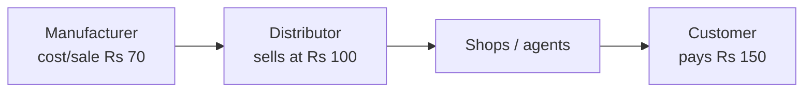
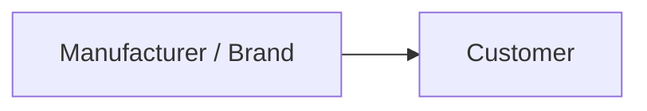
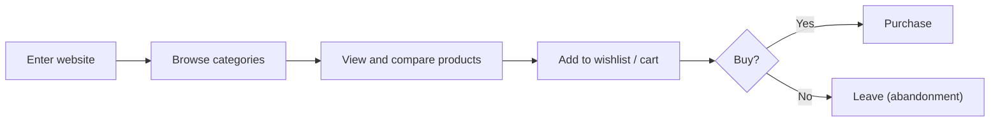
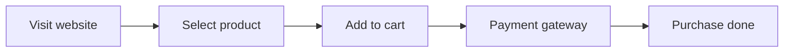

# E-Commerce Models and Digital Footprint Analytics

## What you will learn

- Why online commerce differs from offline retail in reach, speed and data
- The business models: E-Commerce, Quick Commerce (Q-Com), D2C, Marketplace, Subscription
- What a digital footprint, event and session are, and what is tracked
- How the purchase funnel, conversion rate and abandonment rate reveal problems
- How customer data feeds recommendations, RFM and churn analysis
- Why E-Commerce is a data-rich, high-demand career field

---

## 1. Offline Shopping vs Online Shopping

**Simple idea:** Buying in a shop means you see only one shopkeeper's opinion; buying online means the whole world can advise you, and the website can watch what you do.

**Analogy:** Buying a mobile phone about 10 to 20 years ago versus today.

| Aspect | Offline (old way) | Online (Amazon-style) |
|--------|-------------------|-----------------------|
| Where you shop | Walk to a physical shop; if the price is high, travel to another shop (say 10 km away) to compare | Open one website; compare instantly |
| Source of advice | Mostly the shopkeeper's recommendation, or a friend who knows phones | Reviews, YouTube videos, Google reviews, ratings |
| Price visibility | Ask each shop | Compare prices, view **price history** (when it was cheapest) |
| Product handling | See and touch it physically | Wishlist, add to cart, or buy straight away |
| Audience reached by the seller | Limited to one locality | Whole country or world |
| Opening hours | Fixed (for example 9 am to 9 pm) | 24 x 7 |
| Customer information the seller gets | Little (small talk, regulars only) | Very large, automatic |

**Why more people are interested in E-Commerce**

- **Huge customer base:** a shop is limited to its locality and word of mouth; a website can be visited by people from Jammu, South India, West India and abroad at the same time.
- **Speed of traffic:** a shop may see 100 visitors a day; a website can see 100 visitors in a minute because it is not tied to a location.
- **Always on:** when India sleeps, overseas customers still shop, so orders and data never stop.
- **Investors and jobs:** online platforms generate much more revenue than offline, so investors fund them and companies hire and pay well for people who can analyse the data.

**Worked example (visitors and conversion):**
**Conversion rate** = share of visitors who actually buy.

$$\text{Conversion rate} = \frac{\text{Number of buyers}}{\text{Number of visitors}} \times 100\%$$

If 500 people visit a shop in a day and 40% of them buy, that is $500 \times 0.40 = 200$ buyers. Online, the visitor count is not capped by location, so the same 40% (or even a lower one) applied to a much larger number of visitors gives far more buyers.

**Simplification gap:** Real online conversion rates are usually far lower than offline ones (often a few percent). The advantage of online is the volume of visitors, not a higher conversion percentage.

---

## 2. E-Commerce and Quick Commerce

**Simple idea:** E-Commerce is shopping through the internet; Quick Commerce is the same, but the order arrives in about 10 minutes.

- **E-Commerce (E-Com):** buying and selling goods or services online. Examples: Amazon, Flipkart, Myntra, Shopify (store-building platform).
- **Quick Commerce (Q-Com):** very fast delivery (around 10 minutes) of groceries and daily needs. Examples: Blinkit, Swiggy Instamart, BigBasket, Flipkart Minutes.
- Earlier the industry had only E-Com; now Q-Com sits alongside it.

---

## 3. D2C (Direct-to-Consumer) Business Model

**Simple idea:** The maker sells straight to the buyer, skipping the middlemen.

**Analogy (price chain for one product):**

- Traditional route: manufacturer sells at Rs 70, distributor sells on at Rs 100, shop sells to the customer at Rs 150. The price has **doubled** (about 2.1 times) from factory to customer, yet the manufacturer earns very little profit per unit even when volumes are high.
- **D2C:** the manufacturer owns the brand and sells **directly** to consumers, removing distributor and shop layers.

**Worked example (price gap):** Middlemen add Rs 150 - Rs 70 = Rs 80 on top of the Rs 70 base. With D2C, the brand can sell at, say, a price below Rs 150 for the customer and still keep more than Rs 70 for itself. Both sides gain: the customer pays less and the manufacturer earns a fair profit.

**Example:** **Lenskart** manufactures its own eyewear and sells through its own shops and website. Factory outlets work on the same idea.

| Advantages | Disadvantages |
|-----------|---------------|
| Cheaper for customers; better margin for the brand | Brand must **find customers at its own cost** (earlier the distributor or retailer did this) |
| Direct interaction with customers | If customers drop, the brand alone is responsible |
| First-hand feedback on product quality and improvements | Customers may be unwilling to share all their information |

**Why it matters:** The brand owns the customer relationship and data, which supports analytics such as feedback analysis and follow-up with customers who stopped buying.

---

## 4. Marketplace Business Model

**Simple idea:** A marketplace is a big online mall where many sellers rent a place and many buyers walk in; the mall owner takes a cut of every sale.

- A **marketplace** is a platform where buyers and sellers come together to trade. Examples: Amazon, Flipkart, Myntra (Shopify is mainly a store-building platform).
- **Platform owner earns commission** on sales. The owner does not make or hold the products; the owner promotes the platform with events such as the **Great Indian Sale** and **Big Billion** sale, which attract customers and sellers.
- **Manufacturers** can also sell here directly and get ready access to buyers instead of searching for customers themselves.
- **Anyone can become a seller:** manufacture the product, or buy in bulk cheaply (for example import from China) and resell on the platform, earning the margin.

**Effect on a brand's economics**

- Profit **per unit** drops a little because commission is paid to the platform.
- Number of units sold rises a lot.
- Therefore **total profit usually rises**.
- Customers often get products at lower prices.

**Worked example (illustrative numbers):** A brand earns Rs 30 profit per unit selling 1,000 units by itself, total Rs 30,000. On a marketplace, after commission it earns Rs 25 per unit but sells 3,000 units, total Rs 75,000. Per-unit profit fell, total profit rose.

**Simplification gap:** In practice a seller still needs basic registrations (for example GST or business registration) and must follow the platform's rules; the "no formalities" idea applies mainly to the heavy infrastructure and brand-building effort a manufacturer would otherwise need.

---

## 5. Subscription-Based Model

**Simple idea:** The customer pays a small amount regularly (monthly or yearly) instead of paying per item, so the business gets steady income.

- Customers **subscribe** to a product or service on a **periodic basis**; the business earns **recurring revenue** on a predictable schedule.
- Example: **Netflix** sells monthly or yearly packages.
- Why it matters: predictable revenue; and the analytic focus shifts to renewal and **churn** (customers who cancel).

## 6. Comparing the Models

| Model | Who sells to the customer | Who finds customers | Platform earns | Customer data access | Example |
|-------|--------------------------|---------------------|----------------|----------------------|---------|
| Traditional offline | Distributor then shop | Distributor/shop | Not applicable | Very little | Local mobile shop |
| D2C | Brand itself | Brand (own cost) | Not applicable | High, direct | Lenskart |
| Marketplace | Many third-party sellers | Platform (traffic) plus seller | Commission | Very high (platform side) | Amazon, Flipkart |
| Subscription | Provider | Provider | Recurring fee | High (usage history) | Netflix |
| Q-Com | Dark stores / platform | Platform | Margin or commission | High | Blinkit |

---

## 7. Digital Footprints: The Data Behind Analytics

**Simple idea:** Every click on a website leaves a trace, like muddy footprints through a shop, and those footprints tell the owner what the visitor did.

**Analogy:** In a physical shop you only remember what regulars told you in small talk. Online, a "camera" silently records the whole visit.

A typical visit:

**Digital footprint** = all trackable traces a user leaves: when they entered and left, categories clicked, products viewed, compared, wishlisted or carted, filters used, time spent, and what was bought.

**Key trackable metrics and terms**

- **Clicks:** a user pressing a button or link.
- **Impressions:** times an item (product, banner, ad) is shown to a user.
- **Time on site:** how long a visit lasted.
- **Wishlist and cart additions:** items saved or intended for purchase.
- **Filters applied:** for example a price band such as a phone priced in the 15-20 (thousand) range.
- **Abandonment:** items put in the cart but the user leaves without buying.
- **Event:** one single user action (a click, a view, an add-to-cart, a payment).
- **Session:** one continuous visit, from entering the site to leaving; made up of many events.

**Who collects the data:** tools such as **Google Analytics** capture clicks and navigation; large platforms like Amazon also run their own data-collection systems.

**What this gives the business**

- Understand which categories and products attract attention.
- On the next visit, **recommend** better products. Example: a shopper with no brand in mind, only a budget, is guided by browsing history.
- Send personalised emails: "products you might be interested in".
- Recommendations are run in the background by **machine learning and deep learning models**.

**Worked example (data volume):** A 5-minute visit may contain dozens of clicks, category views and scrolls. Each is a data line (event). The longer and more actively a user browses, the more rows of data are generated. Multiply by thousands of concurrent users, 24 hours a day, and the volume becomes enormous.

**Simplification gap:** Not every footprint is equal; users can block cookies or tracking, and privacy laws limit what may be collected and stored. D2C brands often get less data than a marketplace because customers are reluctant to share information.

---

## 8. Monitoring the Business: Funnel, Conversion and Abandonment

**Simple idea:** Think of a funnel with steps; if a lot of people fall out at one step, something is broken at that step.

**Purchase flow (funnel):**

- Every step has its own **conversion rate** = users who reach the next step divided by users at the current step.
- **Abandonment rate** = share of users who quit before completing the purchase (the opposite of conversion at that step).

$$\text{Step conversion} = \frac{\text{Users reaching next step}}{\text{Users at this step}}, \qquad \text{Abandonment} = 1 - \text{Step conversion}$$

**Worked example (payment gateway problem):** A page change goes live. In the last 6 hours, 1,000 users added to cart and 900 reached the payment gateway, but only 90 paid.

- Gateway-to-payment conversion: $90 / 900 = 10\%$
- Abandonment at gateway: $1 - 0.10 = 90\%$

If it was normally around 60-70% conversion at this step, a spike in abandonment points to a failing payment gateway or a bug introduced by the change. Fix it and monitor again.

**Second cause: price.** A new product priced higher than the competition leads shoppers (who compare freely, for example Amazon vs Flipkart) to leave and buy elsewhere; this also shows up as high abandonment or low conversion.

**Operational questions a platform owner tracks:** sales in the last 6 hours; why sales on a particular product is not rising; effect of a new product launch or page enhancement; dashboards and reports of all of these.

**Note:** high add-to-cart numbers with few purchases means the cart-to-purchase conversion is low, not high.

**Why it matters:** Seeing where in the journey customers drop lets you pinpoint and fix an issue rather than guess.

---

## 9. Customer Value, RFM and Churn

**Simple idea:** Not all customers are equal; data tells you who is valuable, who is sleeping and who has left.

**Worked comparison**

| Customer | Typical maximum spend | Visit frequency |
|----------|----------------------|-----------------|
| Customer 1 | Around $2,000 | Once or twice a week (very frequent, small baskets) |
| Customer 2 | $50,000 to $70,000 | About once a year (rare, huge basket) |

From visit history you can find: **valuable** customers, **low-value** customers, and **churning** customers (those who stop coming back for a long period).

- **RFM analysis:** segments customers by **Recency** (how recently they bought), **Frequency** (how often they buy) and **Monetary** value (how much they spend). It is not "Frequency Monitoring"; the three letters are Recency, Frequency, Monetary.
- **Churn prediction models:** models that identify customers likely to drop out or who have already stopped visiting.
- Both are covered in later modules.

**Worked example (RFM labels):** Customer 1 buys weekly: high Frequency, low Monetary. Customer 2 buys yearly: low Frequency, very high Monetary. Neither is "better" on every axis; RFM scores combine all three.

---

## 10. Why Analytics Careers in E-Commerce Are Strong

- Huge **data** is created every minute by a huge customer base, so many analytics jobs exist.
- Work is intense and revenue-critical, hence **good pay packages**.
- Companies (Amazon, Flipkart, Blinkit) want people who can turn data into fast, useful insight.
- A seller or platform gets dashboards, order history and sales data to analyse.
- Your job: make sense of the "ocean of information" and derive meaningful insights that benefit the business.

---

## Exam and Assessment Hints

- Be ready to **differentiate D2C, Marketplace, Subscription, Q-Com** with a one-line definition and an example each.
- Know the Rs 70 / Rs 100 / Rs 150 price-chain example for explaining why D2C exists.
- Be able to explain what a **digital footprint** is and list at least five tracked items.
- Know the purchase **funnel** and how to diagnose a spike in abandonment.
- RFM and churn are introduced here and examined in detail later; know the expansion of RFM.

## Self-Check Questions

1. **What is D2C and why do manufacturers adopt it?** The brand sells directly to consumers, skipping distributors and shops, so customers pay less and the brand keeps a larger share of profit and gets direct feedback.
2. **How does a marketplace earn money?** By charging sellers a commission on sales and promoting the platform with sale events.
3. **What happens to a seller's per-unit and total profit on a marketplace?** Per-unit profit drops because of commission, but volume rises greatly, so total profit usually rises.
4. **Define digital footprint and give examples.** Trackable traces of user behaviour: clicks, time on site, categories browsed, wishlist and cart additions, filters, purchases.
5. **Event vs session?** An event is a single action (click, add to cart); a session is the full visit made of many events.
6. **Cart additions are normal but payments have crashed. What is likely wrong?** Abandonment is high at the payment gateway step: a gateway failure or a bug from a recent page change.
7. **Expand RFM and what is it used for?** Recency, Frequency, Monetary; to segment customers by value.
8. **Why does E-Commerce generate more data than offline retail?** Online runs 24 hours with global reach, and every click is recorded.

## Common Pitfalls / Exam Traps

- Confusing D2C (one brand sells to its own customers) with Marketplace (a platform hosting many sellers and charging commission).
- Treating Q-Com as a separate business model; it is a fast-delivery form of E-Commerce.
- Expanding RFM wrongly (it is Recency, Frequency, Monetary).
- Assuming online conversion rates are higher than offline; the advantage is traffic volume.
- Reading a spike in abandonment as customer disinterest; first check technical and pricing causes.
- Mixing up **impressions** (times shown) with **clicks** (times acted on).

## Quick Revision Summary

- Online shopping offers wider reach, 24 x 7 operation, easy price and review comparison, and rich customer data compared with offline retail.
- Q-Com is E-Commerce with about 10-minute delivery (Blinkit, Instamart, Flipkart Minutes).
- D2C removes middlemen (Rs 70 to 100 to 150 chain), giving cheaper prices, better margins and direct feedback, but the brand must acquire customers itself (example: Lenskart).
- Marketplace = platform connecting buyers and sellers, earning commission; lower per-unit profit but higher total profit for sellers.
- Subscription model = recurring revenue (example: Netflix).
- Digital footprints (clicks, impressions, time, wishlist, cart, filters, purchases, abandonment) are organised into events and sessions and collected by tools like Google Analytics.
- Funnel monitoring (visit, select, cart, payment, purchase) with conversion and abandonment rates helps locate faults such as a failing payment gateway or high pricing.
- Customer history supports recommendations (ML/DL), RFM segmentation and churn prediction.

---

**← [Previous](../README.md) · [Index](../README.md) · [Next](../week-02/01-exploratory-data-analysis-for-e-commerce-data-transcript.md) →**
