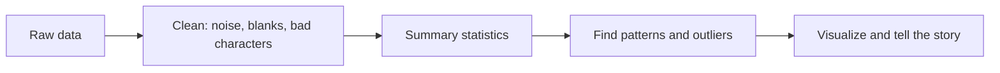
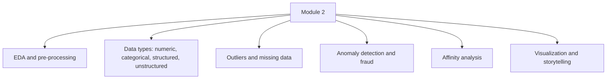

# Exploratory Data Analysis for E-Commerce Data

## What you will learn

- What **Exploratory Data Analysis (EDA)** is, why it is the first step on any dataset, and what it produces
- The two ways of classifying data: numeric vs categorical, and structured vs unstructured
- What **outliers** are, how to spot them, and how to tell them from normal seasonal spikes
- What **affinity analysis** is and how "frequently bought together" suggestions work
- How anomalies relate to fraud, and why **data visualization and storytelling** close the analytics loop
- Why Indian e-commerce firms struggle with data infrastructure, and how agentic AI changes analytics

---

## Where Module 2 Fits: Foundations Recap

Module 1 set up the vocabulary used by everything below:

- **E-commerce models**: D2C (direct-to-consumer) vs marketplace (Amazon, Flipkart; who keeps the larger share of profit), subscription commerce, churn and retention, ONDC
- **Analytics value chain** (five stages): creation, collection, processing, analysis, reporting
- **Metrics**: churn rate, RFM (recency, frequency, monetary), CLV (customer lifetime value), product views, add-to-cart, purchase rate, clicks, time on site, cart abandonment rate
- **Tracking plan**: what events you capture when a user arrives, browses and leaves

Module 2 moves from "what do we measure" to "how do we examine the data we collected": EDA, outliers, missing data, structured vs unstructured data, pattern finding, anomaly detection, affinity analysis and data storytelling. The worked data set is the **Superstore** sample (downloadable from Kaggle): orders with product ID, order date, ship date, customer name, country, and more. It can be explored in Excel or in Python (Anaconda / Jupyter); the ideas are tool-independent.

---

## What Is Data? Numeric vs Categorical

**Simple idea:** Data is anything a computer can store, from a price to a photo.

**Analogy:** Your voice on a call, the images you click, a WhatsApp message, a line written on a whiteboard: each is data because each occupies storage space.

**Precise view:** Data is recorded information that occupies storage. By the *kind of value*, tabular data is of two types:

| Type | What it holds | Examples in e-commerce |
|------|---------------|------------------------|
| **Numeric** | Numbers: whole, fractional, scientific notation, (Boolean 0/1 flags are often grouped here) | price, quantity, order value, discount % |
| **Categorical** | Non-numeric values: text, names, labels, alphabets | customer name, country, product category, ship mode |

**Why it matters:** The type decides which analysis is valid. You can average a numeric price; you can only count or group a categorical country.

**Caveat:** A column of digits is not always numeric in the useful sense. Product IDs, PIN codes and phone numbers are stored as numbers but behave as categorical labels (averaging a PIN code is meaningless).

---

## Structured vs Unstructured Data

**Simple idea:** Structured data fits neatly into a table; unstructured data is a loose heap.

**Analogy:** Ten folded clothes slot into a cupboard (almirah) with room to spare. Ten crumpled clothes dumped in leave you fighting for space. Same quantity, very different storage efficiency.

**Definitions:**

- **Structured data**: has a proper structure, a matrix or tabular view with **rows and columns**; contains numeric values, categorical values, or both. Examples: bank account data, retail data, e-commerce order data.
- **Unstructured data**: has no rows or columns. Examples: images, videos, audio and voice, WhatsApp messages, comments, stories, free-text **product reviews**.

| Aspect | Structured | Unstructured |
|--------|-----------|--------------|
| Layout | Rows and columns (table) | No fixed layout |
| Examples | Orders, transactions, customer table | Reviews, images, audio, video, chat text |
| Storage footprint | Compact | Bulky, "runs out of space" fast |
| Typical e-commerce use | Sales, orders, prices, returns | Review sentiment, brand image |
| Analysis | Direct statistics, EDA | Needs extra processing (e.g. text analysis) first |

**Worked example (storage analogy in numbers):** A 100 MB chip filled with 10 unstructured items is full; the same chip with 10 structured items still has free space. The structured set is the folded pile.

**Why it matters:** Most e-commerce analytics work is on **structured** data. Still, unstructured data carries value: reviews tell you whether the brand image is positive or negative, so they are analysed too.

**Simplification gap:** The "occupies more space" rule is a tendency, not a law. Unstructured items (video, images) are usually larger per record and harder to index and query, but a huge table can outweigh a few small text files. The robust point is that unstructured data costs more to store *and* process before it yields insight.

**Process reminder:** For any data, first store it, clean it, and only then find insights; analysing uncleaned data is of little use.

---

## Exploratory Data Analysis (EDA)

**Simple idea:** Before using data, look at it carefully to learn what is inside.

**Analogy:** Before cooking from a grocery bag, you empty it on the counter: what do I have, how much, is anything spoiled?

**Definition:** **Exploratory Data Analysis (EDA)** is the first-level analysis of a dataset to understand what kind of data you have, its patterns and general statistics, and the relationships among its columns, so that you can bring out insights.

**What EDA examines:**

- What attributes (columns) and values (rows/objects) exist
- General statistics: **mean, median, mode, variance, correlation** (cross-correlation between columns)
- Whether the data is **normally distributed** or follows some other pattern
- Relationships between columns
- E-commerce summary figures: order value, average price, number of orders, total sales

**Data pre-processing (because data is rarely clean):**

- Remove noise
- Remove unreadable characters
- Remove stray spaces and blanks
- Handle missing data

**Worked example (what EDA computes):** Daily order values in rupees: 1200, 1500, 900, 2000, 1400.
- Mean $= (1200+1500+900+2000+1400)/5 = 7000/5 = 1400$
- Median (sorted 900, 1200, 1400, 1500, 2000) $= 1400$
- Mean and median agree, which hints at a roughly symmetric distribution.

**Why it matters:** EDA tells you how to deal with the data before any model or report is built; skipping it means building on unknown quality.

---

## Outliers

**Simple idea:** An outlier is a value that sticks out far from the rest.

**Analogy 1 (prices):** Ten product prices are 10, 20, 50, 60, 90, 110 rupees, plus 5,000 and 60,000. Plot them on a bar or scatter chart: most bars are tiny and two towers rise above. Those two towers are outliers.

**Analogy 2 (personal spending):** You spend between Rs 1,000 and Rs 10,000 a day (weekend party days maybe Rs 5,000 to Rs 6,000). One day a Rs 20 lakh transaction appears. That is definitely out of the ordinary.

**Definition:** An **outlier** is a data point that falls outside the normal boundary of the data and really stands out from the rest. In e-commerce, the same logic applies to **order value**: if average daily order values are Rs 1,000 to Rs 10,000 and one order is Rs 20 lakh, it is an outlier.

**How to detect (standard methods):**

- Visual: scatter plot, bar chart, box plot
- **IQR rule:** with $Q_1$ and $Q_3$ the 25th and 75th percentiles and $IQR = Q_3 - Q_1$, flag values outside
$$[\,Q_1 - 1.5\,IQR,\; Q_3 + 1.5\,IQR\,]$$
- **Z-score:** $z = \dfrac{x-\mu}{\sigma}$, with $|z|>3$ often flagged

**Worked example (IQR on the price list):** Sorted values: 10, 20, 50, 60, 90, 110, 5000, 60000 ($n=8$).
- Lower half (10, 20, 50, 60): $Q_1 = (20+50)/2 = 35$
- Upper half (90, 110, 5000, 60000): $Q_3 = (110+5000)/2 = 2555$
- $IQR = 2555 - 35 = 2520$
- Upper fence $= 2555 + 1.5 \times 2520 = 2555 + 3780 = 6335$; lower fence $= 35 - 3780 < 0$ (nothing below)
- 60,000 $> 6335$, so it is flagged. 5,000 is not flagged by this rule.

**Simplification gap:** The visual idea ("the normal range is about 0 to 110, so 5,000 and 60,000 both stand out") is intuitive, but formal rules can disagree on small samples. Extreme values inflate $Q_3$, $\mu$ and $\sigma$ and can hide smaller outliers (the "masking" effect). Also, an outlier is not automatically an error; it may be a valid rare event or a fraud signal, so investigate before deleting.

### Outliers vs normal spikes

Not every high value is an outlier.

| Situation | Outlier? | Reason |
|-----------|----------|--------|
| Orders rise during a sale season (e.g. Great Indian Festival, pre-Diwali sales) | No | Expected, general pattern |
| Weekend party spending a bit higher | No | Within normal behaviour |
| One Rs 20 lakh transaction among Rs 1,000 to 10,000 days | Yes | Far outside normal range |
| Customer returns a completely different product from the one delivered | Yes (suspicious) | Behaviour outside the normal pattern |

You must decide which spikes are genuine seasonal patterns and which are true outliers, and keep a watch on where outliers occur.

---

## Anomaly Detection and Fraud

**Simple idea:** Anomaly detection is automatically catching the things that look wrong or unusual.

**Analogy:** A bank freezing your card when a sudden foreign purchase appears.

**Definition:** **Anomaly detection** is the process of identifying records or events that deviate from expected behaviour. Outliers are the data-level signal; anomaly detection is the activity of finding and acting on them.

**E-commerce examples:**

- A customer orders an Apple iPhone and receives an actual apple (a reported news incident; shows that delivery and order anomalies occur)
- Return fraud: the right product is delivered, but a completely different product is returned
- An unusually high-value transaction (the Rs 20 lakh example)
- Possible fake or non-genuine customers (browsing and time-on-site behaviour is used to judge whether a visitor is genuine)

**Why it matters:** Anomalies often mean fraud or process failure. Catching them protects revenue and brand trust.

---

## Affinity Analysis (Frequently Bought Together)

**Simple idea:** Find which products people tend to buy together, then suggest them.

**Analogy:** Buy a mobile phone and the shopkeeper immediately asks, "Screen guard and cover?" Websites do this automatically.

**E-commerce example:** On a product page for a premium laptop or phone, you see a **Frequently bought together** block and "explore more from other stores": screen protectors, keyboard guards, USB accessories, mouse, bag. Some suggestions are relevant, some not. This is **affinity analysis**: suggesting items that go together, based on what the site and other customers have browsed and bought.

**Business logic:** Someone spending Rs 70,000 to 73,000 on a device will not hesitate to spend Rs 1,000 to 2,000 more on a guard. The objective of e-commerce is to earn as much revenue as possible from each customer (basket size, upsell and cross-sell).

**Formal measures (standard market-basket analysis):** For items A and B in $N$ orders:

$$\text{Support}(A\Rightarrow B)=\frac{\#(A\text{ and }B)}{N}$$
$$\text{Confidence}(A\Rightarrow B)=\frac{\#(A\text{ and }B)}{\#(A)}$$
$$\text{Lift}(A\Rightarrow B)=\frac{\text{Confidence}(A\Rightarrow B)}{\text{Support}(B)}$$

**Worked example:** $N=1000$ orders; 200 contain a laptop; 150 contain a screen guard; 120 contain both.
- Support $=120/1000=0.12$
- Confidence (laptop $\Rightarrow$ guard) $=120/200=0.60$
- Support(guard) $=150/1000=0.15$
- Lift $=0.60/0.15=4$

Lift $>1$ means the two are bought together more often than chance, so recommending the guard to laptop buyers is justified. Lift $=1$ means independent; $<1$ means they are rarely combined.

**Simplification gap:** High confidence alone can mislead if item B is simply very popular; lift corrects for that. Affinity shows association, not cause.

---

## Data Visualization and Data Storytelling

**Simple idea:** Turn numbers into pictures and a clear story so people can act.

**Analogy:** A fitness watch showing a graph of your week is easier to act on than a table of heartbeat readings.

**Definition:** **Data visualization** is the graphical representation of data (charts, graphs) for quick understanding. **Data storytelling** is building a narrative from the data and displaying it visually so that others understand it: get the data, create the story, show it visually.

**Typical e-commerce questions answered visually:**

- After launching a new product, what do reviews and star ratings say: positive or negative? Where are users facing issues?
- What are sales doing over time?
- Where and why do users abandon carts? Is it the cart page, payment, or something else?
- What is going well and what is going badly?

**Why it matters:** A graphical reference makes it easier to understand the situation and take decisive steps.

---

## Module 2 Topic Map

---

## Infrastructure Reality in Indian E-Commerce, and Agentic AI

### The data-volume problem

**Simple idea:** Shoppers create a flood of records and many young firms cannot even store it, let alone analyse it.

**Example:** Browse a quick-commerce app (Blinkit, BigBasket, Flipkart Minutes) for 5 minutes: you view about 10 products, add to cart, cancel, remove, add again. That can generate about **100 records for one customer in 5 minutes**. Multiply by customers across India and the volume is enormous.

**Business implication:** A new e-commerce business typically needs an idea and an investor. The hard part begins when data arrives: storage infrastructure costs money, and analysis is possible only after storage. A not-yet-profitable startup may be unable to afford storage, so analysis never starts.

### Agents and Gen AI

- **Agents** here are pre-trained models that automate tasks or handle parts of the customer journey. They must be **trained on data**, so without stored data there is nothing to train on.
- They are **not free**: infrastructure and funds are needed; they run on cloud services, not on-premise.
- **Cost case study:** A firm replaced 40 to 50 analysts by agents. Within a couple of months the cloud and technology costs exceeded the analysts' salaries, so they reverted ("back to square one").
- Adoption is stronger outside India; in India it is limited by data and infrastructure issues. Agent-based analytics is outside the scope of this course but is likely in the near future.

### Automation analogy

Fetching milk used to mean walking to the kirana store in rain or heat; now it arrives in 10 minutes. Likewise, building a model with menu-based tools (SPSS, KNIME) once took about **1.5 months** with 2 to 3 people working 8 to 9 hours a day; now a model can be ready in **1 to 2 days**. Automation moves analysts "up the ladder" instead of simply removing them.

### Changing analytics with conversational agents

A seller using a marketplace seller portal now has a ChatGPT-like chat box: instead of navigating many UI screens for metrics and reports, the user types a question and the agent navigates the interfaces and returns a summary. Product search is shifting the same way.

**Impact on analytics:**

| Traditional analytics | Agent-era analytics |
|----------------------|---------------------|
| Track which UI pages and clicks a user followed | Track what the user **typed** (intent) |
| Clickstream funnel of screens | Needs NLP on prompts to extract attributes of intent |
| Journey = sequence of page views | Journey = conversation plus what the agent did on the user's behalf |

This implies the five-stage chain (creation, collection, processing, analysis, reporting) will need new data sources (prompts) and techniques (NLP).

---

## Self-Check Questions

1. **What is EDA and why is it done first?**
   It is the first-level analysis of data to learn its content, patterns, statistics (mean, median, mode, variance, correlation), distribution and relationships; it guides how you clean and use the data.
2. **Name the two classifications of data covered.**
   Numeric vs categorical (by value type), and structured vs unstructured (by layout).
3. **Is a product review structured or unstructured? Why does it still matter?**
   Unstructured (free text, no rows or columns). Analysing it reveals positive or negative sentiment and brand image.
4. **Define an outlier with an e-commerce example.**
   A value far outside the normal range, e.g. a Rs 20 lakh order when daily orders are Rs 1,000 to 10,000.
5. **Is a sale-season rise in orders an outlier?**
   No. It is a general, expected pattern; outliers are unexplained deviations.
6. **Compute lift: 1000 orders, 200 laptop, 150 guard, 120 both.**
   Confidence $=0.6$; Support(guard) $=0.15$; Lift $=4$ (strong positive affinity).
7. **Why is "frequently bought together" valuable to the retailer?**
   It increases revenue per customer through cross-sell and upsell; buyers of a high-priced item rarely resist small add-ons.
8. **Why can't many Indian e-commerce firms use agents yet?**
   They lack the storage infrastructure and funds to hold the data needed for training, and agents running in the cloud can cost more than analysts.

---

## Exam and Assessment Hints

- The EDA session is hands-on in the next part: expect practical work on the Superstore data (orders, ship date, customer, country) in Excel or Python.
- Know the module topic list: EDA, outliers, missing data, structured vs unstructured, pattern finding, anomaly detection, affinity analysis, data storytelling.
- Be ready with e-commerce examples for each concept (order value outlier, return fraud, reviews as unstructured data, frequently bought together).
- Agentic AI and Gen AI for analytics are not in this course's scope.

---

## Common Pitfalls / Exam Traps

- Treating every spike as an outlier: seasonal sales surges are normal patterns, not outliers
- Deleting outliers automatically: they may be fraud or genuine rare events and need investigation
- Treating ID-like numeric columns (product ID, PIN code) as truly numeric
- Saying unstructured data is "always larger": the correct point is it is harder to store and analyse; structured data is compact and tabular
- Assuming e-commerce analytics is only about structured data: reviews and other text matter for brand image
- Confusing support, confidence and lift; confidence alone ignores item popularity
- Forgetting data pre-processing (noise, blanks, unreadable characters) before EDA statistics
- Assuming agents are free: they need data, infrastructure and ongoing cloud cost

---

## Quick Revision Summary

- **EDA** is the first-level look at data: types, patterns, mean/median/mode/variance/correlation, distribution, relationships
- Clean first: remove noise, blanks, unreadable characters; then analyse
- Data is **numeric** or **categorical**; and **structured** (rows and columns) or **unstructured** (images, audio, video, text, reviews); e-commerce analytics is mostly structured
- An **outlier** lies outside the normal boundary; detect by plots, the IQR rule or z-score; separate real outliers from seasonal spikes
- **Anomaly detection** catches fraud and abnormal events such as return swaps and unusual high-value orders
- **Affinity analysis** powers "frequently bought together"; measure with support, confidence and lift
- **Visualization and storytelling** turn analysis into a narrative people can act on
- A single shopper can produce about 100 records in 5 minutes; storage cost blocks many Indian e-commerce firms
- Agents need data, cloud infrastructure and funds; they shift analytics towards NLP on user prompts but are outside this course

---

**← [Previous](../week-01/01-e-commerce-models-and-digital-footprint-analytics-transcript.md) · [Index](../README.md) · [Next](../week-03/01-dashboards-kpis-funnels-and-quick-eda-transcript.md) →**
