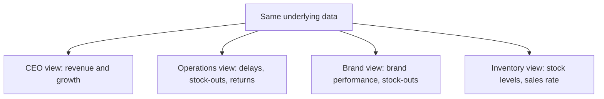
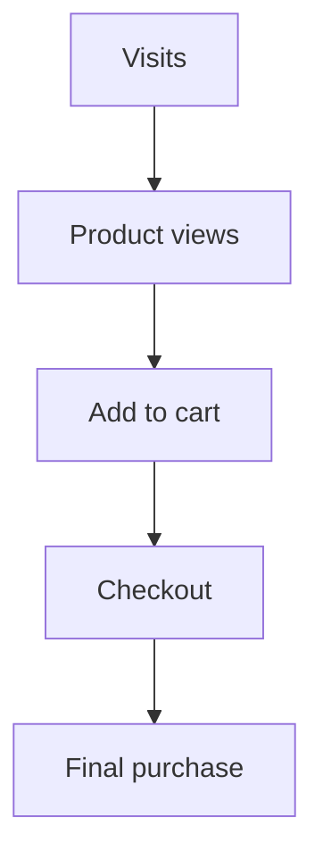
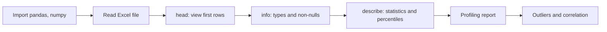

# Dashboards, KPIs, Funnels and Quick EDA

## What you will learn

- What a **dashboard** is, who uses it, and how views differ by role (CEO, operations, brand, inventory)
- What a **KPI** is and how KPIs change with sector and role
- **Leading vs lagging indicators**, **funnels** (conversion, cart abandonment) and **cohorts**
- Dashboard design pitfalls (clutter, bad chart choice, access control per role)
- How to do a fast first-pass **EDA** in Python (`info`, `describe`, percentiles, profiling report, outliers, correlation) on the Sample Superstore data

---

## 1. Dashboard

**Simple idea:** a dashboard is one screen that shows the health of your business at a glance, using a few charts, tables and big numbers.

**Analogy:** the dashboard of a car. You do not open the engine to know how things are going; speed, fuel and warning lights are in front of you. An e-commerce owner wants the same: "Are sales growing? Are returns rising?" without digging through raw rows.

**Definition:** A **dashboard** is a single view that combines a collection of charts, tables and numerical summaries (visual representation of data) so that the reader understands what is happening at first glance.

Typical e-commerce dashboard content:

- Number of orders and average orders per period
- **Average order value (AOV)** = total revenue / number of orders
- Sales (revenue) and its growth over time
- Returns (how many, which products)

Key point: **not everyone needs the same view**. The same underlying data is shown through different views for different people, each focusing on their own area.

### Role-based views

| Role | What they focus on | Typical comparisons |
|------|--------------------|---------------------|
| CEO / owner (executive dashboard) | Revenue and growth only: "how much is coming in, how fast are we growing?" | Today vs last 30 days (daily view); month-on-month growth (monthly view); trend lines and graphs |
| Brand team | Out-of-stock products, how the brand is faring | Brand-level sales and stock-outs |
| Inventory manager | Sales plus stock: products in stock, products about to go out of stock, days of inventory | Stock vs sales rate |
| Operations team | Order progress, average delivery time, delayed products, out-of-stock products, inventory days, returned products, brands out of stock with nothing received yet, products stuck at locations due to delivery issues | Order status, delay, location |
| Banking (other sector) | Accounts opened; loan department tracks revenue generated from loans | Sector-specific |



**Access control caveat:** one dashboard file can have several pages/slides. Operations may see only two pages, which the brand team cannot see, while the CEO sees all. So views are given with **role-based access**, not just different layouts.

**Why raw data is not enough:** data alone "makes no sense". It becomes useful only when you build a cohort, a KPI trend, or a funnel, which shows where the business is doing well and where it is lagging.

---

## 2. KPI (Key Performance Indicator)

**Simple idea:** the one number (or few numbers) that tells you whether you are winning at your main goal.

**Analogy:** in a cricket match the scoreboard shows runs; for a fitness goal it is your weight. A KPI is the "scoreboard number" for a business function.

**Definition:** A **KPI** is a measurable value that represents the main driver/goal of a business or function. It is the main variable of interest in the dataset.

- E-commerce: main KPI is **sales** (revenue)
- Inventory manager: still sales, but also number of products in stock and products going out of stock
- Banking: number of accounts opened; for the loan department, revenue generated
- The KPI **changes with sector and with person/role**

### Metrics that explain a KPI

Once the KPI is fixed, you go deeper with supporting **metrics** that explain it:

- **Conversion rate** = (number of visitors who complete the desired action / total visitors) x 100
- **Average order value (AOV)** = revenue / number of orders
- Returns, growth rate, abandonment rate, etc.

Plain-version caveat: "KPI" and "metric" are not identical. Every KPI is a metric, but not every metric is a KPI. A KPI is the metric tied to a key business objective; other metrics support and explain it.

---

## 3. Leading and Lagging Indicators

**Simple idea:** a lagging indicator tells you what already happened; a leading indicator warns you about what is about to happen.

**Analogy:** a lagging indicator is the exam result; a leading indicator is your mock-test score. The first cannot be changed, the second lets you act.

**E-commerce example:**

- **Lagging:** some products went out of stock in the previous period (already happened; lost sales). Last period's sales and returns are also lagging.
- **Leading:** customers are searching for and adding a product to the cart, and a few products are in stock but will soon run out. This signals future demand/stock-outs, so you can plan inventory and future sales.

| Aspect | Lagging indicator | Leading indicator |
|--------|-------------------|-------------------|
| Time view | Looks backward (outcome) | Looks forward (predictor) |
| Example | Products that went out of stock in the previous period | Products in stock but about to run out; items being added to cart |
| Use | Measure results, diagnose | Plan, prevent problems |
| Can you change it? | No | Yes, by acting early |

**Why it matters (big sale events):** before a big sale (for example an Amazon sale), order counts, order values and revenue jump sharply. The analytics team must plan ahead (inventory, capacity, delivery) so customers face no disruption. Customers always have choices and will **churn** (move) to another e-commerce site if the experience fails.

---

## 4. Funnel and Funnel Visualization

**Simple idea:** a funnel shows how many people you lose at each step on the road from "visited" to "bought".

**Analogy:** a tea strainer or funnel: lots goes in at the top, less comes out at the bottom. Steps happen one after another: product page, sub-product page, payment page, final payment.

**Definition:** A **funnel** is an ordered sequence of steps in a customer journey; funnel visualization shows the count (and conversion rate) at each step.

Typical purchase funnel:



At each step, **step conversion rate** = users at this step / users at previous step. **Overall conversion rate** = purchases / visits.

Worked example (illustrative numbers):

| Step | Users | Step conversion |
|------|-------|-----------------|
| Visits | 10,000 | - |
| Product views | 6,000 | 6,000/10,000 = 60% |
| Add to cart | 1,200 | 1,200/6,000 = 20% |
| Checkout | 600 | 600/1,200 = 50% |
| Purchase | 300 | 300/600 = 50% |

Overall conversion = 300 / 10,000 = 3%. Cart abandonment = (1,200 - 300) / 1,200 = 75%.

Funnel names you may meet: **product funnel**, **purchase funnel**, **customer funnel** (people come in, look at products, finally buy).

### Case: a new product with high interest but low payment

A new, differentiated product (compared with competitors) gets many views and many add-to-carts, but customers leave without paying. This is **cart abandonment**. Find out why conversion is not completing. Possible causes:

- Payment issues
- Delivery issues
- Price higher than competing websites
- Other factors

Fix them so the **abandonment (cart abandonment) rate** does not shoot up and customers actually complete purchase.

Caveat: abandonment rate = 1 - (purchases / carts created). A high rate is a symptom; the funnel shows where, not why. You must investigate the cause.

---

## 5. Cohorts

**Simple idea:** put customers into groups that share something (when they joined, how often they buy) and compare the groups.

**Analogy:** school batches. Comparing the 2023 batch and the 2024 batch tells you more than looking at all students mixed together.

**Definition:** A **cohort** is a group of customers formed on a common characteristic, such as the time since they joined the system or the **frequency** with which they visit/buy (for example grouped month by month). **Cohort analysis** tracks each group's behaviour over time.

What it tells you:

- How many times and how frequently customers visit
- Which are **repeat customers** (focus on keeping them) and which are **non-repeating** (need action to bring them back)
- Links to earlier ideas: **RFM** (Recency, Frequency, Monetary value) and **Customer Lifetime Value (CLV)** are cohort-style groupings used to decide where to focus

| Concept | Looks at | Question answered |
|---------|----------|-------------------|
| Funnel | Steps in one journey | Where do users drop off? |
| Cohort | Groups of customers over time | Who comes back, how often? |
| KPI | One main goal metric | Are we winning? |
| Dashboard | All of the above on one screen | How is the business doing? |

---

## 6. Dashboard Design Pitfalls

Putting too much in a dashboard makes it **cluttered**: the reader cannot tell what to look at or ignore.

Avoid:

- Too much information on one screen
- Loud, high-contrast or excessive colours and heavy graphics that irritate and hinder reading
- Hard-to-read chart types
- A **pie chart with 10 categories** (slices are tiny and impossible to compare; use a bar chart instead)

A good dashboard is **visually appealing, informative and uncluttered**, so people make sense of what is shown.

---

## 7. Exploratory Data Analysis (EDA) in Python

**Simple idea:** before building anything, look at the data: what columns, what types, any missing values, any weird numbers, what relates to what.

**Analogy:** inspecting groceries as they arrive: what is there, is anything missing or damaged, how big are the items.

**Dataset:** Sample Superstore (an e-commerce/retail dataset with orders, people and returns). Orders data has about 20 variables: Order ID, Order Date, Ship Date, Ship Mode, Customer ID, Customer Name, Segment, Country, City, State, Postal (Zip) Code, Region, Product ID, Category, Sub-Category, Product Name, Sales, Quantity, Discount, Profit.

### Step-by-step workflow



1. **Import libraries:** `import pandas as pd`, `import numpy as np`. Any environment works (Anaconda/Jupyter, an IDE, Colab).
2. **Load data:** `data = pd.read_excel("Sample Superstore Data.xlsx")`.
3. **Look at the first rows:** `data.head()`.
4. **Check structure:** `data.info()` gives, per column, the data type and the count of non-null values.
   - **Numeric** columns appear as `int64`/`float64`; **categorical/text** columns appear as `object`; dates as `datetime64`.
   - In Superstore: Order Date and Ship Date are datetime; most others (Order ID, Ship Mode, IDs, names, Segment, Country, City, Region, Category...) are `object`; Sales, Discount, Profit are float; Quantity is integer.
   - About 10,194 entries (as read from the output) with **no missing values** (all columns fully non-null).
5. **Descriptive statistics:** `data.describe()` gives count, mean, standard deviation, min, 25% (Q1), 50% (median), 75% (Q3), max. It covers numeric fields (and datetime fields too).
6. **Custom percentiles:** `data.describe(percentiles=[0.8, 0.9, 0.95, 0.99])` gives the 80th, 90th, 95th and 99th percentiles. Add `0.2, 0.3` etc. for the 20th, 30th and so on. Percentiles are useful to spot how extreme the top values are.

### Automated profiling (Pandas Profiling / YData Profiling)

**Simple idea:** one command that produces a full EDA report, instead of dozens of lines of code or Excel work.

Library: formerly **Pandas Profiling**, now **ydata-profiling**. Code pattern:

```python
from ydata_profiling import ProfileReport
profile = ProfileReport(data)
profile
```

What the report gives:

| Section | Contents |
|---------|----------|
| Overview | Number of variables (20), number of observations, missing cells, **duplicate rows** (2 found), total memory size |
| Variables | Per variable: distinct count and %, missing, memory size; for numeric variables also infinite, mean, min, max, zeros, negatives |
| Numeric statistics | Min, 5th percentile, Q1 (25th), median, Q3 (75th), 95th percentile, max, range, **interquartile range (IQR)**, standard deviation, **coefficient of variation**, **kurtosis**, **skewness**, mean absolute deviation, sum |
| Distribution | Histogram, common values, extreme values |
| Interactions | Scatter views between variables |
| Correlations | Correlation matrix as a heat map (and in table form) |
| Missing values | Charts of missing data |
| Duplicates | Which rows are duplicates |

Reading the Sales variable: **kurtosis about 306 and skewness about 12** (as reported) means a heavy right tail, i.e. the data contains extreme values/outliers. Skewness measures asymmetry (positive = long right tail); kurtosis measures tail heaviness (large = many extreme values).

**Duplicate rows:** the report flagged 2 duplicates. Check them before deleting: rows that differ in some column (for example customer name) are not true duplicates. The report shows a "count" of occurrences; a count of 2 means the same row appears twice. Always inspect the data to find why duplicates occur.

Practical caveats:

- Needs many supporting libraries; installing can be irritating. Follow the install steps carefully.
- Often does not work well in Google Colab (workarounds exist).
- Generating the report takes a long time on large data; do not re-run repeatedly.
- Good for beginners as a first pass; it does not replace your own judgement.

### Alternative: D-Tale

**D-Tale** (a similar library) opens the data in an Excel-like interactive grid in the browser. From it you can use **Describe** (statistics, histogram, categories, QQ plot, outliers for a selected column) and build charts (scatter, bar, line, with grouping such as yearly/monthly). It is also memory-heavy and can fail ("not enough memory"). Use whichever tool you are comfortable with.

### Other visual checks

- **Box plot** (for example with seaborn `sns.boxplot`) for Sales and Quantity to see outliers.
- **Scatter plot** for relationships.
- **Heat map** of the correlation matrix.

### Outlier judgement

In the Superstore data, large sales values (around 5,000, 15,000, 20,000) and larger quantities show on the box plot, but for a retail business these are plausible big orders, not errors. So **there is not much real outlier in the data**: a point being far from the rest is not automatically an error.

If you need to flag outliers formally, use **control limits**: a point beyond the upper control limit or below the lower control limit is an outlier. A common IQR rule:

$$\text{Lower} = Q_1 - 1.5 \times IQR, \quad \text{Upper} = Q_3 + 1.5 \times IQR, \quad IQR = Q_3 - Q_1$$

Worked example: if $Q_1 = 20$ and $Q_3 = 200$, then $IQR = 180$, upper limit $= 200 + 270 = 470$, lower limit $= 20 - 270 = -250$. Any sales above 470 is flagged. Then decide the action (investigate, cap, keep, or remove).

Caveat: with right-skewed sales data many legitimate high values will be flagged; the business meaning decides, not the formula alone.

### Correlation

**Correlation** (Pearson's $r$) measures linear relationship between two numeric variables, from -1 to +1:

$$r = \frac{\sum (x_i - \bar{x})(y_i - \bar{y})}{\sqrt{\sum (x_i-\bar{x})^2}\sqrt{\sum (y_i-\bar{y})^2}}$$

where $x_i, y_i$ are paired observations and $\bar{x}, \bar{y}$ their means. In pandas: `data.corr(numeric_only=True)`; visualise with a heat map.

Finding: **Sales vs Profit correlation is about 0.48** (not even 0.5). So the KPI (sales/profit) has only a moderate relationship with the other variables, and a predictive model may face difficulties.

| Correlation $r$ | Rough reading |
|-----------------|---------------|
| 0.0 to 0.3 | Weak |
| 0.3 to 0.7 | Moderate (0.48 falls here) |
| 0.7 to 1.0 | Strong |

Caveats: correlation is not causation; Pearson only captures linear association; heat maps in the profiling report may also include categorical associations, so check which variables are being compared.

### Descriptive statistics tools compared

| Tool | Output | Best for | Drawback |
|------|--------|----------|----------|
| `info()` | Types, non-null counts | Structure and missing values | No statistics |
| `describe()` | Count, mean, std, quartiles | Quick numeric summary | Only numeric/date by default |
| `describe(percentiles=...)` | Extra percentiles | Tail behaviour | Manual choice of percentiles |
| ydata-profiling | Full HTML-style report | Fast complete EDA for beginners | Heavy, slow, install issues, Colab problems |
| D-Tale | Interactive grid with charts | Exploring and charting | Memory heavy |

---

## Self-Check Questions

1. **What is a dashboard?** A single view of charts, tables and numbers that shows business performance at first glance, tailored to the viewer's role.
2. **What is a KPI and does it stay the same across sectors?** The main goal/driver metric. No: e-commerce uses sales; banking uses accounts opened or loan revenue; it also varies by role.
3. **Lagging vs leading indicator with an e-commerce example?** Lagging: products that went out of stock in the previous period. Leading: products in stock but about to run out, or items being added to carts. Leading ones help planning.
4. **Purchase funnel with 5,000 visits, 1,000 add-to-cart, 250 purchases: conversion and cart abandonment?** Overall conversion 250/5,000 = 5%. Cart abandonment = (1,000 - 250)/1,000 = 75%.
5. **What is a cohort and why use it?** A group of customers sharing a trait (join month, visit frequency). Used to separate repeat from non-repeat customers and decide focus; links to RFM and CLV.
6. **Name three dashboard design mistakes.** Clutter, loud colours/heavy graphics, wrong chart type (for example a pie with 10 categories).
7. **What does `info()` tell you that `describe()` does not?** Data types and non-null counts per column (`object` = categorical, `int/float` = numeric); `describe()` gives statistics for numeric columns.
8. **Sales has skewness about 12 and kurtosis about 306. What does it mean?** Strong right skew with heavy tails, so extreme values exist; check whether they are valid big orders before treating them as errors.

---

## Exam and Assessment Hints

- Be ready to define dashboard, KPI, funnel, cohort, leading/lagging indicators in your own words with an e-commerce example.
- Know which view each role (CEO, operations, brand, inventory) needs; the CEO focuses on revenue and growth.
- Know the EDA steps and functions (`read_excel`, `head`, `info`, `describe`, percentiles, profiling report) and how to read data types (`object` vs `int/float`).
- Interpretation of skewness, kurtosis, outliers and a correlation of about 0.48 may be asked.
- A hands-on dashboard build (Power BI) with this Superstore data (orders, people, returns) is expected to follow, so practise EDA and a basic dashboard on it.

---

## Common Pitfalls / Exam Traps

- Calling every metric a KPI: a KPI is tied to the main business goal.
- Mixing up leading and lagging indicators: lagging describes past outcomes, leading predicts what is coming.
- Treating a funnel as just a chart: its value is the step-to-step conversion and the drop-off location; the reason for the drop must be investigated separately (payment, delivery, price).
- Confusing funnel (steps in a single journey) with cohort (groups of customers over time).
- Deleting "duplicate" rows blindly: rows that differ in any field (for example customer name) are not true duplicates.
- Assuming every far-away point is an outlier error: large orders can be legitimate in retail.
- Reading correlation 0.48 as strong or as causal: it is moderate and linear only.
- Using a pie chart for many categories or piling every metric into one dashboard.
- Giving all users the same dashboard access: sensitive pages should be role-restricted.
- Forgetting that `describe()` by default covers numeric (and date) columns only, not text columns.

---

## Quick Revision Summary

- A dashboard is one view of charts, tables and numbers for at-a-glance understanding; different roles (CEO, operations, brand, inventory) need different views and different access.
- A KPI is the main goal metric (sales for e-commerce); it changes by sector and role, and supporting metrics (conversion rate, AOV, returns) explain it.
- Lagging indicators report past results; leading indicators signal future events and drive planning (for example before a big sale).
- Funnels (visit, product view, cart, checkout, purchase) show drop-offs; investigate abandonment causes: payment, delivery, price.
- Cohorts group customers by join time or frequency to separate repeat from non-repeat customers (related to RFM and CLV).
- Avoid clutter, loud colours, unreadable chart types, and pies with many categories.
- EDA flow in pandas: read data, `head`, `info` (object vs numeric, nulls), `describe` plus custom percentiles, then profiling report (ydata-profiling) or D-Tale.
- Superstore data: 20 variables, no missing values, 2 duplicate rows flagged, Sales highly skewed (skewness about 12, kurtosis about 306) but mostly valid large orders.
- Outliers can be flagged by control limits (for example IQR rule) and acted on according to business meaning.
- Sales-Profit correlation is about 0.48 (moderate), so modelling the KPI from other variables may be hard.

---

**← [Previous](../week-02/01-exploratory-data-analysis-for-e-commerce-data-transcript.md) · [Index](../README.md) · [Next](../week-04/01-e-commerce-data-foundations-schemas-events-governance-transcript.md) →**
