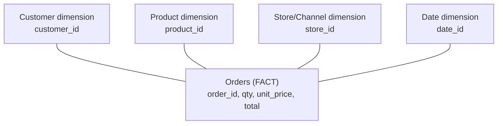
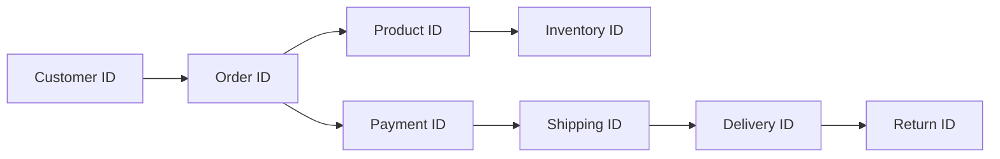
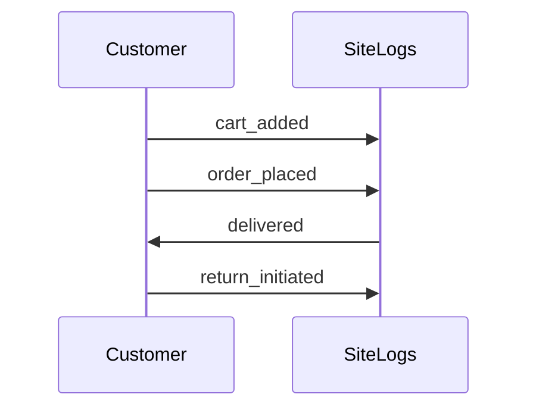
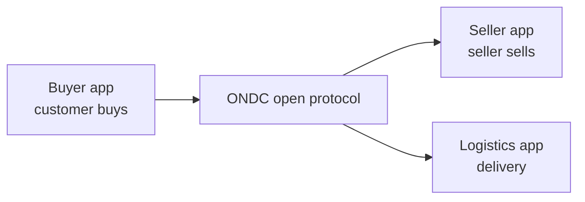

# E-Commerce Data Foundations: Schemas, Events, Governance

## What you will learn

- The difference between **facts** and **dimensions**, and why a useful dataset needs both
- How a **star schema** splits one messy record into a fact table plus dimension tables, joined by keys
- How returns change net sales without rewriting the original order
- How to design **event logs** (cart added, return initiated, wishlist added)
- The four pillars of trustworthy data: quality, access control, documentation, consent, plus a worked consistency check
- Three platform models: monolithic, SaaS (Shopify-style) and ONDC, and how each fragments data

Quick recap of the prerequisite ideas that this chapter builds on:

| Earlier concept | What it does | Example |
|---|---|---|
| **Dashboard** | One screen of charts; different views for different audiences | Executive view vs operations view |
| **KPI** | A headline number tracked over time | Daily sales, net profit |
| **Funnel** | Step-by-step drop-off of users | 100% visit, 55% add to cart, 35% checkout, 22% purchase |
| **Cohort table** | Customers grouped into bins by shared traits | Sign-up month, order frequency, average cart value |

### Dashboards: different views for different people

**Simple idea:** one shop, many people, each person needs to see different numbers.

- **Executive view** (CEO/MD): daily sales, sales growth, returns, net profit, month-on-month and year-on-year comparison.
- **Operational view:** average delivery time, number and frequency of returns, return value, inventory condition, out-of-stock products.
- **Brand view** and other team views are built the same way: the same dashboard (a group of charts) with views and access given per group.

### Funnel (recap)

**Simple idea:** like tea poured through a strainer, each step filters some people out.

Worked example with the numbers: 100% visit the site, 55% add a product to the cart, 35% reach checkout, 22% complete the purchase. Only 22 out of every 100 visitors buy.

Step-to-step conversion (a useful extension): cart to checkout is $35/55 \approx 63.6\%$, and checkout to purchase is $22/35 \approx 62.9\%$.

### Cohort tables (recap)

Customers are grouped by when they joined, how long they have been customers, average cart value, total spend, number of orders, or purchase frequency. This is like creating bins/intervals and analysing each bin separately so you can give targeted business advice.

---

## Facts and Dimensions

**Simple idea:** a **fact** is a number you can do maths on; a **dimension** is a label that tells you what, who, where or when that number belongs to.

**Analogy:** a till receipt. The amounts (quantity, price, total) are facts. The shop name, product name, customer name and city printed on it are the context, the dimensions.

**Precise definitions**

- **Fact:** a numeric, measurable value that records *what happened*. Examples: order value, number of orders, total sales, total profit, quantity, unit price, line total.
- **Dimension:** a non-numeric (categorical, string, object) attribute that gives *context* to the facts. Examples: customer ID, customer name, product ID, product type, product description, location, store, channel, date.

| Aspect | Fact | Dimension |
|---|---|---|
| Nature | Numeric, measurable | Descriptive, categorical |
| Answers | What happened? How much? | Who? What? Where? When? (context) |
| Typical use | Sum, average, count, ratios | Group by, filter, slice |
| Examples | quantity, line total, profit | customer name, category, city |

**Why you need both**

- Only facts (a table of pure numbers): you cannot build a meaningful dashboard, because numbers have no grouping or label.
- Only dimensions: you can draw one or two trivial charts (such as counts), but no real insight.
- Mixture of both: you can slice sales by city, category or month, which is real analysis.

**Simplification gap:** some IDs (such as order ID or customer ID) look numeric but are *labels*, not measures. Rule of thumb: if adding or averaging it makes no sense, it is a dimension (or a key), not a fact.

Facts and dimensions are core vocabulary in BI, data warehousing and data engineering.

---

## Star Schema

**Simple idea:** keep the numbers in one central table and the descriptions in small tables around it, like the centre and points of a star.

**Analogy:** a star drawn with the centre as the fact and four points as dimensions. (A drawn star has 6 points, but the schema in this chapter uses 4 dimensions around 1 fact.)

**Why not one big table?** An e-commerce site passes huge amounts of information every second. Keeping it all in one table makes it hard to manage, repeats the same customer or product details again and again, and each single-topic table alone gives only partial insight. Splitting into tables and joining them gives full insight.

### The tables in an e-commerce star schema

| Table | Type | Holds | Key |
|---|---|---|---|
| Orders | **Fact** (centre) | Quantity, unit price, total / order value | Order ID |
| Customer | Dimension | Name, city/location, email, sign-up date | Customer ID |
| Product | Dimension | Product name, category, description | Product ID |
| Store / Channel | Dimension | Which store or channel the purchase happened on | Store ID |
| Date | Dimension | On which date the purchase happened | Date ID |



What each table alone tells you:

- Customer table only: who the customers are and where they live.
- Product table only: which products and categories exist.
- Store/Channel table only: which channels exist.
- Date table only: calendar information.
- Orders table only: number of orders, average order value.

Joined together, you learn when a customer visited, what they bought, how much they paid, where they are from, which category and which channel. The same fact table with different dimensions gives a completely different report.

### Worked example: splitting one messy record

Messy single-line record: order ID, customer name (Rohit Malhotra), location, product (face pack), 2 units of 100 ml each, date 26 April 2026, total 558.

Split by the star schema:

| Goes to | Values from this record |
|---|---|
| Fact table (orders) | Quantity = 2, unit price = 279, total = 558 |
| Customer dimension | Customer name, location |
| Product dimension | Product name (face pack), category |
| Date dimension | 26 April 2026 |

Check: $2 \times 279 = 558$. One record feeds about five tables.

**Why facts matter:** numeric values accept any mathematical treatment (sum, average, ratios).

### Keys: how tables join

A **join** needs a **primary key**: a unique ID in a table, which the other table also carries (as a foreign key) so rows can be matched.

- Customer table: customer ID
- Store table: store ID
- Product table: product ID
- Orders table: order ID (and it carries the foreign keys, plus date ID for the date table)
- Date table: date ID

Without IDs you would have to repeat the whole description in every place you refer to it.

**Precise caveat:** strictly, the primary key is unique in its own table; the matching column in the fact table is a *foreign key*. In a star schema the fact table references each dimension through these foreign keys.

### The ID chain of one purchase

Each business step generates a new ID that links back to the previous ones:



- Customer ID is created when the customer exists in the system.
- Order ID is generated when the customer places an order.
- Product ID identifies the item ordered; through it you reach the inventory table (in stock or out of stock).
- Then payment ID, shipping ID, delivery ID and, if the customer returns something, return ID.

Benefit: IDs let you refer back to any status ("where is this order?", "how many people are ordering?") without copying the whole record again.

### Worked example: tracing a SQL-style analysis

A flat extract might contain: order ID, order date, customer ID, customer name, customer city, customer email, customer sign-up, product ID, product name, product category, unit price, quantity, line total. Its columns come from different tables:

| Columns | Source table |
|---|---|
| order date | Date |
| customer ID, name, city, email, sign-up | Customer |
| product ID, name, category | Product |
| unit price, quantity, line total | Orders (fact) |

Grouping by customer ID, name and city gives a customer-level view and recreates the customer table. In practice, the reverse direction is also common: small tables are combined into one big denormalised table for reporting.

**Simplification gap:** "schema" here loosely means the table design or architecture. Strictly, a schema is the structure (tables, columns, keys, relationships) rather than the data itself.

---

## Returns and Net Revenue

**Simple idea:** when a customer sends something back, you do not erase the sale; you add a new record that says "this much came back".

**Example:** the customer bought 2 units and returns 1.

- Original order line: remains unchanged (quantity sold = 2).
- New return record in a **returns table**: return ID, order ID, product ID, quantity returned, return date, return reason.
- Net quantity sold = $2 - 1 = 1$.

$$\text{Net revenue} = \text{Gross sales} - \text{Returns}$$

Worked example with the unit price 279: gross sales $= 2 \times 279 = 558$; returns $= 1 \times 279 = 279$; net revenue $= 558 - 279 = 279$.

Why it matters: returns are costly in e-commerce (poor product quality or infrastructure drives them up), so revenue must always be reported net of returns. Keeping returns as a separate table preserves history (an auditable trail) and lets you analyse return reasons.

---

## Events and Event Schemas

**Simple idea:** every click or action on the site writes one line in a diary; that diary is the event log.

**Analogy:** a security camera log: "10:02 person entered, 10:05 picked item, 10:09 paid".

Tables (orders, returns) are the "front end": summaries of sales and returns. Events are the back-end log of everything that happened.

### Parts of an event

| Part | Meaning | Example (cart added) |
|---|---|---|
| **Event name** | Object + action (what happened) | `cart_added` |
| **Properties** | Specific details of the event | product ID, quantity, price |
| **Timestamp** | When it was triggered | 2026-04-26 10:15:02 |
| **User ID / Session ID** | Who did it and in which visit | unique user ID, session ID |
| **Schema version** | Version of the event format, so changes can be tracked | v1 |

Events are usually stored as JSON (dictionary format: key-value pairs).

```json
{
  "event_name": "return_initiated",
  "properties": {
    "order_id": "O123",
    "product_id": "P45",
    "quantity": 1
  },
  "timestamp": "2026-05-02T09:30:00Z",
  "user_id": "U789",
  "session_id": "S456",
  "schema_version": 1
}
```

### Event examples

- **Cart added:** properties are product ID, quantity, price.
- **Return initiated:** properties are order ID, product ID, quantity (plus return reason).
- **Wishlist added:** properties are product ID, product name, timestamp, user ID. Wishlist events let you give product recommendations; the user ID or session ID is how you link the event to the customer's other data.

### Event flow for one customer (Rohit)

Rohit buys 2 products (order ID and product ID created), receives them, then returns 1 (return ID created). Each step is its own event with its own timestamp, so the sequence can be reconstructed using the session ID: when the purchase happened and when the return happened.



### Events vs tables

| | Event log | Fact/dimension tables |
|---|---|---|
| Role | Raw record of each action | Organised summary for reporting |
| Granularity | One row per action | One row per order, return, etc. |
| Use | Behaviour tracking, funnels, sessions | Sales, returns, KPIs |

---

## Data Trustworthiness: Quality, Access, Documentation, Consent

**Simple idea:** data is only useful if people can trust it, and you may only use it in ways people allow.

**Analogy:** photos in a public place can invade other people's privacy, while photos in your own home are your private matter. Similarly, collecting data about people needs their permission.

### The four pillars

| Pillar | Meaning | Example |
|---|---|---|
| **Data quality** | Complete (no missing values), consistent, values in a valid range and format | No negative quantities; totals add up |
| **Access control** | Role-based rules about who sees which data | Operations see delivery data; finance sees profit |
| **Documentation** | A **data dictionary / glossary**: what data exists, what each field means, how it was collected | Definition of "line total" |
| **Consent** | User agrees before data is collected | Cookie / data-sharing prompts |

- Out-of-range values create noise and outliers.
- Good quality means minimal pre-processing is needed downstream.
- Consent: a few years ago companies often collected as much as possible without asking; now consent is required, and without it you may not collect the data.

### Worked example: consistency check

Row: unit price = 279, quantity = 3, recorded line total = 737.

$$\text{Expected line total} = \text{unit price} \times \text{quantity} = 279 \times 3 = 837$$

Since $737 \neq 837$, the row is flagged as an **inconsistent total**. Other typical checks: format correct, values in range, outlier detection.

---

## Platform Models: Monolithic, SaaS, ONDC

| Platform | What it is | Data implication |
|---|---|---|
| **Monolithic** | Front end and back end built and deployed as one piled-up system; the older, primitive style | Single system, so all data sits in one place but is hard to scale or change |
| **SaaS** (e.g. Shopify) | Ready-made hosted store platform you configure | Fast to start; data lives within the vendor's platform |
| **Custom-built** | Built in-house | Full control but more engineering effort |
| **ONDC** (Open Network for Digital Commerce) | Open protocol; buyer and seller use different apps that connect to the network | One order touches several companies' systems; data is fragmented |

**Simplification gap:** the "full control, more engineering effort" description applies to custom-built systems, not to SaaS. SaaS trades control for speed and low effort.

### ONDC in detail

A single order can touch a **buyer app**, a **seller app** and a **logistics partner**. Each sees only its own events, so no single party has the whole picture. Events run in tandem and only make sense when combined; after combining, you can summarise and draw insights.



Platform choice affects what you can track and how fragmented the data is.

---

## Exam and Assessment Hints

- Be ready to classify a field as fact or dimension and to draw a star schema (one fact table in the centre with customer, product, store/channel and date dimensions).
- Know the ID chain (customer, order, product, inventory, payment, shipping, delivery, return) and why keys are needed for joins.
- Know the parts of an event (name, properties, timestamp, user/session ID, version).
- Be able to run a consistency check such as unit price times quantity versus line total.
- Know the four trust pillars: quality, access control, documentation, consent.

---

## Self-Check Questions

1. **Define fact and dimension with two examples each.**
   Fact: numeric measure such as quantity or line total. Dimension: descriptive attribute such as customer name or product category.
2. **Why can't a table of only numbers become a dashboard?**
   There are no labels to group or filter by; you need dimensions to give facts context.
3. **What makes a star schema?**
   One central fact table (orders) surrounded by dimension tables (customer, product, store/channel, date), linked by keys.
4. **A customer buys 2 units at 279 and returns 1. What is net revenue?**
   Gross $= 558$, returns $= 279$, net $= 279$. Net quantity sold is 1.
5. **List the parts of an event.**
   Event name, properties, timestamp, user ID/session ID, and schema version.
6. **A row shows unit price 279, quantity 3, line total 737. What is wrong?**
   Expected 837, so the total is inconsistent and must be flagged.
7. **What are the four pillars of trustworthy data?**
   Quality, access control, documentation (data dictionary), consent.
8. **Why is ONDC data fragmented?**
   One order passes through buyer, seller and logistics apps, and none sees everything.

---

## Common Pitfalls / Exam Traps

- Treating ID columns as facts because they look numeric; they are keys/dimensions.
- Believing a star has six dimensions; the schema has one fact and several (here four) dimensions.
- Overwriting the original order when a return happens; instead add a return record and subtract it to get net revenue.
- Confusing events (raw action log with timestamps) with fact tables (organised numeric summary).
- Calling SaaS "custom-built with full control"; that describes custom builds.
- Forgetting consent: collection without it is not allowed.
- Reporting gross sales when net revenue (after returns) is asked.

---

## Quick Revision Summary

- Fact = numeric measure (what happened); dimension = non-numeric context. You need both for useful analysis.
- Star schema: one fact table (orders) in the centre with customer, product, store/channel and date dimensions, linked by IDs.
- Keys (customer, order, product, inventory, payment, shipping, delivery, return IDs) let tables join and avoid repeating details.
- Returns are separate records; net revenue = sales minus returns (for example 2 sold, 1 returned gives 1 net).
- An event has a name, properties, timestamp, user/session ID and a schema version, typically stored as JSON.
- Trustworthy data needs quality, access control, documentation and consent; check totals (279 x 3 = 837, not 737).
- Platforms: monolithic (front and back end together), SaaS such as Shopify, and ONDC (open protocol; data fragmented across buyer, seller and logistics).
- Dashboards give different views to different roles; funnels show drop-off (100, 55, 35, 22 percent); cohorts group customers into bins.
