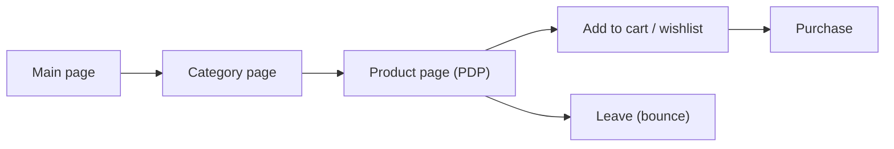
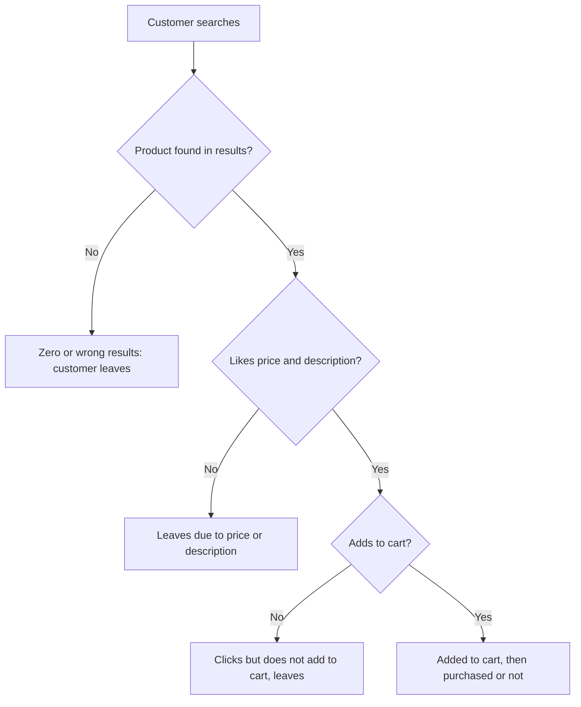
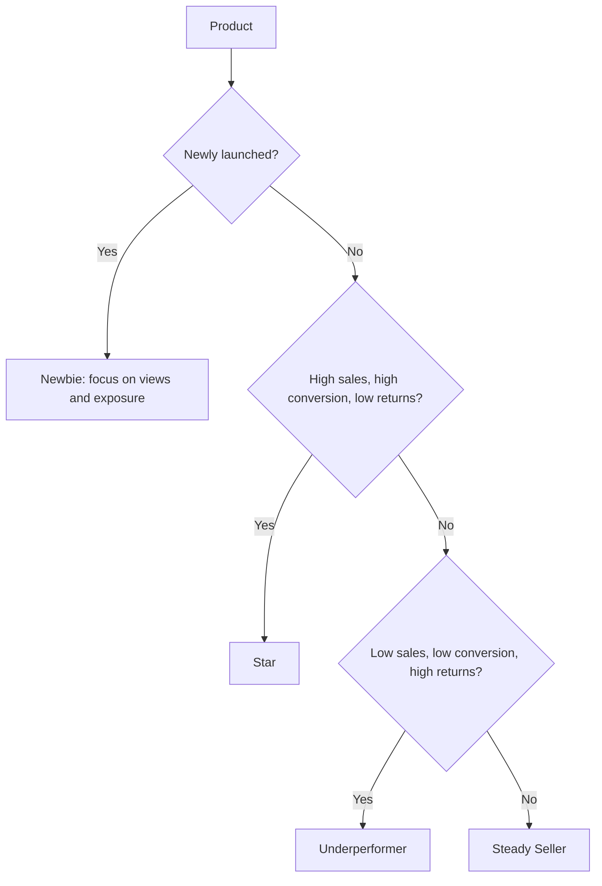

# Product Analytics: Views, Search and KPIs

## What you will learn

- The four lenses used to judge a product: page metrics, engagement, search and sales KPIs
- How to read the Product Details Page (PDP) funnel: views, bounce rate, add-to-cart rate
- Why a high add-to-cart percentage on few views and a low percentage on many views both signal problems (the headphone example)
- How search data (zero results, keyword gaps, SEO, text grouping) reveals demand and fixes lost sales
- How to classify products into Stars, Steady Sellers, Underperformers and Newbies using sales, conversion and return rate
- Why equal revenue can hide very different product health (the dress example)

---

## Why Analyse Products (Not Just Customers)

**Simple idea:** Customer analytics asks "who is buying and how do they behave?"; product analytics asks "which items are winning, which are failing, and why?"

**Analogy:** A shop owner watches foot traffic (customers), but also checks every shelf: which items people pick up, which they put back, and which they return after buying.

When a new product is launched, you check how engaging it is: are people reaching the product page, and are they interested enough to act?

From the back-end analytics view, the customer journey is:

Data for this comes from **Google Analytics** (if available) or from **clickstream** data (raw click/event logs).

### The four lenses for product analytics

| Lens | Question it answers | Typical metrics |
|------|--------------------|-----------------|
| Product page metrics | Is the product gaining traction? | Views, bounce rate, add-to-cart rate |
| Engagement | How interested are visitors beyond a glance? | Wishlist adds, reviews, repeat visitors |
| Search | How did visitors find (or fail to find) the product? | Search terms, zero-result searches, traffic source (search, banner) |
| KPIs | Is the product commercially healthy? | Sales, conversion rate, return rate |

Each lens points to a different fix: low views means a visibility problem; high bounce means a page/price problem; low repeat customers means a loyalty problem; low search penetration means a discoverability problem; falling sales means a commercial problem.

---

## Product Details Page (PDP) Metrics

**Simple idea:** The PDP is the product's "shop window"; you count how many people look, how many walk away, and how many step inside.

A **Product Details Page (PDP)** is the page showing one product (price, variants, photos, description, reviews). Whenever a customer lands on it, one of two broad things happens: they add the product to the cart, or they look at the price and leave.

### Key terms

- **Views:** number of times (or visitors) the PDP was opened.
- **Bounce rate:** share of visitors who land on the page and leave without taking any other action.
- **Add-to-cart rate:** share of visitors who add the product to the cart.
- **Sale:** a completed purchase; this is the KPI outcome.

$$\text{Bounce rate} = \frac{\text{Sessions that land and leave with no further action}}{\text{Total sessions landing on the page}} \times 100$$

$$\text{Add-to-cart rate} = \frac{\text{Visitors who add to cart}}{\text{Views}} \times 100$$

### Example: the iPhone price comparison

You search for an iPhone 15/16. On Amazon it is about ₹79,000. On Flipkart (during a big sale elsewhere) it shows about ₹85,000. You close the Flipkart tab immediately without doing anything: for Flipkart this is a **bounce**. On Amazon you pick a variant and add it to the cart. If your budget allows you buy it; otherwise you keep it in the cart hoping the price drops, then buy later.

So the same visitor produced a bounce on one site and an add-to-cart on another. Price competitiveness is one driver of bounce.

### Simplification gap

Bounce rate is not purely "price too high". A bounce can also come from slow loading, poor photos, wrong search match, or simply having found the needed information. Also, a single view of a page is not the same as a purchase intent; only some adds become sales.

---

## Worked Example: Two Headphones (Model A vs Model B)

**Simple idea:** Percentages and absolute numbers tell different stories; you must read both.

**Analogy:** A busy street stall where 1 in 100 passers-by buys can still sell more items than a quiet kiosk where 1 in 20 buys, but the stall is wasting its crowd.

| Metric (monthly) | Model A | Model B |
|------------------|---------|---------|
| Views | 8,000 | 2,000 (one fourth of A) |
| Add-to-cart rate | 1.2% | 4.5% |
| Add-to-carts (absolute) | $8000 \times 0.012 = 96$ | $2000 \times 0.045 = 90$ |
| Visitors who do not add to cart | $8000 - 96 = 7{,}904$ (98.8%) | $2000 - 90 = 1{,}910$ (95.5%) |

### Reading the numbers

- **Model A:** far more visitors, so slightly more absolute add-to-carts (96 vs 90), but the rate is poor: roughly 98 to 99% drop off. Visitors arrive (good traffic) but are not converting. Possible causes: delivery charges, open-box delivery charges, unattractive photos, or a page issue that puts people off. Because only 96 add to cart, final purchases will be even fewer.
- **Model B:** the rate (4.5%) is healthy, so the page does its job, but the product got little exposure or publicity. If traffic grows, absolute conversions will rise.

### General hypothesis

Where visitor volume is very high, even a small or equal add-to-cart rate yields a larger absolute number of add-to-carts than a lower-traffic product. But a large traffic base with a low rate means the business model is not working for that product: the conversion rate must be raised.

### Diagnosis rule

| Situation | Likely problem | Action |
|-----------|----------------|--------|
| High views, low add-to-cart rate (Model A) | Page, price or delivery-cost issue | Fix page, photos, charges; improve conversion |
| Low views, high add-to-cart rate (Model B) | Exposure/visibility issue | Increase marketing, search ranking, banners |

Both cases are concerns, but Model A's is the more serious one: you already paid for the traffic and lose almost all of it. Model B's page works; it just needs reach.

### Simplification gap

Comparing 96 vs 90 assumes equal time periods and the same definition of "view". Also, absolute add-to-cart counts are not sales; carts can be abandoned, and purchase rate must be measured further down the funnel.

---

## Product Engagement and Engagement Scores

**Simple idea:** Engagement measures how much people care about a product beyond one quick look.

In e-commerce, typically 80 to 90% of customers open a product page, view it and leave. Those who like it add it to the cart or wishlist. Engagement signals therefore capture the interested minority.

There are three main engagement signals:

1. **Wishlist adds:** the customer likes the product but may not afford it now; the wishlist is a "buy when budget allows" list. High wishlist count with low sales suggests a price barrier.
2. **Reviews:** reviews can be positive or negative. Positive reviews are good for you; negative reviews are a concern because they signal unhappy customers and hurt future conversion.
3. **Repeat visitors / repeat customers:** people who return to the product. This links to **cohort analysis** (tracking repeat behaviour once, twice, thrice over time) to see how many come back to buy.

An **engagement score** combines such signals into one number per product so products can be compared.

### Simplification gap

Engagement is not the same as sales. A wishlisted product with no purchases shows interest, not revenue. Reviews must be read for sentiment: a high review count with mostly negative text is bad engagement.

---

## Search Analytics

**Simple idea:** What people type into your search box is a free survey of what they want.

**Analogy:** A shopkeeper who writes down every item customers ask for and does not have; those notes become the next stock order.

### Customer search outcomes

When a customer searches for a product, one of these happens at each step:

So there are four failure points before a sale:

1. They do not find the product (zero results, spelling mistake such as "iphon", or the search not mapped to the product).
2. They find it but leave because of price, description or something off-putting.
3. They like it and click, but do not add to the cart.
4. They add to cart, and then either purchase or abandon.

### Missing products and wrong results: SEO and keyword mapping

Search results depend on linking search keywords to products. Making sure correct keywords map to products is the basis of **Search Engine Optimization (SEO)**. If SEO is poor, searches are not mapped to products, customers see no or wrong results and leave for another site.

Analyst routine (done periodically):

1. Download the search-term log.
2. Understand what exact terms people used.
3. **Map similar words and group them** (this is a **Natural Language Processing (NLP)** task: treating text, handling variants and misspellings, grouping similar words).
4. **Tag** the groups to the relevant products so future searches return them.

If not repeated from time to time, the mapping goes stale and customers keep failing to find products.

### Search data as a demand signal

Search logs show what people prefer, even for products you do not sell.

- Example: **"left-handed scissors"** searched 400+ times. Action: add a dedicated "left-handed scissors" section in the next site development. Expectation: conversion rises within a couple of months because the demand was proven.
- Example: **gym bags.** A new gym-bag section may convert strongly in the first couple of months and then taper. Results can fade, so track the trend rather than assuming permanent gains.
- Broader use: frequent searches for gym items can justify a whole **sports/gym section** (bags, dumbbells and so on). The frequency of search words tells you where demand is, so you can increase product sales.

### Why it matters

| Search insight | Business action |
|----------------|-----------------|
| Many zero-result searches | Fix SEO, spelling tolerance, keyword-to-product tags |
| High-frequency unmet query | Add product or section |
| Searches found but not clicked | Improve title, price, description |
| Clicked but not added to cart | Improve page content, delivery information |

Also track the **traffic source** of a PDP visit: did the customer arrive via internet search, or by clicking a banner? This shows which channel brings engaged visitors.

### Simplification gap

Search frequency shows interest, not guaranteed purchasing power; test with a small section first. Also, "SEO" in the narrow sense means ranking on external search engines; here it is used for on-site keyword-to-product matching, which is often called internal/site search optimization.

---

## Product KPIs: Sales, Conversion Rate, Return Rate

**Simple idea:** Three numbers tell you whether a product deserves more money: how much it sells, how well visits turn into purchases, and how often buyers send it back.

$$\text{Conversion rate} = \frac{\text{Purchases}}{\text{Visitors (or views)}} \times 100$$

$$\text{Return rate} = \frac{\text{Units returned}}{\text{Units sold}} \times 100$$

Why return rate matters: a return cancels the revenue and adds cost (logistics, handling) and signals an unhappy customer. A product with high sales but high returns is not truly profitable.

### Competitor benchmarking (cold cream example)

Suppose you launch a new, seasonal **cold cream** (sells mainly in winter) from a new company, with pricing that competes with established brands. Your own sales come from your own system. Competitor sales come from market-research providers such as **Kantar** and **Nielsen**. Comparing your brand's winter sales with competitors shows where you stand and how much share you gained. The competitor numbers are approximate (not 100% accurate) but good enough for a rough position.

Use KPIs to find the weak spot: low views? high bounce rate? low repeat customers? low search penetration? falling sales? Each points to a different remedy.

### Product portfolio classification

Classify every product on sales, conversion rate and return rate:

| Class | Sales | Conversion | Return rate | Meaning | Budget action |
|-------|-------|-----------|-------------|---------|---------------|
| **Star** | High | High | Low | Hot sellers, in demand | Minimal extra effort; protect and maintain |
| **Steady Seller** | Average | Average | Average | Reliable, keeps revenue flowing | Keep running; they are always doing well |
| **Underperformer** | Low | Low | High | Not performing despite money and campaigns spent | Cut down budget |
| **Newbie (New/Unproven)** | None yet | None yet | None yet | Recently launched; only views are meaningful | Put in effort: study customer needs, SEO, search data |

Every product in the line should fall into one of these four groups so you can distribute budget sensibly.

### Simplification gap

Real thresholds for "high" and "low" are business-specific (set relative to category or portfolio). Products can also change class over time (a Newbie may become a Star; seasonal items swing).

---

## Worked Example: Same Revenue, Different Health (Dress A vs Dress B)

**Simple idea:** Two shops can both ring up the same sales, but if one gets half its clothes sent back, it is much less healthy.

| Metric (monthly) | Dress A | Dress B |
|------------------|---------|---------|
| Revenue | about ₹8 lakh | about ₹8 lakh |
| Conversion rate | 6% | about 1.2% |
| Traffic | Baseline | about 5x A |
| Return rate | 4% | 22% |

Check: $6\% \div 1.2\% = 5$, so Dress B needs about five times the traffic to produce the same revenue.

Illustrative net revenue after returns (assuming return rate applies to revenue):

- Dress A: $8 \times (1 - 0.04) = 7.68$ lakh retained.
- Dress B: $8 \times (1 - 0.22) = 6.24$ lakh retained.

So although revenue is equal, Dress B costs far more in returns, handling and unhappy customers, and needs far more traffic (marketing spend) to get there. Dress A is efficient and healthy. With a 22% return rate much of the revenue effectively "falls into the water". The lesson: always read sales, conversion and return rate together, never sales alone.

---

## Comparison: Easily Confused Metrics

| Metric | Measures | Numerator / denominator idea | Good direction |
|--------|----------|------------------------------|----------------|
| Views | Reach / visibility | Count of page visits | Up |
| Bounce rate | Immediate disinterest | Single-action exits / landings | Down |
| Add-to-cart rate | Purchase intent | Adds / views | Up |
| Conversion rate | Completed purchases | Purchases / visitors | Up |
| Wishlist adds | Interest without immediate buying | Count | Up (but check price barrier) |
| Return rate | Post-purchase dissatisfaction | Returns / units sold | Down |

---

## Exam and Assessment Hints

- Expect a classification question: given sales, conversion and return rate, label the product as Star, Steady Seller, Underperformer or Newbie, and say where to focus budget.
- Be ready to compare two products with numeric examples (headphone Models A and B; Dress A and B) and to explain why absolute numbers and rates must be read together.
- Know the four lenses (page metrics, engagement, search, KPIs) and the data sources (Google Analytics, clickstream, Kantar/Nielsen for competitor sales).

---

## Self-Check Questions

1. **What is bounce rate?** The share of visitors who land on a page and leave without any further action. Example: closing the Flipkart tab on seeing a higher price.
2. **Model A: 8,000 views, 1.2% add-to-cart. Model B: 2,000 views, 4.5%. How many add-to-carts each, and which is the bigger concern?** A: 96; B: 90. Model A is the bigger concern because about 98.8% of a large audience drops off; Model B only needs more exposure.
3. **Name three engagement signals.** Wishlist adds, reviews (positive or negative), and repeat visitors/customers.
4. **Why do zero-result searches matter, and how are they fixed?** Customers leave when they cannot find the product. Fix by reviewing search logs, grouping similar terms (NLP) and tagging them to products (SEO).
5. **What does a search for "left-handed scissors" 400+ times suggest?** Unmet demand; add a dedicated section and expect higher conversion.
6. **Describe a Star product and an Underperformer.** Star: high sales, high conversion, low return rate. Underperformer: low sales, low conversion, high return rate despite spend.
7. **Dress A: 6% conversion, 4% returns. Dress B: 1.2% conversion, 22% returns, same revenue. Which is healthier?** Dress A; Dress B needs about 5x the traffic and loses much more to returns.
8. **Where do competitor sales figures come from?** Market-research sources like Kantar and Nielsen; they are approximate.

---

## Common Pitfalls / Exam Traps

- Judging a product only by add-to-cart percentage or only by absolute count; use both (96 vs 90 example).
- Treating a high-view product as healthy; high views with a very low conversion is the more serious problem.
- Ignoring return rate: equal revenue does not mean equal health.
- Confusing a Newbie with an Underperformer: a new product has no sales history, so judge it on views and exposure, not on conversion or returns.
- Assuming a new search-driven section keeps converting at its launch rate; it may fade after the first couple of months.
- Assuming wishlist adds are sales; they show interest, often limited by price.
- Treating competitor numbers from Kantar/Nielsen as exact; they are only approximate.
- Forgetting that search outcomes have several drop-off points (not found, price/description, no add-to-cart, abandoned cart).

---

## Quick Revision Summary

- Product analytics uses four lenses: page metrics (views, bounce, add-to-cart), engagement, search, and KPIs (sales, conversion, returns).
- Data sources: Google Analytics or clickstream; Kantar/Nielsen for approximate competitor sales.
- Bounce rate = landing and leaving with no action; add-to-cart rate = adds / views.
- High views with low add-to-cart rate signals a page/price/delivery problem; low views with a high rate signals an exposure problem.
- Engagement signals: wishlist adds, reviews (positive or negative), repeat visitors (cohort-style analysis).
- Search analytics: fix zero-result searches via SEO keyword mapping; group and tag terms with NLP; mine frequent searches for new products or sections.
- Classify products: Star (high/high/low returns), Steady Seller (average), Underperformer (low/low/high returns, cut budget), Newbie (focus on views and effort).
- Same revenue can hide different health: Dress A (6% conversion, 4% returns) beats Dress B (1.2%, 22% returns).
