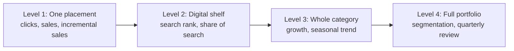
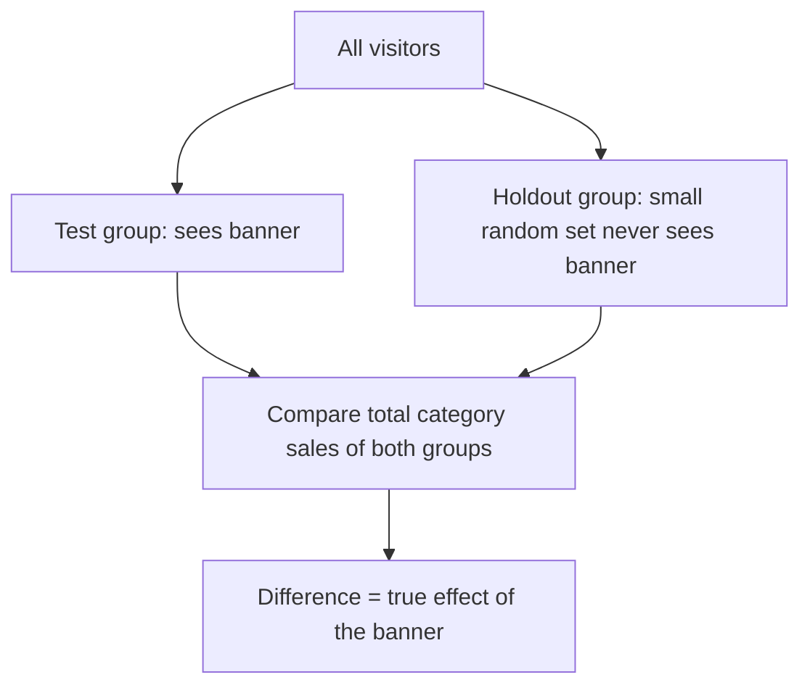
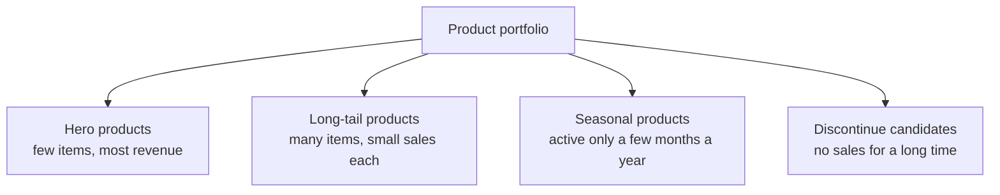

# Merchandising Analytics: Placement to Portfolio

## What you will learn

- What **merchandising** means in e-commerce and the four "zoom levels" used to judge it: placement, digital shelf, category, portfolio
- How to measure a placement with **CTR**, and why a click is not proof of a sale (attribution, cannibalization, holdout groups)
- The five parts of a **digital shelf** (image, title, price, rating, stock) and how benchmarking exposes gaps
- The four category KPIs (revenue, growth, conversion, AOV) and why **seasonality** forces year-on-year comparison
- How to segment a **product portfolio** (hero, long tail, seasonal, discontinue candidates) and decide to prune or expand

---

## What Is Merchandising?

**Simple idea:** Merchandising is deciding which products you show to customers and where you show them.

**Analogy:** In a physical shop, best-sellers go at the front and eye level; slow movers go at the back or bottom shelf. Online, the same logic applies, but the "shop window" is the homepage, category pages, search results and recommendation slots.

**Definition:** Merchandising is the set of decisions about product selection and placement (homepage banner, top of a category page, "recommended for you" slot, search listing) so that high-demand items are easily reachable and lower-demand items sit deeper. The data side of merchandising checks whether each decision is actually helping sales.

### The four topics covered

| Topic | Question it answers |
|---|---|
| Merchandising effectiveness | Is a given placement really working? |
| Digital shelf | How does a product look in search/listing results before the product page is opened? |
| Category performance (and seasonality) | How is the whole group of products doing, once season is accounted for? |
| Product portfolio | Which products should be removed and which added? |

A **category** is the bigger umbrella a product falls under. "Fruity" is a specific drink; the category is beverages (cold drinks). Other categories: skincare, shoes, footwear.

A **portfolio** is the entire product range, including all categories (like a stock portfolio: the whole list of holdings, not one or two stocks).

---

## The Big Picture: Zooming Out Four Times

**Simple idea:** Look at the same business through four lenses, from a single banner up to the whole catalogue.

**Analogy:** A camera zooms in to see detail and out to see the whole frame. Dashboards in Tableau or Power BI do the same with **drill down** (year to month to week to day to hour to minute) and **drill up** (moving back to the coarser view).

| Level | Scope | Progression of what you look at |
|---|---|---|
| 1. One placement | A product in one slot (homepage banner, recommended slot) | Clicks, then sales, then **incremental sales** |
| 2. Digital shelf | How products look in search results | Rank in search results, then **share of search** |
| 3. Whole category | A group of products | Growth, then seasonal trend |
| 4. Full portfolio | Everything you sell | Product segmentation, reviewed every quarter (which products do well, which do not) |

Together, these let you test whether a placement helps sales, see how products look in search, read category numbers fairly despite seasonality, and decide what to add or remove.

---

## Level 1: Merchandising Effectiveness (One Placement)

### Placement and CTR

**Simple idea:** A placement is a spot where a product appears. The first check is: of the people who saw it, how many tapped it?

**Analogy:** A poster in a mall corridor. You count how many people walked past (saw it) and how many stopped to look (clicked).

**Definition:** A **placement** is the place where a product is shown: a big homepage banner, the top slot of a category page, or a "recommended for you" slot while browsing. **Click-through rate (CTR)** is the share of impressions that become clicks.

$$\text{CTR} = \frac{\text{Clicks}}{\text{Impressions}} \times 100\%$$

- **Impression** = one time the item was shown. Digital metrics start with presence (impressions), then clicks.
- Why CTR matters: clicks influence sales. If people click, some fraction will convert; if no one clicks, no sales follow.

**Worked example:** A banner is shown 2,000 times and clicked 60 times.

$$\text{CTR} = \frac{60}{2000} = 0.03 = 3\%$$

### Same chair, three placements

The same chair (same price, same photos) was placed in three slots:

| Placement | CTR |
|---|---|
| Homepage banner | 1.8% |
| Top of category page | 3.4% |
| "Recommended for you" | 5.1% |

Ratio of best to worst: $5.1 / 1.8 \approx 2.8$, so the recommendation slot is almost **3 times** as effective as the homepage banner.

**Why?** Audience. The homepage is seen by everyone, and many visitors are not shopping for furniture. Recommendations are shown to people already browsing furniture, so they are more interested and click more.

**Why it matters:** Comparing one product across placements tells you which location gets the most clicks (and eventually conversions).

**Simplification gap:** CTR comparisons across different placements are not apples-to-apples. A 2% CTR on the homepage is not the same quality as 2% on a category page, because category-page visitors are already interested and find it easier to click. The fair approach is to compare each placement against its own average, not against a different placement type.

### Attribution

**Simple idea:** Did the banner actually cause the purchase, or would the customer have bought anyway?

**Analogy:** A shop assistant stands next to a shelf; a customer buys from it. Did the assistant cause the sale, or had the customer already decided to buy?

**Definition:** **Attribution** asks whether the placement truly caused the purchase. A click is not a sale; it only pushes towards one.

- A person can click and never buy.
- Clicks and impressions are correlated with sales but do not guarantee them.
- A person may buy the product without ever looking at the banner, in which case the placement was futile for that sale.

### Cannibalization

**Simple idea:** The featured product steals sales from its own sibling products, so no new demand is created.

**Analogy:** A bakery puts one cake in the window. Its sales jump, but customers who would have bought the cake next to it now buy the window one. Total cake sales are unchanged.

**Definition:** **Cannibalization** occurs when featuring one product raises its sales while the sales of a similar product fall, so demand is merely moved, not created.

**Worked example (distribution shift):** Products A and B each sell at a similar level (for example 50 and 40 units). Product A is placed on the homepage. Of 100 sales on a day, A now takes 80% and B is left with 20%. Sales shifted to the featured product.

### How to test properly: the holdout group

Most visitors see the banner; a small **random** group (the **holdout group**) never does. Compare **total category sales** (not only the featured product) across the two groups; the difference is the real, incremental effect of the banner. This is the cleanest way to find the true extra effect of a placement.

### Worked case: the smartwatch banner

A shop featured a smartwatch on the homepage for 2 weeks. Smartwatch sales rose by 30% and the team celebrated.

Looking at the whole watch category, the category grew only 4%. Most of the 30% came from customers who would have bought another watch from the same page anyway: the banner moved demand from one watch to another and created no new demand. This is the **cannibalization trap**. (Overall category growth also lifts a product regardless of where it is placed.)

### Comparison: click vs sale vs incremental sale

| Term | Meaning | Limitation |
|---|---|---|
| Click | Customer tapped the placement | Does not guarantee purchase |
| Sale | Customer bought | May have happened without the placement |
| Incremental sale | Extra sale caused only by the placement (vs holdout) | Needs a controlled comparison to measure |

---

## Level 2: Digital Shelf

**Simple idea:** The digital shelf is how your product looks in the search results list, before anyone opens its page.

**Analogy:** In a supermarket, products at eye level get noticed; products on the bottom shelf are missed even if discounted. Position changes sales for the same product. Online, the "eye level" is a high search rank and an attractive listing tile.

**Definition:** **Digital shelf** = how products appear in search results and listing pages before the product page is opened. It has five parts:

| Part | What the customer checks |
|---|---|
| Image | Does the small photo look good among many others? |
| Title | Is the product name clear, even when cut short? |
| Price | Are price and discount easily visible? |
| Rating | A visible rating with many reviews looks more trustworthy |
| Stock status | "Only 2 left" raises interest; "out of stock" kills it (customer will not care, or only asks for a notification) |

**Why it matters:** A weak digital shelf loses the sale in the search results; the customer never reaches your product page and drifts away (churns).

### Benchmarking

**Simple idea:** Compare yourself against competitors to see exactly where you fall behind.

**Definition:** **Benchmarking** compares your products with competitors or a reference threshold, so you can say your range is above or below the benchmark. Competitor pricing and market data come from sources such as data agencies (for example Kantar, Nielsen).

**Example comparison (search for one keyword):**

| | Our product | Competitor |
|---|---|---|
| Search rank | 7 | 1 |
| Number of reviews | 60 | 5,000 |
| Discount visible | Missing | Clearly visible |

This shows precisely where the gaps are: rank, review volume and visible discount.

### Worked case 1: two chargers

Two chargers sit side by side at nearly the same price and quality.

| | Charger A | Charger B |
|---|---|---|
| Photo | Clear, white background | Not clear, poor |
| Title | Clear (weight, cable type, details) | Contains a brand slogan |
| Rating | About 4.6 stars, about 1,200 ratings | No rating |

Customers pick A: they want a clear view of the product, good ratings and reviews, and are sceptical when there is no rating.

### Worked case 2: vitamin C serum

A skincare brand checked the search term "vitamin C serum". Competitors held Rank 1 and Rank 2 with more than 5,000 ratings each; the brand's product was at Rank 7 with only about 60 ratings, despite being on sale for a year.

**Root cause:** no follow-up with buyers. Competitors send post-purchase emails and messages asking for feedback and star ratings.

**Fix:** politely prompt customers for reviews. The product does not need to change; a push increases ratings, which lifts the digital shelf and rank.

---

## Level 3: Category Performance and Seasonality

**Simple idea:** Look at the whole group of products at once, because patterns show up there that single products hide.

### Four category KPIs

| KPI | Meaning |
|---|---|
| Revenue | Total sales of the category |
| Growth | Change versus a comparison period (previous year, month, week or day) |
| Conversion | Of the people who viewed the category, how many actually bought |
| AOV (Average Order Value) | On average, how much is spent per order |

$$\text{Growth} = \frac{\text{Current} - \text{Previous}}{\text{Previous}} \times 100\%$$

$$\text{AOV} = \frac{\text{Total revenue}}{\text{Number of orders}}$$

**Worked example (growth):** Last October the category sold 50 lakh rupees; this October 59 lakh.

$$\text{Growth} = \frac{59 - 50}{50} = \frac{9}{50} = 18\%$$

### Seasonality

**Simple idea:** Some demand rises and falls on a yearly calendar, so a "bad month" may just be the wrong season.

**Analogy:** Cold cream sells in winter, ice cream in summer; nobody judges ice cream by its December numbers.

**Definition:** **Seasonality** is a regular, repeating rise and fall of demand during particular times of the year. Example shape:

- January to March: steady
- June to September: **monsoon spike** (raincoats, umbrellas)
- October to November: **festive spike** (Diwali shopping, gifts)
- December: slowdown

**Rule:** Compare with the **same period of the previous year** (year-on-year), not with the previous month. Comparing July with September may make a category look "in trouble" when it is only out of season. Seasonal demand peaks once a year, so compare this September with last September, not August with September.

### Worked case: home and kitchen category

The category grew 18% compared to last year, which looks excellent. Drilling down showed 3 older products with sales falling by more than 10% (double-digit decline), hidden because 2 new fast-selling products covered the loss. The total looked healthy while some products quietly struggled; the problem would never be found by looking at the total only.

### Worked case: raincoats

Month-on-month comparison cannot capture raincoat demand because of the monsoon spike; use year-on-year.

---

## Level 4: Product Portfolio

**Simple idea:** Sort everything you sell into groups, then decide what to keep, push, cut or add.

**Analogy:** An investor reviews the whole stock portfolio, not just one or two shares.

### Four segments

| Segment | Description | Typical action |
|---|---|---|
| Hero | Small number of products giving the maximum revenue | Give them prime homepage space and marketing budget |
| Long tail | Many products, each selling in small quantities | Keep for variety; do not over-invest |
| Seasonal | Active only for a few months per year | Time promotion to the season |
| Discontinue candidates | No sales for a long time | Stop selling (prune) |

### The 80-20 (Pareto) rule

A small part of the products gives a large part of the revenue (hero products). Analogies: 20% of people do 80% of the work; in a company, about 20% of staff (leadership) take over 80% of total salary while the remaining 80% share the rest.

**Caveat:** 80-20 is a rule of thumb, not an exact law; actual splits vary (the footwear case below is even more skewed).

### Two decisions: prune or expand

| Decision | What it means | Evidence/trigger |
|---|---|---|
| **Prune** | Remove weak products | Very low conversion rate, very high returns, weak digital shelf for about 6 months |
| **Expand** | Add products where demand already exists | Search terms that return zero results (found through search analytics / SEO) |

### Worked case: footwear brand

The brand has more than 800 styles.

| Segment | Styles | Share of styles | Share of revenue |
|---|---|---|---|
| Hero | 25 | about 3% | about 55% |
| Long tail | about 300 | n/a | about 8% |

Long-tail styles are not useless: customers differ and like variety. But the data guides where to spend marketing money and homepage space: favour the roughly 25 hero styles rather than spreading attention evenly across all 800.

### Worked case: homeware

A merchandiser removed 60 weak products (low conversion, poor sales, weak digital shelf, high returns). This freed homepage space and budget (photography, data upkeep). They then added 8 new products chosen from zero-result search terms, i.e. what customers were looking for but could not find.

---

## Comparison: The Four Levels at a Glance

| Level | Key metrics | Typical trap |
|---|---|---|
| Placement | CTR, sales, incremental sales | Cannibalization; click not equal to sale |
| Digital shelf | Search rank, share of search, image/title/price/rating/stock | Fewer reviews and missing discount hide strong products |
| Category | Revenue, growth, conversion, AOV | Totals hide weak products; seasonal distortion |
| Portfolio | Segments (hero, long tail, seasonal, discontinue) | Treating the long tail as useless, or spreading budget evenly |

---

## Self-Check Questions

1. **A banner has 2,000 impressions and 60 clicks. What is the CTR?**
   $60/2000 = 3\%$.
2. **A chair has CTR 1.8% on the homepage and 5.1% in recommendations. Why the gap?**
   Recommendations reach people already browsing furniture (interested audience); the homepage is seen by everyone. $5.1/1.8 \approx 2.8$ times.
3. **A featured smartwatch's sales rise 30% but the watch category rises 4%. What is likely happening?**
   Cannibalization: demand shifted from other watches; little new demand was created. Confirm with a holdout group.
4. **How does a holdout group measure a banner's true effect?**
   A small random group never sees the banner; compare total category sales of both groups; the difference is the banner's effect.
5. **Name the five parts of a digital shelf.**
   Image, title, price (and discount), rating (and reviews), stock status.
6. **Why compare September with last September rather than August?**
   Seasonal demand repeats yearly; month-on-month confuses season with performance.
7. **Category sold 50 lakh last October and 59 lakh this October. Growth?**
   $(59-50)/50 = 18\%$.
8. **What are hero products and the prune/expand triggers?**
   Few products giving most revenue. Prune: low conversion, high returns, weak shelf for about 6 months. Expand: add products for searches that return zero results.

---

## Exam and Assessment Hints

- Know the four zoom levels and the metric progression at each (clicks to sales to incremental sales; rank to share of search; growth to seasonal trend; segmentation with quarterly review).
- Be ready to compute CTR, growth percentage and ratios (for example 5.1 / 1.8) from given numbers.
- The smartwatch (cannibalization), home and kitchen (hidden decliners), vitamin C serum (reviews cause low rank), footwear (25 styles, 55% revenue) and homeware (remove 60, add 8) cases are the worked examples to remember.

---

## Common Pitfalls / Exam Traps

- Treating a click as proof of a sale; attribution asks whether the placement caused the purchase
- Celebrating a sales jump on the featured product without checking category totals (cannibalization)
- Comparing CTR across different placement types as if equal; compare each placement with its own average
- Comparing seasonal categories month-on-month instead of year-on-year
- Reading only the category total (18% growth) and missing older products declining more than 10%
- Calling the long tail useless; it adds variety value, but should not get equal budget or homepage space
- Assuming the product must change to fix low rank; the serum case needed only a push for reviews
- Forgetting the holdout group must be random

---

## Quick Revision Summary

- Merchandising = deciding what to show and where; analysed at four levels: placement, digital shelf, category, portfolio.
- CTR = clicks / impressions; 60 / 2000 = 3%; the same chair got 1.8%, 3.4%, 5.1% across homepage, category top, recommendations.
- Clicks do not guarantee sales; attribution and holdout groups measure the incremental effect.
- Cannibalization: featured product gains while similar products lose (smartwatch +30% vs category +4%).
- Digital shelf = image, title, price, rating, stock; benchmark against competitors (rank 7 with 60 reviews vs rank 1 with 5,000).
- Category KPIs: revenue, growth, conversion, AOV; growth = (current - previous) / previous (50 to 59 lakh = 18%).
- Seasonality: compare year-on-year; monsoon and festive spikes distort month-on-month views.
- Portfolio segments: hero, long tail, seasonal, discontinue candidates; the 80-20 rule explains hero concentration.
- Prune weak products and expand into zero-result search demand (footwear: 25 of 800 styles gave about 55% revenue; homeware: removed 60, added 8).

---

**← [Previous](01-product-analytics-views-search-and-kpis-transcript.md) · [Index](../README.md) · [Next](../week-07/01-behavioral-analytics-journeys-paths-leakage-segments-transcript.md) →**
