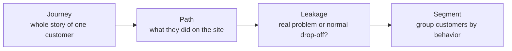
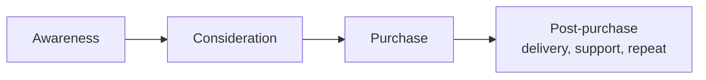
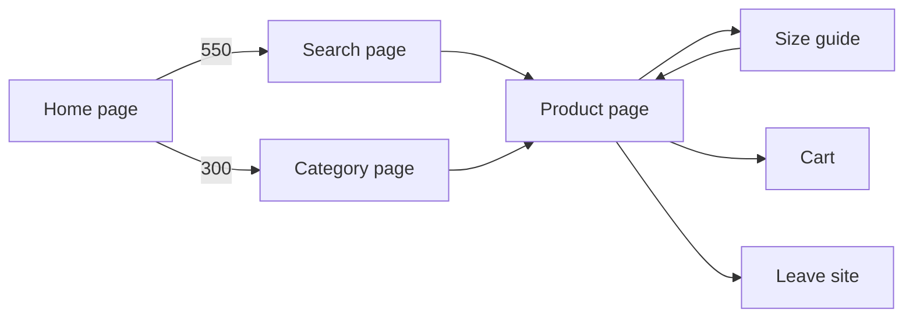
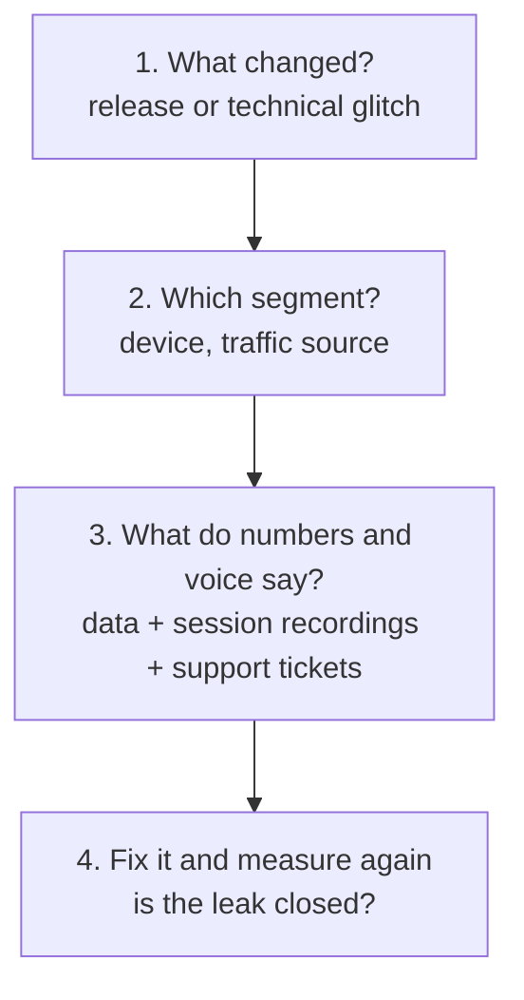
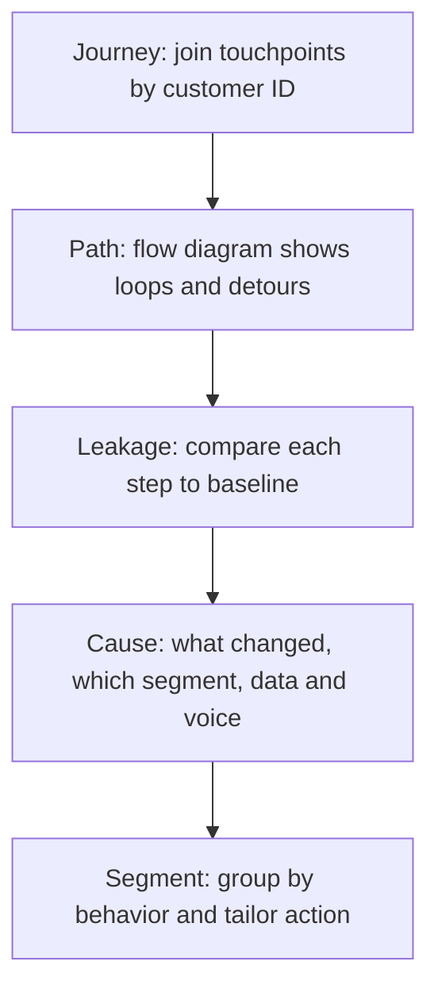

# Behavioral Analytics: Journeys, Paths, Leakage, Segments

## What you will learn

- How to map one customer's **journey** across many visits using a single customer ID, and why last-click reports mislead
- How **navigation path analysis** (flow diagrams) differs from a **funnel**, and how to read loops and detours
- How to tell a **natural drop-off** from a real **funnel leakage** using a baseline, and the four questions that find the cause
- How **behavioral segmentation** differs from demographic grouping and why each group needs its own treatment

## Big Picture: Four Connected Topics

**Behavioral analytics** studies what customers actually *do* on a website or app (pages viewed, return visits, discounts used), not just who they are on paper.

**Simple idea:** instead of guessing why customers do not buy, watch their digital footsteps, find where they get stuck or leave, and fix it.

A **customer journey** here means a *digital* journey: the path from the first contact with the brand to the purchase (and after). It is not physical travel.

| Topic | Question it answers | Output |
|-------|--------------------|--------|
| Customer journey mapping | What is the full story of one customer across many visits? | Timeline of touchpoints |
| Navigation path analysis | Which pages, in which order, with what detours? | Flow diagram |
| Funnel leakage | Is this drop-off normal, or a real problem? What caused it? | Baseline comparison and root cause |
| Behavioral segmentation | Which groups behave differently and need different treatment? | Customised campaigns |

After this module you should be able to: map a journey across visits, read a flow diagram, separate leakage from normal drop-off and find its cause, and group customers by behavior.

---

## Customer Journey Mapping

### Touchpoints and the journey

**Simple idea:** every time a customer meets your brand anywhere, that is a dot; join the dots for one person and you get their journey.

- A **touchpoint** is any contact between the customer and the brand: an ad, a website visit, an email, or a support chat.
- A **customer journey** is the full path of a customer **across many visits, not just one session**.
- Journey mapping starts with touchpoints and then builds a map for **one customer ID**.

**Customer ID analogy:** each employee in a company has an employee ID, each product has a product ID, and each customer who logs in with credentials gets a user ID. The ID lets you recognise the same person across visits.

### Four stages of a journey

| Stage | Meaning |
|-------|---------|
| Awareness | The person first hears about the product, marketplace, or website |
| Consideration | Comparing and thinking ("should I go for it, let me check it out") |
| Purchase | The customer actually buys |
| Post-purchase | Delivery, support, and coming back with a new order (repeat customers) |

### Why one customer ID changes how visits are counted

**Analogy (offline mall counter):** a door counter adds 1 on every entry. If 10 people walk in and out 100 times, the counter shows about 1,000 entries, suggesting a huge crowd, although only 10 people exist.

**E-commerce version:** you open an app, browse, close; reopen after a couple of hours, browse, close; do it a third time. Frequency is 3 logins, but because all activity is tagged to **one customer ID**, it is treated as **one visitor** (one customer), not three. Without a consistent ID, the same person looks like several different customers and counts are inflated, like the mall counter.

- Joining all of one person's visits using one ID gives a **timeline journey**.
- With an ID, opening the app 10 times is **1** customer; without it, it may look like 10 visitors.

**Simplification gap:** the "3 logins = 1 visit" idea is about counting *people* by ID. Web analytics tools also count *sessions*, and a gap of hours usually ends a session (commonly after about 30 minutes of inactivity), so 3 separate openings can be 3 sessions yet 1 unique customer. Always state which unit (session, visit, unique customer) a metric uses.

### Worked example: the backpack shopper

Timeline of one customer:

1. Day 1: sees an Instagram ad but does **not** click.
2. Next day: a friend mentions the product.
3. A few days later: searches for the brand and browses for a couple of minutes.
4. A few days later: receives an email with a discount code and **buys**.

**Last-click report:** gives all credit to the email session, since that was the final touch before the sale. The ad, the friend's recommendation, and the search are ignored. This is misleading: the sale was built over days, and the email only closed it.

**Journey view (deeper credit):** the ad, the friend referral, the search, and the email all contributed and should all receive credit for making the purchase happen.

| Approach | Who gets credit | Weakness |
|----------|----------------|----------|
| Last-click report | Only the final touchpoint (email) | Ignores earlier awareness and consideration touches |
| Journey / multi-touch view | Every contributing touchpoint (ad, friend, search, email) | Needs a consistent customer ID and joined data |

**Simplification gap:** "equal credit" is the simple version. In practice, multi-touch attribution can split credit equally, by position, or by a model; the key point is that it is not 100% to the last touch.

### Example: the furniture (sofa) shop

Furniture e-commerce has fewer sales than fast-moving goods (FMCG). A typical pattern: a customer views a sofa once, twice, or thrice a week (visit 1, visit 2, visit 3) and then vanishes without buying.

- Hypothesis: shoppers cannot picture the sofa in their room. Fix: add an **augmented reality (AR)** feature that uses the phone camera to place a virtual sofa in the room.
- After AR is added, the same revisiting customer buys.
- Other possible reasons for visiting but not buying: high or unexpected **delivery charges**, an **inaccurate product description**, or **poor pictures**.

**Takeaway:** analytics is not only collecting data and selling; you must understand customer sentiment and what the site is missing, and then test the cause.

---

## Navigation Path Analysis

**Simple idea:** follow a shopper through the store and note every aisle visited, in order, including the back-and-forth.

**Navigation path analysis** looks at the exact order of pages a person visits **inside one session** (a session is one stretch of using the site or app after logging in), for example category page to product page to another page, like a process flow.

### Funnel vs flow

| Aspect | Funnel | Flow (path diagram) |
|--------|--------|---------------------|
| Assumption | Everyone follows one fixed path, one step after another | Shows what really happened, including random jumps |
| Typical path | Category, product, cart, payment, order confirmation | Home, search, category, product, back to search, size guide, leave... |
| Shape | Narrowing steps | Branching diagram (not exactly a tree) with a split at every step |
| Use | Measure drop-off between fixed steps | Discover detours, loops, and unexpected behavior |

Real shoppers do not go neatly home, category, product, buy, leave. They browse, find something else, jump to another page, and repeat.

### Reading a flow diagram

The example diagram covers **1,000 sessions**:

- The **thickness of each band** shows how many people took that path.
- From the home page, **550** go to the search page and **300** go to the category page.
- From there they reach the product page; some go to the cart, and many leave the site.
- An **orange loop** goes product page, size guide, back to product page, again and again.

(Only the 550 and 300 figures are from the example; other branches are illustrative.)

### Unexpected patterns: do not decide before investigating

When a **loop** or **detour** appears, ask whether it signals:

- **Confusion** (the customer is unsure what to buy or which option fits), or
- **Healthy comparison** (for example, found an item on Amazon and checking Flipkart for a lower price).

A loop is only an **indication**. As an analyst you must investigate before concluding, then find a solution.

### Example 1: grocery app and the recipe detour

- Customers add items to the cart, go to the **recipe page**, and come back to the cart later.
- A **funnel report** would show this only as a messy checkout flow; the **actual flow** tells the real story.
- Reading: customers are **not confused**; they use recipes for ideas on what to cook.
- **Fix:** put recipe ideas directly on the cart page so customers do not have to leave. Leaving risks distraction or finding other products and abandoning the purchase.

### Example 2: shoe shop and the size guide

- Data shows many more loops between the **product page and the size guide** than for other products. This is **confusion**.
- Cause: the size guide never stated the **country system** (US, UK, or EU). A size 7 bought online may arrive too small, while another site that asks the country shows size 7 fitting correctly.
- **Fix:** add one label line stating US, UK, or EU sizes so customers choose with confidence.
- Result (illustrative numbers): the repeated loop pattern appeared in **100 sessions before** the label and **6 after**. That is a fall of 94 sessions, i.e. well over half (94%) of the loops disappeared.

$$\text{Reduction} = \frac{100 - 6}{100} \times 100\% = 94\%$$

**Takeaway:** a loop means confusion *or* healthy comparison; investigate, then fix.

---

## Funnel Leakage Identification

### Natural drop-off vs leakage

**Simple idea:** a bucket always loses a few drops when you carry it (normal); a hole makes it lose far more (a problem).

- **Natural drop-off:** at every funnel step some customers will leave. This is normal and healthy.
- **Leakage:** a drop-off that is **much higher than the normal level** for that step. Example: a step normally loses 2% to 3%, but now loses 10% to 20%.

### The baseline rule

To decide, you need a **baseline**: the normal drop-off for each step, usually from history. Compare each step with its own baseline.

- A step that normally loses **70%** of people is fine at that level.
- A step that normally loses **10%** is **not fine** if it suddenly loses **25%**.
- Around baseline: fine. Clearly above baseline (beyond a threshold): leakage, so investigate and fix.

Compare against the step's own baseline, not a single global number. A high drop-off can be normal for one step and alarming for another.

### Chart example: subscription box

Gray bar = normal level (baseline); blue bar = this week.

| Step | Normal (baseline) | This week | Verdict |
|------|------------------|-----------|---------|
| First step | 35% | 36% | Normal |
| Choose plan to enter payment (middle) | 30% | 55% | **Leakage** (flagged orange) |
| Enter payment | 10% | 10% | Normal |
| Order placed | 10% | 10% | Normal |

Any step whose value goes above the threshold is flagged as leakage.

### Finding the cause: four easy questions

1. **What changed?** A new release, or a technical glitch.
2. **Which segment is affected?** One device, one traffic source, etc.
3. **What do the numbers and the voice say?** Combine quantitative data with qualitative evidence: session recordings and support tickets.
4. **Fix it and measure again** to confirm the leak is closed.

### Worked example: subscription box payment problem

- For a full year, about **30%** left between choosing a plan and entering payment (the baseline).
- One week it jumped to **55%**.
- Cause: the **payment provider had an outage**, causing network congestion and a high drop-off.
- Impact per 1,000 people: normal loss 300, now 550.

$$\text{Extra lost} = 550 - 300 = 250 \text{ people per } 1{,}000$$

That is a large loss of potential orders.

### Worked example: electronics app checkout (segment split)

Checkout drop-off rose after an **app update**. The team **split the numbers by device**:

| Device | Drop-off |
|--------|---------|
| New phone (Android) | 9% |
| New phone (iPhone) | 10% |
| Tablet | 8% |
| Older phone / older OS | **62%** |

The leak is concentrated on **older phones** (the update is probably incompatible with older operating systems). Locate the baseline, find the affected segment, find the cause, then fix to stop the loss.

**Why segment-splitting matters:** an overall average can hide a severe problem confined to one group.

---

## Behavioral Segmentation

**Simple idea:** two people can look identical on paper and still shop completely differently, so group them by what they *do*.

Two ways to group customers:

| Approach | Based on | Examples |
|----------|----------|----------|
| **Demographic** | Who the person is | Age, city, income |
| **Behavioral** | What the person does | Visit frequency, pages browsed, how they arrive, where discounts are used, purchase pattern, reviews |

Behavioral grouping is preferred here because understanding behavior leads to **better sales next time** through tailored treatment.

### Worked example: Customer A vs Customer B

Both are 28 years old, live in Pune, and have the same income. Demographically they are **identical**.

| Feature | Customer A | Customer B |
|---------|-----------|-----------|
| Buying pattern | Buys only during big sales (for example Great Indian sale, Diwali sale); recent purchases were in the last three sales | Bought 4 times in a year |
| Price sensitivity | Often leaves the cart when the price is slightly higher | Buys at **full price**, never uses a discount code |
| Other behavior | Responds to discounts | Writes **reviews**; buys whenever needed |
| Type | Deal hunter / discount-driven | Loyal, high-value customer |

Demographics say "same customer"; behavior says "different customers". Sending the same email to both is wrong: A responds to discounts, B does not need them.

### Targeting: cart abandonment

- **Cart abandonment:** customers who add to the cart and leave without buying. Typical action: send a **reminder with a small discount**.
- But a discount email to everyone does not work equally: a discount seeker responds, a loyal buyer would have bought anyway, and so the discount is wasted margin.
- Different behavior (buying pattern) requires **different emails and different segments**.

### Case study: beauty brand 20% off email

The brand emailed everyone with **20% off**.

| Segment | What happened |
|---------|--------------|
| Deal hunters | Bought at a better price (the offer worked) |
| Loyal customers | Hardly reacted; they would have bought anyway, so margin was given away |
| Recent full-price buyers | Saw the price cut after paying full price and felt cheated |

The blanket discount **did harm rather than good**.

**Fix:** treat the three segments differently:
- Normal buyers: standard communication.
- High-value loyal customers: protect and reward them without needless discounts (for example, special privileges rather than price cuts).
- Opportunists / discount seekers: targeted discounts.

### Comparison: demographic vs behavioral segmentation

| Dimension | Demographic | Behavioral |
|-----------|-------------|-----------|
| Answers | Who are they? | What do they do? |
| Data | Age, city, income | Visits, browsing, discount use, purchases, reviews |
| Predictive of buying action | Weak (A and B look identical) | Strong |
| Treatment | One message per demographic group | Customised message per behavior group |

---

## Putting It Together

Recap of the three illustrations: the backpack shopper (many touches, last-click gives credit only to the email); a step whose drop-off rises above the benchmark acts as a flag that something must be investigated; and two customers (discount buyer vs full-price buyer) need different segments and different messages.

---

## Self-Check Questions

1. **Q: A customer opens an app 3 times in a day with the same login. How many customers is this?**
   A: One, because activity is tied to one customer ID. The frequency is 3, but it is one customer. (Session counts may be more than 1, so state the unit.)

2. **Q: Why is a last-click report misleading for the backpack shopper?**
   A: It credits only the discount email, ignoring the ad, friend referral, and search that built interest over days. Credit should be shared across contributing touchpoints.

3. **Q: How does a funnel differ from a flow?**
   A: A funnel assumes everyone follows one fixed sequence of steps; a flow shows the real paths, including loops, jumps, and branches.

4. **Q: Many sessions show a loop from product page to size guide and back. What do you do?**
   A: Do not conclude yet; loops may mean confusion or healthy comparison. Investigate. In the shoe example the size guide lacked a US/UK/EU label; adding it cut looping sessions from 100 to 6.

5. **Q: A step normally loses 10% and now loses 25%. Is it natural drop-off?**
   A: No, it is leakage: well above that step's baseline. A step that normally loses 70% would be fine at 70%.

6. **Q: List the four questions used to find the cause of a leak.**
   A: What changed (release, glitch)? Which segment (device, traffic)? What do the numbers and voice say (data, session recordings, support tickets)? Fix and measure again.

7. **Q: Baseline 30%, this week 55%, out of 1,000 people. How many extra people were lost?**
   A: Normal loss 300, now 550, so 250 extra.

8. **Q: Why can two customers of the same age, city, and income need different emails?**
   A: Their behavior differs (a discount-only buyer vs a full-price loyal reviewer), and behavior predicts response to offers; demographics do not show this.

---

## Common Pitfalls / Exam Traps

- Counting every login as a new visitor: with a consistent customer ID, repeat logins belong to one customer (mall counter analogy).
- Giving all credit to the last touch (the email) and ignoring earlier ad, referral, and search touchpoints.
- Treating the funnel as reality: real customers jump around; the flow diagram shows what happened.
- Assuming every loop or detour is confusion; it may be healthy comparison (Amazon vs Flipkart). Investigate before deciding.
- Calling every drop-off a problem: natural drop-off is normal and healthy; leakage is drop-off clearly above that step's baseline.
- Using one global threshold instead of a per-step baseline (70% can be normal; 25% can be a problem).
- Looking only at overall averages; splitting by device or segment exposed the 62% older-phone problem.
- Grouping customers only by age, city, and income; look-alike demographics can hide opposite behavior.
- Sending one discount blanket to everyone: loyal customers waste margin and recent full-price buyers feel cheated.
- Stopping at the fix: always measure again to confirm the leak is closed.

---

## Quick Revision Summary

- Behavioral analytics studies what customers do digitally; four topics: journey, path, leakage, segment.
- A journey spans many visits; a touchpoint is any contact (ad, site, email, support chat); one customer ID joins them.
- Journey stages: awareness, consideration, purchase, post-purchase.
- Last-click credits only the final email; the journey view credits the ad, friend, search, and email.
- Navigation path analysis examines page order within a session; a funnel assumes one fixed path, a flow shows real branching, loops, and detours.
- Loops can mean confusion (shoe size guide: label US/UK/EU cut loops 100 to 6) or comparison/interest (grocery recipe page: fix by placing recipes on the cart page).
- Leakage = drop-off well above the step's baseline (for example 30% rising to 55%, i.e. 250 extra losses per 1,000); natural drop-off is normal.
- Find causes by asking: what changed, which segment, what data and voice say, then fix and re-measure (older phones had 62% drop vs about 8% to 10% elsewhere).
- Behavioral segmentation groups by actions, not demographics: a discount hunter and a full-price reviewer need different emails.
- A blanket 20% discount email helped deal hunters, wasted margin on loyal customers, and upset recent full-price buyers.

---

**← [Previous](../week-06/02-merchandising-analytics-placement-to-portfolio-makeup-transcript.md) · [Index](../README.md) · [Next](../week-08/01-conversion-rate-optimization-for-e-commerce-transcript.md) →**
