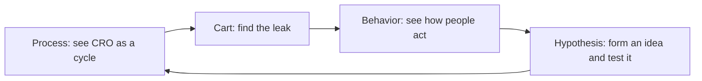
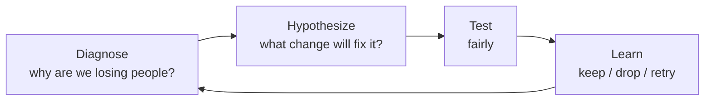
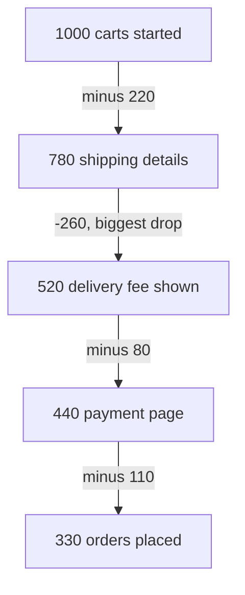

# Conversion Rate Optimization for E-Commerce

## What you will learn

- What **CRO** (Conversion Rate Optimization) is and why it is a repeating cycle, not a one-off fix
- The four levers behind most fixes: friction, trust, relevance, urgency
- How to measure **cart abandonment** step by step and prove a recovery email works using a control group
- How heatmaps, scroll depth and session recordings explain *why* visitors behave as they do
- How to write a testable hypothesis (problem, change, expected outcome) and rank ideas with **ICE**

## The Big Picture: Four Topics, One Loop

Simple idea: a shop that wants more buyers should find where it loses people, guess a fix, test the fix fairly, and keep what works. Then repeat.

Analogy: a physical store manager watches the shop floor, notices customers walking out at the till, tries a change (for example, a second cashier), compares sales before and after, and keeps or drops the change.

| Topic | Question it answers |
|-------|---------------------|
| CRO process | How do we improve conversion as a repeatable cycle rather than guesswork? |
| Cart abandonment | Where, exactly, are we losing carts, and does our recovery email really work? |
| Watching behavior | What are visitors actually doing on the page (heatmaps, sessions)? |
| Testable hypotheses | How do we turn what we saw into a clear, testable idea and pick which to try first? |

Each topic is learned at three levels: basic idea, a worked example, then an advanced extension.

## The CRO Process

### Simple idea

**CRO (Conversion Rate Optimization)** is the work of getting more of your visitors to finish the action you want, such as buying the product.

### Analogy

Think of a leaky bucket. CRO is not buying a bigger tap (more traffic); it is finding and patching the holes so more of the water you already pour in stays in.

### Definition

$$\text{Conversion rate} = \frac{\text{visitors who complete the goal action}}{\text{total visitors}} \times 100\%$$

CRO runs as a four-step loop:

1. **Diagnose** - find why people are lost (using the funnel and customer journey).
2. **Hypothesize** - state a change you believe will fix it.
3. **Test** - run the change in a fair way (for example, an A/B test with a comparison group).
4. **Learn** - keep the change, drop it, or try again. Then loop back to step 1.

CRO is **iterative**: it repeats continuously and is never "run once and done". It is a process, not guesswork.

### The four levers

Most fixes work by changing one of four levers: **friction, trust, relevance, urgency**.

| Lever | Simple idea | Everyday example | E-commerce fix |
|-------|-------------|------------------|----------------|
| **Friction** | Anything that makes the action harder | A job site that demands a long form and many steps; surprise taxes, delivery or website charges at the end of a purchase | Replace the big form with one-click upload (like LinkedIn Easy Apply); one clear payment step; show all charges early |
| **Trust** | Removing the buyer's worry so they feel safe | A shopper unsure about product quality or refunds | Product reviews, a clear return policy, trustworthy and recognised payment gateways |
| **Relevance** | Right thing, to the right person, at the right time | Showing winter clothes to a visitor from a cold region in winter; selling woollens in summer looks absurd | Personalise by person, place and product (the "3 P's": person, place, product) and season |
| **Urgency** | A reason to act now | Diwali sale; "only 1 left in stock"; "order within 25 minutes" countdown | Real stock indicators and genuine deadlines |

Friction is the original physics idea: rough surfaces rubbing together make movement harder. In a purchase journey, anything that makes the action harder is friction.

Relevance works when all three Ps line up: the right person, in the right place/time, sees the right product. If any one is mismatched, the offer fails.

### Caveat: fake urgency backfires

A countdown timer that resets every time you return (for example "order within 30 seconds" shown again hours later) is fake urgency. A customer may be fooled once, but then stops trusting the brand and its products. Urgency must be real; otherwise you damage the **trust** lever while pulling the **urgency** lever. (Note: urgency is an optional lever, to be used only when it is genuine.)

### Worked example: the online furniture store

An online furniture retailer ran **11 tests in a year**.

- Only **4** improved the conversion rate (the "wins"); the other **7** did not.
- Each win was small: about **3-4%**.
- Gains compound across the year, so checkout completion rose by about **14%**.
- Index the start of the year as 100; the end of the year is about **114**.

Quick check: four wins of roughly 3.4% compound to $1.034^4 \approx 1.143$, i.e. about +14%. Adding four 3.5% gains gives 14% too, so the headline matches either way.

Key lessons:

- It was **not** a redesign. It was steady testing and learning.
- Most tests fail ("no"), a few win ("yes"). That is normal, and failed tests still teach you something.
- Good marketing teams track how many real tests they run each month (on average about 10 decent tests a month is cited as a benchmark) and watch results closely. A test that wins completely, beating all others, is rare (about one per year).
- Many small, well-run tests beat one big bet.

### Simplification gaps

- "Conversion" depends on the goal you define (purchase, sign-up, checkout completion). State the goal before you measure.
- Compounding is multiplicative, not additive; for small gains the two are close.
- A "win" should be judged with a fair test (enough traffic, a control group), not just a before/after glance.

## Cart Abandonment

### Simple idea

Cart abandonment is the share of shoppers who start buying (put something in the cart) but leave before finishing the order.

### Analogy

100 people fill their shopping trolley in a supermarket; 90 park it in an aisle and walk out. Only 10 reach the till.

### Definition

$$\text{Cart abandonment rate} = \frac{\text{carts created} - \text{orders completed}}{\text{carts created}} \times 100\%$$

Equivalently, $100\% - \text{checkout completion rate}$.

- Example: 100 carts started, 10 become orders, so abandonment is $\frac{100-10}{100} = 90\%$.
- The rate is **always high** in e-commerce, so a high number alone is not an alarm.
- A single **blended number** (for example "2 of 3 carts abandon") is not actionable: it tells you carts are lost, but not where or why.

### Fix: break it down by checkout step

Track the number of carts remaining at every step, and the drop between steps.

### Worked example: the checkout funnel

Start with 1,000 carts.

| Step | Carts remaining | Lost at this step | Lost as % of start | Lost as % of previous step |
|------|-----------------|-------------------|--------------------|----------------------------|
| Cart started | 1,000 | - | - | - |
| Shipping details | 780 | 220 | 22.0% | 22.0% |
| Delivery fee shown | 520 | **260** | **26.0%** | 33.3% |
| Payment page | 440 | 80 | 8.0% | 15.4% |
| Order placed | 330 | 110 | 11.0% | 25.0% |

Checks:

- Total lost $= 220 + 260 + 80 + 110 = 670$, so abandonment $= 670/1000 = 67\%$ and checkout completion is $330/1000 = 33\%$.
- The **biggest leak** is the step where the delivery fee is displayed: 260 carts, the largest absolute drop (about 39% of all carts lost: $260/670$). It is the biggest single leak, though not literally half of all losses.

Likely fix: show the delivery fee much earlier (for example on the product page) so there is no surprise. Typical reasons for step drops: a **surprise fee**, a **long form**, or a **missing payment option**. Measure step by step, find where the issue is, and fix that step.

### Does a recovery email really work? (Control group)

Example: a homeware brand notices high abandonment and sends a reminder email **3 hours** after a shopper leaves. A few weeks later, **12%** of those carts were ordered.

It is tempting to say "the email recovered 12%". That is wrong, because some shoppers would have returned and bought anyway.

Fix: use a **control group**: a similar set of abandoned carts that received **no email**. The control group recovered **9%** on its own.

$$\text{True email effect} = \text{recovery}_{\text{email group}} - \text{recovery}_{\text{control group}} = 12\% - 9\% = 3 \text{ percentage points}$$

So the email caused only **3 points** of extra recovery, not 12. Do a thorough check before giving credit to a tactic (or to another team).

| Measure | Naive claim | Correct view |
|---------|-------------|--------------|
| Credit to the email | 12% | 3 percentage points |
| Baseline (no email) | ignored | 9% would return anyway |

### Advanced additions

- **Clean the carts first**: items put in "save for later" are not abandonment. A shopper who finds the price slightly high may be waiting a few days. Exclude them from the abandonment count.
- **Start an email sequence**: a gentle reminder ("you have items in your cart", like the ones large marketplaces send).
- **Test each email against its own control group**, so you know which email in the sequence does the job.

## Watching How People Behave

### Simple idea

Numbers say *what* happened and *how often*. They do not say *why*. To see why, watch what visitors do.

### Two simple tools

| Tool | What it shows | Analogy |
|------|---------------|---------|
| **Heatmap** | Where visitors click, where they hover, and how far they scroll | A thermal camera over a shop floor showing where people crowd |
| **Session recording** | An anonymous replay of one real visit, like a short video | CCTV footage of one customer's walk through the shop |

### Reading a heatmap on a product page

- Red and orange spots show the most-clicked areas (for example "product for 2", "add to cart", "ingredients").
- A dotted line marks where a typical phone screen ends (the "fold"). Anything below it (reviews, "you may also like") is not visible without scrolling.
- **Scroll depth** shows how many visitors reach each part of the page. In the example: top of page 100%, ingredients about 55%, reviews about 22%, bottom about 8%.

### Clue, not proof

One recording is a **clue, not a proof**; it is a source of hypotheses. Before calling it a problem, check the numbers: do many sessions behave the same way? Never redesign a page from a single video.

### Worked example: skincare brand

A skincare brand opens the heatmap of its best-selling serum page.

1. Observation: almost nobody clicks or scrolls beyond the first photo and price.
2. Insight: ingredients and reviews sit below the phone fold, and most people never reach them.
3. Check: confirm across many sessions that this pattern is widespread.
4. Change: move **key ingredients** up the page; keep **reviews and the full ingredients** open (visible) below. Before: photo and price first. After: key ingredients pushed higher.

### Advanced: rage clicks

A **rage click** happens when someone clicks the same spot repeatedly and quickly. It suggests frustration: the element may look clickable but is not, or it is broken. Rage clicks flag usability bugs worth investigating (the page may not be responding).

## Turning Observations into Testable Hypotheses

### Simple idea

A hypothesis is a clear, testable "if we do X, then Y will happen because of Z" idea, written so you can tell later whether it worked.

### Three parts of a good hypothesis

| Part | Meaning | Example |
|------|---------|---------|
| **Problem** | Real evidence from data | 60% of mobile users leave without scrolling past the first photo |
| **Change** | Exactly what you will alter | Move the price and the Add to Cart button higher on the screen |
| **Expected outcome** | A number, a metric and a time frame | Mobile add-to-cart rate will rise by at least 10% within 4 weeks |

Full hypothesis: "Because 60% of mobile users leave without scrolling past the first photo, if we move the price and add-to-cart button higher up the screen, then the mobile add-to-cart rate will rise by at least 10% within 4 weeks."

Bad example: "Let's make the product page better." It names no specific change, no metric and no way to tell if it worked. It is untestable.

### Prioritising ideas with ICE

You always have more ideas than time. **ICE** scores each idea from **1 to 10** on three questions:

- **Impact**: how big a difference could it make?
- **Confidence**: how sure are we it will work (is it backed by data)?
- **Ease**: how easily can it be built and tested?

$$\text{ICE score} = \frac{\text{Impact} + \text{Confidence} + \text{Ease}}{3}$$

| Idea | Impact | Confidence | Ease | ICE (average) | Comment |
|------|--------|------------|------|---------------|---------|
| Move price and button up | 8 | 7 | 8 | **7.7** | Big, data-backed, easy: do this first |
| Add a size guide pop-up | - | - | - | 6.3 | Decent |
| Redesign whole checkout | high | low | low | 5.3 | Huge impact, but uncertain and costly |
| Change the banner colour | very low | - | very easy | very low | Easy, but almost no difference |

Check: $(8+7+8)/3 = 23/3 \approx 7.7$ (often rounded down to 7 in quick calculations). Sub-scores for the other rows are not broken out, only their totals.

Alternative: **RICE** (Reach, Impact, Confidence, Effort) is a close relative that adds *Reach*; use ICE or RICE to rank many ideas.

Winner: move the price and button up. Then run the full loop: diagnose, hypothesize, test, learn.

### Simplification gaps

- ICE scores are subjective estimates; use data to set Confidence rather than gut feel.
- A 1-10 average cannot fall below 1, so a score below 1 is impossible (the banner idea scores very low but not below 1).
- Scores rank ideas; they do not replace testing.

## Exam and Assessment Hints

- Expect to define CRO and list the loop steps: diagnose, hypothesize, test, learn.
- Remember the levers: friction, trust, relevance, urgency (four levers, not three).
- Know the numeric examples: 11 tests, 4 wins, about 14% yearly gain; the 1000 to 780 to 520 to 440 to 330 funnel; 12% - 9% = 3 points; ICE of 8, 7, 8.
- Practise computing step-wise drop-offs and identifying the largest leak.
- A common applied question: "How do you prove a recovery email works?" Answer: control group and the difference.

## Self-Check Questions

1. **What does CRO stand for, and what is its goal?**
   Conversion Rate Optimization: increasing the share of visitors who complete the desired action (for example buying).
2. **Name the four steps of the CRO cycle.**
   Diagnose, hypothesize, test, learn (keep, drop or retry), and then repeat.
3. **List the four levers and give one example of each.**
   Friction (long form), trust (reviews/returns), relevance (season/place-appropriate products), urgency (genuine low-stock or sale timer).
4. **A funnel goes 1000, 780, 520, 440, 330. Where is the biggest leak and what is the abandonment rate?**
   Between 780 and 520 (the delivery-fee step, 260 lost); abandonment is $670/1000 = 67\%$.
5. **An email group recovers 12% and a no-email control recovers 9%. What is the email's effect?**
   $12\% - 9\% = 3$ percentage points.
6. **What do heatmaps and session recordings show that numbers cannot?**
   Why visitors behave as they do: where they click, hover and scroll, and individual journeys. One recording is only a clue.
7. **What are the three parts of a good hypothesis?**
   Problem (from data), change (specific), expected outcome (with a number and a time frame).
8. **What is ICE and how is it calculated?**
   Impact, Confidence, Ease, each scored 1-10, then averaged; ideas are ranked by score.

## Common Pitfalls / Exam Traps

- Treating CRO as a one-time project; it is a continuous cycle.
- Expecting most tests to win; typically only a minority do (4 of 11 in the example).
- Quoting the email's raw recovery rate (12%) as its impact instead of subtracting the control (3 points).
- Using a single blended abandonment rate; break it down by checkout step.
- Counting "save for later" items as abandoned carts.
- Using fake countdown timers or fake scarcity: it destroys trust.
- Redesigning from one session recording; verify across many sessions first.
- Writing vague hypotheses ("improve the page") with no change, number or time frame.
- Forgetting that ICE is an average of the three scores (not a sum) and that the scores are subjective.
- Confusing "percentage points" (12% - 9% = 3 points) with relative percent change.

## Quick Revision Summary

- CRO (Conversion Rate Optimization) is a repeating cycle: diagnose, hypothesize, test, learn.
- Fixes act on four levers: friction, trust, relevance, urgency; urgency must be genuine.
- Many small, well-run tests beat one big redesign: 4 wins of about 3-4% compounded to roughly +14% over a year.
- Cart abandonment is the share of started carts that never become orders; always high, so analyse it by checkout step.
- Funnel example: 1000, 780, 520, 440, 330 means 67% abandonment, with the biggest leak at the delivery-fee step (fix: show fees earlier).
- Prove a recovery email works with a control group: 12% - 9% = 3 percentage points.
- Heatmaps (click, hover, scroll) and session recordings reveal why; one recording is a clue, not proof; rage clicks signal frustration.
- A good hypothesis states problem, change and expected outcome with a number and a time frame.
- Rank competing ideas with ICE (or RICE): average of impact, confidence, ease scored 1-10.

---

**← [Previous](../week-07/01-behavioral-analytics-journeys-paths-leakage-segments-transcript.md) · [Index](../README.md) · [Next](../README.md) →**
