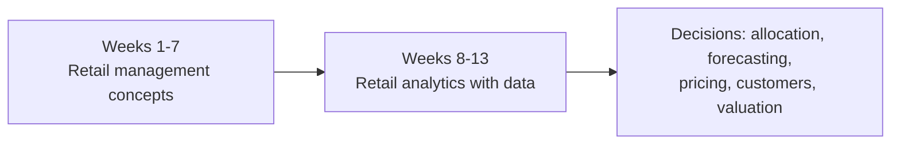
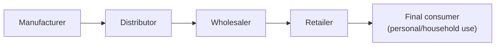
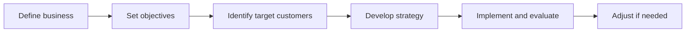

# Retail Fundamentals and Course Roadmap

## What you will learn

- The 13-week structure of Analytics for Retail Management and its grading scheme
- What retailing is (and is not), and the difference between goods and services
- Store-based, non-store and non-traditional retail formats, and ownership types
- The functions a retailer performs and how retailers create value
- Consumer behavior basics: needs, wants, demands, motivation theories
- How Indian retail is changing (organized, digital, quick commerce, omnichannel)

---

## Course Roadmap: Concepts First, Analytics Later

**Simple idea:** First learn how a shop works; then learn how to use data to run it better.

**Analogy:** You cannot read a cricket scorecard analytically until you know the rules of cricket. Similarly, retail data analysis makes sense only after you know retail decisions.

### The core question

Retailing is a chain of **interconnected decisions**:

- Who are we serving (what type of customer, how much do they buy, from where)?
- What should we offer, and what should we not offer? (This affects inventory and cash.)
- Where and how should we sell?
- How do we manage merchandise so the **right product is at the right place**: no lost sales from stock-outs, and no cash locked in unnecessary stock?
- What kind of stores do we sell through, and who manages them (self or others)?
- How do we **attract, serve and retain** customers? Retention matters because acquiring new customers again and again is expensive, whereas serving existing customers lowers the acquisition cost.
- How can **data improve** all these decisions?

The course combines **retail management concepts** with **analytical decision making**: understand retail decisions, see how data helps, analyze the data, interpret the insight, and act on it.

### The 13 weeks

The course has 13 weeks, one topic per week, with recorded content plus one live session each week.

| Weeks | Block | Topics |
|-------|-------|--------|
| 1 | Core concepts | Introduction to retailing |
| 2-7 | Core concepts | Retail strategy (why it matters, how it is framed, how to gain an edge over competitors); merchandise and inventory management; human resources (store management); communicating with customers; integrating and controlling retail strategy |
| 8-13 | Analytics (hands-on with data, Excel) | Retail analytics; resource allocation from analytics insights; sales forecasting; retail pricing analytics; customer management (retention, customer value); retail valuation |

**Why this order:** Learners come from different backgrounds and may not know marketing or retail. Basic concepts are given first (reinforcing earlier marketing learning), and data work starts from Week 8. Merchandising in Week 3 is taught as a concept, not as Excel analysis.

### Learning activities

- Concept videos (several per week; short, around 3-5 minutes, including week introductions and summaries, some AI-generated for engagement; the content itself is designed by the course team)
- Practice quizzes (not graded; give feedback on why an answer is right or wrong)
- Reading materials (typically 5-10 minutes each)
- Discussion prompts (discuss situations with peers)
- Case studies and experiential learning (cases, data to work on)
- Graded assessments
- Weekly live sessions
- From Week 8: demonstrations of using data and Excel

Learning goal order: first **understand the concept**, then **apply it to a retail decision or business situation**.

---

## Assessment Structure

| Component | Coverage | Weightage |
|-----------|----------|-----------|
| Graded Quiz 1 | Weeks 1-3 (held after Week 3) | 10% |
| Graded Quiz 2 | Weeks 4-6 | 15% |
| Graded Quiz 3 | Weeks 7-9 (held at end of Week 9) | 15% |
| Take-home assignment | Due around Week 7 | 20% |
| Comprehensive exam (proctored, final) | Whole course, at end of Week 13 | 40% |
| **Total** | | **100%** |

- A **project** based on the quantitative/analytics part (Weeks 8-13) is completed and submitted online.
- The comprehensive exam is proctored; the institute's digital unit shares the details.
- Graded components affect the final grade/CGPA; practice quizzes do not.
- Check the course calendar and course website for dates, durations and announcements.

### Flipped-mode delivery

**Simple idea:** You study at home first; class time is for questions and discussion.

In a **flipped mode** course, recorded content is available beforehand. You watch videos (in sequence, Week 1 to 13), complete readings and practice quizzes, then come to the live session with doubts, so discussion is richer. If you miss a live session, watch its recording before the next one.

Expectations: attend regularly, participate, practise Excel, and apply concepts to real retail examples using free online datasets, datasets in textbooks, or data from your own organization.

---

## What Is Retailing?

**Simple idea:** Retailing is selling to the person who will actually use the thing.

**Analogy:** A grocer buys 1,000 units from a wholesaler. That purchase is not retailing. When the grocer sells one unit to a household, that is retailing.

**Definition:** **Retailing** is the set of activities involved in selling **goods and services** to **final consumers** for **personal, family or household use**.

Key points:

- The emphasis is on **final**. Manufacturer, distributor and wholesaler sales are not retail because they pass the product to the next business in the chain.
- Retailing is the **final stage of the distribution process**: manufacturer, then distributor, then wholesaler, then retailer, then final consumer.
- A **customer** (who buys) and a **consumer** (who uses) may be different people. You may buy; your family consumes.
- Retailing covers **goods and services**.
- Retailing is **not synonymous with physical stores**.

Only the last arrow (retailer to final consumer) is retail.

### Goods versus services

**Simple idea:** Goods you can hold; services you experience.

| Dimension | Goods (products) | Services |
|-----------|------------------|----------|
| Examples | Toothpaste, soap bar, cooking oil, clothes, shoes | Hotel housekeeping, customer-care call, hospital, educational institute |
| Tangibility | Tangible: can touch and feel | **Intangible**: can feel/experience, not touch |
| Ownership | Can own for a long time | Consumed then and there |
| Variability | Uniform (same pack, weight, fragrance, colour) | **Variable**: depends on who delivers and when |

Example: a burger and fries at McDonald's may be identical, but the staff's attitude and the environment make the service experience vary. The same course taught to two different cohorts can also differ in delivery.

**Caveat:** The split is not absolute. A hospital or restaurant sells a mix of goods and services.

### Store-based and non-store formats

- **Brick-and-mortar** stores: physical location with staff and a shopkeeper.
- **Non-store formats:** websites (Amazon, Flipkart), **direct selling** (salespeople come to you, for example Eureka Forbes), **vending machines** (pay by cash, card or UPI and receive the product with no attendant), and other non-traditional formats.

---

## Functions of a Retailer: Bridging Supply and Demand

**Simple idea:** A retailer is the bridge between what makers can supply and what people want.

**Analogy:** A petrol pump sits next to the highway because location convenience is part of the service.

Key functions:

1. **Bring products from different sources together** and create an **assortment** (retailers may also bundle).
2. **Make products available at convenient locations** (petrol pump near the highway).
3. **Sell in appropriate quantities.** A shopkeeper holds 20-50 tubes of toothpaste in a case; a household buys 1 or 2. Upstream suppliers handle even larger packages (**breaking bulk**).
4. **Provide information and services** (for example, repair or complaint handling for a faulty room heater, in a store or online).
5. **Facilitate the final exchange** of money and products.

**Why it matters:** Retailers do more than transfer products; they **create value** at each stage by making the product available in the right place, quantity and form.

---

## Why Retailing Keeps Evolving

Retail changes because consumer needs and preferences, technology, prices, income, inflation and consumption patterns all change.

Examples:

- **Product lifespans:** earlier generations might keep one television for life; now a mobile phone is replaced every couple of years.
- **1991 liberalization, privatization and globalization (LPG)** brought international brands and many more TV channels, exposing Indians to foreign culture and changing tastes.
- **Music formats:** gramophone, cassette, CD, DVD, Blu-ray, now streaming where you can pay minimally or buy a single song. The competition, pricing and distribution changed with it.
- **Distribution:** from walking to stores to ordering from home (quick-commerce delivery in about 15 minutes).
- **Formats:** mom-and-pop **kirana** stores still exist but their share and influence are shrinking; **organized retail** is growing fast; **digital and hybrid** models (physical plus online) are rising.

Takeaway: retailing changes as the market, consumers and technology change. In India, retail includes traditional, organized, digital and hybrid formats together.

---

## Characteristics of Retail Transactions

- **Small average transaction size** for an individual buyer (for example, one 500 ml bottle at about Rs 100-120). A business buying in bulk for resale pays a lower price per unit but a much higher total.
- **Impulse purchases:** unplanned purchases triggered by something that catches your attention in the store.
- **Need to attract shoppers:** retailers think about location, accessibility and product assortment.
- **Local preferences shape assortment.** Food or products easily available in Kolkata may not be easy to find in Bangalore or Manali, so retailers study nearby people's choices.
- Retailers must manage both **what they sell** and **the environment in which purchase happens**: assortment, store environment, operating hours, promotion and competition.

---

## Retail Strategy (Preview)

A retail strategy answers:

- Whom do we serve?
- What do we want to achieve (**objectives**)?
- What goods and services do we offer?
- How are they priced (and how can prices change dynamically)?
- Where and how do we sell?
- How do we attract customers and sell to them?

Steps:

**Key point:** Retail decisions are **interdependent**. A change in one element (for example, price) can affect others (for example, image, assortment, footfall).

---

## Types of Retail

Retail can be classified in three (not mutually exclusive) ways:

| Basis | Focus |
|-------|-------|
| **Ownership-based** | Who owns the store or business |
| **Store-based strategy mix** | How the retailer combines operating and market-offering decisions |
| **Non-store and non-traditional** | How retailing happens outside the conventional store |

A single retailer can fall into more than one category. They are a base for classification, not watertight boxes.

### Ownership types

| Type | Meaning | Example |
|------|---------|---------|
| **Independent** | One outlet under individual ownership | Kirana / mom-and-pop store |
| **Chain store** | Multiple outlets under common ownership | Retail chains |
| **Franchise** | Retailer (franchisee) operates under an established franchisor's name and business system, follows its protocol and training, and pays it a percentage/fee | McDonald's outlets |
| **Leased department** | A department inside a store operated by an outside party | Makeup or fashion brand counters inside a department store |
| **Vertical marketing system** | Different levels of the distribution channel coordinated within one system | Integrated manufacturer-to-retail channels |
| **Consumer cooperative** | Retail firm owned by its consumer members | A campus co-op owned by staff members, selling at subsidized prices |

Ownership structure affects **control, decision making, coordination and scale**.

### Store-based strategy mix

Elements: **store location, operation, goods and services offered, pricing, store atmosphere, promotion**.

- Atmosphere varies: crammed shelves versus spacious layouts, background music, premium ambience. An Apple iPhone store differs greatly from a clothing store.
- Retailers combine these elements to create a particular **market offer**.
- Two retailers selling similar products can still have different strategies because their strategy mixes differ.

### Major store-based formats

| Group | Formats |
|-------|---------|
| Food-oriented | Convenience stores, conventional supermarkets, food-based superstores |
| General merchandise | Specialty stores, department stores, full-line discount stores, variety stores, off-price chains, flea markets |

Formats differ in **assortment, price, service, location, operating approach and target market**.

### Non-store and non-traditional formats

Direct marketing, direct selling, vending machines, electronic retailing, retail kiosks, airport retailing.

**Key point:** A retail format is decided by **how the retailer reaches and serves the consumer**, not simply by whether it has a physical store.

---

## Consumer Behavior

**Simple idea:** To sell well, understand why and how people choose.

**Example:** Buying 1 litre of cooking oil is a quick, routine choice; buying a laptop or refrigerator involves long searching and comparing. The decision process differs by product.

Consumer behavior covers how consumers **search** for products, **evaluate alternatives** and **make purchase decisions**; preferences and tastes also evolve. Understanding it informs: product offering, pricing, promotion, store environment, customer service, and the overall retail experience.

### Needs, wants and demands

| Concept | Meaning | Example |
|---------|---------|---------|
| **Need** | A state of discrepancy between the current and desired state | Need for food, water, shelter |
| **Want** | A specific way a consumer chooses to satisfy a need | Paratha (North India), rice (West Bengal), dosa/idli (South India) |
| **Demand** | A want backed by **ability and willingness to purchase** | A want you can afford and are willing to pay for |

A need and want does not always become market demand: you may lack money or willingness.

### Types of needs

- **Functional:** solves a consumption-related problem
- **Symbolic:** relates to identity, status, belonging, self-perception
- **Hedonic:** relates to pleasure, stimulation, novelty, experience

### Factors influencing behavior

| Internal (psychological) | External (social) |
|--------------------------|-------------------|
| Motivation, personality, perception, learning, attitude | Culture, subculture, family, social class, reference groups, word of mouth, opinion leaders |

Behavior results from the **interaction of the individual, psychological processes and external social influences**.

### Models of consumer behavior

Economic model, learning model, psychoanalytic model, **Howard-Sheth model**, **Engel-Kollat-Blackwell (EKB) model**, **theory of reasoned action**. These models help explain consumers.

### Motivation theories

| Theory | Core idea |
|--------|-----------|
| **Maslow's hierarchy of needs** | Five levels, from physiological up to self-actualization; as one level is fulfilled you move up to the next |
| **McClelland's theory of needs** | Needs for achievement, power and affiliation |
| **Herzberg's two-factor theory** | Satisfiers (motivators) versus dissatisfiers (hygiene factors) |
| **Expectancy theory** | Motivation depends on **expectancy** (effort leads to performance), **instrumentality** (performance leads to outcome) and **valence** (how much you value the outcome) |

**Caveat:** The five Maslow levels are physiological, safety, social/belonging, esteem, self-actualization. Maslow's hierarchy is a guide; people do not always progress strictly in order.

Consumer decisions are influenced by more than functional requirements or price.

---

## Indian Retail Industry Context

Key themes in the reading on Indian retail:

- **Demographics:** large young population, rising middle class, more urbanization, more purchasing power.
- **Economy:** India ranks third in GDP by purchasing power parity, with an economy valued at about USD 18 trillion in 2026.
- **Changing consumer mindset** since the 1990s: social media affects what people buy, wear and eat; credit cards, online retail and digital payments are mainstream.
- **Formats:** large formal stores, exclusive brand outlets, pop-up and experience stores, franchise-based retail, **tier-2/3** markets, modern grocery formats, traditional kirana stores.
- **D2C (direct-to-consumer)** and **omnichannel**: one retailer uses several channels (store, online, offline, mobile).
- Effects of new technology and government regulation on formats.

Retail format is more than a store type; it also involves **customer experience, scale and expansion, brand control** (exclusive brands have different control), **market testing, channel integration** and **operating complexity**.

### Current trends

- **Value versus premium:** consumers seek value and premium products at once; balancing is tricky.
- **Quick commerce** (Blinkit, Zepto: delivery in about 15 minutes; pizza delivery in 30 minutes).
- **Tier 2 and tier 3 markets** gaining importance.
- **Health, sustainability and responsible consumption** becoming mainstream.
- Consumers are more **digitally connected**, so retailers must also address **influencers** of consumers.
- **Omnichannel** retailing is more integrated.

Consumer behavior is **not static**:

| Change | Leads to |
|--------|----------|
| Changing expectations | New retail formats; greater personalization |
| Changing priorities | New product propositions |
| Changing markets | New expansion strategies |
| Changing technology use | Connected retailing |

---

## Self-Check Questions

**Q1. Why is a grocer buying 1,000 units from a wholesaler not retailing?**
Retailing means selling to final consumers for personal/household use. The grocer buys for resale, so that purchase is an intermediate trade; only the later sale to an individual is retail.

**Q2. List three differences between goods and services.**
Goods are tangible, can be owned long-term and are uniform; services are intangible, consumed then and there, and variable depending on who delivers them.

**Q3. Differentiate need, want and demand.**
Need is the gap between current and desired state; want is a specific way of satisfying a need; demand is a want backed by ability and willingness to pay.

**Q4. Name the graded components and weights.**
Quiz 1: 10%, Quiz 2: 15%, Quiz 3: 15%, assignment: 20%, comprehensive exam: 40%; total 100%.

**Q5. Which weeks does each graded quiz cover?**
Quiz 1: Weeks 1-3; Quiz 2: Weeks 4-6; Quiz 3: Weeks 7-9.

**Q6. Name the three ways to classify retail.**
Ownership-based, store-based strategy mix, and non-store/non-traditional. They are not mutually exclusive.

**Q7. What are the key functions of a retailer?**
Bring products together and create assortments, provide convenient locations, sell in appropriate quantities, provide information and services, facilitate the final exchange of money and goods.

**Q8. What are the three components of expectancy theory?**
Expectancy, instrumentality and valence.

---

## Exam and Assessment Hints

- Graded quizzes are held after Weeks 3, 6 and 9; the comprehensive exam is proctored and covers the whole course.
- Practice quizzes are ungraded; use their feedback to clear doubts, and raise queries on the platform (response within about 24 hours is expected).
- The emphasis on **final consumer**, the **goods versus services** differences, and the **ownership types** and **need-want-demand** distinctions is likely to appear in questions.
- Check the course website and announcements for changes, since faculty have flexibility in grading and evaluation.

---

## Common Pitfalls / Exam Traps

- Calling any sale "retail": only sales to **final consumers** for personal/household use count.
- Assuming retailing is only about physical goods or stores; services and non-store formats (online, direct selling, vending) are retail too.
- Mixing up **customer** (buyer) and **consumer** (user).
- Treating need, want and demand as synonyms; demand requires ability and willingness to buy.
- Treating the retail classifications as mutually exclusive.
- Assuming analytics (data work) starts in Week 1; it starts from Week 8, and Weeks 1-7 are concept-based.
- Forgetting that **expectancy theory** has three parts (expectancy, instrumentality, valence), and that Herzberg's theory has two factors.
- Assuming a format is defined purely by having a store; it is defined by how the retailer reaches and serves consumers.

---

## Quick Revision Summary

- The course has 13 weeks: Weeks 1-7 retail concepts, Weeks 8-13 analytics (retail analytics, resource allocation, forecasting, pricing, customer management, valuation).
- Grading: Quiz 1 (10%), Quiz 2 (15%), Quiz 3 (15%), assignment (20%), comprehensive exam (40%), plus an analytics project; delivery is flipped mode.
- Retailing = selling goods and services to final consumers for personal, family or household use; it is the last stage of distribution.
- Goods are tangible, uniform and ownable; services are intangible, variable and consumed on the spot.
- Retail occurs in stores and non-store formats (online, direct selling, vending, kiosks).
- Retailers bridge supply and demand: assortment, convenient location, right quantities, information and services, and final exchange; they create value.
- Ownership types: independent, chain, franchise, leased department, vertical marketing system, consumer cooperative.
- Need, want and demand differ; needs can be functional, symbolic or hedonic; motivation theories include Maslow, McClelland, Herzberg and expectancy.
- Indian retail is shifting to organized, digital, hybrid, omnichannel and quick-commerce models, driven by changing consumers.

---

**← [Previous](../README.md) · [Index](../README.md) · [Next](../week-02/01-retail-strategy-analysis-finance-location-and-technology-transcript.md) →**
