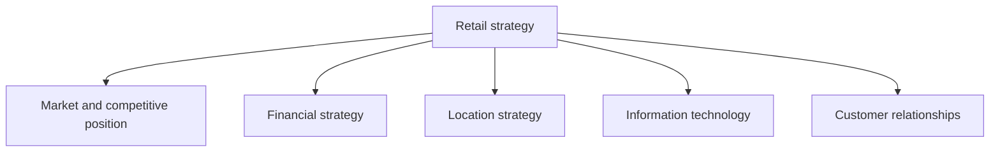
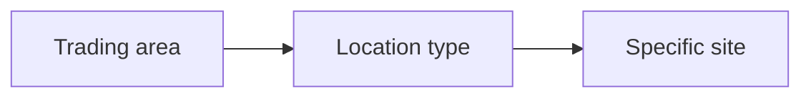
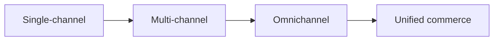
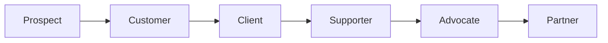

# Retail Strategy: Analysis, Finance, Location and Technology

## What you will learn

- What a strategy is, and how it differs from tactics and operations (and from short, medium and long-term horizons)
- How to run a situation analysis with the 5 Cs, SWOT and PESTLE, and why it must be repeated
- How financial strategy works: profitability, asset efficiency, liquidity, the Strategic Profit Model, working capital and customer lifetime value
- How retailers choose trading areas, location types and specific sites
- How technology (omnichannel, AR, self-checkout, RFID, AI) and human augmentation shape retail, and how customers climb the loyalty ladder
- How hyperlocal thinking, location criteria and analytics fit into the overall strategy

---

## 1. What Is a Strategy?

**Simple idea:** A strategy is the big plan for reaching a big goal. A to-do list for today is not a strategy.

**Analogy:** A store manager who makes sure shelves are stacked and every customer pays before leaving has a good plan. But those are steps and routines. Ask "what is all this *for*?" The answer, "make browsing and checkout easy, suggest and bundle products, and ultimately maximise profit", is the objective. The long-run plan to reach it is the strategy.

**Definition:** A **strategy** is a plan, usually formed at the top of an organisation, that says how the organisation will achieve a broad, long-term objective (for example "become the market leader" or "know our customers better than any competitor").

### Strategy vs tactics vs operations

| Level | Who decides | Time horizon | Retail example |
|-------|-------------|--------------|----------------|
| **Strategy** | Top management (CEO, COO, CFO, directors) | Long term, organisation-wide | Make every IKEA store show the customer the entire product range |
| **Tactics** | Middle management | Medium term, per store or function | A single entry point and a one-way path through the whole store; exactly where products and shelves are placed |
| **Operations** | Store-level staff and supervisors | Day to day | Making sure everyone goes through proper billing and pays the exact amount before leaving |

- Not everything is a strategy. Arranging products on shelves day to day is tactics or operations.
- "Improve customer satisfaction" can be a strategy, because satisfaction is built over a long time and many purchases, not one transaction.
- Big companies and organisations all have some strategy; whether it is a good one is a separate question.
- Malls often have several entry and exit points, so the IKEA single-path idea is a retailer tactic, not a property of every shopping space.

### Strategy time horizons

| Horizon | Typical length |
|---------|----------------|
| Short-term | Below 1 year |
| Medium-term | 1 to 3 years (some firms stretch to 5) |
| Long-term | Beyond 3 to 5 years (usually 3 to 5 years is called long term) |

A short-term strategy is still not day-to-day operations: it covers what the company will achieve over that whole year, guided by mission and vision.

**Caveat:** A strategy is not static. Markets, technology and customers change, so companies revise their strategies after a few years.

---

## 2. What Retail Strategy Covers

**Simple idea:** Retail strategy is the bundle of decisions that decide how a shop competes and runs.

A retail strategy brings together decisions on:

- **Competitors and environment:** customers, direct competitors, generic competitors, technology, government support, the economy, number and power of suppliers and customers.
- **Financial performance and sustainability:** profitability, total sales or turnover, and more.
- **Market, location and site selection:** which market to target, where, and which exact site.
- **Information technology:** supports retail operations.
- **Customer relationships:** developing and maintaining them.

### Why top managers get several KPIs

A **KPI (key performance indicator)** is a measurable target. A CXO-level leader is usually given several KPIs, not one, because a single target can be gamed. If only "increase sales" is the target, sales can rise by cutting prices, at the cost of profit. So KPIs also cover profit, **market share** (taking share from competitors or expanding beyond a niche) and sustainability.

### Sustainability

Sustainability means more than profit today or customers added today. Will customers stay? Is the business viable over time? The idea includes **people, planet and profit** together.

### Product, customer, price

Three pillars matter for any business: **product** (how good it is), **customer** (how well you know them) and **price point**. Companies usually aim to be the best at one, above average at another, and relatively relaxed on the third. These are not separate activities; together they shape the **strategic position**.

### Know your position and your target customers

- **Position:** market leader, challenger, follower, or one of many. It tells you how you can compete next.
- **Target customers:** no retailer targets every customer. D-Mart, Pantaloons and Shopper Stop serve different segments. Even within a brand's range there are premium, semi-casual and casual products for different people.

---

## 3. Situation Analysis and the 5 Cs

**Simple idea:** Before deciding where to go, check where you stand right now, inside and outside the business.

**Analogy:** Like a health check-up before a fitness plan: look at your own body (internal) and also at the weather and gym options around you (external).

**Definition:** **Situation analysis** examines the present situation of the retailer. Internal factors are strengths and weaknesses; external factors are opportunities and threats. The **5 Cs** is a checklist that makes sure nothing is missed.

| C | What you check |
|---|----------------|
| **Company** | Product portfolio (what performs well or lags), human resources, labour turnover and absenteeism, motivation, technology adopted, organisational culture; strengths and weaknesses |
| **Customers** | Who they are, how price-sensitive, their **lifetime value** (how long they stay and how much value they bring) |
| **Competitors** | Number, market share, their strategies, financial power |
| **Collaborators** | Suppliers (and suppliers' suppliers), distributors, wholesalers, retailers who take products and help distribute |
| **Climate** | Business environment: stable or unstable, market structure such as monopoly or oligopoly |

### Related tools

| Tool | Scope | What it covers |
|------|-------|----------------|
| **SWOT** | Company (strengths and weaknesses are internal; opportunities and threats are external) | Looks at the company from all four perspectives |
| **PESTLE** | Industry/environment | **P**olitical, **E**conomic, **S**ocial, **T**echnological, **L**egal, **E**nvironmental |
| **5 Cs** | Whole situation | Company, Customers, Competitors, Collaborators, Climate |

- Using the 5 Cs together with SWOT and PESTLE leaves very little chance of missing important information. Use all the tools together; do not focus on one and ignore the others.
- It is **not a one-time activity**. The business environment keeps changing, so repeat the analysis from time to time.

### Sensitivity analysis (a related idea raised in discussion)

**Sensitivity analysis** asks what happens to an outcome (sales, say) when you change one factor. Example: a star product's sales decline, you suspect old packaging, you change the packaging and observe whether sales go up, down or stay the same. It is a "what-if" check on one change, not the same thing as situation analysis.

---

## 4. Turning Analysis into Retail Decisions

Strategic analysis is useful only when it influences decisions. Questions it should answer:

- Will the current target market stay attractive over a long time? How fast is it changing?
- Do we need resources for **expansion** (same or related field) or **diversification** (a different business altogether)?
- How do changes in competition affect our position? How easily can new competitors enter?
- Is technology changing customer expectations?
- Are there economic or regulatory changes (for example new government regulations, or the allowed level of FDI)?
- Which capabilities give a **sustainable advantage**?

### Examples

| Example | Lesson |
|---------|--------|
| **Micromax and BlackBerry** (mobile phones, popular roughly 2009 to 2013/14): BlackBerry kept bulky keypad phones while rivals offered touch phones with smaller bodies and big screens; both lost their market | Technology changes quickly; failing to track it destroys position |
| **E-commerce entry** | Starting costs only a couple of lakh rupees, sometimes less, so barriers are low, competition is intense and your positioning (how customers perceive you) matters a lot |
| **Repair and service expectations** | 10 to 15 years ago, repair in a week or even 10 to 15 days was acceptable. Now rivals deliver in a day or two, so customers have lost patience |
| **Easy returns** | Amazon, Flipkart and Meesho offer easy returns; a retailer that does not is at a disadvantage |
| **Ford EcoSport and Honda City** | Ford's popular EcoSport got no major update for about 3.5 to 4 years, and Ford later left the Indian market. Honda City has seen no major update for a couple of years. Carmakers launch new models almost yearly to keep their edge |
| **Compact SUV market** | Renault Duster arrived first, then Ford captured a large part of the market (Duster was out of the market for a couple of years). Having gained share did not make it sustainable |
| **Meesho** | Has a very different business model that lets it offer products much cheaper than Amazon or Flipkart |

**Why a sustainable competitive advantage is nearly impossible to hold:** technology, the world and customer preferences keep changing, so any advantage (knowing customers better, differentiated products) eventually dwindles. You must keep changing and ask "what next?"

**Caveat:** Environmental analysis is not an end in itself. It exists to improve strategic decision-making.

---

## 5. Financial Strategy

**Simple idea:** A shop can sell a lot and still die. You must check whether it earns well, uses what it owns well, and has cash when bills arrive.

### 5.1 Four lenses

| Lens | Question |
|------|----------|
| **Profitability** | How much profit do I earn from each sale? |
| **Asset efficiency** | How well do I use my assets? Measured by asset turnover = net sales / average total assets |
| **Liquidity** | Do I have cash, or things easily turned into cash, to pay what I owe? Cash is the best liquidity |
| **Sustainable growth** | Do individual sales and customer relationships create enough economic value? |

These questions connect financial measures to real retail decisions.

### 5.2 Strategic Profit Model (SPM)

**Simple idea:** Return depends on three things: how much you keep from each sale, how hard your assets work, and how much borrowed money you use.

**Analogy:** A sweet shop can earn well by (a) charging high margins on few boxes, (b) selling many boxes a day from the same counter, or (c) borrowing money to open more counters.

$$\text{Net profit margin}=\frac{\text{Net profit}}{\text{Net sales}}$$

$$\text{Asset turnover}=\frac{\text{Net sales}}{\text{Average total assets}}$$

$$\text{Financial leverage}=\frac{\text{Total assets}}{\text{Net worth}}$$

$$\text{Return on net worth (RONW)}=\text{Net profit margin}\times\text{Asset turnover}\times\text{Financial leverage}$$

Net profit margin times asset turnover gives **return on assets (ROA)**; multiplying by leverage converts ROA to return on net worth. **Net worth** is owners' equity (assets minus liabilities).

**Worked example:** Net sales = 100, net profit = 5, average total assets = 50, net worth = 25.

- Net profit margin = 5 / 100 = 5 percent
- Asset turnover = 100 / 50 = 2
- ROA = 5% x 2 = 10 percent
- Leverage = 50 / 25 = 2
- RONW = 10% x 2 = **20 percent** (check: 5 / 25 = 20 percent)

**Why it matters:** the model shows *where* the return comes from instead of just showing a final figure. A retailer can raise return by:

- **Better profitability from sales.** Option A: a small niche market with high profit per unit and enough buyers. Option B: a mass market with very small profit per unit but huge volume. Both can be highly profitable.
- **More productive use of assets** (higher turnover).
- **Appropriate financial leverage:** whether to borrow (loans) or dilute equity, where the money comes from and how it will be repaid.

**Caveat:** Higher leverage raises RONW but also raises risk, because debt must be repaid whatever the sales.

### 5.3 Profitability vs liquidity, cash flow and working capital

A business can make a large profit while customers do not pay on time. Suppliers and employees still must be paid, so profit alone is not enough; you need cash.

$$\text{Working capital}=\text{Current assets}-\text{Current liabilities}$$

Working capital is affected by cash, receivables (money to be received), inventory (including work in progress), accounts payable (money you owe) and other short-term obligations. **Cash flow** is the actual movement of cash into and out of the business.

| Concept | Meaning |
|---------|---------|
| Profit | Revenue minus costs (an accounting result) |
| Liquidity | Ability to pay short-term obligations with cash or near-cash |
| Cash flow | Actual cash entering and leaving |
| Working capital | Current assets minus current liabilities |

**Worked example:** Current assets (cash 30 + receivables 40 + inventory 80) = 150; current liabilities (payables 60 + short-term loan 40) = 100. Working capital = 150 - 100 = 50.

### 5.4 Inventory

For retailers inventory is especially important. Excess inventory leads to spoilage, theft and storage and security costs, and it locks up cash until sold. Slow-moving stock is worse, for example dresses go out of fashion and must be put on sale after a year, hurting profit. Some firms operate with near-zero inventory (stock arrives when needed) or act as middlemen/agents holding no inventory.

### 5.5 Is growth economically sustainable?

Many e-commerce companies stopped operations. They claimed fast growth and rising market share, but bought it at the expense of **contribution margin**.

- Amazon took roughly 10 years to become profitable; Flipkart, which followed the Amazon model in India, took around 7.
- Within 4 to 5 years of its founding, Flipkart's estimated market value was said to be higher than Indian Oil's, though it was not yet profitable. Market value is **perception-driven** (based on potential), so it can be deceptive and differ from reality.
- Many companies of that period could not withstand the pressure and closed.

### 5.6 Customer Lifetime Value (CLV) and acquisition cost

**Simple idea:** A customer is worth everything they will pay you over the years, valued in today's money, minus what you spent to win them.

**Analogy:** An e-commerce site gives a first-time customer a discount. That discount is an investment, expected to be repaid by later purchases.

**Definition:** **Customer lifetime value** is the present value of all future earnings from the customer's lifetime association with the company. **Customer acquisition cost (CAC)** is the money spent winning a customer (advertising, first-time discounts).

**Time value of money:** you prefer 100 rupees now to 100 rupees after a year, because today's money can be spent or invested to earn interest. So future earnings are discounted:

$$\text{CLV}=\sum_{t=1}^{T}\frac{m_t}{(1+d)^t}$$

where $m_t$ is the margin earned from the customer in year $t$, $d$ is the discount rate and $T$ is the expected tenure (average duration of association, estimated from historical data). Net value after acquisition is CLV minus CAC.

**Worked example:** margin of Rs 1,000 per year for 3 years, $d=10\%$:

- Year 1: 1000 / 1.1 = 909.09
- Year 2: 1000 / 1.21 = 826.45
- Year 3: 1000 / 1.331 = 751.31
- CLV = 2,486.85. If CAC = Rs 800, net value is about Rs 1,686.85.

**Why it matters:**

- Acquiring new customers costs money; retaining existing ones is generally cheaper.
- You still must acquire new customers to grow market share and customer base; do not neglect existing ones.
- Loyal customers are less price-sensitive and help the company.

**Caveat:** Detailed calculation models come later in the analytics part; here CLV is a concept. Real CLV also needs retention probabilities, not just a fixed tenure.

---

## 6. Retail Location Strategy

**Simple idea:** Pick where to be in three steps: the area, then the kind of place, then the exact spot. A mistake at any step can wreck the strategy.

### 6.1 Trading areas

| Trading area | Customer pattern |
|--------------|------------------|
| **Primary** | Highest density of customers |
| **Secondary** | Customers more dispersed |
| **Fringe** | Customers travel greater distances |

**Walmart:** the world's largest retailer (Amazon is roughly one-third of Walmart's business level). It offers **everyday low pricing** and places stores in outskirts (fringe areas), because it expects many customers who need big parking and large areas, which would be very costly in the city centre.

### 6.2 Location types

| Type | Description |
|------|-------------|
| **Isolated store** | Stands alone |
| **Unplanned business district** | Retailers cluster without central planning (one store arrives, others follow in a growing place) |
| **Planned shopping centre** | A planned development such as a mall, with coordinated store mix and facilities |

There is **no universally superior location type**; each suits different strategies. McDonald's shows variety: market areas and drive-through sites where you order without leaving the car.

### 6.3 Site selection

Evaluate a specific site on: vehicular traffic, shopper (foot) traffic, parking, visibility, surrounding stores and the zone it sits in. A site should be judged as a combination of **market access, physical suitability and economic viability**, not on traffic or rent alone.

---

## 7. Information Technology in Retail

**Simple idea:** Technology is the support system under pricing, inventory and customers.

IT covers how customers transact, inventory systems, digital channels and point-of-sale systems, and how IT supports pricing, inventory and demand decisions.

### 7.1 Channel evolution

| Stage | Description |
|-------|-------------|
| **Single-channel** | One channel, for example only physical stores |
| **Multi-channel** | Several channels (online, mobile app, physical stores) that operate separately, not synchronised |
| **Omnichannel** | Channels synchronised properly |
| **Unified commerce** | Latest stage: inventory, payments, order management and more integrated so everything runs smoothly |

### 7.2 Technology uses

| Area | Examples |
|------|----------|
| **Customer experience** | **Augmented reality (AR)**: Lenskart lets you try spectacles virtually; Amazon shows how a product looks placed in your room through your phone. Checkout: staffed counter, then **self-checkout** (scan items yourself), then **cashierless** (walk out and the card is charged automatically) |
| **Operations** | **RFID** tracks products; smart shelves signal when quantity falls; inventory robots place products on shelves |
| **Decision support** | AI-based forecasting for needed colours/products and changing customer behaviour |
| **Employees** | **Human augmentation** (see 9.3): technology raises efficiency but humans are not replaced |

---

## 8. Customer Relationship Management and Loyalty

**Simple idea:** A stranger becomes a shopper, then a regular, then a fan, then a helper.

### Loyalty ladder

| Stage | Meaning |
|-------|---------|
| **Prospect** | Potential customer; you guess they may buy |
| **Customer** | Has made a first purchase |
| **Client** | Repeat purchases; a relationship begins |
| **Supporter** | Recommends the company; shows loyalty |
| **Advocate** | Actively advocates for the company |
| **Partner** | Deep involvement, suggesting improvements and what products the market needs: **co-creation** |

**Caveat:** Repeat purchase does not always mean loyalty (it may be habit, convenience or price); it is only one consideration. A genuinely loyal customer is less vulnerable to price changes, speaks well of the company and spreads positive word of mouth.

### Value tiers

Companies use tiers (credit cards: silver, gold, diamond and so on) to give each tier a defined service level. Done well, tiers help identify and segment customers, decide where to put more effort, personalise products and service, and engage continuously. Do not make them too complicated, or they become hard to run.

---

## 9. Readings: Hyperlocal, Location Criteria, Human-Augmented Retail

### 9.1 From cities to hyperlocal

Retail opportunity is increasingly diverse across cities and local markets. In one city, different stores may need different product mixes because of the local population. Example: in Delhi, one neighbourhood (such as CR Park) has more Bengali food items, another more South Indian, another more Punjabi demand. So think **hyperlocal**: how tastes vary even within a city.

City selection: a retailer cannot start in any city or any number of cities abruptly. Check size and growth prospects, how much customers can spend, **local market attractiveness** (competitors, customer profiles, existing retail presence). Over-concentration can be a risk: one West Bengal place with a record density of medical stores shows how many shops can crowd together, splitting the same customers.

### 9.2 Store location selection criteria

- Population structure
- Economic factors
- Competition and saturation level (nearby stores can also drive customers to you)
- Store characteristics

### 9.3 Human-augmented retail

Staff are empowered by technology so they can quickly find customer and product information and give more customised service and suggestions. The goal is technology where it adds efficiency while keeping people where they add value.

| Technology is suited to | People remain important for |
|-------------------------|-----------------------------|
| Processing large amounts of information | Personal interaction |
| Repetitive, standardised activities | Understanding customer needs |
| Speed and consistency | Advice, assistance, empathy |

Technology will become more important but will not do everything; human support will always be needed.

---

## 10. Bringing It Together: Analytics, Science and Art

Retail strategy combines **market strategy, financial strategy, location, information technology and customer relationships**. Analytics makes many of these decisions more efficient and more successful, but it is **not 100 percent foolproof**: management is both **science and art**, so analytics improves decision-making without guaranteeing outcomes.

---

## Exam and Assessment Hints

- Formulas shown so far (SPM, working capital, CLV and others) are for **conceptual understanding** at this stage; later analytics topics will use formulas more directly.
- Detailed explanations of concepts are given in the recorded videos; go through them and the reading materials before live sessions so discussion time goes to questions.

---

## Self-Check Questions

1. **Why is "arrange all products neatly and bill every customer" not a strategy?**
   It is an operational routine. A strategy is a long-term, top-level plan to reach a broad objective such as maximising profit or becoming market leader.

2. **Order the time horizons of strategy.**
   Short-term below 1 year, medium-term 1 to 3 (up to 5) years, long-term beyond 3 to 5 years.

3. **What are the 5 Cs, and which are internal?**
   Company, Customers, Competitors, Collaborators, Climate. Company strengths and weaknesses are internal; opportunities and threats are external.

4. **State the Strategic Profit Model.**
   RONW = net profit margin x asset turnover x financial leverage. It shows where return comes from.

5. **Why can a profitable retailer still fail?**
   Poor liquidity: customers pay late, cash is locked in excess or slow-moving inventory, and suppliers and staff still have to be paid. Working capital = current assets minus current liabilities.

6. **What is CLV and why discount it?**
   Present value of all future earnings from a customer. Money now is worth more than money later (time value of money).

7. **Name the three trading areas and Walmart's choice.**
   Primary (densest), secondary (dispersed), fringe (customers travel far). Walmart uses fringe sites for space and parking with everyday low pricing.

8. **Distinguish multi-channel, omnichannel and unified commerce.**
   Multi-channel: channels exist separately. Omnichannel: synchronised. Unified commerce: inventory, payments and order management integrated.

---

## Common Pitfalls / Exam Traps

- Calling day-to-day store arrangement a strategy; it is tactics or operations.
- Thinking strategy is fixed; it must be revisited as markets change.
- Doing situation analysis once; it should be repeated.
- Mixing SWOT (company-focused, internal and external) with PESTLE (industry/environment).
- Assuming sales growth or market share equals health; contribution margin, cash and sustainability matter.
- Confusing profit with liquidity or cash flow.
- Treating market value as true value; it can be perception-driven.
- Assuming repeat purchase always means loyalty.
- Assuming one location type is best, or choosing a site on traffic or rent alone.
- Assuming technology replaces humans; the aim is augmentation.
- Believing analytics guarantees success.

---

## Quick Revision Summary

- Strategy is the top-level, long-term plan for a broad objective; tactics sit at middle management and operations at store level.
- Horizons: short below 1 year, medium 1 to 3 years, long beyond 3 to 5 years; strategies get revised.
- Retail strategy covers market position, financial performance, location, IT and customer relationships; leaders get multiple KPIs to avoid single-target gaming.
- Situation analysis uses the 5 Cs (Company, Customers, Competitors, Collaborators, Climate) with SWOT and PESTLE, repeated regularly.
- Sustainable competitive advantage is very hard to keep (Micromax, BlackBerry, Ford EcoSport, Honda City examples).
- Financial lenses: profitability, asset efficiency, liquidity, sustainable growth; RONW = margin x turnover x leverage; working capital = current assets - current liabilities.
- CLV is the present value of future earnings; compare it with acquisition cost; loyal customers are less price-sensitive.
- Location is chosen in steps: trading area (primary, secondary, fringe), location type (isolated, unplanned, planned), then site (access, suitability, viability).
- Channels evolve single to multi to omnichannel to unified commerce; AR, self-checkout, RFID and AI forecasting support retail, with human augmentation keeping people central.
- Loyalty ladder: prospect, customer, client, supporter, advocate, partner (co-creation); analytics helps but management is science and art.

---

**← [Previous](../week-01/01-retail-fundamentals-and-course-roadmap-transcript.md) · [Index](../README.md) · [Next](../week-03/01-merchandise-and-inventory-management-in-retail-transcript.md) →**
