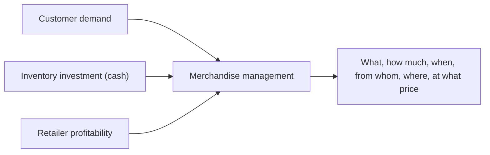
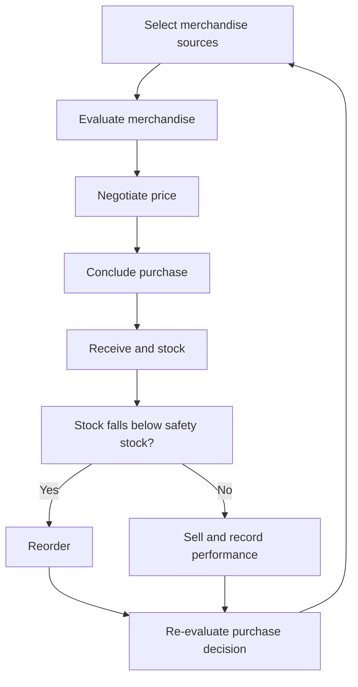
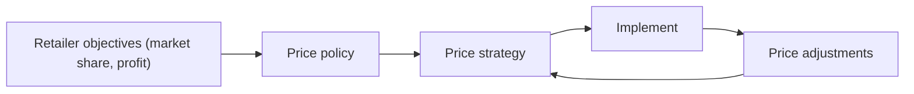

# Merchandise and Inventory Management in Retail

## What you will learn

- Why merchandise management is a balancing act between customer demand, cash and profit
- Who makes buying decisions: centralized vs decentralized, general vs specialized, internal vs external
- How to classify merchandise (staple, assortment, fashion, fad) and describe assortment (breadth and depth)
- The merchandise implementation cycle, on-floor decisions, and supply-chain links
- Inventory trade-offs, valuation (cost vs retail method), open-to-buy, stock turnover, GMROI, safety stock and EOQ
- How retail pricing strategy is set and adjusted

---

## 1. Why Merchandise Management Exists

**Simple idea:** A shop must have what people want, in the right amount, at the right time, at a price that still leaves a profit.

**Analogy:** Stocking a home kitchen. If you run out of rice, dinner is ruined (lost sale). If you buy 200 kg, your money is stuck, the rice may spoil, and you cannot spend that cash on anything else.

**Precise view:**

- Stock is needed so a visiting customer does not walk away because the product was unavailable.
- Holding stock is costly: maintenance, storage, and above all products that are **not sold** (no sale = no cash). **Cash flow** is critical for every business.
- Two questions must be answered together: *how much will customers ask for later?* and *how much money can we spend in a given period?*

**Merchandise management** links what customers want with what the retailer actually buys, stocks and sells. It covers:

- Whether to carry a product at all
- How much to buy, when to buy, and from whom
- Where inventory is placed (which warehouse, which store, which shelf)
- At what price merchandise is sold (price directly affects final sales)

These decisions must balance **customer availability**, **inventory investment** and **retailer profitability**.

---

## 2. Who Makes Merchandise Decisions (Buying Organization)

**Simple idea:** Before deciding *what* to buy, decide *who* gets to decide.

**Analogy:** A national supermarket chain's head office picks one menu for all branches; a local family shop owner picks stock based on what the neighbours ask for.

**Key facts:**

- There is **no single right answer**. The structure depends on objectives, price points, number of categories, number of products per category, customer type, competition and organization size.
- Large organizations usually have a **formal** buying process with a dedicated purchasing team. Small ones often have the owner deciding what and how much to buy (**informal**).
- The buying organization should reflect the retailer's size, product variation and operating requirements.

### Dimensions of the buying organization

| Choice | Option A | Option B |
|---|---|---|
| Authority | **Centralized**: one team decides for all stores | **Decentralized**: local stores/teams decide |
| Skill | **Specialized buyers**: buying team separate from shop-floor team | **General buyers**: one person/team decides what, when and manages everything |
| Resource | **Internal**: own staff plan and buy | **External**: outside party does buying/planning |
| Responsibility | Merchandise and store personnel **separate** | Merchandise and store personnel **combined** |

Six such choices exist in total (centralized/decentralized, specialized/general, internal/external, and responsibility split). Retailers can be almost equally profitable with any of them; success depends on how well the choice is managed and what the retailer intends to sell.

### Centralized vs decentralized buying

| Aspect | Centralized | Decentralized |
|---|---|---|
| Purchase volume | Large, bulk | Small |
| Negotiating power | High (can be the biggest buyer of a supplier) | Low |
| Purchase cost and selling price | Lower | Higher |
| Consistency and control | High; consistent merchandise image everywhere | Lower |
| Coordination | Greater | Less |
| Local responsiveness | Low; may miss local tastes (e.g. community pockets within one city) | High; faster local decisions, e.g. stock up for a local festival |
| Local autonomy | Low | High (when to buy, shelf layout, quantity) |
| Main risk | Goods not selling at the desired pace in some localities | Higher cost, weaker bargaining |

**Worked illustration (negotiating power):** Walmart's **EDLP** (Everyday Low Pricing) is possible because of huge centralized volume. In a Delhi example, one pocket may have many Bengali, Telugu or Kashmiri residents; a centralized team that stocks identical items everywhere misses products that would sell very well there. A decentralized team would catch them but pays more per unit.

**Link to Porter's Five Forces (buyer and supplier power):** If a supplier has many buyers for the same product, the supplier has the advantage and can ask for a higher price. If you are the single largest buyer of a supplier, you hold the advantage and can negotiate hard. Centralized, high-volume buying shifts bargaining power towards the retailer.

**Planning-lead-time contrast:** A luxury fashion house sells in November 2026 a winter collection that was identified at fashion shows around January 2026, ordered from brands and manufactured in places such as India, Bangladesh, Vietnam or China, then shipped. A department store or supermarket (e.g. Carrefour, Lulu) instead uses highly centralized, volume-based procurement driven by demand forecasting and category plans.

**Balance rule:** Centralization improves consistency and purchasing efficiency; decentralization improves adaptability. The right balance depends on how standardized or locally oriented the retailer wants to be.

**Simplification gap:** "Centralized = cheaper, decentralized = more relevant" is a tendency, not a law. Many retailers use a hybrid (central contracts and core range, local discretion for a share of the range).

---

## 3. What Goes Into a Merchandise Plan

A merchandise plan translates understanding of customers into decisions about **what** should be available, **where** and **when**. Inputs include:

1. Customer tastes and preferences (style, fashion, fad)
2. Willingness to introduce new merchandise (innovation)
3. Assortment (range and variety)
4. Brands to carry
5. Lead time and seasonality
6. Allocation across store locations

### 3.1 Style, fashion and fad

**Simple idea:** Some tastes never change, some change slowly, some vanish overnight.

**Analogy:** Polka-dot dresses (as on the Amul girl advertisements) became very popular around the 1980s, faded after some years, then returned in popular culture recently.

| Term | Meaning | Duration | Example |
|---|---|---|---|
| **Style** | A basic, distinctive, perpetual way of doing something; personal and slow to change | Very long | A person's speaking or delivery style |
| **Fashion** | Currently accepted way of dressing or behaving | Considerable period (e.g. a decade) | Jewellery trends of 2010-2020 |
| **Fad** | Sudden, very popular, short-lived craze | Very short | A product made popular by a film or cartoon |

**Fad example (non-retail):** The "Kacha Badam" song. A West Bengal peanut seller who sang it while exchanging peanuts for old items became globally popular; the song was sung and danced to across many countries, yet few now know what happened to the seller. Popularity arrived suddenly and then faded.

**Why it matters:** An experienced merchandiser must understand demand arising out of fashion and fads. Fad demand is hard to time, so overbuying is risky.

### 3.2 Assortment: breadth and depth

**Simple idea:** How many *kinds* of things you sell (breadth/width) and how many *choices within each kind* (depth).

**Analogy:** A fashion retailer has categories (men, women, kids, babies; possibly split by age group). Within women's fashion, depth is the variety of dress materials, Western/Eastern/traditional styles, and dresses for different functions or festivals.

- **Width (breadth):** number of different product categories carried.
- **Depth:** number of different varieties/products within each category.

**Assortment matrix (2 x 2):**

| | Shallow (few choices per category) | Deep (many choices per category) |
|---|---|---|
| **Wide (many categories)** | Many categories, limited choice in each. Example: Zudio | Many categories and extensive choice. Examples: Croma, Reliance Retail, Amazon, Flipkart |
| **Narrow (few categories)** | Few categories, limited choice. Typical of small retailers (space and budget constraints) | Few categories, extensive choice within them. Example: a specialist such as Bewakoof-type quirky apparel brand focusing on a few lines |

Note: retailers move across the grid over time; a brand that began with limited product lines can expand to many categories and designs after growth or acquisition. Any cell can be successful; no single quadrant is mandatory.

Caveat on the examples: the quadrant placement of a named retailer is a judgement and can change as its range changes (some retailers are also described as wide and deep, e.g. Reliance Retail); focus on the definition, not the label.

### 3.3 Brands and image

What you sell reflects your **credibility**. Stocking products of a well-known manufacturer makes shoppers look up to the store; selling cheap-quality goods may make the store be seen as cheap. Choose the perception you want to project.

- **Manufacturer (national) brands:** well known; borrow credibility.
- **Private (store) brands / white labels:** the retailer's own brand name, e.g. Reliance store-brand rice or sugar.
- **Generic brands:** packed and sealed but with no brand name.

### 3.4 Lead time and seasonality

- **Lead time:** how long it takes to procure a product after ordering; it decides how early to order so you do not lose customers.
- **Seasonality:** demand repeats at certain times. It can be annual (umbrellas, winter clothing: peak demand during or just before the season) or spread over several years (items that return after a couple of years). Timing of orders is critical.

### 3.5 Allocation

How merchandise is distributed across store locations. A wrong allocation means stock-outs in one store and overstock in another.

---

## 4. Types of Merchandise and Planning Needs

**Simple idea:** Different goods are predictable to different degrees, so they need different planning.

| Type | Nature of demand | Example | Planning implication |
|---|---|---|---|
| **Staple** | Regularly bought, relatively stable, little peak; weekly sales roughly the same with low variation | Rice, salt, daily-consumption goods in a local shop | Easier; maintain through planned stock levels; always carry |
| **Assortment** | Needs sufficient variety; demand varies across styles, sizes or other attributes | Apparel in many sizes and styles | Plan the mix of variants |
| **Fashion** | Influenced by changing tastes and lifestyles; greater forecasting uncertainty | A saree or dress that becomes popular after a movie | Higher uncertainty; fast response |
| **Fad** | Very short-lived; timing and duration difficult to predict | Craze products tied to a viral trend | Highest risk; minimal commitment |

**Context for changing tastes:** After India's 1991 economic reforms (**liberalization, privatization, globalization**), exposure to Western culture changed preferences in dress and food; tastes keep being influenced by what people see in other countries.

**Rule:** As merchandise becomes less predictable, **forecasting, timing and inventory risk** become more important.

---

## 5. Merchandise Implementation: From Plan to Shelf

The merchandise plan is converted into purchasing and operations decisions. Sourcing choices can involve **ethics**: many retailers state they will not buy from suppliers who use child labour or follow unethical practices.

- Implementation continues **beyond the initial purchase**.
- Sales and inventory performance feed back into later merchandise decisions, so merchandise management is an **ongoing cycle of planning, execution and reporting**; it is never a one-time buy.
- **Safety stock:** the minimum quantity always kept on hand. When stock drops below the reorder trigger, you reorder.

### B2B vs B2C

The retailer sells to final customers (**B2C**, buying for own use) but buys from suppliers (**B2B**). The purchase decision differs: B2B buying tends to be in higher volumes with scheduled, planned reorders, though regular review is still needed.

### On-floor and operational decisions

Buying is only one part. A retailer must also:

- Receive and store products, maintain inventory, mark prices
- Decide the **floor assortment** (how products are grouped and displayed)
- Handle customer transactions, payments, returns and damaged merchandise
- Reorder and measure merchandise performance (sales, profit, turnover, shortages, seasonality and cost) to see whether decisions are working

**Example 1 (cross-category placement):** A well-known retail-analytics story says a US retailer found young parents buying diapers and beer together on weekends, so the two very different categories were kept together to make both easy to pick up. Caveat: the story is widely told as an illustration of market-basket analysis; treat it as a teaching example of using transaction data to guide placement, not a verified case record.

**Example 2 (impulse buying):** Small items are placed near the checkout counter because people buy at the last moment and do not always follow their shopping list.

**Example 3 (eye-level shelving):** Suppliers ask for eye-level shelf space because shoppers rarely bend or stretch to look at lower or upper shelves, so eye-level products have a higher chance of being picked up.

---

## 6. Supply Chain Links: Order Processing, Transport, Warehousing

Merchandise must also **move** to reach customers at the right time. This connects to order processing and fulfilment:

- **Transportation:** GPS lets retailers track trucks and vehicles in transit.
- **Warehousing:** where goods are kept; specialist firms provide warehousing solutions via software or apps that give **real-time stock tracking** (what is in inventory, what is leaving, what is arriving, and when).
- **Stores and distribution points:** location matters not only at city level but within the city. Example: Walmart often places stores some distance from cities because shoppers drive and need large parking space.
- **Customer transactions and returns:** handling payment and returns is part of the cycle.

**Returns example (cash on delivery):** An online furniture retailer announced it would not sell to a particular area because of very high returns. With cash-on-delivery, a customer may refuse the product at the door; the item returns, the expected cash never arrives, a sale to someone else may have been lost while stock was low, and if replenishment was already ordered the retailer ends up **overstocked** with money tied up. Returns therefore have inventory and cash-flow consequences.

---

## 7. Inventory: Too Little vs Too Much

**Simple idea:** Inventory is like a bucket: too empty and customers leave, too full and it costs money and spoils.

| Too little inventory | Too much inventory |
|---|---|
| **Stock-outs**: product unavailable, customers move out | Funds tied up in stock; cash flow hampered |
| Lost sales | High storage and handling costs (rent, refrigeration electricity) |
| Reduced product availability | Greater **markdown risk**: price cuts to clear stock threaten profitability |
| Customer dissatisfaction | Exposure to **obsolescence** or deterioration (stock becomes unusable or exceeds its shelf life) |

Inventory planning seeks an appropriate balance between the two.

### Other inventory management elements

- **Supplier participation and vendor-managed inventory (VMI):** the supplier monitors the retailer's stock and replenishes it.
- **Faster replenishment** through **quick response** systems and **EDI** (electronic data interchange), which tells the supplier how much stock is left and when to resend.
- **Merchandise security and shrinkage control** (loss from theft, damage, error).
- **Reverse logistics:** handling customer returns flowing back.
- **Identifying fast- and slow-moving products** and **inventory classification**.
- **Shelf-space allocation** (where each product is located).

### Slow-moving inventory: how is it defined?

There is **no single fixed threshold** (6 months, 3 months or more can all be used). The retailer decides by comparing a product category's movement with the overall inventory movement and the typical turnover period of that industry or category.

- Some items are **slow-moving by design**: a seasonal product bought cheaply and held for the next season (saves on cost), or very high-value items such as flats/apartments that may take months or years to sell.
- So slow-moving is a function of seasonality, product value and industry norms, and is judged relative to the benchmark for the category.

---

## 8. Inventory Valuation

**Simple idea:** Stock on the shelf has a money value; there are two legal ways to state it.

**Analogy:** A jacket bought for 800 and now priced at 1,500: do you value it at what you paid, or at what it sells for?

| Method | Basis | Behaviour |
|---|---|---|
| **Cost method** | The price at which it was bought; kept in physical or perpetual records | Fixed once recorded |
| **Retail method** | Current selling price of the stock | Varies over time: discounts lower the value, price rises increase it |

Why valuation matters:

- Supports **financial reporting** and shows the financial value of merchandise remaining in stock.
- Has **tax implications**: closing stock is reported when filing tax. Both methods are legal, but a retailer must choose one consistent way to value inventory.

**Simplification gap:** Under formal accounting, inventory is generally carried at the lower of cost and net realizable value, and the retail method is an estimation technique that converts retail value back to approximate cost using the markup percentage. Follow your applicable accounting standard.

---

## 9. Merchandise Financial Planning

A sequence of related decisions:

1. Control units (what units of stock are tracked)
2. Forecast sales
3. Plan inventory level
4. Plan **reductions** (markdowns, staff discounts, shrinkage) and purchases
5. Plan **profit margin** (expected margins)

Consider expected sales, inventory levels, markdowns and other **reductions** (such as staff discounts), merchandise already **committed** to buy, and expected margins.

### Open-to-Buy (OTB)

**Simple idea:** How much more you are still allowed to buy this period.

**Analogy:** A monthly grocery budget: planned budget minus what you have already promised or bought equals what you can still spend.

$$\text{Open-to-Buy} = \text{Planned purchases for the period} - \text{Purchases already committed (ordered)}$$

- **Positive OTB:** you can still buy that much.
- **Negative OTB:** you have already over-purchased; do not buy more.

**Worked example:** Planned purchases for the season are 5,00,000. Orders already placed (committed) are 3,20,000.
OTB = 5,00,000 - 3,20,000 = **1,80,000** (positive, so you may still buy up to 1,80,000).
If commitments were 5,30,000, OTB = **-30,000** (over-purchased; stop buying).

Caveat: full OTB planning often also adjusts planned purchases for sales, markdowns, opening and ending stock; the basic idea is planned purchases less commitments.

---

## 10. Inventory Performance Measures

### 10.1 Stock turnover

**Simple idea:** How many times the average stock is sold and replaced in a period.

**Analogy:** If a shop's shelf of 100 packets is fully sold out and refilled 12 times a year, that product turns 12 times.

$$\text{Stock turnover} = \frac{\text{Cost of goods sold (or net sales)}}{\text{Average inventory}}$$

(Both numerator and denominator must use the same basis, either cost or retail.) Average inventory is the average stock held over the period. A **low** turnover relative to the category benchmark flags slow-moving products.

**Worked example:** Cost of goods sold = 12,00,000 per year; average inventory at cost = 3,00,000.
Turnover = 12,00,000 / 3,00,000 = **4 times a year**, i.e. stock is sold roughly every 3 months (12 / 4).

### 10.2 GMROI (Gross Margin Return on Investment)

**Simple idea:** For every rupee tied up in stock, how many rupees of gross margin do you earn?

$$\text{GMROI} = \frac{\text{Gross margin}}{\text{Average inventory investment}}$$

Average inventory can be valued at cost or at retail, as long as it is used consistently.

**Worked example:** Gross margin = 6,00,000; average inventory at cost = 3,00,000.
GMROI = 6,00,000 / 3,00,000 = **2.0**, i.e. 2 of gross margin per 1 invested in stock.

**Together:** Turnover and GMROI let retailers judge inventory both as **merchandise** (is it moving?) and as a **financial investment** (is it earning?).

| Measure | Question answered | Needs |
|---|---|---|
| Stock turnover | How fast does stock sell? | Sales (or COGS) and average inventory |
| GMROI | How much margin does stock earn? | Gross margin and average inventory |
| Open-to-buy | How much can I still buy? | Planned purchases and commitments |

---

## 11. Reorder Decisions: Safety Stock and EOQ

How much and when to reorder depends on the forecast, **usage rate**, **lead time** and **safety stock** (the minimum level always held). When stock falls below the reorder level, place an order.

### Economic Order Quantity (EOQ)

**Simple idea:** The order size that balances the cost of placing many small orders against the cost of holding a lot of stock.

**Analogy:** Buying household supplies in bulk gets a discount, but too much bulk may expire or be wasted. Too many small trips cost time and fees.

- **Order processing (ordering) cost** falls as order size rises (fewer orders).
- **Inventory holding cost** rises as order size rises (more stock held).
- EOQ is the order size that **balances** the two (the minimum total cost point).

The standard formula:

$$EOQ = \sqrt{\frac{2DS}{H}}$$

where $D$ = annual demand (units), $S$ = cost per order, $H$ = holding cost per unit per year.

**Worked example:** $D = 1{,}200$ units/year, $S = 500$ per order, $H = 6$ per unit per year.
$EOQ = \sqrt{(2 \times 1200 \times 500)/6} = \sqrt{200000} \approx 447$ units.
Orders per year $\approx 1200/447 \approx 2.7$.

Caveat: the formula assumes steady demand, a fixed order cost and a constant holding cost, and ignores quantity discounts and stockouts; real retailers adjust for these.

---

## 12. Retail Pricing

**Simple idea:** Price is not set in isolation; it sits between what customers will pay, what it costs, and what rivals charge.

### Factors that influence price

| Factor group | Considerations |
|---|---|
| **Consumers** | Price sensitivity, shopping orientation, loyalty (including habit-based buying), perceived value in the offering |
| **Suppliers** | Their costs, brand positioning, channel relationships (relationship-based discounts) |
| **Competition** | Rivals' prices |
| **Environment** | Wider market, legal rules such as **MRP** (Maximum Retail Price; no product may be sold above it) and other restrictions |
| **Retailer** | Objectives (increase market share, increase profitability), costs |

The retailer has **some**, but not total, control over price.

### Pricing process

### Pricing orientations

- **Demand-oriented:** price moves with demand. Examples: **surge/dynamic pricing** in ride-hailing (Ola, Uber), flights and trains.
- **Cost-oriented:** price must cover costs and give the desired return.
- **Competition-oriented:** match rivals.

### Pricing tactics

| Tactic | Meaning |
|---|---|
| **EDLP vs variable (value) pricing** | Consistent low prices vs prices that fluctuate; too much variability can confuse customers, and customers must see value in the price |
| **One price vs flexible pricing** | Static price vs varying price by customer/situation |
| **Product bundling / multiple-unit pricing** | Buy several products together and get a discount |
| **Leader pricing** | Selling certain items at a special (low) price to attract traffic |
| **Price lining** | Fixing a few price points for the range |
| **Markdowns** | Price reductions, e.g. to clear stock |
| **Additional markups** | Raising price above cost to earn extra margin (e.g. wanting 5% more profit on an item) |

Note: leader pricing is conventionally a price **below** normal on selected items; it is sometimes loosely described as a special price point, so rely on the standard meaning.

**Why adjust prices:** change in demand, competition, seasonality, change in merchandise cost, and **excess inventory** (sales clear stock and **liquidate** inventory).

Pricing is both a **strategic decision** and an **ongoing merchandise management tool**; the strategy must remain adaptable.

---

## Comparison: Easily Confused Terms

| Pair | Difference |
|---|---|
| Width vs depth | Width = number of categories; depth = varieties within a category |
| Style vs fashion vs fad | Perpetual / considerable period / very short |
| Staple vs fashion merchandise | Stable, predictable vs uncertain, taste-driven |
| Cost vs retail inventory method | Purchase price (fixed) vs current selling price (varies) |
| Stock turnover vs GMROI | Speed of sale vs margin earned on investment |
| Safety stock vs EOQ | Minimum buffer to keep vs best size of each order |
| Private brand vs generic | Retailer's own named brand vs no brand name |
| B2B vs B2C | Retailer buying from suppliers vs selling to final consumers |

---

## Exam and Assessment Hints

- The first graded quiz is evaluative and counts towards the overall course score.
- It allows only one attempt, lasts roughly half an hour, and closes at midnight on 7 October.
- Start it only when prepared and on a stable network connection; it is auto-submitted when time runs out.
- Three readings were assigned for this module; questions on them can be raised in the next class.

---

## Self-Check Questions

1. **Give two advantages of centralized buying.**
   Bulk purchase gives stronger negotiating power and lower cost, and ensures consistency and control across stores.

2. **Why can centralized buying hurt sales?**
   It may miss local tastes and community preferences, so stocked goods do not sell at the desired pace in some localities.

3. **A retailer has many categories but few choices in each. Which assortment is this?**
   Wide and shallow (for example, Zudio).

4. **Difference between a fashion and a fad?**
   A fashion lasts a considerable period; a fad appears suddenly, is very popular and disappears quickly.

5. **Planned purchases are 8,00,000 and commitments are 9,00,000. What is OTB and what should you do?**
   OTB = -1,00,000 (negative); you have over-purchased and should not buy more.

6. **COGS 20,00,000 and average inventory 5,00,000. Stock turnover?**
   20,00,000 / 5,00,000 = 4 times per year.

7. **What does EOQ balance?**
   Order processing cost against inventory holding cost.

8. **Name three costs or risks of overstocking.**
   Funds tied up, high storage and handling costs, markdown risk and obsolescence or deterioration.

---

## Common Pitfalls / Exam Traps

- Saying one buying structure is always best; the right choice depends on objectives, size, products and competition.
- Mixing up width (categories) and depth (varieties per category).
- Treating slow-moving inventory as having a fixed time limit (e.g. exactly 6 months); it is relative to the category and may be slow by design.
- Believing purchasing ends when the order is placed; receiving, stocking, reorder, pricing, returns and performance review are all part of the cycle.
- Reading a negative open-to-buy as "buy more"; negative means over-purchased.
- Confusing cost and retail inventory valuation; cost is fixed at purchase price, retail varies with selling price.
- Ignoring returns: returned goods (especially cash-on-delivery refusals) can cause overstock and trapped cash.
- Forgetting that price is constrained by competition, suppliers, consumers and law (MRP).
- Using different bases (cost vs retail) in the numerator and denominator of turnover or GMROI.

---

## Quick Revision Summary

- Merchandise management balances customer availability, inventory investment and profitability; too little stock loses sales, too much ties up cash and risks markdowns and obsolescence.
- Buying can be centralized (power, consistency, low cost, weak local fit) or decentralized (local responsiveness, higher cost); also general/specialized and internal/external; no universal best.
- Plans must consider tastes (style, fashion, fad), assortment (width x depth), brands (national, private, generic), lead time, seasonality and allocation.
- Merchandise types: staple (stable), assortment (variety), fashion (uncertain), fad (very short and unpredictable); forecasting risk rises as predictability falls.
- Implementation is a continuing cycle: source, evaluate, negotiate, buy, receive, stock, reorder below safety stock, review performance.
- Inventory valuation by cost (fixed) or retail (varies) affects reporting and tax.
- Open-to-buy = planned purchases - commitments; negative means stop buying.
- Stock turnover (sales speed) and GMROI (margin per unit of inventory investment) judge stock as merchandise and as an investment.
- EOQ balances ordering cost against holding cost; safety stock is the minimum buffer.
- Pricing depends on consumers, suppliers, competition and regulation (MRP), uses tactics such as bundling and markdowns, and must stay adaptable.

---

**← [Previous](../week-02/01-retail-strategy-analysis-finance-location-and-technology-transcript.md) · [Index](../README.md) · [Next](../week-04/01-retail-store-organization-and-human-resource-strategy-makeup-transcript.md) →**
