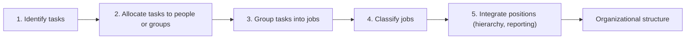
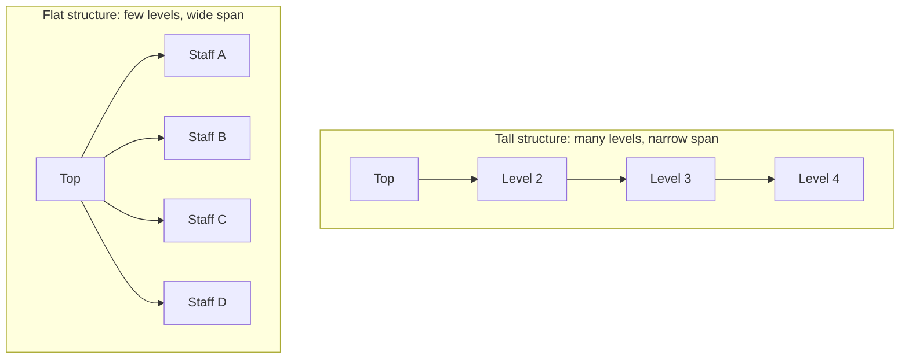
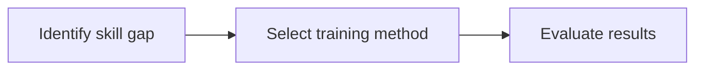
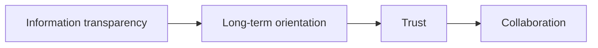

# Retail Store Organization and Human Resource Strategy

## What you will learn

- Why retail organizations and their workforce differ from other businesses
- How tasks are grouped into jobs, jobs are classified, and positions are integrated into a structure
- Flat versus tall structures, span of control, and the principles of effective organization
- The Mazur plan, centralization versus decentralization, and structures for chains and diversified retailers
- Retail HR challenges, job descriptions, and the training cycle
- How to apply all of this to a case (Udaan Bazar) covering structure, HR, job design, and supplier relations

---

## Why Retail Organization and HR Matter

**Simple idea:** A store works well only if everyone knows what they must do, who decides what, and who answers for what.

**Analogy:** On a busy weekend evening in a multi-format store, aisles are packed, billing queues are long, and staff look overwhelmed. Behind the vibrant storefront is an invisible engine: how work is divided, how authority is delegated, how the hierarchy is arranged, and how people are empowered. Great products on shelves are not enough.

Two pillars turn retail strategy into daily operations:

1. **Store organization** (structure of work, authority, reporting)
2. **Retail human resource (HR) strategy** (recruiting, training, retaining people)

Any organization must settle: how activities are performed, who is in charge of what, who responds when, who has **authority**, **accountability** and **responsibility**, and how all of this is **coordinated**. It also needs people: where to recruit, what to tell them at recruitment, how to develop, train and manage them. Other businesses do this too, but in retail it is far more critical.

### What makes retail different

| Feature of retail | Consequence |
|---|---|
| Very large number of employees (e.g., Walmart, the largest by sales) | Many people to coordinate; risk of overlapping responsibilities and chaos |
| Many staff are not highly educated (other firms split roles into highly educated and semi-/less-educated groups; in retail the majority of the workforce is not well educated) | Training and supervision must be designed accordingly |
| Many are part-time or studying or doing other jobs, so their main focus lies elsewhere | Lower commitment, flexible scheduling needed |
| Lower average age, so varying maturity | Closer guidance and development needed |
| Long operating hours (early morning to late night) and demanding conditions | Job is hard to sustain; staff must stretch over long durations |
| Resulting **high attrition rate** (employee turnover) | Constant recruiting and retraining |

Because of these traits, the **management approach must differ** from other organizations.

**Caveat:** These are general tendencies, not rules. Many retail employees are well educated, and skilled roles (buyers, managers) exist in every retailer.

---

## From Tasks to Jobs to Positions

**Simple idea:** Break the work into tiny pieces, bundle similar pieces into jobs, sort the jobs, then connect the positions in a hierarchy.

**Analogy (clothing store such as Zudio):** You pick many clothes to see what fits. One person helps you find the right item. Another person re-arranges the shelf after you finish. Each is a small unit of work, a **task**. Showing items to customers and arranging the shelf can be **clubbed together as one job**. Another job might be buying merchandise for the organization across product categories.

### The organizing workflow

- **Task:** a very small unit of work.
- **Job:** a broader category; several similar tasks together complete one job.
- **Classification of jobs:** grouping jobs by category (activity, expertise, product, location).
- **Integration of positions:** deciding the hierarchy, who reports to whom, and how one climbs the ladder (for example in merchandising). This integrates job profiles and is where **organizational structure** becomes important.

**Task versus job:** tasks and jobs are separate concepts. A task is the unit; a job is a bundle of tasks.

### Typical retail activity groups

Retail operations spread across the business. Common activity areas:

- Buying and receiving merchandise
- Inventory storage and control (who stores, who records, when to reorder)
- Pricing and merchandising displays (how many units on the shelf, how to price, how often to discount)
- Customer contact and service, including complaint handling (a defined complaint procedure; redirecting customers between departments is a symptom of weak design)
- Personnel management
- Billing and financial records
- Delivery and returns (on-time delivery; returns accepted in proper condition, not damaged or tampered with)
- Sales forecasting and budgeting
- Coordination (possibly an entirely separate team)

---

## Outsourcing: Which Activities Stay In-House?

**Simple idea:** Do yourself only what you are best at; hand the rest to specialists.

**Analogy:** A fashion retailer may not run its own trucks; a logistics specialist can do it more efficiently while the retailer focuses on its strength.

- Not every retailer performs every activity internally. Retailers decide which activities to perform and which to **delegate (outsource)**.
- Reason: the retailer's expertise lies elsewhere; a specialist can do the job better and more efficiently.
- **First organizational decision:** identify which activities are essential to the retailer's strategy and customer offering ("what does the customer want from you?"). This depends on how tastes and preferences evolve over time and vary from place to place.
- Participants who can perform activities: the **retailer itself**, **manufacturers and wholesalers** (supporting shipping, storage, marking, displays), and **specialists**.

### Growth and economies of scale

A retailer often starts with one or two people, then grows and reaches different regions. It must satisfy customers in many places while still keeping cost advantages, that is, **economies of scale** (lower cost per unit as volume grows). This growing complexity forces more classification of jobs and more teams.

---

## Job Description

**Simple idea:** A written, clear promise of what a position expects and offers, so candidates know before they apply.

A **job description** for a position (for example, Shop Floor Manager) should state:

- **Title** (e.g., Shop Floor Manager)
- **Responsibilities and duties**, specifically
- **Required qualifications** (academic qualifications, work experience)
- **Working conditions:** reporting line (to whom), timings, flexibility in timing, work environment

It should be clear before the interview or recruitment process begins.

### Ways to organize jobs

| Basis | Example |
|---|---|
| Activity or expertise | Buying, store floor, billing counter |
| Product category | In a large store like Reliance: fashion and garments, daily or convenience goods, makeup and fashion accessories; station people by aptitude |
| Geographic location | In different regions of India, recruit people who know the local language and customs |

**Why geography matters:** Customer-facing staff who speak the customer's language and know local preferences can respond to feelings and fulfil requests much more easily.

---

## Delegation, Accountability, and Span of Control

When there are several teams, you must decide authority, accountability and responsibility: who reports to whom, who decides, what responsibility lies with whom, and how coordination occurs.

**Span of control** is how many people one manager controls and manages.

### Flat versus tall structure

**Simple idea:** A tall structure is a many-step ladder with few people on each step; a flat structure is a few steps with many people on each.

**Analogy:** In a tall structure a manager may directly control 5 employees; that manager reports to one of 2 or 3 people, who in turn report to one person above. Many levels, few people per level, very close supervision. In a flat structure, one manager can handle many more employees, using CCTV cameras, online video meetings, mobile apps and other software.

| Dimension | Tall structure | Flat structure |
|---|---|---|
| Management levels | Many | Fewer |
| People per manager (span of control) | Small | Large |
| Supervision | Very close | Looser, not tightly controlled |
| Communication and coordination | Slow (must pass through many levels) | Faster, one person talks to many |
| Employee involvement | Lower | Greater; easy access to the manager and the "manager's manager" |
| Era / enabler | Traditional | Enabled by technology (CCTV, video meetings, mobile, software) |

**Caveat:** Even a flat structure in a very big organization still has many levels; it simply has fewer than a comparable tall one. More levels improve supervision but increase communication and coordination difficulty.

### Principles of effective organization

1. **Traceable authority:** it must be clear who has authority for what.
   - Example (retail bank): a cash counter employee can pay out only if authorized. An officer may approve disbursal up to a limit (say Rs 50,000, 1 lakh or 2 lakh). Beyond that, it goes to the officer's manager.
2. Each employee knows their **direct supervisor**.
3. Managers have an **appropriate span of control** (know whom they control and whom not).
4. **Responsibility is backed by sufficient authority.** Giving responsibility without authority does not work.
5. **Accountability** stays with one person: authority can be delegated, but the delegating person remains accountable. For any job or task, accountability should ideally rest with **only one person**; making several people accountable creates clashes and confusion.
6. A **formal structure** exists alongside **informal relationships**; the latter matter more in retail because so many people work together.

---

## What Determines the Structure of a Retailer

Structure depends on:

- Size of the retailer (from one owner-employee to thousands of employees)
- Number of stores and their locations
- Type of product (some need more staff or technical knowledge for demonstration)
- Number of retail formats (online e-commerce, multiple stores, single product vs multi-brand)
- Degree of specialization required
- Where strategy is created and managed, and where buying happens
- How much control is exercised over local influence and demand (responsiveness)

### Small versus growing retailers

| Aspect | Small independent retailer | Growing/large retailer |
|---|---|---|
| Organizational levels | Few | Many |
| Roles | Owner-manager involved in many areas (multitasking) | Specialized roles (buyers, floor manager, counter manager) |
| Decisions | Concentrated with owner-manager | Delegated to specialists |
| Supervision | Direct | Through hierarchy |

---

## The Mazur Plan

**Simple idea:** Split all retail work into four big boxes so every activity belongs to someone, while keeping them connected.

The **Mazur plan** groups retail activities into four broad areas:

| Area | Primary focus |
|---|---|
| **Store management** | Operations, service, HR, store activities |
| **Merchandising** | Buying, selling, planning, forecasting |
| **Communication** (publicity) | Promotion, advertising, customer communication |
| **Financial accounting** (accounting and control) | Financial records, budgeting, control |

Reason: this categorization covers all retail activities. The structure separates major areas of expertise while maintaining coordination across the store. The Mazur plan (and the "matrix" idea below) supplies the building blocks of the case solution.

**Caveat:** Store management and merchandising are the focus areas stressed here; the focuses listed for communication and financial accounting are standard textbook content.

---

## Centralization versus Decentralization

**Simple idea:** Either head office decides (same everywhere, cheaper, coordinated) or each store decides (closer to local customers).

| Aspect | Centralized | Decentralized |
|---|---|---|
| Control | Main store/headquarters | Branches have autonomy |
| Benefit | Better coordination, standardization (same product, same ambience across stores) | Better response to local customer needs |
| Cost | Less local responsiveness | Less coordination and consistency |

**Trade-off:** For better coordination, centralize; for more responsiveness, give more control to the local level.

**Typical split:**

- **Centralize:** buying and major planning (buying in bulk from one place gives economies of scale and bulk discounts), brand building, strategy.
- **Decentralize (local):** selling and store operations, merchandising adaptation to local taste (staff interact better with local customers).

### Chain retailers

Large retail chains require coordination across many stores and geographies. **Corporate headquarters generally retain authority over strategic decisions**, because strategy is made at the top. Example: Walmart's strategy is made at headquarters and then flows to different regions. India's states have different cultures and languages, so more local flexibility is needed in execution, while strategy is best made in one central location.

### Diversified retailers

**Diversified retailers** operate different retail businesses under common ownership. Central management keeps the overall direction while letting each business respond to its own market.

Example (clothing): the Aditya Birla group has brands such as Allen Solly, Louis Philippe, and Van Heusen (and others). Each has a different target customer, different staff training, and different product and store organization, even when stores sit next to each other. Hence the need for **divisional flexibility**.

> Greater diversification increases both the need for coordination and the need for divisional flexibility.

---

## Retail Human Resource Management (HRM)

**Simple idea:** Have the right people, with the right skills, in the right place, at the right time.

Why retail HRM is different:

- Long working hours and part-time employment
- Constant contact with customers
- Diverse workforce
- Staffing requirements vary across hours of the day and seasons
- High employee turnover

Retailers need not only day-to-day operations but a **strategy** to have enough appropriately trained employees at any time of day. This includes:

- **Recruitment strategy**
- **Training** for new employees, new technology, new merchandise, policy changes
- **Retention and motivation**, including promotion and managing turnover

(Motivation, incentives, and retention of employees are covered later in the course; they resemble customer retention.)

### Training process

1. **Identify the skill gap:** where employees lag (for example, complacent, or not aware of a product's functions). Decide whom to train and why. Sometimes people are trained because they are expected to perform better in the future; sometimes because they lag. Know the purpose of the training first.
2. **Select the right training method.**
3. **Evaluate the results.**

### Key decision areas

- **Task identification:** what work needs to be performed
- **Task allocation:** who should perform it
- then grouping, classification and integration as in the workflow above

---

## Case Study: Udaan Bazar

Udaan Bazar is a fictional multi-store retailer. Four questions follow, each with a solution drawing on the concepts above. There is no single right answer in management; reasoning matters.

### Q1. Rigid, centralized headquarters

**Problem:** A rigid, highly centralized headquarters structure stops local store managers from tailoring inventory to regional tastes in cities like Kochi and Jaipur. What structural evolution balances central control with local responsiveness?

**Answer:**

- Move toward a **matrix** (or equal-weight) store organization model, drawing on the **Mazur plan** with its four areas. A matrix structure has its own drawbacks (for example, dual reporting lines and possible conflict), so weigh its advantages and disadvantages.
- Keep **strategic decisions centralized** at corporate headquarters: **brand building**, **core buying and planning** (bulk discounts, economies of scale).
- **Decentralize** selling, merchandising adaptation to local taste, and store operations.
- Result: a **hybrid approach** giving branch autonomy to respond to local preferences while maintaining corporate governance and standardization.

### Q2. High turnover and poor service

**Problem:** Annual cashier and floor staff turnover exceeds 45%, causing inconsistent customer service and frequent billing errors. Given the unique nature of retail HR (fluctuating footfalls, long hours, part-time staff), how should HR move from reactive hiring to capability building?

**Answer:**

- Shift from merely **filling vacancies** reactively to **proactively building the workforce** with the right capabilities.
- Align staffing levels with customer demand patterns using a **flexible scheduling system** to match staffing with peak hours, days, and seasons.
- Provide **ongoing, structured training** (identify skill gap, select method, evaluate), rather than a one-time orientation.

### Q3. Job design and specialization

**Problem:** With five stores, employees performed multiple duties with minimal specialization. At 35 stores, management introduced extreme job specialization, causing repetitive tasks, boredom, and operational silos. How to balance specialization and flexibility?

**Answer:**

| | Benefits | Drawbacks if excessive |
|---|---|---|
| Specialization | Clearer responsibilities, greater expertise, focused training | Rigid silos, repetitive and boring jobs |
| Flexibility | Variety, cover for peaks | Blurred responsibility if overdone |

- Design jobs that **group related activities logically** (follow the workflow: identify tasks, allocate, group into jobs, classify jobs, integrate positions).
- Break jobs into smaller tasks, let people specialize in a job while knowing its tasks, and **rotate** them.
- **Cross-train** employees to handle adjacent tasks during peak traffic hours; this also relieves boredom.

### Q4. Supplier relationship

**Problem:** Tension with upstream FMCG suppliers causes mistrust and frequent stockouts. How to structurally transform the supplier relationship to minimize channel uncertainty?

**Answer:** Relationships move through four progressive stages:

- Retailers and suppliers are **interdependent channel partners**.
- Share **real-time point-of-sale (POS) data and demand forecasts** to reduce uncertainty; this also increases trust.
- Cultivate trust and long-term orientation, which enables **joint inventory planning** and **vendor-managed inventory (VMI) agreements**.
- This gives better adaptation to the dynamic retail and regulatory environment of the country.

### Case takeaway

- Retail organization and HR are never static and are not check boxes.
- **Structure defines how work flows**, but empowered, well-trained people deliver the customer experience.
- Balance **central efficiency** with **local market responsiveness**, and move from **reactive hiring to capability building**. This separates retailers that merely survive from industry leaders.

---

## Exam and Assessment Hints

- Data analysis topics begin from Week 8; the current material is conceptual/theoretical.
- Case answers should show reasoning; there is no single right answer, but use the module frameworks (workflow of tasks to positions, Mazur plan, centralization trade-offs, training cycle, four supplier-relationship stages).
- Be ready to apply: flat vs tall, hybrid centralization, flexible scheduling, structured training, specialization vs flexibility via rotation and cross-training.

---

## Self-Check Questions

1. **List the steps in organizing retail work.**
   Identify tasks, allocate tasks, group tasks into jobs, classify jobs, integrate positions.
2. **Why is retail HR management different from other industries?**
   Large, young, often part-time workforce; long hours; varying demand by hour and season; high attrition.
3. **Compare tall and flat structures.**
   Tall: many levels, narrow span, close supervision, slow communication. Flat: few levels, wide span, faster communication, more employee involvement, enabled by technology.
4. **What are the four areas of the Mazur plan?**
   Store management, merchandising, communication, financial accounting.
5. **Which retail decisions are typically centralized and which are local?**
   Centralized: buying, major planning, strategy, brand building. Local: selling, store operations, local merchandising adaptation.
6. **What should a job description contain?**
   Title, responsibilities and duties, required qualifications, working conditions (reporting line, timings, flexibility, environment).
7. **What are the stages of training?**
   Identify the skill gap, select the training method, evaluate the results.
8. **What are the four progressive stages of the supplier relationship?**
   Information transparency, long-term orientation, trust, collaboration.

---

## Common Pitfalls / Exam Traps

- Confusing **task** (small unit of work) with **job** (bundle of tasks).
- Assigning accountability to several people; it should rest with **one** person even when authority is delegated.
- Giving responsibility without matching authority.
- Assuming a flat structure has no hierarchy; it just has fewer levels.
- Treating centralization as always better (or worse); it is a trade-off between coordination and responsiveness, and retail usually uses a hybrid.
- Treating training as a one-time orientation; it must be structured and continuous.
- Reacting to turnover by only filling vacancies instead of building capability and flexible scheduling.
- Over-specializing jobs (silos, boredom) or under-specializing (low expertise); balance with rotation and cross-training.
- Forgetting that diversified retailers need both coordination and divisional flexibility.

---

## Quick Revision Summary

- Retail organization and HR matter because of large, young, often part-time workforces, long hours, and high attrition.
- Workflow: identify tasks, allocate, group into jobs, classify jobs, integrate positions into a structure.
- Retailers may outsource activities outside their core strength; decide first which activities are essential to strategy.
- Job descriptions state title, duties, qualifications, and working conditions.
- Tall structures give close supervision but slow communication; flat structures (enabled by technology) give faster communication and wider spans.
- Effective organization: traceable authority, known supervisor, suitable span, authority matching responsibility, single-point accountability.
- Mazur plan: store management, merchandising, communication, financial accounting.
- Centralize buying, planning and strategy; decentralize selling and store operations; diversified groups need divisional flexibility.
- Training cycle: skill gap, method, evaluation; HR should move from reactive hiring to capability building with flexible scheduling.
- Supplier relations progress from information transparency to long-term orientation, trust, and collaboration (POS data sharing, joint planning, VMI).
