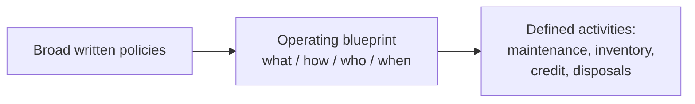
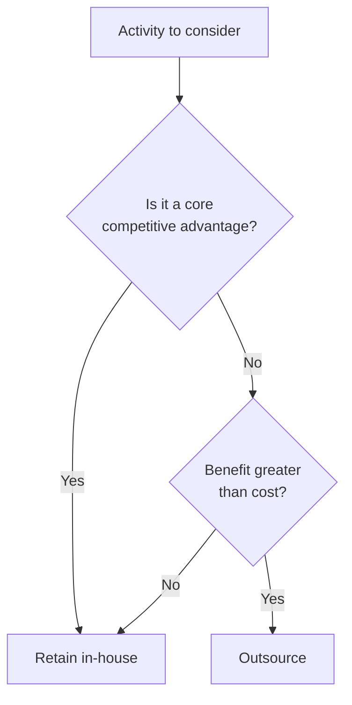
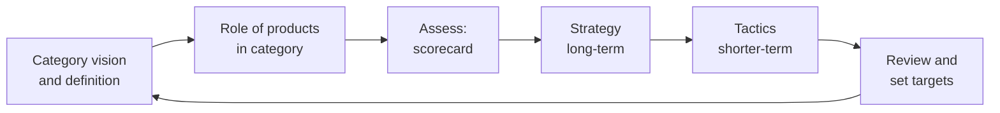
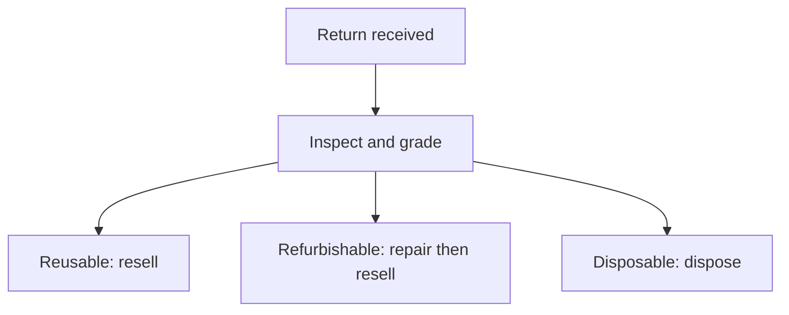

# Retail Store Operations and Management Decisions

## What you will learn

- The main decision areas in **store management** (format, space, energy, inventory, security, credit, outsourcing, category management, reorders, returns)
- Standardization versus localization of store formats, and the hybrid compromise
- Inventory tools: EOQ, open-to-buy, inventory turnover, GMROI, ABC, FSN, Pareto's law and the 3x3 ABC-FSN matrix
- Category management, loss-leader pricing and the outsourcing (value = benefit / cost) decision
- Reverse logistics, omnichannel inventory accuracy and predictive analytics
- How to answer the "Urban Fresh" case questions in an exam-style way

---

## Store Management and the Operating Blueprint

**Simple idea:** Store management is everything needed to keep a shop running well day to day: what it looks like, what it stocks, how it is kept safe and how its money and returns are handled.

**Analogy:** Running a store is like running a household: you decide the size of the home, how rooms are used, the electricity bill, how much food to stock, insurance, whether to lend money to neighbours and which chores to hire out.

**Definition:** **Store management** is the efficient and effective implementation of the retailer's operating policies and activities. The objective is to create a store operation that supports customers while controlling resources, costs and risks.

The decision areas are:

| Area | Typical questions |
|------|-------------------|
| Store format and size | What kind of store? How big? Where? |
| Space allocation | Which categories, what quantity, where on the floor? |
| Maintenance and energy | How to maintain resources and cut energy use? |
| Inventory | What level? When to reorder? How much to buy? |
| Security and insurance | Who pays if loss occurs? How is the store secured? |
| Payments and credit | Which credit mechanisms? How many credit days? |
| Outsourcing | What to do in-house, what to hand over? |
| Merchandise | Variety, shelf contents, replenishment, returns |

Challenges exist for both very large multi-location chains (harder to control) and small stores (different types of problems).

**Operating blueprint:** a document stating **what** activities must be performed, **how** they are carried out, **who** performs them and **when**. Retailers may create separate operating plans for areas such as store maintenance, inventory management, credit management and store disposals. The blueprint converts broad written policies into clearly defined operating activities.

---

## Store Format, Site Planning and Store Identity

**Simple idea:** Where you put a shop and how it looks tells customers who you are before they pick up anything.

**Example:** An Apple store is clean, spacious, full of helpful staff, and shows the full genuine product line to touch and try. A local multi-brand mobile shop is cramped, stocks many companies' phones and has few staff relative to products. Nike, Adidas and other premium stores also look very different from local stores. The store itself becomes an **identity for the brand**.

**Site planning** covers more than state or city: it includes the exact location within the city, the type of customers you expect there, construction type, total space, store size and design, and the feeling you want customers to have.

### Standardization vs localization

A chain with many stores can use a **prototype store** (same format, site planning, shelf locations, size, design) or adapt to local tastes.

| Aspect | Standardization | Local adaptation |
|--------|-----------------|------------------|
| Main benefit | Consistency, brand recognition | Fits local customer needs |
| Control | Centralized | More decentralized |
| Operating complexity | Lower | Higher (products and displays keep changing) |
| Market responsiveness | Lower | Higher |
| Example | McDonald's operations and look-and-feel are near identical worldwide | McDonald's sells the Aloo Tikki burger mainly in India; KFC serves biryani in India; spicier items for Indian taste |

**Hybrid model (the usual best answer):** keep the core store layout and visual identity the same (as Apple does) but localize space planning and what is stocked on each shelf. There is no single 100% right answer; justify your choice.

**Caveat:** Standardization of operations/look does not mean standardization of product range. Even McDonald's localizes its menu while standardizing its operations. Also, standardization does not guarantee profit for every retailer.

---

## Space Productivity and Store Size

**Simple idea:** Every square foot of a shop costs money, so each one must earn its place.

**Definition:** Store space is a **productive resource**. Retailers decide how much space goes to merchandise categories, individual products and displays. Retail looks at the return from each square foot (or inch): **space productivity**.

Factors considered:

- Space productivity (return per unit of space)
- **Inventory turnover** (how fast the product sells)
- Display requirements (a Reliance Fresh grocery store differs greatly from a jewellery shop)
- Product category, number of brands and **SKUs** (stock-keeping units: one distinct sellable item/variant)
- Customer needs

**Two planning approaches:**

| Approach | Who decides | Based on |
|----------|-------------|----------|
| Top-down | Top management | Total store space, category allocation, product layout |
| Bottom-up | Starts from individual products and categories | Local store requirements |

**Store size trade-off:**

| | Bigger store | Smaller store |
|---|---|---|
| Customer feel | Spacious, comfortable | Less comfort |
| Rent and operating expenses | Higher | Lower |
| Payroll | Higher | Lower |
| Selection | Wider | Reduced |

---

## Touch Points, Maintenance, Energy and Renovation

**Simple idea:** Every place where a customer meets your business shapes their opinion of it, even without touching anything.

**Touch points** are all points where the customer gets in touch with the organization:

- Exterior: street in front, parking, entrance decoration, ease of entry, signage
- Interior: flooring, walls, layout

These must be maintained because they tell the customer what the store is about.

**Energy management**

- **Short-term actions:** turn off unnecessary equipment; manage temperature settings.
- **Temperature example:** too low makes people drowsy, too high makes people uncomfortable. About 25 to 27 degrees C is typically kept in stores (room temperature is quoted as about 22.5 degrees C, and many experiments are run near 25 degrees C as a comfortable working temperature). Changing the setting by even 1 degree changes energy consumption, so the aim is lower energy use **without** hurting the comfort of staff and customers.
- **Long-term actions:** energy-efficient building design, building management systems. Companies and buildings are becoming environmentally sustainable (for example, recycling water for various uses); the question is how much a retailer can do.

**Renovation** is an **investment decision**: when to renovate, which areas, how extensive and how expensive, and whether the store stays open or closes during renovation.

---

## Operational Risks in Online and Omnichannel Retail

**Simple idea:** The moment you sell online, new things can go wrong: lost parcels, returns, products missing at pickup, wrong information.

**Omnichannel retailing** integrates formats: physical (brick-and-mortar) store, web store and app. A customer may order on the app and pick up at the store, or order at the store and have it delivered home.

Risks to plan for:

- Product lost in transit; handling returns
- Customer arrives at the store for a product and finds it missing (what then? what return policy? what information?)
- Inconsistent information across platforms

**Real examples**

1. **Analytics-driven cash-on-delivery (COD) restriction:** some online stores stopped COD in certain districts because analytics showed those districts produced more returns, which inflated operating cost.
2. **Personalized returnability:** Amazon may allow a customer to return an item that is normally non-returnable for others, depending on purchase history. The same product can show as returnable to one customer and not another. So you must check who your ordering customers are.
3. **FirstCry (baby and mother-care products):** the website showed a price against an old product image whose MRP was lower than the price claimed. Customers objected because the image carried the old MRP while the website showed the increased MRP. Lesson: keep **accurate and consistent information across all platforms**.

---

## Store-Level Inventory Management

**Simple idea:** Keep enough of the right goods to sell, but not so much that cash is stuck on shelves.

Decisions: sales floor versus **store room** inventory (not everything is on the floor), replenishment frequency, supplier involvement, handling and storage.

Techniques:

| Tool | What it answers |
|------|-----------------|
| **EOQ** (economic order quantity) | How much to order at once |
| **Open-to-buy** | How much more merchandise can still be bought within the plan |
| **Inventory turnover** | How fast stock is sold |
| **GMROI** (gross margin return on inventory investment) | Profit earned per rupee invested in inventory |
| **ABC analysis** | Classify products by value |
| **FSN analysis** | Classify products by movement speed |

### ABC analysis and Pareto's law

**Analogy:** In a class, a few students score most of the marks that decide the top ranks; similarly a few products bring most of the profit.

- **ABC analysis** splits products into three groups by value: **A** most valuable, **B** moderate, **C** least valuable.
- **Pareto's law (80/20 rule):** about 80% of an outcome comes from about 20% of causes. Example: about 80% of profit may come from 20% of the product assortment.

### FSN analysis

Classify by movement: **F** fast-moving, **S** slow-moving, **N** non-moving. Slow and non-moving products tie up money that could be used better elsewhere, so you do not want them.

### 3x3 ABC-FSN matrix

Combine value (A, B, C) with movement (F, S, N) to get a **3x3 matrix** of nine cells, and choose an action for each cell.

| | Fast (F) | Slow (S) | Non-moving (N) |
|---|---|---|---|
| **A** (high value) | AF: protect availability | AS: review closely | AN: act urgently |
| **B** (medium) | BF | BS | BN |
| **C** (low) | CF | CS | CN: candidate to remove |

(The cell actions shown are typical textbook readings; the key point is that the matrix links value and movement to a specific action per cell.)

**Caveat:** Pareto's 80/20 is a rule of thumb, not an exact law; the actual split varies by retailer. Sell-through metrics can also be used for deciding what to keep.

---

## Store Security and Insurance

**Simple idea:** Insurance means many people pay a little so the few who suffer a loss get paid.

**Security has two parts**

- **Personal security:** employees and customers (for example, fire in a mall or store; how are people compensated after an incident?)
- **Merchandise security:** shoplifting, employee theft, burglary, robbery. Tools: store design, employee controls.

**Insurance principle:** not everyone claims; money is pooled from many sources and whoever has a loss gets the claim settled. The insured **transfers part of the risk**. Insurance companies are themselves insured by much larger companies (reinsurance).

Retailer insurance covers burglary, accidents, natural disasters and so on. Pricing for retailers is **customized** (individually quoted), unlike consumer life or health policies where you can get a standard online quote.

---

## Payment and Credit Decisions

**Simple idea:** Letting customers pay later helps sales but you may never get paid.

Credit was once common, became a menace so stores stopped it, and has now returned in new forms (online "pay by credit card" or "buy now, pay later").

Decisions:

- Which credit mechanisms to accept
- How many credit days
- Eligibility (not everyone qualifies)
- Terms and conditions; what if payment is late
- Who bears processing fees and transaction cost
- Risk: customer may not pay at all

The decision balances **customer convenience, revenue potential and financial risk**.

---

## Outsourcing Decisions

**Simple idea:** Hand over tasks others do better and cheaper; keep the ones that make you special.

**Value** is defined as **benefit / cost**. Compare the benefits of outsourcing with its costs; if the benefit exceeds the cost, outsourcing can be considered.

$$\text{Value} = \frac{\text{Benefit}}{\text{Cost}}$$

**Exception:** do not outsource a **core competitive advantage** (an activity that gives an upper hand over competitors, or where outsourcing would reveal how you operate). Decide which things you can handle better and which to offload. Regular, non-core tasks can be outsourced.

---

## Category Management

**Simple idea:** Treat a group of similar products as one mini-business and aim for the best profit from the group, not from each item alone.

**Definition:** A **category** is a group of similar products that customers see as substitutable. **Category management** focuses on the performance (profit) of one category. It covers assortment (which products together), pricing, promotion and shelf-space allocation.

**Process (continuous, not one-time):**

### Loss-leader pricing

**Example:** A shop prices a few items very low, even at a loss. Customers come for those, then buy other items, which recovers the loss.

**Loss-leader pricing** (also called second-layer pricing): no money is made on the first layer (the cheap item) but profit is made on the second layer (other items bought during the visit).

**Merchandise standardization:** for products, you inspect, sample and describe how standardization is managed, or whether local variants are allowed (McDonald's looks the same worldwide but not every retailer can profit by standardizing).

---

## Reorder Decisions: Large vs Small Orders

| | Large, infrequent orders | Small, frequent orders |
|---|---|---|
| Price | Bulk purchase, better negotiation, quantity discounts | May pay more |
| Storage | Storage problem; more working capital tied up | Less storage |
| Obsolescence | Higher risk | Lower risk |
| Flexibility | Low | High, product can change fast |

---

## Reverse Logistics (Returns)

**Simple idea:** Reverse logistics is the journey of a product coming back from the customer to the seller.

**Why returns hurt:** you lose time. The item went out expecting payment, and a reorder may already have been placed. When the return comes back you pay logistics costs, and if the reordered goods have already arrived you now have **overstock**. Returns also tie up money.

**Return policy design:** how many days (Amazon: 10 days for some items, a month for others), which products, how returns are checked (not damaged, the same product that was sent), who authorizes returns, refund rules and documentation.

**Return lifecycle blueprint:**

1. Reduce return processing time.
2. **Classify** items as **reusable, refurbishable or disposable**.
3. The grade determines the **disposition route and recovery value**.
4. Repair and refurbish as appropriate.
5. Maintain refund rules, documentation and authorization.

**Analytics use:** Amazon's AI shopping assistant (Rufus) can indicate the percentage of customers who keep or return a product, which helps decide what to stock. Doing this for every product manually is hard, but analytics techniques make it feasible.

---

## Predictive Dispatch (Anticipatory Shipping)

**Simple idea:** Start moving the parcel toward the customer before they click Buy.

Amazon's **predictive dispatch** ships products in the direction of the likely customer based on data on what customers look for and when they are likely to buy, but does not deliver until the order is placed. By the time the customer buys, the product is nearby, so delivery can happen within a couple of hours or a day.

**Caveat:** this requires a deeply integrated supply chain and strong data; few companies can do it. Early versions that delivered without consent caused many returns, so it is used only up to the point of movement, not delivery.

---

## Case Study: Urban Fresh

Urban Fresh is a retail chain with a standardized prototype store model, omnichannel inventory inaccuracies, mounting returns, large infrequent bulk ordering, and a conflict between the CFO (wants to outsource warehousing, IT and delivery to cut costs) and the VP of Operations (fears losing control).

### Q1. Standardized prototype vs local responsiveness

- This is the standardization versus localization dilemma.
- Customer type drives store design: for tech-savvy catchments separate electronics from snacks; premium locations (for example, a high-end mall) change pricing and product positioning.
- Recommended answer: **hybrid model**. Keep core layout and visual identity standard; localize the shelf-level assortment and space planning.
- Centralized control gives consistency and lower complexity; local responsiveness gives better fit to local needs. Balance them.

### Q2. Fix omnichannel inventory visibility and reverse logistics

Problem: click-and-collect (buy online, collect in store) rollout; the **POS system, ERP and store managers' reports are not in sync**, so customers order online, travel to the store and find the item out of stock.

Operating blueprint:

- IT, warehouse operations and POS teams jointly **synchronize data in real time** across POS, ERP and store reports.
- Confirm stock at the nearby store or hub-and-spoke warehouse before promising a pickup window (for example 24 or 48 hours).
- **Proactive notification** to customers if the item will arrive late (for example advise visiting after 72 hours), reducing dissatisfaction.
- Returns: cut processing time; classify as reusable, refurbishable or disposable; grade decides disposition route and recovery value.
- Maintain a well-maintained information system across all channels, plus refund rules, documentation and return authorization.
- Consider predictive dispatch where data allows.

### Q3. Bulk ordering trade-offs and alternative reorder framework

- Trade-offs of bulk ordering: quantity discounts and negotiation power versus storage cost, obsolescence risk and **working capital** locked up (see the reorder table above).
- Alternative: segment products by **ABC analysis**, or combine **ABC and FSN** (the 3x3 matrix), or use **sell-through** metrics, and pick a hybrid strategy: for example, bulk ordering for stable, fast-moving, long-lead-time items; small, frequent orders for short-life-cycle, slow or uncertain items.
- Product attributes to segment on: category, lead time (long or short) and product life cycle.

### Q4. Outsourcing framework: retain vs outsource

- Framework: outsource what is **not a core competency**; retain what gives competitive advantage or customer data/control. Use value = benefit / cost.
- Suggested split (from the discussion): outsource **IT** (not core, data is already in the cloud) and **last-mile delivery** and some warehousing (through **3PL/4PL** logistics partners; multiple delivery partners, as food chains do through delivery platforms). Retain customer relationship and order data so the retailer keeps control of customers and orders.
- With a 50-50 board split (CFO for, VP Operations against), a **hybrid option** for IT is a practical compromise.
- Facility management: the case describes a **reactive maintenance** approach; use IT and data for **predictive/proactive maintenance**. KPIs: breakdown orders per square foot, maintenance orders per square foot, materials consumed, replacement cost, turnaround time.
- **Predictive returns:** from, say, 18 months of data, model the probability that a product will be returned (for example 80% or 90%) so warehouses and logistics prepare. This also lets IT and warehouse leaders reframe AI spend as an **investment**, not only a cost.
- Organizational conflict: functions fear losing budget, team size and power if they outsource. This needs change management; the board decides on strategic grounds.

---

## Exam and Assessment Hints

- Cases are discussed in class; answers are judged on reasoning, not one "right" answer. Present the dilemma, the trade-off and a justified recommendation (often hybrid).
- Be ready to apply ABC, FSN, ABC-FSN matrix, EOQ, open-to-buy, inventory turnover and GMROI to a scenario.
- Reading material covered local retail and global trends, and merchandising.
- Course format is a flipped class: read material and watch videos first, then discuss.

---

## Self-Check Questions

1. **What is the objective of retail store management?**
   To create a store operation that supports customers while controlling resources, costs and risks.
2. **State Pareto's law with a retail example.**
   About 80% of results come from 20% of causes; for example, 80% of profit from 20% of the product assortment.
3. **What does the ABC-FSN matrix combine, and what is its size?**
   Value (A, B, C) with movement (fast, slow, non-moving), giving a 3x3 matrix with an action for each cell.
4. **Define loss-leader pricing.**
   Pricing selected products below cost to attract customers, who then buy other products, recovering the loss in the "second layer".
5. **When should a retailer not outsource an activity?**
   When it is a core competitive advantage, or when the benefit/cost ratio does not favour outsourcing.
6. **Give the three classes used for returned items.**
   Reusable, refurbishable and disposable; the grade determines disposition route and recovery value.
7. **Why is a hybrid model often recommended for chains?**
   It keeps consistent identity and low complexity while allowing shelf-level local adaptation.
8. **What is predictive dispatch?**
   Moving goods towards a customer before the order is placed, based on predicted buying, without delivering until ordered.

---

## Common Pitfalls / Exam Traps

- Treating standardization versus localization as either-or; the best answer is usually a hybrid, with reasons.
- Treating the 80/20 rule as exact; it is a rule of thumb.
- Mixing up ABC (value) and FSN (movement); they measure different things.
- Forgetting that large orders save price but cost storage, obsolescence risk and working capital.
- Outsourcing everything to cut cost; core capabilities and customer data should be retained.
- Ignoring returns cost: returns cause lost time, logistics cost and overstock when reorders arrive.
- Ignoring inconsistent information across channels (price and image mismatch) as an operational risk.
- Viewing IT or AI spend only as cost; the case frames it as an investment.

---

## Quick Revision Summary

- Store management turns policies into activities through an operating blueprint (what, how, who, when).
- Standardization gives consistency and control; localization gives responsiveness; hybrid combines them.
- Treat space as a productive resource; bigger stores cost more in rent and payroll but feel better.
- Inventory tools: EOQ, open-to-buy, turnover, GMROI, ABC, FSN and the 3x3 ABC-FSN matrix; Pareto 80/20.
- Insurance transfers risk; credit balances convenience, revenue and financial risk.
- Outsource on value = benefit / cost, but keep core competitive advantages.
- Category management is a continuous cycle; loss leaders make profit in the second layer.
- Reverse logistics: reduce processing time, classify (reusable, refurbishable, disposable), and use analytics to predict returns.
- Omnichannel needs real-time synchronized inventory data and proactive customer notifications.
