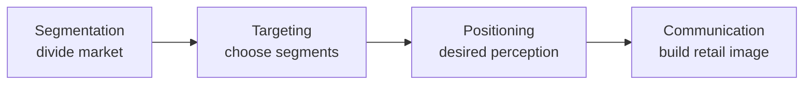
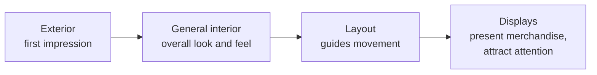
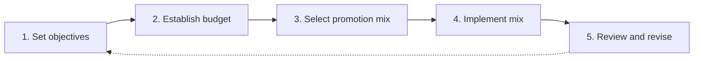
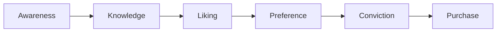

# Communicating with Retail Customers: Image and Promotion

## What you will learn

- What marketing and marketing communication really mean (beyond advertising and sales)
- The 4 Ps, 7 Ps and 4 Cs, and where communication fits
- Segmentation, targeting and positioning (STP) and how **retail image** is built
- The four elements of **store atmosphere** and how the same ideas apply online
- The retail promotional mix, the five-step promotion plan, budgeting methods and the response hierarchy
- A worked case (Aura Living): inconsistent image, cognitive dissonance, user-generated content, promotion-mix design and stock-outs

---

## 1. What Is Marketing, and Where Does Communication Fit?

**Simple idea:** Marketing is not just "advertising" or "selling". It is the whole job of working out what customers need and giving it to them at a profit. Communication is one big tool inside that job.

**Analogy:** A restaurant that only shouts about its food (advertising) but never checks what diners want, how much they will pay, or whether the kitchen can cook it, is doing promotion, not marketing.

**Precise definition:** Marketing is the process of **identifying, anticipating and satisfying customer needs and wants profitably**. Common (partial) student answers are "promotion", "advertisement", "sales", or "communicating the value of products and services to customers". The last one is correct but covers only the communication function.

Retailers do marketing, so they must know which communication activities help operations and which should be avoided or controlled.

### 1.1 4 Ps, 7 Ps and 4 Cs

| Framework | Elements | Use |
|-----------|----------|-----|
| **4 Ps** (marketing mix for products) | Product, Price, Place, Promotion | Classic mix for physical goods |
| **7 Ps** (for services) | The 4 Ps + People, Process, Physical evidence | Services are intangible, so staff, process and environment matter |
| **4 Cs** (customer-centred view) | Promotion is replaced by **Communication** (the other Cs are customer value, cost, convenience) | Shifts focus from "pushing" to two-way communication |

Promotion is the 4th P of the marketing mix. In the 4 Cs view it is replaced by communication, which is broader than promotion.

### 1.2 Communication is much broader than promotion

Communication also happens through:

- **Positioning** (how people think about your merchandise and pricing)
- **Customer service** and the **physical environment** (store design, area allocated, product display)
- **Fragrance** in a store (companies pump a scent to attract visitors)
- **Shopping experience**: layout, employees, even **uniforms**
- **Digital interface**: websites differ in objective and clientele
- **Customer-to-customer communication** (reviews, posts) which you cannot control

Example: Amazon, Flipkart, Myntra and Meesho target different clientele and have different communication/sales objectives. A manufacturer-brand site such as LG or Dell has yet another objective. The digital interface itself says a lot about the business.

**Key point:** You communicate with words and with the **experience** you give. Not everything is under your control; you must carefully handle how you **reply** to communication you did not start.

---

## 2. STP and Retail Image

### 2.1 Segmentation, Targeting, Positioning

**Simple idea:** Slice the market into groups, pick the groups you will serve, and decide what picture of you you want in their heads.

| Term | Meaning | Who does it |
|------|---------|-------------|
| **Segmentation** | Dividing the market into different clusters | The retailer |
| **Targeting** | Choosing which clusters to serve | The retailer |
| **Positioning** | How customers **perceive** your offerings and services | Lives in the customer's mind |

**Caveat:** Positioning is not something you "offer". It is how people feel about you. Your job is to make sure that feeling matches what you intended.

**Example:** Maruti vs Volkswagen/Skoda vs Honda. Even for similar full-size sedans, the price gap is large, the communication objective differs and the target audience differs. A Skoda buyer has an entirely different profile from a Maruti buyer. A showroom owner of any of these brands conveys a message through how the cars are displayed, which builds the **retail image**.

### 2.2 Retail image

**Retail image** is the overall perception customers hold of the retailer. A strong image should be **clear, distinctive and relevant to the target market**, and helps customers understand what the retailer represents and how it differs from alternatives.

Image is shaped by many dimensions; each one is perceived by customers:

| Dimension | What customers infer | Example |
|-----------|----------------------|---------|
| Target market | Who the retailer serves | "Mileage kitna deti hai?" (Maruti) signals value-conscious buyers; "safest car in the world" (Volvo) signals safety-conscious buyers |
| Positioning | What the retailer represents | Zudio vs Pantaloons vs Lifestyle serve very different customers |
| Customer service | How customers are treated | McDonald's vs another burger seller; bank branches (SBI vs private banks) treat customers differently |
| Location | Not only city/state, but where within the city | The same private bank has different clientele and treatment across branches |
| Merchandise | Variety, quality, brand | High-priced brands vs low-priced stock; Rs 99 stores have disorganised shelves, crowds and a very low staff-to-customer ratio compared with a lifestyle outlet |
| Pricing | Value level | |
| Physical facilities | Look and feel | Ugaoo nursery shop: neat plants, each looks cared for, unlike a local nursery |
| Community relations | Reputation, social role | |
| Promotion | Messages and offers | |

**Image is built continuously, not by one activity.** Ongoing contributors: shopping experience, how often merchandise changes, service encounters, communication style, **POS materials** and the social media chosen.

### 2.3 POS (point of sale) materials

**Simple idea:** Anything you see or use at the place where you pay or decide to buy.

- Card-swiping machine / billing terminal (captures **transaction-level data** at the exact point of sale)
- Danglers, banners, standees, table cut-outs, barcode scanner displays in stores and bank branches
- Any promotional material seen at the point of sale

All of them communicate something to the customer.

### 2.4 Choosing social media

A brand such as Domino's must choose between LinkedIn, Instagram and X (Twitter) based on **where its customers are**, the **demographics** of each platform and **changing customer expectations**.

### 2.5 Establish, deliver, monitor

Retailers must:

1. **Establish** the desired image
2. **Deliver** it **consistently** (not once)
3. **Monitor** customer experience and spot any mismatch

**Online vs offline consistency:** Saying one thing online and doing another offline confuses customers and backfires. The challenge is to **remain relevant without becoming inconsistent**.

### 2.6 Image is co-created with customers

Retail image comes from **retailer-controlled communication** and **customer-generated (user-generated) communication**.

- Customers share opinions with others, including people who may never buy from you.
- Public reviews, comments, photos and videos on social media are visible to anybody and can **destroy** or **build** reputation.
- Retailers must **monitor how the intended image compares with the image developing among customers**.

---

## 3. Retail (Store) Atmosphere

**Simple idea:** Atmosphere is the "feel" of a place: how comfortable, rushed, premium or cheap it seems.

**Analogy:** Walking into IKEA, you follow a fixed path from the single entry to the single exit, so you see nearly every product at least once. The building itself is steering your behaviour.

**Definition:** **Retail atmosphere** is the feeling customers experience when interacting with the retailer. It covers location and design, comfort (e.g. temperature: soothing, 25-26 degrees C, or no air conditioning), how you browse, how you interact with employees and what purchase behaviour is encouraged (e.g. self-checkout with no cashier queue, common abroad and growing in India).

Atmosphere makes the image **tangible**. Example: in Reliance or Croma electronics stores you can handle and check specifications without asking anyone, which feels comfortable.

**Rule:** Atmosphere should **support the desired positioning**, not be a separate design decision.

### 3.1 Four major elements of store atmosphere

| Element | Role | Example |
|---------|------|---------|
| **Exterior** (storefront, entrances) | First impression | Apple Store: premium entrance |
| **General interior** | Overall look and feel: lighting, colours, flooring, fixtures, music | Apple dealers keep high-end **air purifiers** to signal comfort and status; an iPhone is a status symbol for many buyers |
| **Layout** | Organises space, guides movement, influences product accessibility | IKEA one-way path |
| **Displays / visual merchandising** | Present products, attract attention, give information, create an engaging environment; push what you most want to sell | Product tables, perfume testers |

Music at a salon, spa or restaurant changes customers' mood. The physical environment should reinforce the same image across the **whole shopping journey**. Layout and merchandising should make shopping easier while supporting the retailer's image and commercial objectives.

### 3.2 Restaurant example: menu card and colour

A menu card is the restaurant's point of sale.

- **Where to place the most profitable items:** in the **middle** of a hardcover menu (centre stage), then the **right-hand page**. Customers do not start at the left; attention and dwell time are highest in the middle.
- **Colours:** Yellow, orange and red dominate restaurant banners, billboards and menus. These colours are said to make people feel hungry and be tempted by food. Not every restaurant does this (clientele differs).
- An electronics or mobile store uses a different colour combination for a different point-of-sale message.

### 3.3 Online equivalent of store atmosphere

| Physical store | Online store |
|----------------|--------------|
| Storefront / entrance | **Home page** (tells you what products, pricing, merchandising to expect) |
| General interior look and feel | Website look and feel |
| Merchandise display | Product presentation |
| Checkout counter | Online checkout |

The underlying objective is the same: an environment that is **easy to use, appealing and consistent with the retailer's image**.

**Colour psychology:**

- Amazon uses mainly **black and white** backgrounds (product images supply colour): a sense of sophistication.
- **Blue** is widely used by communication/technology brands (Nokia, Dell logos).
- Shades matter too.
- Liquor: costlier bottles tend to be **simple** (value is inside the bottle); cheaper ones carry busier images and label designs.

**Product description comparison:** Amazon typically gives more product detail than Flipkart, and Meesho gives less. Presentation differences reflect different positioning. (This is a perception-based observation; check the sites yourself.)

### 3.4 Experiential merchandising and engagement

**Simple idea:** Let people try, touch and play so they feel the product before buying.

**Example:** Perfume testers let you spray on skin or paper to feel how it will smell after purchase.

Goal: move customers from **shopping to engagement**: browse, explore, interact. Provide a comfortable environment and a solution through selling. Engagement is meaningful only if it improves **what customers feel and take home**, not simply **time spent in the store**.

### 3.5 Community relations

Retailers operate within communities; their actions affect public perception.

- **Reputation** and **customer relationships** feed the image.
- Community can **differentiate**: Apple has a very loyal customer community that spreads **positive word of mouth**, so the product is differentiated beyond its quality alone.
- **Cause-related marketing** (e.g. contributing to a charity) attracts attention and interest.

---

## 4. Promotion: Communicating Retail Value

**Simple idea:** Promotion is the retailer deliberately telling customers who you are, what you sell and why they should come.

**Definition:** Retail promotion is communication used to **inform, persuade and remind** customers about the retailer, its merchandise, services, special offerings and positioning.

### 4.1 Retail promotional mix

| Tool | What it is | Notes |
|------|-----------|-------|
| **Advertising** | Paid, non-personal messages (e.g. newspaper) | Broad reach |
| **Public relations** | Building reputation; includes **advertorials** | Credibility |
| **Personal selling** | Direct customer interaction, door to door, consultations | Two-way, high persuasion |
| **Sales promotion** | Discounts and offers that stimulate purchase | Fast response |
| (Others) | e.g. **direct marketing** (personalised emails) | Besides the main four/five |

Tools differ in **audience reach, variety of communication, mode and speed of communication**; these influence tool choice.

**Caveat about sales promotion:** Frequent promotions may clash with marketing objectives. Ask first: do you want to be perceived as a **discount store**? If yes, promote frequently. If not, think carefully.

### 4.2 Five-step promotion planning (ends with control)

Step 5 is the **control** part. Management always needs a control mechanism, and the process ends at the review stage.

### 4.3 Promotional budget methods

| Method | How the budget is set | Weakness |
|--------|----------------------|----------|
| **All you can afford** | Use whatever funds remain after other spending | Arbitrary; ignores goals |
| **Incremental** | Last year's budget plus a fixed increase (e.g. +5%) | Ignores objectives and market change |
| **Competitive parity** | Match what competitors spend | Competitors' goals differ from yours |
| **Percentage of sales** | Link spending to expected annual sales | Sales drive spending, though promotion should drive sales |
| **Objective and task** | Set objectives, define tasks to reach each, cost each task | Best: ties money to goals |

**Worked example (incremental):** Last year's budget Rs 20,00,000; this year +5% gives $20{,}00{,}000 \times 1.05 = $ Rs 21,00,000.

The objective-and-task method is the recommended one (see the case below).

### 4.4 Response hierarchy and matching tools

Customers move through stages before buying:

| Stage goal | Suitable tools |
|-----------|----------------|
| Build **awareness and knowledge** | Advertising and public relations |
| Influence **attitudes** and stimulate desire (liking, preference, conviction) | Personal selling and sales promotion |
| Purchase | Targeted sales promotion, loyalty incentives, personal selling |

The right promotion mix depends partly on the **response the retailer is trying to create**. The tool used at the start (awareness) can differ completely from the tool used near purchase.

### 4.5 Implementation: sync online with offline, and promise with delivery

- What you do online must match what you do offline.
- If you promise a product, it must be **available**; otherwise confusion and chaos result.
- A promotion communicates effectively only when **the rest of the retail operation can deliver what was promised**.

---

## 5. Case Study: Aura Living

**Setting:** A premium, "artisanal luxury" home-products retailer (Aura Living) with a physical store and an online presence. A new manager (RIA) takes over from a previous management that had weak communication practices. The target market is urban, young professionals.

### 5.1 Problems identified

1. **Inconsistent storefront**: poor website design; physical and digital storefronts are disconnected.
2. **Campaign timing** not well planned.
3. **Negative customer reviews and unboxing videos** online, causing negative publicity (word of mouth outside the retailer's control).
4. **Packaging** does not meet **premium branding** (the physical store signals premium, the online store and packaging do not).
5. **Budgeting** mismatch: promotion budget set by "all you can afford" / ad hoc methods and not matching needs.

### 5.2 Q1: Psychological impact of the physical-vs-online inconsistency

The store has designed lighting, layout, music and scent; the website looks like a discount store.

- **Confused positioning**: Is it an artisanal luxury brand or a fast-moving discount retailer? Confused positioning is harmful for any business.
- **Cognitive dissonance**: **Cognition** means thinking. If what a customer *thinks* about a retailer differs from what they *see*, discomfort arises.
- Consequences: **breakdown of trust**, **lower perceived value**, uncertainty ("this store may not be right for me"), and discouraged purchases.

**Why it matters though "the product is the same":** Customers judge the brand through the whole experience, not only the product.

### 5.3 Q2: Using customer-generated content to bridge the positioning gap

How to use unboxing videos and store reviews:

- **Encourage positive, authentic content**: ask buyers to share their real experience online (e.g. via a QR/barcode link after purchase); showcase genuine excited unboxings.
- **Respond to negative content**: it cannot be suppressed today. **Address complaints promptly** and show what action was taken.
- Handle **both**: amplify the positive and manage the negative.

**Measuring perception and experience** (set-up after launch; more detail comes later):

- **Surveys**, even a single question on sentiment: will you return, refer, or buy again soon?
- Observing customer expressions in store.
- **Digital analytics online**: where visitors leave, how long they stay, what they do.

### 5.4 Q3: Restructuring the promotion mix from awareness to purchase conviction

- **Budget:** replace "all you can afford" with the **objective and task method**.
- **Tools:** Use a **mix**, matched to response stages and objectives:
  - Early awareness: **blogs on sustainability**, advertising, PR
  - Knowledge and liking: **personal selling** such as online design consultations with experts
  - Conviction and purchase: **targeted sales promotion**, **loyalty-based incentives**
  - **Direct marketing**: emails with product recommendations based on customer preferences and visits
- Use the whole gamut of tools, not one.

### 5.5 Q4: Why the eco-friendly bamboo collection launch failed (stock-outs)

- Promotion began **before the products reached the stores**, so customers who responded found stock-outs.
- Teams were **working in silos** and no one was kept in the loop; there was no clear objective or plan.
- **Lesson:** Communication must be in sync with what is actually in store. Coordinate with **supply chain partners**, budgeting, competitors and the image you want to portray.

---

## Comparison: Easily Confused Concepts

| Concept A | Concept B | Difference |
|-----------|-----------|-----------|
| Marketing | Promotion | Marketing identifies, anticipates and satisfies needs profitably; promotion is one P |
| Promotion (4 Ps) | Communication (4 Cs) | Communication is broader: includes store, web, service and customer-to-customer talk |
| Targeting | Positioning | Targeting is choosing segments; positioning is the perception in customers' minds |
| Retail image | Retail atmosphere | Image is the overall perception; atmosphere is the felt environment that makes image tangible |
| Controlled communication | User-generated communication | Retailer-created vs customer-created; both shape image, only the first is controllable |
| All you can afford | Objective and task | Leftover funds vs costing tasks needed for set goals |
| Advertising/PR | Personal selling/sales promotion | Build awareness and knowledge vs shape attitudes and drive purchase |

---

## Exam and Assessment Hints

- A quiz follows; the dates given are 25th to 27th of the month, on the Lumen portal. Do not miss it.
- The hands-on analytics part of the course starts from week 8, so weeks 6 and 7 are the theory weeks.
- Expect case-style questions on inconsistency between physical and digital presence, promotion-mix design and budgeting method choice.
- Be able to state STP definitions, the 4 elements of store atmosphere, the promotional mix tools and the budgeting methods.
- Measuring customer perception (surveys and digital analytics) is covered in more depth later.

## Self-Check Questions

1. **What is marketing, beyond promotion and sales?**
   Identifying, anticipating and satisfying customer needs and wants profitably; communication is only one function.
2. **How does the 4 Cs view treat promotion?**
   Promotion is replaced by communication, which also covers store design, service, digital interface and customer-to-customer talk.
3. **Define positioning and say who owns it.**
   How customers perceive your offerings and services. It exists in the customer's mind, so you can only influence it.
4. **Name the four elements of store atmosphere.**
   Exterior, general interior, layout, displays.
5. **Where should a restaurant place its most profitable items on a menu, and why?**
   In the middle (and right) of the menu, where attention and dwell time are highest.
6. **Which budget method is recommended and why?**
   Objective and task: it links spending to clear goals; all-you-can-afford is arbitrary.
7. **Which tools suit awareness versus conviction?**
   Advertising and PR for awareness/knowledge; personal selling and sales promotion for attitudes, conviction and purchase.
8. **Why did Aura Living's bamboo collection launch fail?**
   Promotion ran ahead of supply, with teams working in silos, so customers met stock-outs.

## Common Pitfalls / Exam Traps

- Equating marketing with advertising or sales.
- Treating positioning as something the retailer offers rather than a customer perception.
- Thinking image is fully retailer-controlled; user-generated content also shapes it.
- Running frequent sales promotions without checking they fit the desired (non-discount) image.
- Promoting a product before inventory is available; promise must match delivery.
- Using a single tool for all stages; each stage of the response hierarchy needs different tools.
- Treating atmosphere as a decorative decision separate from positioning.
- Believing negative reviews can be suppressed; the right response is a prompt, visible resolution.
- Stating that more time in store equals better engagement; the aim is what customers feel and take home.

## Quick Revision Summary

- Marketing = identify, anticipate, satisfy needs profitably; communication is a major function, broader than promotion (4 Ps, 7 Ps for services, 4 Cs).
- STP: segment the market, target segments, position (customer perception).
- Retail image is shaped by target market, merchandise, service, location, pricing, facilities, community and promotion; it must be built consistently and monitored.
- Customer-generated content co-creates image, so monitor intended vs actual image.
- Store atmosphere has four elements: exterior, interior, layout, displays; online equivalents are the home page, look and feel, product presentation and checkout.
- Promotional mix: advertising, PR, personal selling, sales promotion (plus direct marketing); plan in five steps ending with review/control.
- Budget methods: all you can afford, incremental, competitive parity, percentage of sales, objective and task (best).
- Response hierarchy: awareness, knowledge, liking, preference, conviction, purchase; match tools to stage.
- Inconsistent online/offline image causes confused positioning and cognitive dissonance, which erodes trust.
- Communication must be coordinated with supply and operations; never promote what cannot be delivered.
