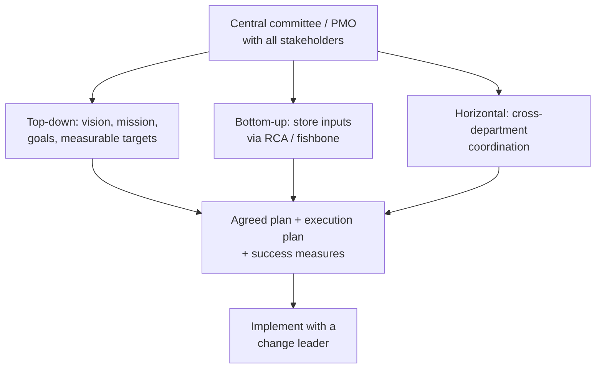
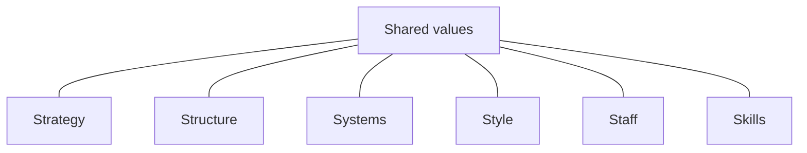
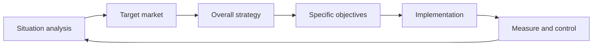
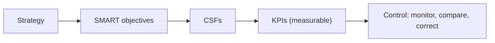
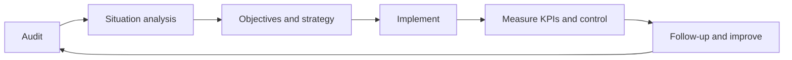

# Retail Strategy: Planning, 7S, KPIs and Audit

## What you will learn

- Why retailers fail at strategy: planning and implementation gaps (the "Arjun" retailer case)
- Top-down, bottom-up and horizontal planning, and how to combine them (with RCA and fishbone)
- The McKinsey 7S framework: hard vs soft components
- Situation analysis (5 Cs), SMART objectives, CSFs and KPIs, and the control step
- Pricing/discount logic, omnichannel, showrooming vs webrooming, scenario analysis
- The retail audit and the continuous strategy cycle

---

## 1. Case Background: The Arjun Retailer

**Simple idea:** A retailer wants to grow fast, but every department pulls in a different direction, so growth plans fall apart in execution.

**Analogy:** A rowing boat where each rower paddles hard but nobody agrees on direction or rhythm. More effort does not move the boat forward.

**Facts of the case**

- The retailer ("Arjun") has about **18 stores** and wants to reach **30 stores within 2 years**.
- The CEO's stance: the objective is not simply to grow faster; every part of the business must work toward one strategic direction.
- Perception of the company: very ambitious, wants to grow, but has problems inside its departments.

**Problems identified**

| Area | Symptom in the case |
|------|---------------------|
| Strategic coordination | Departments not aligned; poor coordination |
| Supply chain / procurement | Procurement struggles to source the right products |
| Technology integration | Online systems not in sync with the store inventory database; customers see unavailable products |
| Productivity | Some stores have larger teams but low footfall; this is not measured |
| Costs and results | Rising operating costs, falling revenue/performance, customer dissatisfaction |
| Department conflict | Finance wants cost cuts; Marketing wants aggressive campaigns; some want fewer employees while the CEO says do not cut staff without rationale |

**Planning and implementation gaps**

- **Inadequate stakeholder involvement**: senior management built an expansion strategy without consulting store managers and functional teams.
- **Lack of department coordination**: one department promotes products while another cannot procure them or integrate technology.
- **Insufficient resource planning**: unclear where, and how much, resource to put.
- **No implementation checkpoints**: no clear responsibilities or timelines.

**Key point:** Making a strategy is one thing; **implementing** it is another. Misaligned stakeholders and unclear objectives doom a strategy.

**Is 18 to 30 stores realistic?** Growth = $\frac{30-18}{18} = \frac{12}{18} \approx 67\%$ (about 1.67 times the current size) in 2 years. For a small retailer this is a very steep target, and the company did not align resources to it.

**Caveat:** The case is a fictional teaching scenario; the point is the pattern of gaps, not the specific numbers.

---

## 2. Strategy vs Tactics vs Operations

**Simple idea:** Strategy is the long-term direction; tactics are the medium-term moves; operations are the daily doing.

**Analogy:** A road trip. Strategy = the destination city; tactics = which highways and stops; operations = steering and braking each minute.

| Level | Who decides | Horizon | Example |
|-------|-------------|---------|---------|
| **Strategy** | Top management | Long term, whole organization | Become a top-2 retailer in the segment |
| **Tactics** | Middle managers | Medium term | Run a seasonal promotion |
| **Operations** | Operational staff | Day to day | Restock shelves, staff the counter |

- Strategy can exist at the **enterprise level** or at the **strategic business unit (SBU)** level.
- The organization is often drawn as a **pyramid**: operations at the bottom, tactics in the middle, strategy at the top.

---

## 3. Top-Down, Bottom-Up and Horizontal Planning

**Simple idea:** Decide who gets a voice when a plan is made: bosses only, front-line only, or all departments side by side.

**Analogy:** Planning a family trip. A parent decides alone (top-down), children's wishes are collected first (bottom-up), or every family member who must pack, drive and pay agrees together (horizontal).

| Approach | Direction | How it works | Strength | Weakness |
|----------|-----------|--------------|----------|----------|
| **Top-down** | Top to bottom | Senior management frames strategy and pushes it down | Quick decisions, few people involved, industry-savvy leaders | Far from reality; unforeseen implementation problems |
| **Bottom-up** | Bottom to top | Input from staff who deal directly with customers; the top then finalizes | Realistic, grounded in customer reality | Many people involved; slower |
| **Horizontal** | Across departments | Marketing, finance, HR, IT, procurement, store operations coordinate | Aligned execution | Needs a coordinating body |

**Horizontal example (promotion):** Marketing advertises a product. Then:

- Procurement ensures the advertised products are available.
- IT ensures online inventory is synced.
- Store operations ensures staff and displays are ready.
- Finance ensures adequate budget.

**How to integrate all three (recommendations)**

- Form a **centralized committee** (a PMO-like structure) with representatives from every stakeholder group.
- Decide what must change, the company goal, and how resources are shared; then write an **execution plan** with success measures, and get everyone to approve it.
- A **change leader with authority** is needed. In small companies every function head behaves like a mini-CEO, which makes agreement hard. Example given: when Tata announced the one-lakh-rupee car, the design team said it was impossible; the leadership replaced them with a person who said it could be done, and the car reached the market. The lesson: strong, authoritative leadership drives change.
- **Caveat:** Replacing dissenters is an extreme example; in general, a change leader needs authority *and* a process for buy-in.

### Getting bottom-level inputs: RCA and fishbone

- **Root Cause Analysis (RCA)** with the **5 Whys**: ask "why?" repeatedly (about five times) to reach the underlying cause. This brings grassroots inputs up into the strategy.
- **Fishbone (Ishikawa) diagram**: a diagram with the problem at the "head" and branches showing the different categories of causes.

**Worked mini-example (5 Whys):**

1. Why are customers unhappy? Products shown online are out of stock.
2. Why? Online inventory is not synced with stores.
3. Why? Systems were never integrated.
4. Why? Technology integration was not planned or resourced.
5. Why? Expansion strategy was set without consulting IT and store managers (the root cause).

---

## 4. McKinsey 7S Framework

**Simple idea:** An organization works well only when seven linked "S" elements fit together; some are easy to change, some very hard.

**Analogy:** Wood vs clay. Hard components are like a wooden block you can shape on paper and with tools. Soft components are like clay: they take long to build and one small mistake makes a mess.

The seven components: **S**trategy, **S**tructure, **S**ystems, **S**tyle, **S**taff, **S**kills, **S**hared values.

| Type | Components | Why | Can be changed by |
|------|------------|-----|-------------------|
| **Hard** | Strategy, Structure, Systems | Easy to define and alter; can be done on paper | Drawing a plan, redrawing hierarchy, putting systems in place |
| **Soft** | Style, Staff, Skills | Develop slowly | Long-term vision, time, money, effort (skills); style flows from founders/top executives downward |
| **Centre** | Shared values | Develop over a long time; has both hard and soft aspects | Long period of culture-building |

**Application to Arjun:** Strategy was drawn up, but implementation failed because staff (and style/skills) were not aligned with it. Shared values sit in the middle because all other elements must be consistent with them.

**Caveat:** In the standard model, Shared values is the core connected to all six others; the hard/soft split is a teaching simplification.

---

## 5. Retail Strategy Process

**Simple idea:** Go from "where are we?" to "where do we want to be?" to "are we getting there?", in a fixed order.

Steps stated in order: identify the target market, develop the overall strategy, convert it into specific objectives, implement, then **monitor and control** performance. Strategy covers customers, target market, merchandise, pricing, promotion, location and activities, and ways to improve productivity. The final goal is to **increase value for stakeholders/stockholders**.

**Four functions of management:** Planning, Organizing, Leading, Controlling. Control shows up in many frameworks and must always be remembered.

---

## 6. Situation Analysis and the 5 Cs

**Simple idea:** Before planning, find out where you stand right now by looking from five angles.

**Analogy:** Before a trip, check your fuel (company), other drivers (competitors), your passengers (customers), your suppliers of fuel and parts (collaborators) and the weather (climate).

| C | Look at | Arjun example |
|---|---------|---------------|
| **Company** | Present performance and state of operations | Productivity gaps, rising costs |
| **Competitors** | Major rivals, industry development | (Industry growth and rivals) |
| **Customers** | Tastes and preferences, how fast they change, economic conditions | Unavailable products frustrate them |
| **Collaborators** | Those who help manufacture or supply products | Procurement struggling to source products |
| **Climate / Context** | Business climate: smooth or troubled | Overall economic and business conditions |

Output of situation analysis: the basis for forming objectives.

---

## 7. SMART Objectives vs Goals

**Simple idea:** A goal is a wish; an objective is a wish with numbers and a deadline.

**SMART:** **S**pecific, **M**easurable, **A**ttainable (achievable), **R**ealistic, **T**ime-bound.

| Aspect | Goal | Objective |
|--------|------|-----------|
| Precision | Can be vague, broad | Must be specific |
| Scope | Gives room to widen operations | Narrow and testable |
| Example | "Be a leading retailer" | "Reach number 1 or 2 position in this industry within 5 years" |

- A company can have several objectives; they should be consistent with each other.
- Another example: a manufacturer promising a car priced below a given rupee amount within a stated number of years.
- Arjun's problem: the 18-to-30 stores in 2 years target is questionable on the "attainable/realistic" tests.
- **Strategic mismatch** (finance cutting vs marketing spending) damages the company badly.

**Caveat:** Textbooks vary on the "A" (attainable/achievable) and "R" (realistic/relevant); both are accepted.

---

## 8. Critical Success Factors (CSFs) and KPIs

**Simple idea:** A CSF is "what must go right"; a KPI is the number that tells you whether it is going right.

**Analogy:** For a runner, the CSF is "stay hydrated and keep pace"; the KPI is "litres drunk" and "minutes per km".

- **Critical Success Factor (CSF):** a factor or element that is vital for the organization's success at a stage. Examples: reaching more customers (a new, growing company), profitability, employees.
- **Key Performance Indicator (KPI):** a measurable form of a CSF.
- KPIs are **defined during strategic planning**, at the same time as objectives, and can differ by division, unit, organization and industry (finance KPIs differ from operations KPIs).

**Common retail KPIs**

| KPI | Meaning |
|-----|---------|
| Total sales | Overall revenue (and units sold) |
| Sales per store | Revenue per outlet |
| **Sales per square foot** | Revenue per unit of selling space; especially important in retail |
| Gross margin | Sales minus cost of goods sold |
| Operating income | Profit from operations |
| Units sold (SKUs) | Volume sold, counted by stock-keeping unit |
| Inventory turnover | How fast inventory sells |
| Markdown percentage | Share of price discounted |

**Sales can be viewed two ways:** volume (number of items/units sold) or revenue (money earned), plus profitability. The objective determines which KPI to track.

**Worked example (sales per square foot):** A store has Rs 6,00,000 sales in a month and 2,000 sq ft of selling space.

$$\text{Sales per sq ft} = \frac{6{,}00{,}000}{2{,}000} = \text{Rs } 300$$

Compare with another store: Rs 4,50,000 on 1,000 sq ft gives Rs 450 per sq ft, so the smaller store uses space better even though total sales are lower.

---

## 9. Pricing, Discounts and Profit

**Simple idea:** Every discount comes out of your profit, so give it only where it earns something in return.

**Analogy:** An abandoned-cart email with a discount code goes to the shopper who browsed and left, not to the loyal buyer who would have paid anyway.

### Targeted discounting

- Markdown is a KPI because discounts reduce profitability.
- Some companies send a discount code to people who added items to the cart but did not buy; they do not reward loyal regular buyers, because the loyal customer would buy anyway. Discount only where it changes behavior.

### MRP, willingness to pay and the markdown ladder

- **MRP (Maximum Retail Price)** is the ceiling price in India. A company knows a profit range: a minimum (base) profit when sold at a discount and a maximum when sold at MRP, with an expected average.
- **Customer willingness to pay (WTP)**: hard to know exactly; a customer who adds to cart is willing to buy, but perhaps not at the maximum price. So prices start at the top and step down.
- Typical seasonal pattern: start at the full price, then cut progressively, then clear stock and launch new products at full price.

**Worked example (markdown ladder on a Rs 1,000 item):**

| Month | Discount | Price (Rs) |
|-------|----------|------------|
| 1 | 0% | 1,000 |
| 2 | 10% | 900 |
| 3 | 20% | 800 |
| 4 | 30% | 700 |
| Clearance | 50% | 500 |

The retailer's plan already budgets the average margin across these steps. Strategy can pivot from "make more profit per unit" to "sell more SKUs" as the season ends.

**Exception - prestige pricing:** Apple does not cut prices and may raise them. A classic precedent: Chivas Regal raised its price when sales were slow, and buyers took the higher price as a sign of higher quality.

### Optimal pricing, bundles and decoys

- The objective is usually to maximize profit, but the practical goal is **optimal pricing**: raise some prices, cut others.
- **Bundles:** choose products that, together, maximize profit over the whole range.
- Retailers look at the **entire category's** contribution, not one product. Some products earn little but compensate elsewhere.
- **Decoy (bait) pricing:** a middle option priced so that adding a little more gets a much better product; the middle item is not expected to sell, but it pushes buyers to the higher one.
- Strategic decisions include which products and brands to stock.

**Caveat:** Willingness to pay and the decoy effect are standard marketing ideas; real pricing also depends on competition and demand.

### Pricing strategies by life-cycle stage

- **Price skimming:** start high, lower over time (typical for new/premium products).
- **Penetration pricing:** start low to win market share quickly.
- Choice depends on the objective and the product's life-cycle stage.

---

## 10. Targeting the Right Customer

**Simple idea:** You cannot serve everyone; pick who you serve and make every channel say the same thing.

- Choose a **segment**, not everybody. Credit cards illustrate this: silver, gold, platinum, and so on target different customer groups.
- Some customers are a **burden** (draining resources, energy); firms try to move away from them.
- **Message consistency:** the physical store targeted the upmarket buyer while the website sent a different message. Channels and messaging must be in sync; this looks trivial but is central to strategy.
- Brand image is built not only by marketing communication but also by whether operations and merchandise (right manufacturers) work in sync.

---

## 11. Corrective Actions to Improve Performance

For each stage of the strategy, find where the company went wrong, then fix:

- Review **merchandise selection** and **promotional effectiveness**; they must go hand in hand.
- **Integrate** online systems and physical inventory.
- Improve **demand forecasting** and **inventory replenishment**.
- Identify **slow-moving products** and rationalize inventory.
- Evaluate **store-level productivity**: define the purpose of each store; compare staffing with footfall.
- Adopt **omnichannel** thinking (next section).
- Use **scenario analysis** and contingency planning.

---

## 12. Omnichannel, Showrooming and Webrooming

**Simple idea:** Customers hop between online and store; the retailer must treat the channels as one journey.

**Omnichannel retailing:** multiple channels work together and are synchronized.

| Mindset | View of channels | Behavior |
|---------|------------------|----------|
| **Competing** | One channel's gain is another's loss ("eating the pie") | Underinvest in the weaker channel; some stores block mobile connectivity |
| **Cooperating** | Channels help each other sell | Store gives tablets so customers check stock and order online |

| Term | Behavior |
|------|----------|
| **Showrooming** | See and test the product in a physical store, then buy elsewhere (usually online) |
| **Webrooming** | Research online, then buy in the physical store |

A manager must decide how to handle each and how to help the customer; a satisfied customer grows the business.

---

## 13. Scenario Analysis and Contingency Planning

**Simple idea:** Ask "what if?" before it happens, and have a plan ready.

**Analogy:** Carrying an umbrella plan, a sunscreen plan and a normal plan for a trip.

Three standard scenarios:

1. **Best case**
2. **Worst case**
3. **Realistic case**

For each, plan actions in advance. Examples: the economy suddenly shatters; the government offers an incentive and you want to grab it. **Contingency plan:** what to do if a given scenario happens. Arjun could have used this to get a better grip on the future.

---

## 14. Retail Audit and the Continuous Cycle

**Simple idea:** A regular health check-up of the whole retail business, followed by action.

- A **retail audit** is a **systematic examination** done at **regular intervals**. It reviews objectives and strategy, and sits before control (measurement comes before control).
- Plan the audit by deciding: **who** conducts it, **when and how often**, **what** is audited, and the **audit form** (which can evaluate KPIs and "where do we stand now").
- Audit results feed the next **situation analysis** and produce recommendations; **implementing** the recommendations decides the benefit.
- Strategy is **not one-time**: it runs in cycles. Finish one, follow up, and start the next to improve continuously.

---

## Change Management and Management Styles

- Managers vary: democratic, autocratic and others, depending on personality.
- Managing change is a big challenge for managers; frameworks exist for it.

---

## Self-Check Questions

1. **Name three problems in the Arjun case.**
   Poor strategic coordination, procurement/supply issues, online-offline systems out of sync, and unmeasured store productivity (any three).

2. **Compare top-down, bottom-up and horizontal planning.**
   Top-down: top frames and pushes down. Bottom-up: front-line input moves up. Horizontal: cross-department coordination.

3. **Which 7S elements are hard and which are soft?**
   Hard: strategy, structure, systems. Soft: style, staff, skills. Shared values sit at the centre.

4. **List the 5 Cs of situation analysis.**
   Company, competitors, customers, collaborators, climate/context.

5. **How are CSFs and KPIs related?**
   A CSF is a vital success factor; giving it a measurable form creates a KPI.

6. **Differentiate showrooming and webrooming.**
   Showrooming: examine in store, buy elsewhere (online). Webrooming: research online, buy in store.

7. **What is the percentage growth from 18 to 30 stores?**
   $\frac{12}{18} \approx 66.7\%$.

8. **What decisions does an audit plan need?**
   Who audits, when and how often, what is audited, and the audit form.

---

## Exam and Assessment Hints

- Case questions are reused: expect to identify strategic hurdles and planning/implementation gaps, integrate three planning types, recommend corrective actions (3B), and design a retail audit framework that ensures the strategy is implemented and continuously improved (4C).
- Tie answers to the stages of strategy (analysis, objectives, implementation, control) and point out where the company went wrong at each stage.
- Use the frameworks by name (7S, 5 Cs, SMART, RCA/fishbone, scenario analysis) and apply them to the case.

---

## Common Pitfalls / Exam Traps

- Confusing **goal** (vague) with **objective** (SMART).
- Listing 7S components without saying which are hard vs soft.
- Treating strategy as one-time instead of a repeating cycle.
- Forgetting the **control** step and KPIs when answering strategy questions.
- Ignoring implementation: a good strategy with poor alignment fails.
- Mixing up showrooming and webrooming.
- Assuming every customer should get discounts; discounting reduces profit.
- Using "5 Cs" (analysis) for "5 Whys" (RCA); they are unrelated.

---

## Quick Revision Summary

- The Arjun case shows poor alignment, weak stakeholder involvement, resource gaps and missing checkpoints, so implementation fails.
- Combine top-down, bottom-up and horizontal planning through a central committee/PMO and a change leader; use RCA (5 Whys) and fishbone for bottom inputs.
- McKinsey 7S: strategy, structure, systems (hard); style, staff, skills (soft); shared values at the centre.
- Situation analysis uses the 5 Cs: company, competitors, customers, collaborators, climate.
- Objectives must be SMART; CSFs become measurable KPIs (e.g. sales per square foot, gross margin, inventory turnover, markdown %).
- Control is a key management function; the four functions are planning, organizing, leading, controlling.
- Pricing follows MRP-down markdown ladders, targeted discounts, bundles and decoys; premium brands may hold or raise prices.
- Omnichannel treats channels as cooperating; know showrooming vs webrooming.
- Scenario analysis (best, worst, realistic) plus contingency plans prepares for the future.
- A regular retail audit feeds the next cycle of situation analysis and continuous improvement.

---

**← [Previous](../week-06/01-communicating-with-retail-customers-image-and-promotion-transcript.md) · [Index](../README.md) · [Next](../week-08/01-retail-analytics-with-excel-data-to-decisions-transcript.md) →**
