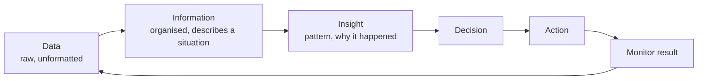

# Retail Analytics with Excel: Data to Decisions

## What you will learn

- Why data-backed decisions beat pure experience, and why judgment still matters
- The four types of analytics and the Data -> Information -> Insight -> Decision -> Action chain
- Core retail questions, level of detail, and primary / secondary / internal / external data sources
- How to turn insight into action and check data quality ("garbage in, gospel out")
- The Excel toolkit: statistics, COUNTIF/SUMIF family, lookups, Tables, PivotTables, slicers
- A worked retail case (500 transactions) solved with SUMIFS and PivotTables

---

## 1. Why Analyze Retail Data?

**Simple idea:** Look at what the numbers say before you decide, then add your own judgment on top.

**Analogy:** A doctor reads the test reports before prescribing, but still uses clinical experience when the reports look odd.

- One cited study found: decisions based only on part-time/domain experience turn out right about **40%** of the time; decisions based on data turn out right about **90% or more**.
- **Retail analytics** combines four ingredients: knowledge, relevant data, the method used, and **managerial judgment**.
- **Netflix example:** it holds huge data on which series, cast and director combinations are likely to be hits. Even so, it does not rely on data alone, because many things are not uncovered by data. Use data and experience together; emphasise both.

**Caveat:** the 40% / 90% figures are illustrative from one study, not a law. Data can mislead if it is poor or irrelevant (Section 6).

### Why decisions are harder now

- Customer preferences keep changing and demand fluctuates
- New competitors appear and margins narrow
- Customer expectations of service keep rising

So data is needed to decide **where to put emphasis and what to prioritise**. Analytics helps you to:

1. Identify problems
2. Recognise opportunities
3. Compare alternatives
4. Improve decisions

Retail analytics focuses on **customers, products, stores, promotions, inventory and sales channels**.

**Collect only meaningful data.** Collecting data costs money, time and effort, and unnecessary data can lead to false conclusions. Customers may also be uncomfortable sharing too much. "More data is always better" is false: collect data only if it will help a decision.

---

## 2. Four Types of Analytics

**Simple idea:** Four questions, in order: what happened, why, what next, what should I do?

**Analogy:** A shop owner sees sales fell (what), finds the shelf was empty (why), expects the same next festival (what next), and decides to order more stock earlier (what to do).

| Type | Question answered | Time focus | Example |
|------|-------------------|-----------|---------|
| **Descriptive** | What happened? | Past | Monthly sales by store |
| **Diagnostic** | Why did it happen? | Past (causes) | Sales fell because of stock-outs |
| **Predictive** | What may happen? | Future | Forecast demand next quarter |
| **Prescriptive** | What should we do to reach an objective or avoid unwanted outcomes? | Action | Recommend reorder level or promotion |

Progression: **understand performance -> explain it -> anticipate it -> act on it.**


---

## 3. From Data to Action

**Simple idea:** Raw facts become useful only after you organise them, find the pattern, decide, and act.

**Analogy:** Raw receipts in a shoebox (data), a sorted monthly sheet (information), noticing Mondays are weak (insight), choosing a Monday offer (decision), running it (action).



| Stage | Meaning |
|-------|---------|
| Data | Unformatted, raw, collected from different sources |
| Information | Data after processing; organised; describes a situation |
| Insight | Better understanding of why something happened; a pattern |
| Decision | Choice based on the insight |
| Action | Implementing the decision. Analytics alone does not help unless action follows |

### Start with a business question

Without a clear question, analysis becomes unfocused. Examples:

- A business is making **losses** for a few quarters: where is most of the loss generated? Which product contributes most?
- A business is making **profit**: where does most profit come from? Which stores are most profitable?

Also decide early:

- The **level of detail** (how do you identify customers, how deep to go)
- How employees fit in
- **How you will interpret the result**, right at the beginning

---

## 4. Retail Data, Basic Questions and Level of Detail

**Simple idea:** Each record (one sale) is a tiny piece of the business; organised together, records reveal patterns, differences, trends and relationships. They must connect to a business problem.

### Basic retail questions

| Dimension | Main question |
|-----------|---------------|
| Customer | Who is buying? |
| Product | What is being bought? |
| Transaction | What happened in the purchase? What was the average purchase value? |
| Place | Where did the sale happen? |
| Time | When did it happen? (spikes and ebbs) |

**Average Order Value (AOV)** = average transaction value:

$$AOV = \frac{\text{Total sales revenue}}{\text{Number of orders}}$$

Worked example: revenue of 2,00,000 over 400 orders gives AOV = 2,00,000 / 400 = 500 per order.

When a spike or dip occurs, ask whether it connects to a factor the data does not capture. Example: data is stored month-wise, but it does not say **when a festival falls**; knowing the festival month explains the sales rise of certain products. Some items sell less in a season because they are not needed then.

### Level of detail (granularity)

**Analogy:** A map of the whole country hides your street; a map of every house is too cluttered to see the city.

- **Too much aggregation** hides important differences (monthly totals hide a festival week).
- **Too much detail** makes patterns hard to see and costs time and money to gather and analyse.
- Aim for the **right level of detail for the decision maker**: enough understanding of the situation plus a broad overview. This balance is a tricky trade-off.

---

## 5. Sources of Data

**Simple idea:** Data you gathered for your own need versus data someone else gathered; data from inside your firm versus outside.

Two separate classifications that are often confused:

| Classification | Meaning | Examples |
|----------------|---------|----------|
| **Internal** | Generated within the retailer; explains what is happening inside | Sales transactions, customer records, inventory, store operations |
| **External** | Outside the organisation; gives wider market context | Demographics, competitor activity, market trends |
| **Primary** | Collected specifically for your requirement, fully aligned to it | Your sales data; a survey a market research firm runs for you |
| **Secondary** | Already collected by others, often not in the format you want; may contain extra data or need extraction | Reports from ministries, organisations, market research companies |

Key points:

- You control internal sales, customer, inventory and store data.
- **Primary data need not be internal.** If you commission a third-party marketing research company to gather data for you, it is still primary data.
- External data (demographics, competitors, trends) usually comes as published reports, hence **secondary**.

**Simplification gap:** Internal is usually primary and external is usually secondary, but the two axes are independent (third-party commissioned data is external-but-primary).

### No single source is complete

- **POS (point of sale) data** records purchases but does **not** show competitor purchases.
- **Loyalty data** leaves out **unidentified (non-member) customers**.
- Good analysis asks: What does this source reveal? What does it not reveal? What additional source is needed?

**Example: a decline in sales could mean**

- Lower demand
- **Stock-out**, so customers bought elsewhere
- A service problem
- More competition and loss of market share
- Your price too high, or competitors giving discounts

Different sources (sales, inventory, customer feedback) help separate these explanations. **Combine only the sources that improve the decision, not all available data.**

---

## 6. Turning Insight into Action

**Simple idea:** An insight is worthless until it changes something in the store, and every change must be checked for impact, cost and feasibility.

Typical actions:

- **Assortment:** what products to stock. Example: in a region with many people from a particular ethnic background, stock products that community prefers.
- **Replenishment:** where to order from and at what stock level to reorder.
- **Promotions:** when, what kind, through which channels.
- **Customer offers:** whom to give an offer and whom not to.
- **Service:** check how long service takes and improve it.
- **Local competition:** respond to it.

**Offer targeting example:** If customers already buy what you expect them to, a discount is "paying from your own pocket". Give incentives to customers who otherwise would **not** buy, to lure them to try the product.

### Check before acting

| Check | Question |
|-------|----------|
| Customer impact | Will customers actually buy if price drops or promotion increases? |
| Financial implication | Will extra volume overcome the reduced margin? Your concern is **profit, not sales volume** |
| Operational feasibility | Which channels? What trade-offs? |
| Behavioural effects | If fees are reduced, will customers take loyalty cards and become loyal? |

**Worked example (profit vs volume):** A product sells 100 units at price 100 with cost 70, so profit = 100 x 30 = 3,000. After a 10% price cut the price is 90, margin 20. To merely match 3,000 you need 3,000 / 20 = 150 units, a **50% volume increase**. Novice marketers assume a price cut always helps; it only helps if volume rises more than the margin falls.

Finally, **monitor the result** to see whether the original problem improved.

### Retail data should be

Systematically **collected, organised, integrated, stored, updated and accessible** (to the right people). This takes significant organisational effort. It supports routine decisions (promotions, store-wise sales), tracking whether performance improved or fell, solving problems and exploiting new opportunities.

---

## 7. Data Quality

**Simple idea:** If the ingredients are bad, the dish is bad, however good the recipe.

**Analogy:** Adding up a bill where one item was entered twice, and "M" and "Male" are treated as different people.

System-generated data is **not automatically analysis-ready**; it needs a quality check. Watch for "garbage" data, i.e. data not in the expected format.

| Issue | Effect / what to do |
|-------|---------------------|
| **Duplicate records** | Inflate numbers and give wrong output; remove them |
| **Missing values** | Common (customer skips a survey question, a paper form is not fully ticked). Decide how to treat them (covered later) |
| **Inconsistent codes across systems** | Store A uses Male/Female, store B uses M/F, store C uses 1/0. Aggregate and **transform** to one standard before analysis |
| **Product classification** | Define how products are classified and identified |
| **Inconsistent field definitions / price information** | Check consistency of definitions and prices |

Also remember computers store everything as 1s and 0s, so you must decide how values (e.g. gender) are represented in your tool.

- **GIGO: Garbage In, Garbage Out** - wrong input gives wrong output.
- **Garbage In, Gospel Out** - worse: you trust the faulty output as if it were truth and make wrong decisions.

---

## 8. Why Excel, and Its Limits

- Available on almost every computer; people are comfortable; usually no installation.
- Most managers use it, and it has strong functionality built over many years.
- **Limits:** cannot handle very large datasets well; slow, may crash. Then use other tools (Python, R, etc.).
- It is used in this course to understand how analysis works; the same ideas carry over to Python (the same functions and PivotTable logic exist there).

Typical Excel workflow: charts -> functions -> formulas, interpreted with statistical understanding. Check whether the answer is **meaningful**, not just computed.

---

## 9. Statistical Measures to Know

**Simple idea:** A few numbers summarise "typical", "spread" and "position".

| Group | Measures | What it tells you |
|-------|----------|-------------------|
| Central tendency | Average (mean), median, mode | What is typical |
| Dispersion | Variance, standard deviation | How data deviates from the expected location |
| Position | Minimum, maximum, rank, percentile, quartile | Where an observation stands relative to others |

**Percentile:** place everyone on a scale of 100. Someone at the **99th percentile** has 99% of others below them, i.e. is in the top 1%. CAT, GMAT and similar computer-based exams report percentiles.

**Quartiles:** divide data into four parts of 25% each: Q1 = 25th percentile, Q2 = 50th (median), Q3 = 75th, Q4 = the top quarter up to 100th.

Worked example: scores 10, 20, 30, 40, 50. Mean = 150/5 = 30; median = 30; no mode (all values appear once). Deviations -20, -10, 0, 10, 20; squared sum = 1000; population variance = 1000/5 = 200 (sample variance = 1000/4 = 250); standard deviation = $\sqrt{200} \approx 14.14$ (population).

$$\sigma^2 = \frac{\sum (x_i - \mu)^2}{N}, \qquad \sigma = \sqrt{\sigma^2}$$

Where $x_i$ is each value, $\mu$ the mean, $N$ the count. These measures show what is typical, how much value the business carries, and which observations stand out.

---

## 10. Essential Excel Functions

### COUNT / SUM / AVERAGE families

**Simple idea:** Count, add or average only the rows that meet your condition.

**Analogy:** "How many red shirts did we sell, and what was the total rupee value of red shirts sold in the North?"

| Need | Function |
|------|----------|
| Count items | `COUNT` |
| Count with one condition | `COUNTIF` |
| Count with several conditions | `COUNTIFS` |
| Total | `SUM` |
| Total with one condition | `SUMIF` |
| Total with several conditions | `SUMIFS` |
| Average with condition | `AVERAGEIF` (and `AVERAGEIFS`) |

Syntax and example:

```
=SUMIFS(sum_range, criteria_range1, criteria1, [criteria_range2, criteria2], ...)
=SUMIFS(I:I, D:D, "East")
```

Here column I holds **total sales amount** and column D holds **region**; Excel sums column I only where column D equals "East". Note the argument order: **sum range comes first** in SUMIFS (in SUMIF the sum range comes last).

### Lookup functions

**Simple idea:** Find a name in a table and fetch the related information next to it.

**Analogy:** Looking up a product in a price list to get its price.

- **VLOOKUP** (vertical lookup), **HLOOKUP** (horizontal lookup): older functions that still exist.
- **XLOOKUP**: the newer replacement for VLOOKUP.
- Example: a white-goods table (refrigerator, washing machine, TV), assuming one model each with one price. A lookup finds "refrigerator" and returns its price; it can also return information tied to a particular transaction.

| Function | Direction | Note |
|----------|-----------|------|
| VLOOKUP | Searches down the first column, returns from a column to the right | Older |
| HLOOKUP | Searches across the top row | Older |
| XLOOKUP | Either direction, more flexible | Newer successor to VLOOKUP |

### Excel Tables

Select the data range -> Insert -> Table. Benefits:

- Automatically identifies the data range
- Quick totals and averages
- New rows/columns are **automatically included** in the table
- **Banded rows** (alternating colours) make it easy to see which values belong to the same transaction
- Easy sort and filter; structured cell references

Use Excel Tables whenever possible, and keep data **consistent** and structured. You do not have to memorise all functions or shortcuts; learn those relevant to your business and practise, since they work in a similar fashion.

---

## 11. PivotTables, PivotCharts and Slicers

**Simple idea:** A PivotTable lets you re-arrange the same data into different summaries by dragging fields.

**Analogy:** Rotating a **Rubik's Cube** to look at the data from different angles to see how it reflects the business.

- **PivotTable:** summarises data by chosen rows, columns, filters and values.
- **PivotChart:** the graphical version of the PivotTable. Together they are extremely important and widely used by retail managers ("best of both worlds": table plus chart).

### Steps (as done on the case data)

1. Select the entire data range (or convert it to a Table).
2. Insert -> PivotTable (or PivotChart and table).
3. Drag fields into **Rows**, **Columns**, **Filters** and **Values**.
   - Example: **Quarter** in rows; **Region** and **Product Category** as filters; **Sum of Total Sales Amount** as values; stores (Ahmedabad, Bangalore, Chennai, Delhi, ...) in columns.
4. Use **Value Field Settings** to change the summary: Sum (default), Count, Average, Max, Min, Product, etc.
5. Read the **Grand Total** for rows and columns.
6. Insert **slicers**.

### Slicers

Button-like filters. Click an item (e.g. only Washing Machine) and the table updates; select several (North and South) or all; focus on only Chennai and Delhi. They behave like filters but are easier to use.

| Tool | Best for |
|------|----------|
| Formula (SUMIFS) | One specific number, precise and repeatable |
| Chart | Visual pattern for a fixed view |
| PivotTable / PivotChart | Exploring many cuts of the data quickly |

---

## 12. Worked Case: Retail Sales Dataset

The dataset had **500 transaction rows**, **4 product types** (e.g. refrigerator, washing machine, TV), **different prices** for the same product type (a TV or refrigerator price is not always the same), and **several stores in different cities** grouped into regions (North, South, East, ...), with quarters.

| Question | Approach |
|----------|----------|
| 1. Total company revenue and top contributing region | `SUMIFS` on total sales amount by region (or PivotTable); compare each region's share |
| 2. Analytical view over time/category | PivotTable, line chart or clustered column chart; slicers |
| 3. Product performance (units sold, revenue) | `SUMIFS` per product; repeat for each region (and quarters if wanted) |
| 4. Further conditional totals | `SUMIFS` with multiple criteria |

Results obtained:

- **Total company revenue is about 2.45 (in the dataset's currency unit, across all 500 transactions).** The unit was unclear in the source; confirm it from the dataset.
- **East** was the top contributing region, reported as **36.68** (this is the figure recorded for the East region; it is best expressed as a share of total revenue).
- Region revenue alone is not enough: express it as a **percentage**.

$$\text{Region share (\%)} = \frac{\text{Region revenue}}{\text{Total revenue}} \times 100$$

Illustrative check: if total revenue were 2.45 and East revenue were about 0.90, then share = 0.90 / 2.45 = 36.7%, consistent with 36.68 being a percentage share. A **pie chart** is an easy graphical way to show these shares.

Python (pandas) equivalents work the same way: a `groupby` sum is the same logic as SUMIFS, and `pivot_table` matches the Excel PivotTable. Using Python is acceptable, but the course uses **Excel**.

Final analysis loop to apply as a manager: output -> pattern -> interpretation -> decision -> monitor effect. Ask: What is different? How has it evolved over time? Where is the strongest pattern? What explains a change in the pattern?

---

## Exam and Assessment Hints

- The course moves into **retail analytics using Excel**; expect Excel-based, dataset-driven questions (SUMIFS, PivotTables, charts).
- Be ready to define and distinguish the four analytics types, and the data -> information -> insight -> decision -> action chain.
- Know primary vs secondary and internal vs external data with examples.
- Recommended reading: *Excel Practices That Improve Analysis* (shared reading).
- An answer key for the case dataset is shared after class; practise with it.
- Express contributions as **percentages** (region revenue / total revenue), not only raw totals.

---

## Self-Check Questions

1. **What are the four types of analytics?**
   Descriptive (what happened), diagnostic (why), predictive (what may happen), prescriptive (what to do).

2. **Is internal data the same as primary data?**
   No. Internal/external is about location; primary/secondary is about fit with your need. Third-party data commissioned for you is primary but external.

3. **Why is "more data is always better" wrong?**
   Collection and storage cost money, time and effort, customers may resist sharing, and irrelevant data can mislead.

4. **What does GIGO versus "garbage in, gospel out" mean?**
   Bad input gives bad output; gospel out means you trust that bad output as truth, which is worse.

5. **Which Excel function totals sales for one region?**
   `SUMIFS(total_sales_column, region_column, "East")`; a PivotTable gives the same result.

6. **What is the 99th percentile?**
   99% of the others score below you; you are in the top 1%.

7. **Why do POS and loyalty data each give an incomplete picture?**
   POS lacks competitor purchases; loyalty data excludes unidentified customers.

8. **Why check profit and not just sales after a price cut?**
   Lower price shrinks margin; volume must rise enough to compensate, otherwise profit falls.

---

## Common Pitfalls / Exam Traps

- Treating primary as "internal only"; primary data can come from a third party.
- Using SUMIFS with the criteria range first; the **sum range goes first** in SUMIFS.
- Reporting raw regional revenue without the percentage share of total.
- Assuming system-generated data is clean; duplicates inflate totals and inconsistent codes (M/F vs 1/0) break aggregation.
- Over-aggregating (hides festival or seasonal effects) or over-detailing (hides the pattern).
- Believing data replaces judgment (or the reverse); use both.
- Assuming a price cut raises profit; check the margin effect.
- Stopping at insight; analytics without action and monitoring is incomplete.
- Using Excel for very large datasets; it may be slow or crash.

---

## Quick Revision Summary

- Data-based decisions are right far more often (about 90% versus about 40% in the cited study), but combine them with managerial judgment (Netflix example).
- Four analytics types: descriptive, diagnostic, predictive, prescriptive.
- Chain: Data -> Information -> Insight -> Decision -> Action, then monitor; begin with a clear business question.
- Choose the right level of detail; avoid both too much aggregation and too much detail.
- Data sources: internal/external and primary/secondary; no single source is enough, so combine only what improves the decision.
- Before acting, check customer impact, profit implication and operational feasibility.
- Check quality: duplicates, missing values, inconsistent codes; GIGO and "garbage in, gospel out".
- Excel toolkit: mean/median/mode, variance/SD, percentile/quartile, COUNTIF/SUMIF/AVERAGEIF(S), VLOOKUP/XLOOKUP, Tables, PivotTables, PivotCharts, slicers.
- Case: 500 transactions, total revenue about 2.45, East top region; show contribution as a percentage (pie chart).

---

**← [Previous](../week-07/01-retail-strategy-planning-7s-kpis-and-audit-transcript.md) · [Index](../README.md) · [Next](../README.md) →**
