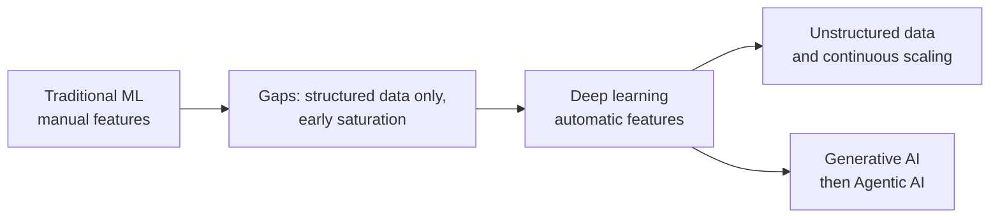
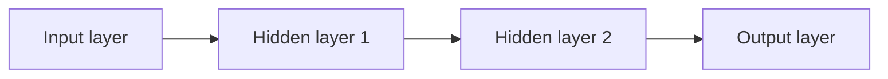
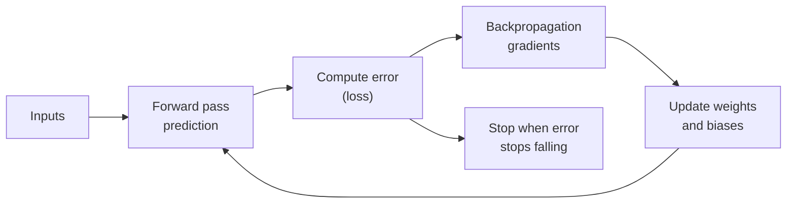
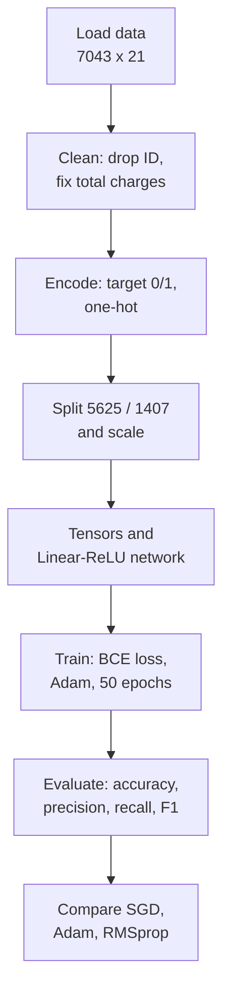

# Deep Learning Foundations: Concepts, Training Loop and Churn Case Study

## What you will learn

- Why deep learning exists: the limits of traditional machine learning and how deep networks remove them
- Universal approximation, depth versus width, and hierarchical feature reuse
- The four-step training pipeline: forward pass, error, backpropagation, weight update (and the chain rule behind it)
- Training problems and remedies: vanishing gradients, learning rate, optimizers, overfitting and regularization
- Choosing loss functions (MSE, MAE, Huber, cross-entropy, focal loss), the linear layer, parameter counting and hardware limits
- A complete PyTorch customer-churn case study: data prep, network, training, evaluation, optimizer comparison, STAR format

---

## 1. Why Deep Learning? Machine Learning's Gaps

**Simple idea:** Classic machine learning needs a human to tell the computer what to look at; deep learning learns what to look at by itself, and handles messy data like pictures and sound.

**Analogy:** A bank analyst building a loan-risk model first decides which columns matter (income, age, past defaults) and hand-builds them. That is traditional ML. Now imagine instead handing the system raw photos of cheques and letting it work out which strokes and shapes matter. That is deep learning.

### Traditional machine learning: the limitations

| Limitation | What it means |
|---|---|
| **Manual feature engineering** | You must know the domain (healthcare, banking, telecom...) and decide, create or fetch the **features** (the columns of the data) yourself, then verify that all necessary ones exist. |
| **Needs structured data** | Works best on clean, tabular data (rows and columns, like a spreadsheet) with numeric or categorical values. |
| **Early saturation** | If the dataset size stays fixed, performance flattens at some point no matter how much you tune; more data is needed to improve further. |
| **Poor on unstructured data** | Images, audio, video (and, partly, text) cannot be neatly placed in a table. ML was used on them but gave weak results. |

### What deep learning changes

| Aspect | Traditional ML | Deep learning |
|---|---|---|
| Features | Hand-crafted by domain experts | **Learned automatically** from raw data because of the network architecture |
| Data type | Structured, clean, tabular | Structured and **unstructured** (image, audio, video, text) |
| Performance vs data | Saturates early | Keeps improving as data and model size grow |
| Scaling | Limited | Scales continuously: add layers/units/parameters as the problem grows |

**Structured vs unstructured data:**

- **Structured:** fixed rows and columns, clean numbers or categories (spreadsheet, database table).
- **Unstructured:** no tabular layout. An image is a grid of many coloured pixels; you cannot sensibly squeeze it into a few named columns. Text is *semi*-structured: partly structured, but not completely.

### Scaling, by analogy

An application built for 10 users breaks if 2,000 arrive suddenly. A robust system should cope with 10, 100 or 2,000. In the same spirit, a deep network can keep **scaling**: when the use case becomes more complex you add more layers and parameters, and the architecture can absorb it.

### Why it matters

Generative AI and agentic AI both grew out of deep learning research. To judge a design (for example, "if I do this tomorrow, will my system cope?"), always relate a technique to a concrete use case.

**Simplification gap:** "Deep learning removes feature engineering" is not absolute. Data still needs cleaning, scaling and encoding (see the churn case study below), and deep models need much more data and compute than classic ML. For small tabular datasets, classic ML is often as good or better.

---

## 2. Network Structure: Layers, Universal Approximation, Depth vs Width

**Simple idea:** A deep network is a chain of simple steps; stacked together they can learn almost any pattern.

**Analogy:** An assembly line in a factory. Each station does a small, simple job, but a long line can build something very complicated.

### Basic structure

A network has an **input layer**, one or more **hidden layers**, and an **output layer**. The harder the problem, the more hidden layers (or units) you add. Each unit in a hidden layer applies a mathematical function called an **activation function**.

### Universal approximation

**Simple idea:** Given enough units, a network can imitate any reasonable input-output relationship.

**Precise statement:** A network with a **single hidden layer** using a suitable (non-linear) activation function can approximate any continuous function to any desired accuracy, provided the layer has **sufficient width** (enough units). Each hidden unit contributes a small non-linear piece, and together the pieces fit a complicated curve. The result passes from layer to layer to give the final answer.

**Caveat:** The theorem says such a network *exists*; it does not say that training will find it, that it needs few units, or that it generalizes well.

### Depth vs width

- **Depth** = number of layers stacked one on top of another.
- **Width** = number of units side by side within a layer.

| | Deep network | Wide (shallow) network |
|---|---|---|
| Shape | Many hidden layers | Few layers, many units each |
| Strength | Builds complex patterns layer by layer; can be more efficient and faster to reach a good fit for complex problems | One layer can in principle approximate anything, but may need very many units |
| Caveat | Harder to train (see vanishing gradients) | May work poorly or be inefficient for complex structure |

A deeper network is often more efficient than a wide, shallow one, **but not in every case**.

### Hierarchical feature reuse

**Simple idea:** Early layers learn simple building blocks; later layers combine them into big ideas.

**Analogy (image):** Early layers detect edges, middle layers combine edges into shapes, deeper layers combine shapes into "wheel", "face" or "car".

- **Lower (early) layers:** simple, general patterns.
- **Deeper layers:** complex, abstract concepts.
- Lower-layer results are **reused** by higher layers, so nothing is recomputed from scratch.

This is a core reason deep learning became important, along with approximation power and scalability.

### Choosing wide or deep by data type (course guidance)

| Data | Suggested shape | Reasoning given |
|---|---|---|
| Images (for example 100 categories) | Wide networks | Image input passes through layers one after another, and each layer picks up a different set of features or portion of the image; understanding requires sequential understanding of various parts of the input |
| Text (for example sentiment analysis of product posts) | Deep networks | Stacking layers increases the capacity of each unit; text needs richer understanding within a layer rather than a sequential piece-by-piece view. RNNs and Transformers are the text architectures studied later |

**Simplification gap:** This is a rule of thumb, not a law. In current practice, image models (CNNs) are usually *deep* as well, and the stronger result is that depth gives efficient hierarchical features. Use the heuristic for exam answers as stated in the course, but be ready to justify any architecture by the use case.

**Scope note:** Computer vision (CNNs), RNNs and Transformers come in later weeks. Generative AI appears near the end of the course, with a short introduction to agents (to show the path from deep learning to generative AI to agentic AI); agentic AI is not covered in depth.

---

## 3. The Training Pipeline: Forward Pass, Error, Backpropagation, Update

**Simple idea:** Guess, see how wrong you are, adjust, and repeat until the guesses are good enough.

**Analogy:** Learning to throw darts. You throw (forward pass), see how far you missed (error), remember the feedback and change your aim (weight update), and throw again. You stop when you keep landing at the same distance from the target and stop improving.

### The four steps

1. **Forward pass:** inputs flow through the layers (input, hidden, output) to produce a prediction.
2. **Error (loss):** the difference between the original (true) value and the model's output. The aim is to **reduce this error**.
3. **Backpropagation:** go backwards through the network and compute how each parameter contributed to the error.
4. **Update:** change the **weights and biases** (the learnable parameters) using mathematical update formulas, then repeat from step 1.

- Weights and biases start at **default (initial) values**.
- The cycle is **iterative**: forward pass, error, backpropagation, update, repeat.
- **Stopping:** when the error becomes small, or **flat** (the last 2-3 steps give the same error), stop.

### The update rule and the chain rule

The loss is differentiated with respect to each weight, using the **chain rule** (a calculus rule for derivatives of composed functions; the exact algebra need not be memorized, but the idea must be understood). The derivative of the loss is called the **gradient**.

$$w_{\text{new}} = w_{\text{old}} - \eta \,\frac{\partial L}{\partial w}$$

- $w$: a weight; $L$: loss (error); $\frac{\partial L}{\partial w}$: gradient (how the loss changes when $w$ changes);
- $\eta$: **learning rate** (step size).

In words: weight $W_1$ becomes $W_2$ after taking the derivative of the loss and moving a small step against it.

**Worked example:** $w_{\text{old}} = 0.50$, gradient $= 0.20$, $\eta = 0.1$.

$$w_{\text{new}} = 0.50 - 0.1 \times 0.20 = 0.48$$

If the gradient were $-0.20$ the weight would rise to $0.52$. A positive gradient means "increasing $w$ raises the loss", so you decrease $w$.

**Chain rule intuition:** for a deep network, $\frac{\partial L}{\partial w_1} = \frac{\partial L}{\partial a_n}\cdot\frac{\partial a_n}{\partial a_{n-1}}\cdots\frac{\partial a_2}{\partial w_1}$, a product of many local derivatives, one per layer. This product is the source of the gradient problems below.

---

## 4. Vanishing Gradients and Their Fixes

**Simple idea:** The feedback signal gets weaker and weaker as it travels back through many layers, until the early layers barely learn.

**Analogy:** A message whispered down a line of 200 people: by the end almost nothing is left.

### Definition

In a deep network, the gradient is a product of many derivatives. Going back many layers (for example, 200 steps), repeated multiplication of small numbers makes the gradient **very, very small (negligible)**. You can no longer tell whether weights are changing: the gradient is said to be **vanishing**, and early layers learn extremely slowly or not at all.

**Numeric feel:** if each layer contributes a factor of 0.5, after 10 layers the gradient is $0.5^{10}\approx 0.001$; after 20 layers $\approx 10^{-6}$.

### Remedies

| Remedy | How it helps |
|---|---|
| **ReLU activation** | Other activations (sigmoid, tanh) suffer **saturation**: the curve goes flat, so derivative is near zero. ReLU, $f(x)=\max(0,x)$, does not flatten for positive inputs (derivative 1), breaking that flatness. |
| **Residual connections** | Let gradients **bypass deep layers directly** (skip connections), so they reach early layers intact. |
| **Gradient stability techniques** | Other methods that keep gradients well-behaved through the chain rule. |

**Caveat:** ReLU can have "dead" units for negative inputs (gradient 0), and gradients can also *explode*; the same family of stabilizing techniques addresses these.

---

## 5. Learning Rate

**Simple idea:** The learning rate is how big a step the algorithm takes each time it adjusts the weights.

**Analogy:** Walking down into a valley in fog. Giant steps make you overshoot and bounce from side to side; tiny steps get you there only after a very long time; steady medium steps work best.

| Learning rate | Behaviour |
|---|---|
| Too high | Overshoots; zig-zags or shoots out, may never settle |
| Too low | Very slow; time and compute wasted |
| Well-chosen / scheduled | Smooth progress to convergence (saturation/flat loss) |

A **learning rate schedule** changes the rate during training (neither too fast nor too slow) so the process smooths out. Learning rate is one of the most important hyperparameters; it controls the speed at which learning happens.

---

## 6. Optimizers

**Simple idea:** An optimizer is a smarter way of using the gradient to take steps, so training is faster and more efficient.

**Analogy:** Basic walking downhill (SGD) versus a rolling ball that builds momentum, or a hiker who takes shorter steps on steep, bumpy slopes (adaptive methods).

| Optimizer | Idea |
|---|---|
| **SGD** (Stochastic Gradient Descent) | Update using the gradient of a small random subset (mini-batch) of data; simplest baseline |
| **Momentum** | Adds a running average of past gradients so movement keeps going in a consistent direction |
| **RMSprop** | Scales each parameter's step by a running average of recent squared gradients (adaptive step size) |
| **Adam** | Combines momentum with RMSprop-style adaptive scaling |

Which optimizer to use depends on the use case; you should be able to justify the choice for a given scenario. See the churn case study for a hands-on comparison.

---

## 7. Overfitting and Regularization

**Simple idea:** Overfitting is memorizing the practice questions instead of learning the subject.

**Analogy:** A student who memorizes last year's paper scores 100% on it but fails a new paper.

### Definition

**Overfitting:** the model performs very well on training data but poorly on unseen (test) data; it is overconfident on data it has seen and much less confident on new data. It is a tendency of any model (ML or DL), not only deep learning.

### Regularization techniques

| Technique | What it does |
|---|---|
| **Dropout** | Randomly switches off some parts (units) of the network during training so the network cannot rely on specific units |
| **L1 / L2 regularization** | Adds a penalty on weight size to the loss (L1: sum of absolute values; L2: sum of squares), keeping the model simpler |
| **Batch normalization** | Normalizes the inputs to a layer before passing them on, which stabilizes training and has a mild regularizing effect |

Know what happens when regularization is **not** done: the train-test gap grows (overfitting).

**Caveat:** Batch normalization's main purpose is stabilizing and speeding up training; its regularization effect is a side benefit.

---

## 8. Loss Functions

**Simple idea:** The loss function is the scorecard that measures how wrong the model is; choosing the wrong scorecard misdirects all learning, because the gradient comes from it.

**Analogy:** Grading a delivery driver by average lateness versus penalizing very late deliveries heavily; the grading rule changes behaviour.

### Regression losses (predicting a number)

| Loss | Formula | When to use |
|---|---|---|
| **MSE** (Mean Squared Error) | $\frac{1}{n}\sum_{i}(y_i-\hat y_i)^2$ | Large errors/outliers must be penalized heavily |
| **MAE** (Mean Absolute Error) | $\frac{1}{n}\sum_{i}\lvert y_i-\hat y_i\rvert$ | Robust when targets are noisy; outliers do not dominate |
| **Huber loss** | Quadratic for small errors, linear for large errors | Compromise between MSE and MAE |

$y_i$ = true value, $\hat y_i$ = prediction, $n$ = number of samples.

**Worked example:** errors of $1, 1, 1, 10$.

- MSE $=(1+1+1+100)/4 = 25.75$ (the outlier dominates).
- MAE $=(1+1+1+10)/4 = 3.25$.

### Classification losses (predicting a class)

| Loss | Use |
|---|---|
| **Cross-entropy** | Most common; compares the predicted probability distribution with the true labels (a likelihood-based measure) |
| **Binary cross-entropy** | Two-class problems |
| **Focal loss** | **Imbalanced data**: dynamically down-weights easy examples so the model focuses on hard/minority ones |

**Imbalanced data example (healthcare):** patients with diabetes vs without. The non-diabetic population is much larger, so classes are unequal. In ML you would balance the data first; with focal loss, weights are assigned dynamically (high for some examples, low for others) based on the examples.

**Why it matters:** the loss is what gets differentiated, so choose it wisely for each use case.

---

## 9. Loss Landscapes: Saddle Points, Curvature and Noise

**Simple idea:** The loss surface is a hilly terrain; training is walking downhill, and the terrain has traps.

- **Saddle point:** a flat spot that is a minimum in one direction and a maximum in another; the algorithm gets stuck there.
- **Hessian curvature:** the second-derivative information describing the shape of the surface; curvature can be positive, negative or zero in different directions.
- **Noise:** small inconsistencies in the data distort the loss, which distorts the derivative, which distorts weight updates, ultimately harming the output.

Understanding the loss landscape explains why training sometimes stalls or behaves unpredictably.

---

## 10. Linear Layer, Parameter Counting and Memory

**Simple idea:** A linear layer is the straight-line equation $y = mx + c$ scaled up to many inputs and outputs; training means finding its weights and biases.

### The fully connected linear layer

$$y = Wx + b$$

- $x$: input vector; $W$: **weight matrix**; $b$: **bias**; $y$: output.
- The algorithm's job is to find the values of $W$ and $b$. Forward pass and backpropagation repeat until good values are found.
- Computation is **matrix multiplication**, which looks simple but is **computationally heavy** for large networks, with many equations and many repeated weight updates.

### Parameter counting

For a layer with $n_{in}$ inputs and $n_{out}$ outputs:

$$\text{parameters}=n_{in}\times n_{out}\;(\text{weights})+n_{out}\;(\text{biases})$$

**Worked example:** a network $20 \to 64 \to 1$.

- Layer 1: $20\times 64 + 64 = 1344$
- Layer 2: $64\times 1 + 1 = 65$
- Total $=1409$ parameters.

Other quantities to estimate: **activation memory** and **optimizer states** (for example, Adam stores extra running averages per parameter).

**Why it matters:** more parameters means a more complex model and more memory. Do not use a huge model for a simple problem; it only adds complexity without benefit.

---

## 11. Hardware Considerations: Memory Wall, Roofline, Quantization

**Simple idea:** Big models are limited not only by maths but by how fast data can move in the machine.

**Analogy:** A fast chef (processor) is useless if ingredients arrive slowly from the store room (memory).

- **Memory wall:** a lot of data moves between memory and compute units; memory **bandwidth** (including GPU bandwidth) becomes the bottleneck. Complex applications may require GPUs.
- **Roofline model:** a performance model showing whether a workload is limited by compute or by memory bandwidth.
- **Batching:** how data is grouped into batches, and how increasing batch size affects hardware use.
- **Hardware acceleration and system optimization:**
  - **Quantization:** compressing a model by using fewer bits per number (for example from 32 bits down to 4 bits), which reduces memory and increases effective bandwidth.
  - Number of **Tensor cores** (hardware units), **kernels**, and **attention** blocks that help manage memory problems.

**Why hardware appears in a deep learning foundation:** such models are used for large applications (for example, image classification over huge image sets, not 5-10 images), so scalability depends on hardware as well as algorithms.

**Caveat:** Quantization usually trades a small accuracy loss for large memory and speed savings.

---

## 12. Key Takeaways and How to Study

- How deep learning works and how it eliminates manual feature engineering.
- How gradients, backpropagation and optimizers work.
- Which hardware considerations matter at scale.
- The aim is **application-based understanding**: you need to know the concepts and formulas, but not memorize them; you should be able to answer "in this situation, which optimizer, which learning rate, which loss?"
- The foundation covers roughly six topics.
- Think in terms of use cases: a robust system needs strong understanding of each network component, otherwise the architecture is weak and the system breaks.

---

## 13. Case Study: Customer Churn Prediction with PyTorch

**Simple idea:** Predict whether a telecom customer will leave (churn), using a small neural network.

**Context:** A telecom company wants to know which customers are about to leave so it can act in time. The dataset is a telecom churn dataset from Kaggle (also supplied through the LMS). It is a worked example of the whole pipeline: data, preprocessing, network, forward pass, loss, backpropagation, optimization, training and evaluation. The code was run on SageMaker with data stored in an S3 location.

### The STAR format

Structure every problem like this:

| Letter | Meaning |
|---|---|
| **S**ituation | What is the context/problem? |
| **T**ask | What are you trying to achieve? |
| **A**ction | What steps did you take? |
| **R**esult | What was the outcome? |

### Data

- **7,043 rows and 21 columns.**
- Features include tenure, monthly charges, total charges, contract type, internet service, payment method.
- Target: churn, with labels Yes/No. Check how many customers have churned and how many have not (class balance).

### Preprocessing steps

1. **Drop the ID column** (adds no analytical value).
2. Convert the **total charges** column to numeric.
3. Convert the target Yes/No to **1/0**.
4. **One-hot encode** categorical variables (this increases the number of columns).
5. **Train-test split** as in classical ML: **5,625 training rows and 1,407 test rows** (7,032 in total, i.e. 80% / 20%; the 11 rows fewer than 7,043 are those removed when total charges could not be converted, a common data issue in this dataset).
6. **Scale** features to a common scale.
7. Convert data to **torch tensors**, since PyTorch is used.

### Model, loss, optimizer

- Architecture: **Linear, ReLU, Linear, ReLU, Linear (output)**: a simple feed-forward network.
- Loss: **sigmoid with binary cross-entropy** (churn is a two-class problem).
- Optimizer: **Adam**.
- An **epoch** is one complete pass through the training data. The loop per epoch: call the model (forward pass), compute loss, backpropagate, optimizer step.
- Training ran for **50 epochs**, with loss recorded every **10th** epoch; the loss should decrease. You can increase the epochs or change the logging interval.

### Evaluation

- **Test accuracy: about 75-76%.**
- Precision, recall, F1 reported per class (churn and no churn): decent but not great; churn F1 and recall can be improved.
- Accuracy above roughly 70-75% is considered decent for churn prediction, though this is not a fixed benchmark.
- Reported **churn recall is only about 16%**, meaning the model catches the churners only 16% of the time. Causes: **small dataset, unoptimized hyperparameters** (and likely class imbalance). Improve with hyperparameter tuning, a larger dataset, imbalance handling (for example focal loss or class weights).
- With such a small dataset there is a high chance of some **overfitting**, so the result is a demonstration of implementation, not a performance benchmark to compare with others.

**Key formulas for the metrics:**

$$\text{Precision}=\frac{TP}{TP+FP},\quad \text{Recall}=\frac{TP}{TP+FN},\quad F1=\frac{2PR}{P+R}$$

**Worked example:** 100 actual churners; the model finds 16 of them: $TP=16$, $FN=84$, so recall $=16/100=16\%$.

**Why recall matters for churn:** missing a churner (false negative) means a lost customer, so recall for the churn class is usually the metric to improve.

### Optimizer comparison experiment

Same architecture, same data, **same learning rate 0.001**; only the optimizer changes: **SGD vs Adam vs RMSprop**. Results are shown in a table of optimizer, learning rate, loss and test accuracy, and as plotted loss curves.

- A curve that goes **flat** means the model is not learning (not performing well).
- In this example **RMSprop** gave the best result (**almost 80% accuracy**) and converged in a slower, steadier way.
- This is only an illustration, **not a ballpark figure**; results depend on data and settings.

### Suggested activities

Try different optimizers, learning rates and other parameters, and observe the results; try to improve churn recall and F1.

---

## Comparison: Look-Alike Concepts

| Concept A | Concept B | Difference |
|---|---|---|
| Deep learning | Machine learning | DL learns features automatically and handles unstructured data; ML needs manual features and mostly structured data |
| Structured data | Unstructured data | Tabular rows/columns vs images, audio, video (text semi-structured) |
| Depth | Width | Layers stacked vs units side by side |
| Forward pass | Backpropagation | Prediction flow vs error and gradient flow backwards |
| Vanishing gradient | Overfitting | Training signal dies in deep layers vs model memorizes training data |
| MSE | MAE | Penalizes large errors/outliers heavily vs robust to noisy targets |
| Cross-entropy | Focal loss | General classification vs imbalanced classification |
| L1/L2, dropout, batch norm | Optimizers | Reduce overfitting/stabilize vs speed up and improve optimization |

---

## Self-Check Questions

**Q1. Name three limitations of traditional machine learning that deep learning addresses.**
Manual feature engineering, dependence on structured data (poor on image/audio/video), and early performance saturation.

**Q2. State universal approximation in one sentence.**
A network with a single hidden layer and non-linear activation functions can approximate any continuous function given sufficient width.

**Q3. List the four steps of the training pipeline.**
Forward pass, error (loss) calculation, backpropagation, weight and bias update; repeat until error stops falling.

**Q4. A weight is 0.8, gradient 0.5, learning rate 0.2. What is the new weight?**
$0.8 - 0.2\times0.5 = 0.7$.

**Q5. Why do vanishing gradients occur and how are they reduced?**
Multiplying many small derivatives through deep layers makes the gradient negligible. Use ReLU (avoids saturation), residual connections (bypass layers) and gradient stabilization techniques.

**Q6. Which regression loss for data with outliers you must penalize, and which for noisy targets?**
MSE penalizes large errors strongly; MAE is robust to noisy targets.

**Q7. When do you use focal loss?**
For imbalanced classification (for example diabetic vs non-diabetic patients); it dynamically down-weights easy examples.

**Q8. How many parameters in a linear layer with 20 inputs and 64 outputs?**
$20\times64+64=1344$.

---

## Exam and Assessment Hints

- Understanding over memorization: formulas and concepts must be understood, but the emphasis is on **which situation calls for which optimizer, learning rate, loss function or regularizer**.
- Expect scenario-style questions ("tell me what optimizer / learning rate you would use").
- Use the **STAR format** (Situation, Task, Action, Result) to structure applied problems and project write-ups.
- Do not compare your churn results with others'; the data is small and the example is for learning implementation. Improving the model by tuning is an open activity.
- Chain-rule derivations are for knowledge; focus on what each step does.

---

## Common Pitfalls / Exam Traps

- Saying deep learning needs **no** preprocessing: cleaning, encoding and scaling are still required.
- Confusing depth (layers on top of each other) with width (units side by side).
- Claiming deeper is always better or faster: the advantage holds **not in every case**.
- Forgetting that the universal approximation theorem guarantees existence, not trainability.
- Mixing up MSE and MAE use cases: MSE punishes outliers; MAE is robust to noise.
- Treating accuracy as sufficient for imbalanced data: check recall, precision and F1 (the churn model has high-looking accuracy but about 16% churn recall).
- Presenting the optimizer comparison (RMSprop about 80%) as a general ranking: it is a single illustration.
- Believing overfitting is only a deep learning issue: it affects every model.
- Forgetting that the learning rate is a trade-off: too high overshoots, too low wastes time.
- Ignoring hardware: parameters, memory footprint and bandwidth determine whether a model can be deployed at scale.

---

## Quick Revision Summary

- Traditional ML needs manual features, mostly structured data, and saturates early; deep learning learns features, handles unstructured data and scales continuously.
- A network has input, hidden and output layers; universal approximation: enough width gives any continuous function; depth gives hierarchical feature reuse (not always faster).
- Training = forward pass, error, backpropagation (chain rule), weight update: $w_{new}=w_{old}-\eta\,\partial L/\partial w$; stop when the error flattens.
- Vanishing gradients: fix with ReLU, residual connections and stabilization techniques.
- Learning rate: too high overshoots, too low is slow; use a schedule in between.
- Optimizers: SGD, Momentum, RMSprop, Adam; regularization (dropout, L1/L2, batch norm) fights overfitting.
- Losses: MSE (outliers), MAE (noisy), cross-entropy / binary cross-entropy (classification), focal loss (imbalance).
- Linear layer $y=Wx+b$; parameters $=n_{in}n_{out}+n_{out}$; more parameters means more complexity and memory.
- Hardware matters: memory wall, roofline, batching, quantization (for example 32 to 4 bits), tensor cores.
- Churn case: 7,043 x 21 data, 5,625/1,407 split, Linear-ReLU network, BCE with Adam, 50 epochs, accuracy about 75-76%, churn recall about 16%, RMSprop about 80% in the optimizer comparison.

---

**← [Previous](../README.md) · [Index](../README.md) · [Next](01-deep-learning-foundations-summary-presentation.md) →**
