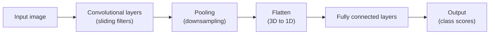
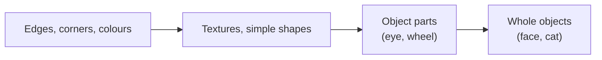
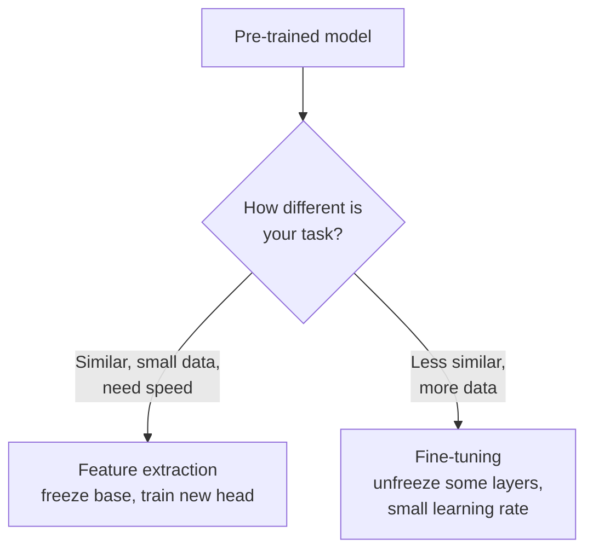
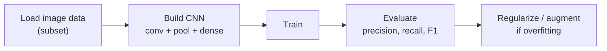

# Convolutional Neural Networks: Full Concept Walkthrough

## What you will learn

- Why fully connected networks fail on images (five concrete problems)
- The three ideas that make CNNs work: local sliding filters, weight sharing, translation invariance (plus the low-to-high feature hierarchy)
- Stride, padding, max pooling and average pooling, with worked numbers
- Flattening, fully connected layers and how the whole CNN pipeline fits together
- Transfer learning (feature extraction vs fine-tuning), evaluation metrics (confusion matrix, precision, recall, F1), dropout, batch normalization and data augmentation

---

## 1. Why Not a Plain Neural Network for Images?

**Simple idea:** a plain neural network reads an image like a long shopping list of numbers, with no idea which numbers were neighbours. A photo is not a list; it is a grid where neighbours matter.

**Analogy:** cut a family photo into 65,536 tiny squares, shuffle them into one long line, and ask a friend "who is in this photo?". The squares are all still there, but the arrangement that tells you "this is an eye, next to a nose" is gone.

An image is a grid of **pixels** (picture elements, each holding a brightness or colour number). A **fully connected (dense) network** connects every input to every neuron in the next layer. To feed an image to it, you must first **flatten** the 2D grid into a 1D vector. This causes five problems.

| # | Problem | What goes wrong |
|---|---------|-----------------|
| 1 | **Loss of topology / proximity** | Flattening destroys the information that pixel A sits next to pixel B. Each pixel is read independently, so spatial relationships are lost. |
| 2 | **Blind matrix representation** | The network only sees raw numbers; it has no notion of context (edge, corner, object part), so it cannot interpret the image. |
| 3 | **Parameter explosion** | Every pixel gets its own weight for every neuron, so the weight matrix becomes enormous. Colour (RGB) images have even more values than grayscale. |
| 4 | **Overfitting** | Too many weights let the model memorize individual pixels and even pixel noise instead of learning general patterns. |
| 5 | **Computational bottleneck** | Huge matrices mean long training time and heavy memory use. |

### Worked example: counting weights

Take a $256 \times 256$ grayscale image fed to a dense layer with 1000 neurons.

- Inputs after flattening: $256 \times 256 = 65{,}536$
- Weights: $65{,}536 \times 1000 = 65{,}536{,}000$ (about 65.5 million), plus 1000 biases, for the first layer only.

For a colour (RGB) image of the same size there are 3 channels:

- Inputs: $256 \times 256 \times 3 = 196{,}608$
- Weights: $196{,}608 \times 1000 = 196{,}608{,}000$ (about 197 million).

Compare this with a convolutional layer in Section 3, which needs only a few hundred parameters.

**Simplification gap:** flattening itself is only a reshape and loses no numbers; what it loses is the explicit neighbourhood structure. A dense network could in principle re-learn this structure, but only with vast data and parameters, which is why it is impractical.

---

## 2. The Big Picture of a CNN

**Simple idea:** a CNN adds a "scanning stage" in front of an ordinary neural network. The scanning stage looks at small patches of the image and extracts useful patterns; the ordinary network at the end makes the decision.

- The **convolutional filters/layers** are the part a normal neural network does not have. Everything else (the fully connected part) is a simple neural network.
- Each architectural part exists to solve one of the problems above; if a part were removed, a specific problem would return.

---

## 3. Convolutional Filters: Sliding Local Scanning

**Simple idea:** instead of looking at the whole image at once, slide a small magnifying window across it and write down what you see at each position.

**Analogy:** reading a printed page with a small reading-ruler that shows a few words at a time, moving systematically left to right, line by line, instead of trying to absorb the whole page in one glance.

A **convolutional filter** (also called a **kernel**) is a small grid of numbers (for example $3\times3$ or $5\times5$). It is placed over a patch of the image, a single number is computed, then the filter slides to the next patch. The patch the filter sees at one moment is its **local receptive field**. Systematic sliding means every region is scanned in an orderly way, so neighbouring pixels are processed together.

### The filter dot-product operation

At each position, the filter and the image patch under it (both $K \times K$) are multiplied element by element and summed. This is the **dot product**:

$$
y = \sum_{i=1}^{K}\sum_{j=1}^{K} w_{ij}\, x_{ij} \; (+\; b)
$$

- $x_{ij}$: pixel value in the patch
- $w_{ij}$: filter weight at the same position
- $b$: optional bias term
- $y$: one output value; an activation function is usually applied to it afterwards (local activation value)

For colour (RGB) images the filter has **depth** equal to the number of input channels (3), so a $K\times K$ filter has $K\times K\times 3$ weights and sums over all channels.

### Worked example: one dot product

Patch and filter (both $2\times2$):

$$
\text{patch}=\begin{bmatrix}1&2\\3&4\end{bmatrix},\quad
\text{filter}=\begin{bmatrix}1&0\\0&-1\end{bmatrix}
$$

$$
y = (1)(1)+(2)(0)+(3)(0)+(4)(-1) = 1+0+0-4 = -3
$$

### Feature map and volume stacking

- Each dot product gives one number. Sliding across the whole image gives a grid of these numbers called a **feature map** (activation map). It shows where in the image the filter's pattern was found.
- Using **multiple filters** gives multiple feature maps (each filter looks for a different pattern). Stacking these maps one on top of another gives a 3D block, called **volume stacking**; its depth equals the number of filters.

### Worked example: parameter count versus dense layer

- One $3\times3$ filter on a grayscale image: $3\times3 + 1\text{ bias}=10$ parameters. With 32 filters: $32\times10=320$ parameters.
- On an RGB image: one filter has $3\times3\times3+1=28$ parameters; 32 filters give $32\times28=896$.

Compare with 65.5 million for the dense layer in Section 1.

---

## 4. Why CNNs Work: Four Key Properties

### 4.1 Compact local receptive field (sliding filter)

Small filters scan the image in a window, preserving the relationship between neighbouring pixels (fixes problem 1 and 2).

### 4.2 Weight sharing

**Simple idea:** use the same stamp everywhere instead of making a new stamp for every spot.

**Analogy:** a security guard who checks every door in a building with one master key, rather than carrying a separate key cut for each door.

In a dense network each pixel has its own weights. In a CNN, the **exact same filter weights are reused at every position** of the image. Repeated patterns are therefore handled by the same weights, so the **number of parameters drops sharply** (fixes problems 3, 4 and 5).

### 4.3 Spatial hierarchy of vision (early vs deep layers)

**Simple idea:** first learn the letters, then words, then sentences.

- **Early layers** detect **low-level features**: edges, corners, colours, basic textures.
- **Deeper layers** combine them into **high-level features**: how many pixel patterns come together to form a face, an eye, a wheel, a whole object.
- The workload is divided: no single layer has to understand everything.

### 4.4 Translation invariance (positional robustness)

**Simple idea:** a cat is still a cat whether it is on the left or the right of the photo.

The same filter is applied everywhere, so a pattern is detected **regardless of where it appears**. A cat face or a human face in different locations is recognized equally well, so the model **generalizes** across positions.

**Simplification gap:** strictly speaking, convolution is *translation equivariant* (shift the input and the feature map shifts with it); approximate invariance to position comes from combining this with pooling and the final layers. Also, CNNs are not automatically invariant to rotation or scale, which is one reason for data augmentation (Section 12).

### Summary table: dense network versus CNN

| Aspect | Fully connected network | CNN |
|--------|------------------------|-----|
| Input handling | Flattened vector, neighbourhood lost | Grid kept, local patches scanned |
| Weights | One per pixel per neuron (huge) | Small shared filter reused everywhere |
| Parameters | Explosive | Greatly reduced |
| Features | No hierarchy | Low-level to high-level hierarchy |
| Position of object | Sensitive | Robust (translation invariance) |
| Overfitting risk | High | Lower |

---

## 5. Stride and Padding

### 5.1 Stride

**Simple idea:** stride is the step size of the sliding window: how many pixels you jump each time.

**Analogy:** walking along a corridor of tiles, taking one tile per step (stride 1) or two tiles per step (stride 2).

Example with a 1D row of 8 pixels (numbered 1 to 8) and a filter of size 3, stride 1:

- Window 1: pixels 1,2,3 gives one value
- Window 2: pixels 2,3,4
- Window 3: pixels 3,4,5
- Window 4: pixels 4,5,6
- Window 5: pixels 5,6,7
- Window 6: pixels 6,7,8

The filter moved by one place each time, so **stride = 1**. With stride 2 it would use 1-2-3, then 3-4-5, then 5-6-7. Larger strides give fewer outputs (a smaller output) and faster computation but may skip fine detail. The image cannot be taken "all at once" because that would distort the understanding of local structure; the filter must go window by window.

### 5.2 Padding

**Simple idea:** padding is a border or cushion added around the image so the filter can also sit on the edges and the output does not shrink.

Without padding, each convolution reduces the image (many pixels collapse into one value, and edge pixels are covered less often). Adding a border keeps size and edge information. Common kinds:

- **Zero padding:** border filled with zeros.
- **Same padding:** enough padding added so output size equals input size (for stride 1).
- **No (valid) padding:** no border; output shrinks. Acceptable if you are happy with a smaller image.

### 5.3 Output-size formula

$$
O = \left\lfloor \frac{N - F + 2P}{S} \right\rfloor + 1
$$

- $N$: input size (height or width), $F$: filter size, $P$: padding on each side, $S$: stride, $O$: output size.

**Worked examples**

- The 1D example above: $N=8,\,F=3,\,P=0,\,S=1$ gives $O=(8-3)/1+1=6$ windows (matches the six windows listed).
- $N=256,\,F=3,\,P=0,\,S=1$: $O=254$ (image shrank).
- $N=256,\,F=3,\,P=1,\,S=1$: $O=(256-3+2)/1+1=256$ (same padding keeps size).
- $N=256,\,F=3,\,P=1,\,S=2$: $O=\lfloor(255/2)\rfloor+1=127+1=128$.

---

## 6. Pooling: Max and Average

**Simple idea:** pooling shrinks a feature map by summarizing each small window with one number.

**Analogy:** a class of students sends one representative per bench. Max pooling sends the tallest; average pooling sends a number that represents the average height.

A pooling window (for example $2\times2$) slides over the feature map. It has no learnable weights; it simply applies a fixed rule.

### 6.1 Max pooling

Take the **maximum** of the values under the window. It keeps the strongest response (**peak feature detection**) and discards weak responses (**noise suppression**). It is the standard default in the classic CNNs (LeNet-style networks, AlexNet, VGG, ResNet's early stage).

### 6.2 Average pooling

Take the **mean** of the values: sum them and divide by the count (for a $2\times2$ window, divide by 4). It gives a **smoother** output and **retains texture and background information**, since it uses all values rather than the extreme one. It is common in modern networks.

### Worked example ($2\times2$ window, stride 2)

Input feature map ($4\times4$):

$$
\begin{bmatrix}
1&3&2&1\\
4&6&5&0\\
7&2&9&8\\
3&1&4&6
\end{bmatrix}
$$

| Window (position) | Values | Max pool | Average pool |
|-------------------|--------|----------|--------------|
| Top-left | 1, 3, 4, 6 | 6 | $14/4=3.5$ |
| Top-right | 2, 1, 5, 0 | 5 | $8/4=2$ |
| Bottom-left | 7, 2, 3, 1 | 7 | $13/4=3.25$ |
| Bottom-right | 9, 8, 4, 6 | 9 | $27/4=6.75$ |

Result (max): $\begin{bmatrix}6&5\\7&9\end{bmatrix}$. Result (average): $\begin{bmatrix}3.5&2\\3.25&6.75\end{bmatrix}$. The $4\times4$ map became $2\times2$ (height and width halved).

### Comparison

| Aspect | Max pooling | Average pooling |
|--------|-------------|-----------------|
| Operation | Largest value in window | Mean of window |
| Keeps | Strongest feature (peak) | Overall texture, background |
| Noise | Discards weak noise | Smooths it in |
| Typical use | Classic CNNs (AlexNet, VGG, ResNet) | Modern networks |

**Simplification gap:** many modern networks (including ResNet's final stage) use *global* average pooling, averaging each whole feature map to one number before the classifier, while still using max pooling early on. Treat "max = old, average = modern" as a rule of thumb, not a strict rule.

### Why pooling is used (downsampling)

- **Downsampling:** compress height and width to cut computation and the number of values.
- **Larger effective receptive field:** later layers see larger regions of the raw image.
- **Overfitting mitigation:** fewer values and some tolerance to small shifts make it harder to memorize individual pixels.

---

## 7. Choosing Filter Settings: Trial and Error

The filter itself is the same kind of object; what changes is how you use it:

- Filter size
- Stride (step size)
- Padding type (none, zero, same)
- Pooling type (max or average)

There is **no single definitive correct choice**. Which stride or pooling works best depends on your images, so the answer is found by **experimenting** (trial and error / hyperparameter tuning). For example, max pooling may work well on one dataset while average pooling does not.

These choices also affect: compression of height and width, how much of the raw image each unit sees, overfitting control, parameter optimization, and the overall pipeline (how layers cascade). Their impacts are studied together, typically in the second or third lesson of the CNN module.

---

## 8. Flattening and Fully Connected Layers

### 8.1 Flattening

**Simple idea:** after the scanning stage produces a stack of small maps, unroll the stack into one long line so a normal classifier can read it.

The convolution and pooling stages produce a **3D feature map** (height $\times$ width $\times$ number of filters). A **flatten** step converts this 3D block into a **1D vector**, placed after the convolution/pooling stages and just before the fully connected part. Without it the classifier could not decide "is this image class A or B". The flattening must be done so that **no information is lost**: it is a pure reshape of the feature values, which have already captured the important spatial information by that point.

Example: a final feature map of $7\times7\times64$ flattens to $7\times7\times64 = 3136$ values.

(Note the contrast with Section 1: here flattening occurs *after* spatial features are extracted, not on raw pixels, so the harm described earlier does not apply.)

### 8.2 Fully connected (dense) layers

The last layers of the CNN are fully connected. Their roles:

- **Global connections:** every feature can influence every neuron.
- **Feature integration:** combine the extracted features into a decision.
- **Linear transformation** ($z = Wx + b$) followed by an **activation function** (for example ReLU in hidden layers; softmax at the output for classification).
- Optional **reduction of neurons** (making the layers smaller or using dropout).
- Finally, a **score** per class gives the final output.

Each part exists because of what comes before and after it: filters extract features, pooling compresses, flatten reshapes, dense layers decide.

---

## 9. Transfer Learning

**Simple idea:** do not learn everything from zero; start from a model that already learned a lot, and teach it only your specific task.

**Analogy (retail):** hiring an experienced cashier from another supermarket and training them on your store's till, instead of training a person who has never worked before.

### The problem it solves

Deep models need a **huge amount of data**, time, infrastructure and cost. Training from scratch means millions of images, long training and redundant learning. In business you cannot afford extra cost or delay.

### The method

A **pre-trained model** is a model already trained by someone else on a large dataset; it already holds general knowledge (such as edge and shape detectors). You **transfer** that knowledge, add your own (smaller) dataset, and obtain a new model for your task.

Benefits:

- Less infrastructure, cost and time
- **Data efficiency:** a small dataset is enough
- **Rapid convergence:** training is much faster
- Generally strong performance

You must still **validate** that the pre-trained model suits your task and that your data fits what it expects. Transfer learning is not only for images: it is used for text models (RNN-based language models and others) and many other model types.

### Two strategies

| Aspect | Feature extraction | Fine-tuning |
|--------|--------------------|-------------|
| What changes | Only the output part (the **head**); base layers are **frozen** | Some or many base layers are **unlocked** and trained too |
| Data needed | Small dataset | Larger dataset |
| Speed | Faster | Slower |
| Learning rate | Normal for the new head | **Small**, to avoid destroying learned knowledge |
| Use when | Simple application, need a fast solution | Pre-trained model not fully relevant; more than the outer layers must adapt |
| Size of change | Small | Larger |

The inner (early) layers hold general features and are left alone; the outer (top) layers are changed or retrained for your task.

---

## 10. Evaluating the Model

### 10.1 Confusion matrix

**Simple idea:** a scoreboard of how many times the model was right and how it was wrong.

For a yes/no (positive/negative, present/not present) problem:

| | Predicted Yes | Predicted No |
|---|---------------|--------------|
| **Actual Yes** | True Positive (TP) | False Negative (FN) |
| **Actual No** | False Positive (FP) | True Negative (TN) |

- **TP:** actual yes, predicted yes (correct).
- **TN:** actual no, predicted no (correct).
- **FP:** model says yes, truth is no: a **false alarm**, also called **Type I error**.
- **FN:** model says no, truth is yes: a **missed target**, also called **Type II error**.

Multi-class example: with 100 images each of humans, cats and dogs, the model may call a dog a cat, a cat a dog, or a human a cat; these mistakes appear as FP/FN counts (for each class, treat it versus the rest).

### 10.2 Metrics

$$
\text{Accuracy}=\frac{TP+TN}{TP+TN+FP+FN},\quad
\text{Precision}=\frac{TP}{TP+FP},\quad
\text{Recall}=\frac{TP}{TP+FN}
$$

$$
F1 = \frac{2\cdot \text{Precision}\cdot\text{Recall}}{\text{Precision}+\text{Recall}}
$$

**Accuracy:** overall fraction of correct predictions.

**Precision:** of everything the model called positive, how much really was positive. It **prevents false alarms**. Important for spam filtering, legal and money-sensitive decisions where a false alarm is costly.

**Recall (sensitivity):** of all real positives, how many the model caught. Important in **fraud detection** and **disease detection**: for example chest X-rays for pneumonia, where a pneumonia patient must be flagged as having pneumonia. High recall means few missed cases.

**F1 score:** the harmonic mean of precision and recall; it is high only when both are high, so it works well on imbalanced data. It is especially valued for **medical images** (scans, X-rays), where wrong diagnoses and many false positives are both serious.

### Worked example

Suppose 100 test images: $TP=40,\ FP=10,\ FN=20,\ TN=30$.

- Accuracy $=(40+30)/100=0.70$
- Precision $=40/(40+10)=0.80$
- Recall $=40/(40+20)=0.667$
- $F1 = \dfrac{2(0.80)(0.667)}{0.80+0.667}=\dfrac{1.067}{1.467}\approx 0.727$

### Why accuracy misleads on imbalanced data

**Imbalanced dataset:** classes have very different counts, e.g. 5 cat images, 100 human images, 10 dog images. The model becomes biased toward the dominant class (human), and accuracy can look like 90-95% while the minority classes are handled badly.

Numeric illustration: 95 negatives and 5 positives; a model that always predicts "negative" gets $95/100=95\%$ accuracy but recall $=0/5=0$: it catches no positive case. Real-world data is usually imbalanced, so precision, recall and F1 are preferred.

### ROC

The **ROC curve** (receiver operating characteristic) is built from sensitivity (recall) and specificity at different thresholds. It is used in some cases and can be an extension, but for image tasks precision, recall and F1 usually suffice.

| Metric | Answers the question | Prefer when |
|--------|---------------------|-------------|
| Accuracy | How often is the model right overall? | Classes roughly balanced |
| Precision | When it says positive, is it right? | False alarms are costly (spam, legal) |
| Recall | Did it find all real positives? | Misses are costly (fraud, disease) |
| F1 | Are precision and recall both good? | Imbalanced data; both errors matter (medical images) |

Know *why* you pick a metric, not just its formula. These are the same metrics used in classical machine learning, chosen by use case.

---

## 11. Reducing Overfitting: Dropout and Batch Normalization

**Overfitting** means the model memorizes training data and fails on new images; it is checked during evaluation, and regularization is applied if found.

### Dropout

**Simple idea:** randomly switch some neurons off during training so no neuron can rely on others, forcing the network to learn robust, non-redundant features.

**Analogy:** a sports team where random players sit out each practice, so every player must learn to perform independently.

- A fraction of neurons is turned off (for example **10%**). Typical practice is about 10%, but it is not a hard rule (10%, 15% and other values are used).
- It stops the network from repeatedly relying on the same features and from redundant weight calculation.

**Caveat:** dropout is active only during training; at test time all neurons are used. Rates of 20-50% are also common in practice, especially in dense layers.

### Batch normalization

Normalizes the inputs to a layer (for each mini-batch) to a common scale (roughly zero mean, unit variance). It stabilizes and speeds up training and has a mild regularizing effect. Related model-inspection concepts: counting how many parameters a model has, and which are **learnable** (trained weights) versus **non-learnable** (e.g. frozen layers, or batch normalization's running statistics).

| Technique | What it does | Effect |
|-----------|--------------|--------|
| Dropout | Randomly switches off a fraction of neurons in training | Reduces overfitting |
| Batch normalization | Rescales layer inputs per batch | Stabilizes training, reduces overfitting a little |
| Data augmentation | Creates modified copies of images | More diverse data, reduces overfitting |

---

## 12. Data Augmentation

**Simple idea:** make "new" training photos by editing the ones you already have.

**Analogy:** photographing the same product from slightly different angles, brightnesses and crops so the model learns that it is the same product.

**Why:** deep learning models are **data hungry**. With too little data, the model sees too little variety and its performance drops. In the real world you often cannot collect much more data, so you expand it artificially.

Common transformations:

- Rotation (and flipping horizontally or vertically)
- Cropping
- Scaling
- **Colour jittering** (random changes in colour)
- Contrast shifts and other cosmetic changes

Each altered image is added to the training set. The label stays the same (a rotated cat is still a cat), but the model sees varied versions, which also builds robustness to position, orientation and lighting.

**Caveat:** apply only transformations that preserve the label (e.g. flipping a handwritten "6" upside down could turn it into a "9"), and augment only training data, not test data.

---

## 13. Putting It Together: Practical Implementation Notes

- The CNN module has **7 lessons**, building from why plain networks fail, through filters, stride and padding, pooling, flattening, fully connected layers, transfer learning, evaluation and regularization, to augmentation.
- The hands-on example uses the **CIFAR-10** image dataset (small colour images of 10 classes) to train a simple CNN. The task is image **classification**; the workflow is the same as for a simple neural network implementation, with convolutional layers (and pooling) added before the dense part.
- The dataset is large; **use a subset** of the training and test data to avoid running out of memory or running too long.
- Activation functions (Sigmoid, Tanh, ReLU, Softmax) and gradient descent are covered in the first module of the course.

---

## Exam and Assessment Hints

- Be ready to explain **why** each CNN component exists (what problem it solves and what goes wrong without it), not only what it is.
- Metrics: know the formulas for accuracy, precision, recall and F1, and *which to choose for which use case*; know why accuracy fails on imbalanced data.
- Know the difference between feature extraction and fine-tuning in transfer learning.
- Know the Type I (false positive) and Type II (false negative) definitions.
- Typical dropout rate quoted is about 10% (not fixed).
- Choice of stride, padding and pooling is by experimentation; there is no universal best setting.
- Study with the recorded lessons slowly, and review the hands-on implementation video and supplied dataset and code files.

---

## Self-Check Questions

1. **Name the five problems of feeding images to a fully connected network.**
   Loss of topology/proximity, blind raw-number matrix, parameter explosion, overfitting, computational bottleneck.

2. **How does weight sharing reduce parameters?**
   One small filter's weights are reused at every image position instead of separate weights per pixel, so the parameter count drops sharply.

3. **A $32\times32$ image, $5\times5$ filter, padding 0, stride 1. What is the output size?**
   $O=(32-5+0)/1+1=28$, so $28\times28$.

4. **Max-pool the window values 2, 8, 5, 1.**
   Maximum is 8. (Average pooling would give $16/4=4$.)

5. **When is recall more important than precision? Give an example.**
   When missing a positive is costly: fraud or disease detection, e.g. pneumonia on X-rays.

6. **A model scores 95% accuracy on a dataset with 95% negatives. Is it good?**
   Not necessarily; it could predict "negative" always and have zero recall. Use precision, recall and F1.

7. **Feature extraction versus fine-tuning?**
   Feature extraction freezes the pre-trained base and trains only a new head (fast, small data). Fine-tuning unfreezes some layers and trains them with a small learning rate (more adaptation, more data).

8. **What does dropout do?**
   Randomly switches off a fraction (commonly about 10%) of neurons during training to reduce overfitting.

---

## Common Pitfalls / Exam Traps

- Saying flattening is the problem for images: flattening raw pixels loses neighbourhood structure, but flattening *after* convolutions is normal and necessary.
- Mixing up Type I and Type II: Type I = false positive (false alarm), Type II = false negative (missed target).
- Confusing precision with recall: precision divides by TP+FP (predicted positives); recall divides by TP+FN (actual positives).
- Trusting accuracy on imbalanced data.
- Believing pooling has learnable weights; it uses a fixed rule (max or mean).
- Thinking max pooling is always better; it depends on the data, and average pooling is common in modern networks.
- Forgetting that padding keeps the output size (same padding) while no padding shrinks it.
- Assuming the filter type changes with stride or padding; the filter is the same kind of object, the settings change how it is used.
- Believing transfer learning is image-only; it also applies to text and other models.
- Unfreezing everything with a large learning rate during fine-tuning, which can destroy pre-trained knowledge.
- Treating 10% dropout as a fixed rule.
- Applying augmentation that changes the true label.

---

## Quick Revision Summary

- Dense networks fail on images: lost topology, blind numbers, parameter explosion, overfitting, heavy computation.
- CNNs use small sliding filters (local receptive field) with the dot product $\sum w\,x$ to build feature maps; many filters stack into a volume.
- Weight sharing slashes parameters; early layers learn edges/colours, deep layers learn complex shapes; translation invariance makes position irrelevant.
- Stride is the step of the window; padding is a border that stops shrinkage; $O=\lfloor (N-F+2P)/S\rfloor+1$.
- Max pooling keeps peaks and discards noise; average pooling smooths and keeps texture; settings are chosen by trial and error.
- Pipeline: conv layers, pooling, flatten (3D to 1D), fully connected layers, activation, class scores.
- Transfer learning reuses a pre-trained model: feature extraction (freeze base, train head) or fine-tuning (unfreeze, small learning rate); saves data, time and cost.
- Metrics: confusion matrix; precision for false-alarm control, recall for catching positives, F1 for balance; accuracy misleads on imbalanced data.
- Dropout (about 10% of neurons off), batch normalization and data augmentation (rotate, crop, scale, colour jitter) fight overfitting and data scarcity.
