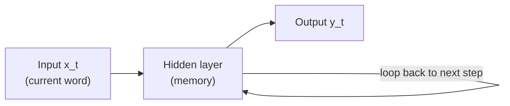
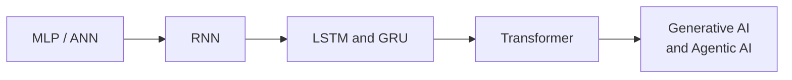
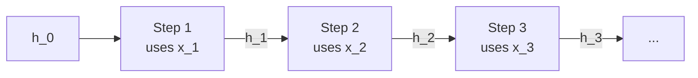
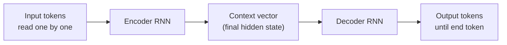
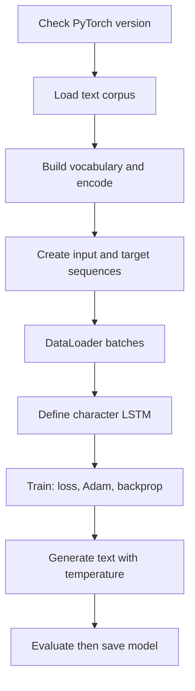

# Recurrent Neural Networks: Roadmap and Character-Level LSTM Lab

## What you will learn

- Why ordinary neural networks fail on sequences, and how RNNs fix three specific problems
- The three RNN task shapes: sequence-to-vector, vector-to-sequence, sequence-to-sequence
- How the hidden state, the weight matrices $W$, $U$, $V$, unrolling and BPTT fit together
- Exploding and vanishing gradients, gradient clipping and truncated BPTT
- Why LSTM, GRU, bidirectional models, encoder-decoder and attention appeared, in order
- How a character-level LSTM is built, trained and sampled in PyTorch (with temperature)

---

## 1. Why Sequences Need a Special Network

**Simple idea:** in some data, order is the meaning. Shuffle the words and the message is gone.

**Analogy:** a recipe. "Add eggs, then bake" and "bake, then add eggs" use the same words but give a very different cake. A network that only sees a bag of ingredients cannot tell them apart.

**Sequential data** is any data where the arrangement of items carries information:

- Text (word order)
- Speech (sound order over time)
- Time series (stock prices, power load, climate readings)
- Video (a sequence of frames; the content can also be turned into text)

A plain feed-forward network (an **ANN**, also called a **multilayer perceptron, MLP**) treats the input as one fixed block. It has no notion of "this came first, this came second".

### Three limits of feed-forward networks on sequences

| Limit | What it means | Example |
|-------|---------------|---------|
| **Fixed input size** | The input layer has a set number of neurons | One sentence has 4 words, another has 10. The network cannot take both |
| **No memory of earlier inputs** | Each input is processed independently | At sentence 5 you need a fact from sentence 1 (or sentence 1000); the network has kept nothing |
| **No parameter (weight) sharing** | Each position would need its own weights | Long text means a huge pool of weights and very expensive computation |

### What a sequence model must provide

1. Handle **dynamic input size** (any length).
2. Have a **memory** of what happened earlier.
3. Use **weight sharing**: one set of weights reused at every step.

RNNs satisfy all three.

**Simplification gap:** a feed-forward network can be forced to take variable text by padding or truncating to a fixed length, but then position-specific weights make it costly and it still has no built-in memory. The statement "ANNs cannot be used" really means "they are a poor fit".

---

## 2. The Core Idea of an RNN

**Simple idea:** read one word at a time, and carry a "note to self" from word to word.

**Analogy:** reading a sentence while keeping a running summary in your head. At each new word you combine the word with your current summary, then update the summary.

In an RNN the hidden layer **loops back** into itself. The output of the hidden layer at one step is fed back as an input at the next step along with the next word. This repeated looping is why it is called **recurrent** ("repeatedly occurring").

Key consequences:

- One weight matrix is **reused at every step**, so a sequence of length 4, 100 or 2000 is handled by the same network.
- The loop gives a **memory**: the hidden state summarises everything seen so far.
- Weights are computed (learned) once and **reused again and again**, which keeps computation manageable.

**Why a new architecture at all?** Because each of the three limits in Section 1 was fixed by a specific architectural change. Knowing the reason behind each change is the exam-worthy point.

---

## 3. Types of RNN Tasks (Input and Output Shapes)

**Simple idea:** it depends on whether you feed in a sequence, get out a sequence, or both.

| Type | Meaning | Typical uses |
|------|---------|--------------|
| **Seq2Vec** (sequence to vector) | Encode a whole sequence (words) into one vector of numbers | Sentiment classification, topic classification |
| **Vec2Seq** (vector to sequence) | Decode a vector back into a sequence of words | Text generation, image captioning |
| **Seq2Seq** (sequence to sequence) | Map one sequence to another sequence | Machine translation (for example German to English), summarisation |

Explanations:

- **Vector:** a list of numbers. If a sentence's words are converted to numeric values, that list is the vector.
- **Image captioning:** an image is turned into a numeric vector, then decoded into text that describes the image.
- **Text generation** (as in GPT-style generative models) needs numeric representations decoded back to text.
- **Summarisation:** both input and output are text, so it is sequence-to-sequence.

### Application shapes (many-to-one, many-to-many)

| Application | Shape | Why |
|-------------|-------|-----|
| Sentiment analysis | **Many-to-one** | Many sentences/words in, one sentiment label out |
| Text generation | **Many-to-many** | A sequence of text in, a sequence of text out |

Other applications: time-series forecasting (stock prices, power load, climate trends).

---

## 4. Evolution of Sequence Models

Each model was created to fix the weakness of the previous one.

| Step | What it added | Remaining problem |
|------|---------------|-------------------|
| MLP / ANN | Basic learning | No order, no memory, fixed size, no weight sharing |
| RNN | Dynamic size, memory, weight sharing | Only short-term memory (forgets far past); gradient problems |
| LSTM, GRU | Gated long-term memory | Process word by word (no parallelism); LSTM is complex |
| Transformer (built on attention) | Parallel processing, attention | Foundation of GPT-style generative models |

Why study the history: GPT-style generative AI is a transformer; understanding why each step happened gives you the foundation to answer questions anywhere in the chain. Issues such as exploding and vanishing gradients also appear in generative AI models, not just in RNNs.

---

## 5. RNN Architecture in Detail

**Simple idea:** at every step the network blends "what I see now" with "what I remember", and produces a new memory.

**Analogy:** a student taking running notes in a class. Each minute, the new sentence from the teacher plus the notes so far produce an updated set of notes.

### Components

- **Current input** $x_t$: the current word (or frame) at step $t$.
- **Hidden state** $h_t$: the **memory**, a vector summarising everything the network has seen so far.
- **Previous state** $h_{t-1}$: the output of the previous step, fed back in.
- **Update rule:** combine $x_t$ and $h_{t-1}$ using weights to get the new state.

### Equations

$$h_t = \tanh\left(W h_{t-1} + U x_t + b\right)$$

$$y_t = V h_t + c$$

Symbols:

- $W$: **state-to-state** weight matrix (hidden to hidden, the memory loop)
- $U$: **input-to-state** weight matrix (input to hidden)
- $V$: **state-to-output** weight matrix (hidden to output)
- $b$, $c$: bias vectors
- $\tanh$: a squashing activation that keeps values between $-1$ and $1$

The same $W$, $U$, $V$ are used at **every** time step. That is why any sequence length (4, 100, 2000) works.

**Why both inputs are needed:** if only the current word were given, the network could not relate it to what came before. Feeding the previous output together with the current input is what lets it draw a relationship between past and present. The state carries context "word by word, frame by frame".

### Worked example (one scalar neuron)

Take $W = 0.5$, $U = 1$, $b = 0$, start $h_0 = 0$, inputs $x_1 = 1$, $x_2 = 2$.

- Step 1: $h_1 = \tanh(0.5 \cdot 0 + 1 \cdot 1) = \tanh(1) \approx 0.762$
- Step 2: $h_2 = \tanh(0.5 \cdot 0.762 + 1 \cdot 2) = \tanh(2.381) \approx 0.983$

Note $h_2$ depends on $x_1$ through $h_1$. That dependence is the memory.

### Weight sharing in numbers

Suppose the input is a 3-dimensional vector and the hidden state is 4-dimensional.

- $W$: $4 \times 4 = 16$ parameters
- $U$: $4 \times 3 = 12$ parameters
- $b$: 4 parameters
- Total for the recurrent part: $16 + 12 + 4 = 32$, **whatever the sequence length**.

Without sharing, a 100-step sequence would need $100 \times 32 = 3200$ for the same part, and it would grow with length.

### Unrolling

**Unrolling** (or unfolding) turns the recurrent loop into a **chain of identical layers**, one per time step, all sharing the same weights.

Why it matters:

- It makes the information flow explicit step by step.
- It lets you do **backpropagation through time**: at time $t$, $t+1$, $t+2$, $t+3$ and so on, gradients flow backwards along the chain, because words are passed one by one.

**Simplification gap:** the "3 weight matrices" are the basic (vanilla) RNN; LSTM and GRU have more matrices (one set per gate), though they still share them across time.

---

## 6. Training: Backpropagation Through Time (BPTT)

**Simple idea:** unfold the loop over $T$ steps, then do ordinary backpropagation on the long chain.

**Analogy:** replaying a tape of a game from the end to find which moves caused the loss.

Algorithm outline:

1. **Forward:** run the sequence through $T$ steps with shared weights.
2. Compute the loss.
3. **Backward:** apply the chain rule through time; the state at step $t$ depends on the state at step $t-1$, so gradients pass back through every step.
4. Sum the gradients for the shared weights across all steps and update them once.

Properties:

- All **intermediate states are stored**, so memory use **grows linearly** with the sequence length. Memory is one of the biggest practical costs of RNNs.
- The same shared weights appear at every step.

### Truncated BPTT

**Truncated BPTT** stops the backward pass after a fixed number of steps (for example 200) instead of going all the way back. You cut the unrolled chain into pieces and backpropagate within each piece. It is a trade-off.

Reasons given for using it:

1. Very long backpropagation raises the chance of **overfitting** (the model memorises everything in the training data).
2. Very long chains run into the **long-term memory problem** (after about 200 steps the first steps are forgotten anyway).

Applicability:

- Vanilla RNN: commonly used.
- **LSTM:** memory is not the problem, but its complexity makes overfitting likely, so truncation can still be used.
- **GRU:** needed less, as it is a simpler architecture.

**Caveat (precise version):** the main textbook motivation for truncation is to **limit computation and memory** and to reduce gradient instability over very long chains. Overfitting control is usually done with dropout, regularisation and early stopping; truncation is not a dedicated regulariser. Truncation also means gradient information from further back than the window is not used.

---

## 7. Gradient Problems and Fixes

When weights are updated through many time steps, the gradient is multiplied again and again, which causes two problems.

| Problem | What happens | Effect |
|---------|--------------|--------|
| **Exploding gradient** | Gradient becomes very large; updates jump wildly from place to place | Training becomes unstable |
| **Vanishing gradient** | Gradient becomes so small that updates almost stop | Early steps are not learned; long-term memory is lost |

### Gradient clipping

**Simple idea:** put a speed limit on the gradient.

**Gradient clipping** caps the gradient's size at a fixed threshold. If the gradient is larger, it is rescaled to the threshold.

$$g \leftarrow g \cdot \frac{\tau}{\lVert g \rVert} \quad \text{if } \lVert g \rVert > \tau$$

Worked example: $g = [6, 8]$, so $\lVert g \rVert = \sqrt{36 + 64} = 10$. With $\tau = 5$: $g \leftarrow [6, 8] \cdot 5/10 = [3, 4]$. Direction is unchanged; size is now 5.

**Important correction:** gradient clipping fixes **exploding** gradients, not vanishing ones. Vanishing gradients are addressed by changing the architecture (LSTM, GRU with gates), better activations and initialisation. Clipping cannot make a tiny gradient bigger.

Why the fixes matter: whether you build a chatbot, a sentiment model or a translator, gradient instability will break training. You should know the problems and the remedies even when the problem has not appeared yet.

---

## 8. Why RNNs Were Not Enough: Short-Term Memory

**Simple idea:** a plain RNN squeezes its whole past into one hidden vector, so old details fade.

**Analogy:** whispering a message down a long line of people; by the 200th person, the start is gone.

- At step 200 an RNN may remember step 150, but not step 0.
- It has **short-term memory** only, not long-term memory.
- This is the reason LSTM and GRU were created.

---

## 9. LSTM (Long Short-Term Memory)

**Simple idea:** give the network a protected "memory lane" with doors (gates) that decide what to keep, add or reveal.

**Analogy:** a notebook with a secretary: one person decides what old notes to erase, one decides what new facts to write, one decides what to read out.

An LSTM is a small change of the RNN that adds a dedicated memory lane across all time steps, guarded by three **gates**:

| Gate | Job |
|------|-----|
| **Forget gate** | Decides which part of the old information to erase and which to keep |
| **Input gate** | Decides which new (current) information to add to memory |
| **Output gate** | Decides what part of memory to pass on as the output / hidden state |

- The gates use **sigmoid** (a 0 to 1 "how open is the door" value) and **tanh** activation functions to filter information and produce the hidden state.
- Because of the gates, information can survive **hundreds of time steps** without fading. The LSTM has both short-term and long-term memory.
- Gradients are still computed and weights updated repeatedly as in other networks.
- Uses: time series prediction, speech recognition.

---

## 10. GRU (Gated Recurrent Unit)

A GRU is a simplified relative of the LSTM with **two gates** instead of three. It works on the same principle; GRU is simpler, LSTM is more complex.

| Gate / part | Job |
|-------------|-----|
| **Update gate** | How much past information to carry forward |
| **Reset gate** | How much past context to use when forming the new information |
| **Candidate state** | The proposed new content computed from the current input (and reset past) |

### LSTM vs GRU

| Feature | LSTM | GRU |
|---------|------|-----|
| Number of gates | 3 (input, forget, output) | 2 (update, reset) |
| Complexity | Higher | Lower |
| Overfitting risk | Higher (more complex) | Lower |
| Purpose | Fix RNN's short memory | Same purpose, simpler |

**Simplification gap:** an LSTM also has a separate cell state in addition to the hidden state; a GRU merges them into one. Do not assume the two have identical accuracy: GRU is faster and has fewer parameters, LSTM is sometimes better on very long dependencies.

---

## 11. Bidirectional RNN, LSTM and GRU

**Simple idea:** read the sentence from both ends, because meaning at one word can depend on words after it.

**Analogy:** in "He went to the bank to ...", the word after tells you whether it is a river bank or a money bank.

- One RNN runs **left to right**, another runs **right to left**; their outputs are combined.
- Any of the three can be made bidirectional: bidirectional RNN, bidirectional LSTM, bidirectional GRU.
- Uses: machine translation, speech recognition, anywhere context is needed from both sides.

**Caveat:** the backward pass needs the whole sequence in advance, so bidirectional models do not suit real-time generation where future words do not exist yet.

---

## 12. Encoder-Decoder (Seq2Seq) and Attention

### Encoder-decoder

**Simple idea:** one network reads and summarises; another writes the answer from that summary.

**Analogy:** an interpreter who listens to a full sentence, then speaks it in another language.

- **Encoder:** an RNN reads tokens one by one; its **final hidden state is the context vector**.
- **Decoder:** another RNN is initialised from the context vector and generates output tokens until the **end token** appears.
- Used for translation (one language to another).

### The bottleneck

All the meaning must be squeezed into **one fixed-size vector**. Squeezing can lose information.

### Attention mechanism

**Simple idea:** instead of one summary, look back at the input and focus on the parts that matter for the current output word.

**Analogy:** when translating a long paragraph you glance back at the relevant phrase rather than trusting memory of the whole thing.

- Only certain parts of the input are important for a given output.
- The model builds a **dynamic context** using **alignment scores** (also called **attention scores**).
- A higher score means that part of the input is more important; a low score means less important.
- The scores are computed mathematically.
- Attention is a **stepping stone to the transformer** and is the heart of the transformer architecture.

### Why transformers followed

RNN, LSTM and GRU process **word by word**, so they cannot run in parallel. LSTMs are complex, so working through large document collections is slow. Transformers remove this limit.

---

## 13. Applications Summary

| Task | Model shape | Notes |
|------|-------------|-------|
| Sentiment analysis | Many-to-one | Sentences in, one label out |
| Text generation | Many-to-many / Vec2Seq | GPT-style generation |
| Translation, summarisation | Seq2Seq | Encoder-decoder |
| Image captioning | Vec2Seq | Image vector decoded to text |
| Time-series forecasting | Sequence models | Stock prices, power load, climate trends |
| Speech recognition | LSTM / bidirectional | Context from both sides |

Any application built with a vanilla RNN can also be built with an LSTM or GRU, which avoids the long-term memory problem.

---

## 14. Hands-On: Character-Level LSTM in PyTorch

**Simple idea:** teach a network to predict the next character, then let it write text one character at a time.

**Analogy:** phone auto-complete, but one letter at a time.

### Pipeline

### Step by step

1. **Check the PyTorch version** at the start of each practical. The practicals depend on PyTorch; a wrong or missing setup causes errors.
2. **Load the dataset.** A Shakespeare text corpus is read from a link (an S3 bucket in the example) or from a local file in the same directory. A small built-in **fallback** sample is used if the dataset is not found. Inspect columns and data types and preview the text.
3. **Vocabulary and encoding (character level).** The vocabulary is the set of **unique characters**; each is mapped to an integer.
   - Vocabulary size = number of unique characters (77 in this example).
   - Keep two maps: character-to-index and index-to-character (encode and decode).
   - Convert the encoded text to a **tensor**, as PyTorch requires.
4. **Input and target sequences.** Choose a **sequence length** (for example 100 characters per training sample; adjustable). A custom dataset class returns pairs $(X, Y)$ where $Y$ is $X$ shifted by one character. Its length is the number of characters minus the sequence length.
5. **DataLoader.** PyTorch needs a DataLoader to feed data. You give it the dataset, the batch size and whether to drop the last incomplete batch. You can then see the number of training samples and the shapes of input and target batches.
6. **Define the character LSTM model.** Parameters and layers:
   - Vocabulary size
   - **Embedding dimension** (size of the numeric vector per character)
   - Hidden dimension
   - Number of layers (2 in the example)
   - **Dropout** (0.2 means 20% of neurons are switched off at random during training)
   - An **embedding layer**, then the **LSTM**, then a final **linear layer**
   - A **forward** function that takes a batch of sequences and returns **logits** (raw scores for each character) and the hidden state

   An LSTM layer can be called directly from the library; writing out the model shows how it is built. Printing the model shows its layers and the number of **trainable parameters** (weights that get updated; non-trainable ones stay fixed).
7. **Train.**
   - Loss: **cross-entropy**
   - Optimiser: **Adam**
   - 3 epochs, up to 200 batches per epoch (these are **hyperparameters**; you can change them)
   - Standard loop per batch: load inputs, zero gradients, get logits, compute loss, backward pass, optimiser step. This loop is the same for essentially all models.
   - Loss is printed every 50 batches.
8. **Generate text.** Feed a starting string, take the logits of the last character, convert them to **probabilities**, sample the next character, append it, and repeat.
9. **Evaluate, then save.** Save the model and vocabulary as a `.pt` file; reload it with `torch.load`. The example intentionally omits evaluation: adding evaluation metrics before saving is an exercise.

### Results in the example

| Quantity | Value |
|----------|-------|
| Vocabulary size | 77 characters |
| Sequence length | 100 |
| Layers | 2 |
| Dropout | 0.2 |
| Epoch 1 average loss | about 1.98 |
| Epoch 3 average loss | 1.24 |

Falling loss within an epoch (checked every 50 batches) and across epochs shows the model is learning. More epochs would lower it further.

Interpreting the numbers: cross-entropy loss $L$ corresponds to **perplexity** $e^{L}$, the effective number of characters the model is "choosing between".

- Epoch 1: $e^{1.98} \approx 7.2$
- Epoch 3: $e^{1.24} \approx 3.5$
- Random guessing over 77 characters: $\ln 77 \approx 4.34$ loss, perplexity 77

### Dropout clarified

Dropout **does not remove** neurons or erase memory. It randomly switches different neurons off and on at each step during training, so the network cannot depend on any one path. It reduces **overfitting**. Applying dropout does not harm long-term memory.

**Caveat:** dropout is only active during training; at generation/evaluation it is turned off (`model.eval()`). Standard dropout inside recurrent connections can disturb memory, which is why libraries apply it between layers.

### Temperature in generation

**Simple idea:** a creativity dial.

**Temperature** $T$ rescales the logits before the softmax:

$$p_i = \frac{e^{z_i / T}}{\sum_j e^{z_j / T}}$$

- Low $T$ (near 0): conservative, nearly the same answer every time, little variety.
- $T$ near 1: more varied and creative.
- High $T$: even more random.

Worked example with logits $z = [2, 1, 0]$:

| Temperature | $p_1$ | $p_2$ | $p_3$ |
|-------------|-------|-------|-------|
| $T = 0.5$ | 0.867 | 0.117 | 0.016 |
| $T = 1$ | 0.665 | 0.245 | 0.090 |
| $T = 2$ | 0.506 | 0.307 | 0.186 |

Lower temperature sharpens the distribution on the top character.

**Correction:** low temperature gives *less* diversity, not more. Outputs at different temperatures differ somewhat, but the essence stays the same.

---

## 15. Suggested Practice

- Run the notebook, then replace the Shakespeare corpus with another dataset.
- Repeat the same task with a **vanilla RNN** and a **GRU** and compare results across all three models.
- Add the **evaluation** step before saving the model.
- Try different sequence lengths, hidden sizes, epochs and temperatures.

---

## Exam and Assessment Hints

- Be able to explain **why** RNNs replaced ANNs for text: dynamic input size, memory, weight sharing.
- Know the evolution MLP, RNN, LSTM/GRU, transformer, and the reason for each step.
- Know the weight matrices ($W$ state-to-state, $U$ input-to-state, $V$ state-to-output) and that they are shared across steps.
- Know BPTT, exploding and vanishing gradients, gradient clipping and truncated BPTT, including why each is used.
- Know LSTM gates (3) versus GRU gates (2) and what each gate does.
- Know the encoder-decoder bottleneck and how attention addresses it.
- The coding exercise to complete: add an evaluation step before saving the model, and compare RNN, LSTM and GRU on the same data.

---

## Self-Check Questions

1. **Name the three limits of feed-forward networks for sequences.**
   Fixed input size, no memory of earlier inputs, no parameter sharing.

2. **Why can an RNN handle a sentence of any length?**
   The same weight matrices $W$, $U$, $V$ are reused at each time step, so the network is just applied as many times as there are words.

3. **Match each task to a type: sentiment classification, image captioning, translation.**
   Sentiment classification: Seq2Vec (many-to-one). Image captioning: Vec2Seq. Translation: Seq2Seq.

4. **What does gradient clipping fix, and how?**
   Exploding gradients; it rescales the gradient so its size never exceeds a threshold. It does not fix vanishing gradients.

5. **What problem of RNNs do LSTMs and GRUs solve, and how?**
   Short-term memory (fading of far-past information); they add gates and a protected memory path so information survives hundreds of steps.

6. **What is the bottleneck in a basic encoder-decoder, and what is the fix?**
   All meaning is squeezed into one fixed-size context vector; attention lets the decoder weight the important input parts dynamically.

7. **What does temperature do when generating text?**
   It scales logits before softmax. Low temperature gives conservative, repetitive output; near 1 gives more varied output.

8. **In the lab, loss fell from 1.98 to 1.24 over 3 epochs. What does that show?**
   The model is learning; perplexity fell from about 7.2 to about 3.5.

---

## Common Pitfalls / Exam Traps

- Saying gradient clipping solves vanishing gradients (it addresses exploding gradients).
- Saying low temperature increases diversity (it decreases it).
- Thinking each time step has its own weights (they are shared; unrolling copies the same weights).
- Confusing LSTM gates (input, forget, output) with GRU gates (update, reset).
- Thinking dropout removes neurons permanently or erases memory (it switches units off randomly during training only).
- Treating truncated BPTT as a pure overfitting fix (its main purpose is limiting compute, memory and gradient length).
- Saying vanilla RNNs have no memory (they have short-term memory, not long-term).
- Forgetting to evaluate the model before saving it.
- Assuming the vocabulary in a character-level model is words (it is unique characters).
- Forgetting that BPTT memory grows linearly with sequence length.

---

## Quick Revision Summary

- Sequence data (text, speech, time series, video) depends on order; ANNs have fixed input size, no memory and no weight sharing.
- RNNs loop the hidden state back, giving dynamic input size, memory and shared weights.
- Update: $h_t = \tanh(W h_{t-1} + U x_t + b)$, output $y_t = V h_t + c$; unrolling turns the loop into a chain of identical layers.
- Task shapes: Seq2Vec (classification), Vec2Seq (generation, captioning), Seq2Seq (translation, summarisation).
- BPTT trains through time; memory grows linearly; truncated BPTT stops the backward pass after a fixed number of steps.
- Exploding gradients are handled by clipping; vanishing gradients cause short-term memory.
- LSTM (3 gates) and GRU (2 gates) provide long-term memory; bidirectional versions read both ways.
- Encoder-decoder squeezes input into one context vector; attention removes that bottleneck and leads to transformers.
- Character-level LSTM lab: vocabulary of unique characters, sequences of 100, 2 layers, dropout 0.2, cross-entropy, Adam, 3 epochs; loss 1.98 to 1.24; temperature controls creativity.

---

**← [Previous](../week-03/01-cnn-architectures-and-yolo-summary-presentation.md) · [Index](../README.md) · [Next](01-recurrent-neural-networks-summary-presentation.md) →**
