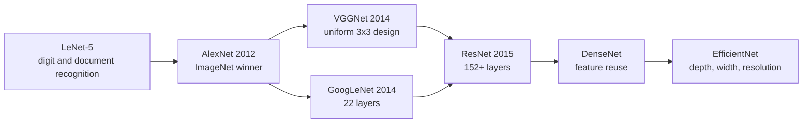
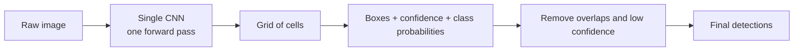
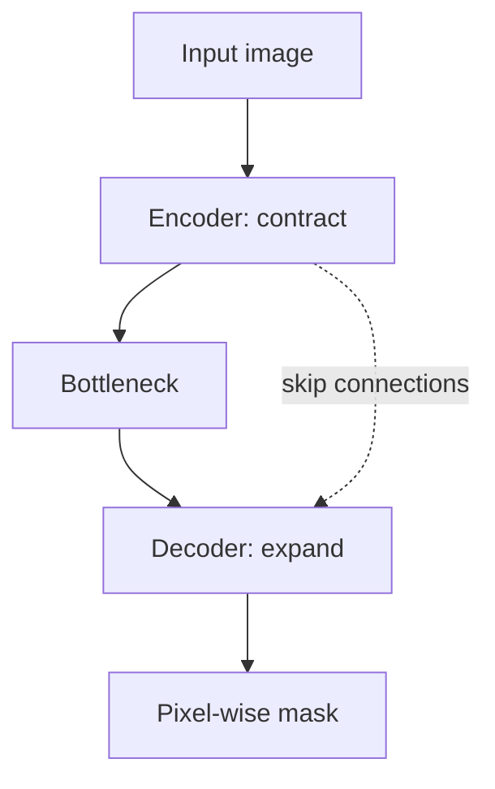
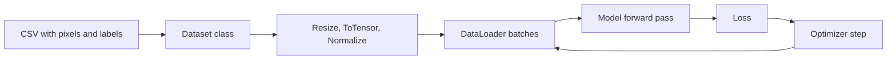

# CNN Architectures, YOLO and U-Net Roadmap

## What you will learn

- The family of benchmark CNN architectures (LeNet-5, AlexNet, VGG, GoogLeNet, ResNet, DenseNet, EfficientNet) and what each one contributed
- AlexNet and VGG in detail: layer counts, filter sizes, variants (VGG11/16/19), training tricks and uses
- How YOLO detects objects in a single pass, and the key metrics: IoU, precision, recall, mAP50, mAP50-95
- How U-Net performs pixel-level segmentation with an encoder-decoder (U-shape) and skip connections
- How to implement AlexNet and VGG from scratch in PyTorch and run a pre-trained YOLOv8 through the Ultralytics library
- Why the training loss trend is the first sanity check, and why detection systems fail in the real world

---

## 1. Big Picture: From Basic CNNs to Benchmark Architectures

**Simple idea:** Once you know how a CNN works, you do not need to invent a new one for every task; smart researchers have already built well-tested designs you can reuse.

**Analogy:** Think of building a house. You can design every room yourself, or you can start from a proven floor plan (a 2BHK, a villa) and only change the furnishing. Standard CNN architectures are proven floor plans.

All of these architectures share the same building blocks (convolution, pooling, activation, fully connected layers). They differ mainly in **how many layers** there are and **how those layers are arranged**. Different competitions and use cases produced different designs.

### Summary of the architectures

| Architecture | Key facts | Main contribution |
|---|---|---|
| **LeNet-5** | 2 convolutional layers, 2 pooling layers, then fully connected (FC) layers | Early network used for document / digit recognition |
| **AlexNet** (2012) | 5 conv + 3 FC layers, ReLU, dropout, trained on ImageNet | Turning point that made deep learning mainstream for vision |
| **VGGNet** (2014) | Only 3x3 convolutions and 2x2 pooling; variants VGG11/13/16/19 | Simple, uniform, deep design |
| **GoogLeNet** (2014) | 22 layers, uses several filter sizes in parallel | Efficient use of different filters/layers |
| **ResNet** (2015) | 152+ layers | Fixes the **degradation** and **vanishing gradient** problems of very deep networks |
| **DenseNet** | Layers connected to many earlier layers | Feature reuse, better gradient flow, fewer parameters |
| **EfficientNet** | Scales depth, width and input resolution together | High accuracy with efficient compute |

The trend: from simple architectures towards architectures that give more accuracy for less computation.

**Simplification gap:** "ResNet fixes vanishing gradients" is a shorthand. Precisely, ResNet adds shortcut (skip) connections so that very deep networks can be optimised; the observed problem was that plain networks got *worse* (higher training error) as depth increased, which is called degradation.

---

## 2. AlexNet

**Simple idea:** AlexNet is the network that proved that a big CNN trained on lots of images with a GPU-friendly recipe beats older methods.

**Analogy:** If LeNet-5 is a small neighbourhood shop, AlexNet is the first big supermarket: same idea (look at the goods, sort them), but far larger scale.

**Facts to remember**

- Came up in **2012** with the **ImageNet** competition (about 15 million+ images, 1000 classes).
- Structure: **5 convolutional layers + 3 fully connected (FC) layers**, with downsampling (max pooling) between them.
- Uses **ReLU** activation: $f(x)=\max(0,x)$. It is cheap to compute and helps stabilise training because it does not saturate for positive inputs (reduces vanishing gradients compared with sigmoid/tanh).
- Uses **dropout** as regularisation.
- Uses **data augmentation** to create more training samples.
- Input size expected by the implementation: **227 x 227** (the original paper states 224 x 224; the 227 value is what makes the arithmetic of the first layer work).
- First layer uses **96 filters**; the final FC layer outputs one **logit** per class.

### Dropout

**Simple idea:** Randomly switch off some neurons during training so the network cannot rely on any one of them.

**Analogy:** A cricket team that practises with random players missing learns to win without depending on one star.

During training each unit is dropped with some probability $p$; at test time all units are used (with appropriate scaling). Purpose: curb **overfitting**.

### Data augmentation

**Simple idea:** Make many slightly different copies of each training picture so the model sees more variety.

**Example:** From one $256\times256$ image you can cut many random $224\times224$ crops, flip it horizontally, or rotate it. Each is a new training sample with the same label.

**Caveat:** Augmentation does not create genuinely new information; it makes the model invariant to the transformations you apply, so choose transformations that keep the label valid (flipping a cat is still a cat).

---

## 3. VGGNet

**Simple idea:** Instead of mixing many different layer shapes, use the same small building block again and again, just stacked deeper.

**Analogy:** Building a wall with identical bricks. It is easy to describe, easy to scale and easy to reuse.

**Facts to remember**

- Came up in the **2014** competition, designed to raise accuracy over AlexNet.
- **Uniform design:** every convolution uses a **3x3 kernel**; every pooling layer is **2x2**; ReLU is used.
- Why 3x3? Stacking small kernels gives the same receptive field as a larger one with fewer parameters and more non-linearities. For example, two stacked 3x3 layers see a $5\times5$ region, three see $7\times7$.
- Channel width grows block by block from **64 up to 512**.
- Expects **224 x 224** input.

### Variants

The number in the name counts **weight layers** (convolution + FC).

| Variant | Convolutional layers | FC layers | Total |
|---|---|---|---|
| VGG11 | 8 | 3 | 11 |
| VGG13 | 10 | 3 | 13 |
| VGG16 | 13 | 3 | 16 |
| VGG19 | 16 | 3 | 19 |

Training idea: a deeper VGG can be initialised from a shallower one (for example VGG11) and extended, reusing the learned features.

**Uses:** medical imaging, general detection backbones, and **style transfer** (changing the look of an image, such as turning a photo into a cartoon or retro style; models of this kind work in the background of such trends).

**Drawback:** deep with large FC layers, so it is parameter- and memory-heavy.

### VGG16 vs VGG19

| Aspect | VGG16 | VGG19 |
|---|---|---|
| Depth | 13 conv + 3 FC | 16 conv + 3 FC |
| Accuracy | Slightly lower | Slightly higher |
| Speed | Faster | Slower |
| Memory | Lighter | Memory hungry |
| Practice | Most commonly used | Used when the small gain is worth the cost |

Related topics covered with this comparison:

- **Training recipe:** batch size, momentum, learning rate, flips/augmentation and dropout all need to be set.
- **Timeline:** AlexNet 2012, VGG 2014, GoogLeNet 2014, ResNet 2015.
- **Transfer learning:** after these networks appeared, it became common to take a **pre-trained model** (trained on a large dataset) and adapt it to your own data. VGG is a popular legacy baseline and a **frozen feature extractor** (you keep the convolution layers fixed and train only a new classifier head), which is faster than training from scratch.

---

## 4. YOLO: You Only Look Once

**Simple idea:** Look at the whole picture once and immediately say what objects are in it and where.

**Analogy:** A security guard who scans a whole market photo in one glance and marks "person, truck, building" with boxes, instead of examining the photo piece by piece many times.

### Why it exists

- Earlier **two-stage** detection pipelines first proposed regions and then classified each one with a CNN. They were **slow** and unsuitable for live use.
- YOLO uses **one CNN and one forward pass**. From raw pixels it directly outputs **bounding boxes** and **class probabilities**.

### How it works (version 1 idea)

1. Divide the image into a **grid**.
2. Each grid cell predicts bounding boxes, a **confidence** for each box, and class probabilities.
3. A class is assigned when its probability is highest. Example: a box labelled human with probability 0.96 means 96% confidence it is a human.
4. Overlapping duplicate predictions are removed (non-maximum suppression, using a threshold).

### Other points

- YOLO has a **base** version and a faster **Fast YOLO** version, with different speeds; higher-resolution input helps accuracy.
- It uses a dedicated **loss function** combining box location, confidence and classification errors.
- YOLO has evolved through **versions 1 to 8** with large gains in speed, accuracy and capability.
- **Works on video** in real time because of the single pass.

### Limitations

- Struggles with **crowded scenes** (for example a busy marketplace with many small objects) and unusual objects or poses.
- Can make errors when objects are partially visible, or when similar objects are adjacent.
- Training is heavy; the architecture later versions fix these gradually.

### Applications

Medical imaging, real-time surveillance (CCTV), retail, autonomous vehicles, traffic monitoring, and mask detection during COVID.

---

## 5. Intersection over Union (IoU) and Evaluation Metrics

**Simple idea:** IoU measures how well your predicted box overlaps the true box. Perfect overlap is 1, no overlap is 0.

**Analogy:** Lay two sheets of paper over each other. The shared area compared with the total area covered by both sheets tells you how well they line up.

$$\text{IoU}=\frac{\text{Area of overlap}}{\text{Area of union}}=\frac{|A\cap B|}{|A\cup B|}$$

where $A$ is the predicted box and $B$ the ground-truth box, and $|A\cup B|=|A|+|B|-|A\cap B|$.

**Worked example:** Predicted box area $=100$, true box area $=100$, overlap $=50$.
Union $=100+100-50=150$, so $\text{IoU}=50/150\approx0.33$. Below 0.5, so this is **not** counted as a correct detection.
If overlap were 80: union $=120$, $\text{IoU}=80/120\approx0.67>0.5$, a correct detection.

**Rule:** a detection is counted as correct when IoU is **greater than a threshold**, usually **0.5**.

### Other metrics

| Metric | Meaning |
|---|---|
| **Precision** | Of the detections made, the fraction that are correct: $\frac{TP}{TP+FP}$ |
| **Recall** | Of the real objects, the fraction found: $\frac{TP}{TP+FN}$ |
| **mAP50** | Mean average precision with IoU threshold fixed at 0.5 |
| **mAP50-95** | mAP averaged over IoU thresholds from 0.5 to 0.95 (stricter, benchmark standard) |

Prediction filtering and scoring (confidence threshold plus IoU-based overlap removal) happen before deployment.

**Caveat:** mAP50 is more lenient than mAP50-95; a model can look good on mAP50 but have poorly aligned boxes.

---

## 6. U-Net

**Simple idea:** Instead of drawing a box around an object, label every single pixel with what it belongs to.

**Analogy:** Colouring a drawing so each object (road, car, person) gets its own colour, rather than just drawing rectangles around them.

This task is **segmentation**. U-Net made pixel-level segmentation much easier.

### Architecture

- **U-shape** encoder-decoder:
  - **Contracting path (encoder):** convolution and pooling reduce size and capture what is in the image.
  - **Expanding path (decoder):** upsampling restores the original **resolution** so each pixel gets a label.
- **Skip connections** copy features from the encoder to the matching decoder level, combining coarse context with fine detail so boundaries stay sharp.
- Training uses data augmentation (rotations, flips) to make more data from limited samples, and a segmentation loss.

The encoder-decoder idea is the start of the path to later models that reuse it.

### Comparison of vision tasks

| Task | Output | Typical model |
|---|---|---|
| Classification | One label per image | AlexNet, VGG, ResNet |
| Detection | Boxes + labels | YOLO |
| Segmentation | A label per pixel | U-Net |

---

## 7. Hands-on: AlexNet and VGG from Scratch, YOLOv8 with Ultralytics

**Simple idea:** Write the architecture as code, check it, train it on images, and watch the loss go down.

### AlexNet and VGG in code

- Architectures are **fixed by the original papers**: number of layers, filter counts, kernel sizes, stride and padding. You do not redesign them.
- Convolutional layers, pooling, ReLU, dropout and linear layers are stacked in a sequence inside a PyTorch model class.
- AlexNet first layer uses 96 filters, then ReLU and max pooling; later conv layers use padding and 384 filters.
- The final linear layer gives **logits** for the number of classes.
- VGG is built from a **configuration list** (numbers mean a convolution with that many channels; `M` means a max-pool layer). The same code builds VGG11/13/16/19 by changing the config.
- Check the model: output shape, **total parameters** and **trainable parameters**. They can be equal (everything trainable) or trainable can be smaller (when layers are frozen).
- Input sizes: **AlexNet 227x227**, **VGG 224x224**.

### Training pipeline

- Dataset: a small subset (**5,000 rows**) of an image classification dataset (CIFAR-10 style), streamed from an S3 bucket, to keep training time short.
- Transform: resize to the size the model expects, convert to tensor, normalise.
- Standard loop: define loss, define optimizer, loop over batches, forward pass, compute loss, back-propagate, update. It is the same loop as in any neural network.
- Loss is printed every 5 batches. Example run: loss fell from **about 5.54 to about 5.11**.
- To train more thoroughly: increase the maximum rows, epochs and batch size (it will take longer).

**Sanity check:** a starting loss of about $\ln(K)$ is expected for $K$ classes with random predictions. Here $\ln(256)\approx5.545$ matches 5.54, consistent with 256 output classes in that run. Note that standard CIFAR-10 has only 10 classes, so always check the class count your data actually has.

**Rule of thumb:** **decreasing loss** means the model is learning in the right direction; a loss that stalls or rises signals a problem. Also check accuracy alongside loss.

### YOLOv8 with Ultralytics

- Install OpenCV (and its Python binding) and the **Ultralytics** library, which ships ready-made YOLO models including **YOLOv8**.
- Load the pre-trained model and run it on a sample image. YOLO is **not trained from scratch** here because training it needs very large infrastructure; industry also uses Ultralytics.
- Example output on a street photo with a bus: **6 objects** detected.

| Object | Confidence |
|---|---|
| Bus | 87% |
| Person | 87% |
| Person | 85% |
| Person | 83% |
| Person (partly visible) | 26% |
| Stop sign (partly visible) | 26% |

Low confidence for a partly visible object shows the model is unsure. Each result also gives the bounding-box coordinates.

---

## 8. Real-World Detection Questions

**Image denoising**
- These classification and detection models do **not** denoise well. AlexNet and VGG have some built-in tolerance (resizing, normalisation), but a poor-quality image makes the model learn from poor input.
- **Diffusion models** (such as stable diffusion) handle denoising well: noise is added to an image and the model learns to remove it.

**Case: a motorcyclist carrying a guitar on the back was fined for a pillion rider without a helmet.** Likely causes:
1. **Training data gap:** the model may never have seen guitars or similar objects.
2. **Visibility and confidence:** if an object cannot be detected with enough confidence, or is next to look-alike objects, the detection fails or is wrong.

Lesson: detection quality is only as good as training data coverage and confidence thresholds.

---

## Exam and Assessment Hints

- Questions will cover both **theory** (module content) and **practical/experiential learning** (architecture implementation, code), including architecture-related aspects.
- Know layer counts and names (VGG11/16/19 splits, AlexNet 5+3), years, input sizes and the purpose of each model.
- Know IoU, the 0.5 threshold, mAP50 vs mAP50-95.

---

## Self-Check Questions

1. **How many conv and FC layers do AlexNet, VGG16 and VGG19 have?**
   AlexNet: 5 conv + 3 FC. VGG16: 13 conv + 3 FC. VGG19: 16 conv + 3 FC.
2. **Why does VGG use only 3x3 kernels?**
   Stacked 3x3 filters give a large receptive field with fewer parameters and extra non-linearity, and keep the design uniform.
3. **What problem did ResNet address?**
   Degradation and vanishing gradients in very deep networks, using skip connections (152+ layers).
4. **Why is YOLO faster than two-stage detectors?**
   One CNN and one forward pass produce boxes and class probabilities directly.
5. **Compute IoU for boxes of area 100 and 100 that overlap by 50.**
   Union $=150$, IoU $=50/150\approx0.33$, below 0.5, so not a correct detection.
6. **What do the contracting path, expanding path and skip connections do in U-Net?**
   Contracting path extracts context, expanding path restores resolution, skip connections bring back fine detail for pixel-wise masks.
7. **How do you know scratch training is working?**
   The loss decreases across batches/epochs (here about 5.54 to 5.11).
8. **Why is YOLO used through Ultralytics instead of trained from scratch?**
   Training needs very large compute; pre-trained versions (such as YOLOv8) can be loaded and applied directly.

---

## Common Pitfalls / Exam Traps

- Confusing the digit in VGG16/VGG19 with the number of convolutional layers: it counts **conv + 3 FC** layers.
- Mixing input sizes: AlexNet code uses 227x227, VGG uses 224x224.
- Treating detection, classification and segmentation as the same: they output boxes, labels and per-pixel masks respectively.
- Forgetting that IoU is overlap divided by **union**, not by a single box area.
- Assuming a low-confidence detection (26%) is a reliable object; it usually means a partially visible object.
- Assuming AlexNet/VGG are good denoisers; diffusion models are the tools for that.
- Believing a decreasing loss alone proves a good model; also check accuracy.
- Expecting to train YOLO from scratch on a laptop.

---

## Quick Revision Summary

- Benchmark CNNs: LeNet-5, AlexNet (2012), VGG (2014), GoogLeNet (22 layers, 2014), ResNet (152+, 2015), DenseNet, EfficientNet.
- AlexNet: 5 conv + 3 FC, ReLU, dropout, augmentation, ImageNet (15M+ images, 1000 classes).
- VGG: 3x3 conv and 2x2 pooling; VGG11 = 8+3, VGG16 = 13+3, VGG19 = 16+3; VGG19 is more accurate but slower and heavier; VGG16 is the practical choice.
- Transfer learning with frozen feature extractors followed these networks.
- YOLO: one CNN, one pass; boxes plus class probabilities; grid; versions 1 to 8; weak in crowds.
- IoU = overlap / union; a detection counts when IoU exceeds 0.5; also precision, recall, mAP50, mAP50-95.
- U-Net: encoder-decoder U-shape with skip connections for pixel-level segmentation.
- Practical: AlexNet (227x227) and VGG (224x224) from scratch in PyTorch; YOLOv8 via Ultralytics; falling loss means learning.

---

**← [Previous](01-recurrent-neural-networks-summary-presentation.md) · [Index](../README.md) · [Next](../week-05/01-transformers-i-attention-and-architecture-summary-presentation.md) →**
