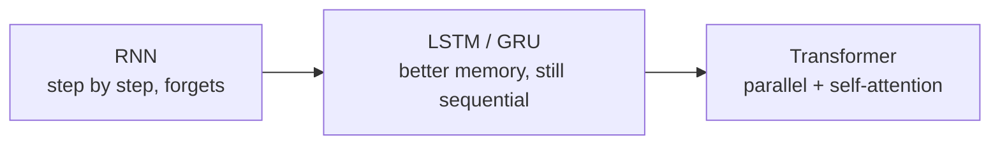
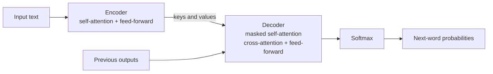
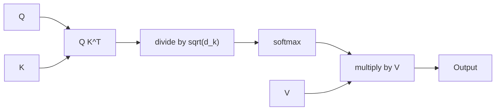
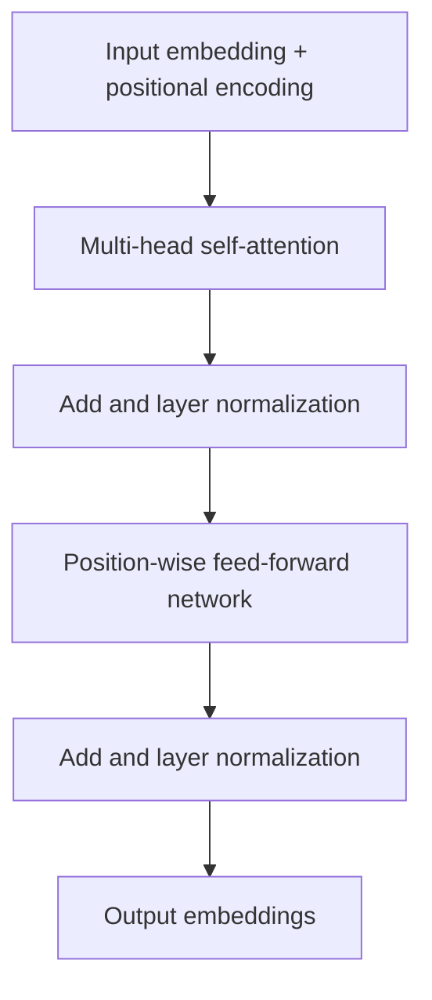
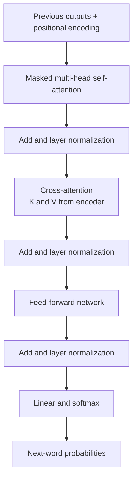

# Transformers Part 1: Architecture, Attention and Code

## What you will learn

- Why RNNs, LSTMs and GRUs hit a wall, and how the Transformer removes that wall
- Query, Key, Value and the scaled dot-product attention formula (with a numeric example)
- Multi-head attention, masked (causal) attention and cross-attention
- Positional encoding, layer normalization, feed-forward blocks, dropout
- How encoder and decoder blocks are wired into the full architecture of "Attention Is All You Need"
- How to implement attention from scratch in PyTorch and verify it against the built-in module

---

## Roadmap of the Module (7 Topics)

| Topic | Content |
|-------|---------|
| 1 | Introduction: limits of RNNs, why Transformers, Q/K/V idea |
| 2 | Self-attention: how Q, K, V give attention scores |
| 3 | Multi-head attention, scaled dot product, multimodal use |
| 4 | Positional encoding |
| 5 | Encoder block |
| 6 | Decoder block |
| 7 | Full architecture, loss functions, masking, scaling laws |

Transformers Part 1 (this module) covers the **structure** of the model. Part 2 covers **applications**. The Transformer is the pioneer of generative AI: GPT (Generative Pre-trained Transformer) is itself a Transformer, so mastery of it is the base for generative AI and later agentic AI.

---

## 1. Why RNNs, LSTMs and GRUs Were Not Enough

**Simple idea:** Older sequence models read a sentence one word at a time, like a person reading with a finger under each word, and they slowly forget the start of a long text. The Transformer reads the whole sentence at once and picks out what matters.

**Analogy:** A single cashier scanning items one by one (RNN) versus a bank of checkout lanes working side by side (parallel processing) while a supervisor who can see the whole basket decides which items matter.

### The chain of ideas



### Limitations

| Problem | RNN | LSTM / GRU | Transformer |
|---------|-----|-----------|-------------|
| Step-by-step (sequential) processing | Yes, no parallelism | Yes, word by word, time-consuming | No: processes tokens in parallel |
| Early-information degradation (long-range memory) | Severe: can recall ~5 steps back, not ~200 | Reduced by gates (GRU for simpler tasks, LSTM for complex ones) | Avoided: self-attention links any two positions directly |
| Hardware use | Sequential training leaves GPUs idle | Same | Parallel work keeps hardware busy |
| Scaling with data/compute | Poor | Poor | Good |

- LSTMs and GRUs were introduced to fix early-information degradation, but they kept the sequential bottleneck, so training stayed slow and added limited extra value.
- Sequential training means "step-by-step processing"; it wastes GPUs because many units wait for the previous step.
- The Transformer was proposed by Vaswani et al. (Google). Its key mechanism is **self-attention**, which finds the important parts of the input and focuses on those.

**Simplification gap:** "RNNs cannot remember 200 steps back" is a simplification: they can in principle, but gradients vanish so information is effectively lost. Also, attention compares every token with every other token, so cost grows with the square of the sequence length; parallelism is gained, not free compute.

---

## 2. Big Picture of the Architecture

**Simple idea:** One half (the **encoder**) reads and understands the input; the other half (the **decoder**) writes the output one word at a time while peeking at what the encoder understood.

**Analogy:** A translator who first reads the whole French sentence and makes notes (encoder), then writes the English sentence word by word while consulting those notes (decoder).



**Encoder path:** input (plus positional encoding) is turned into query, key and value, goes through self-attention, the result is normalized, then passes through a simple feed-forward neural network, and is normalized again. The output is a set of embeddings (numeric vectors) for the input.

**Decoder path:** the output generated at previous steps is fed back in (with positional encoding). It goes through a **masked** self-attention layer, normalization, then a second attention layer whose keys and values come from the encoder, then a feed-forward network, and finally a softmax that gives a probability distribution over the next word.

The attention mechanism is the building block of the Transformer: it appears once per encoder block and twice per decoder block.

### Model family tree

| Model | Year (approx.) | Notes |
|-------|----------------|-------|
| Transformer (Vaswani et al.) | 2017 | Original encoder-decoder |
| BERT | 2018 | Built from the encoder side |
| GPT-2, GPT-3 | later | Built from the decoder side |
| Vision Transformer (ViT) | 2020 | Used mostly for images |
| T5 | - | Encoder-decoder |

All of these rely on the same attention mechanism to compute attention scores.

---

## 3. Query, Key and Value (Q, K, V)

**Simple idea:** Every word asks a question, advertises a label, and carries some content. Words whose label matches your question get listened to more.

**Analogy (library):**

| Symbol | Role | Library analogy | E-commerce analogy |
|--------|------|-----------------|--------------------|
| Query (Q) | What am I looking for? | The search term you type | Customer search "red running shoes" |
| Key (K) | Label describing each item | The book title | Product title/tags |
| Value (V) | The actual content | The book contents | Product details returned |

You compare your query with every title (key); the better the match, the more of that book's content you take.

**Precise version:** The input embedding $X$ is projected into three versions using learned weight matrices:

$$Q = XW^Q,\quad K = XW^K,\quad V = XW^V$$

**Simplification gap:** The input is not literally "divided into 3 parts"; the same input is multiplied by three different learned weight matrices to produce three roles. In **self-attention** all three come from the same input. In **cross-attention** the query comes from the decoder, while keys and values come from the encoder.

---

## 4. Self-Attention and Scaled Dot-Product Attention

**Simple idea:** For each word, score how relevant every other word is, turn the scores into percentages, and take a weighted mix of their contents.

**Analogy:** In the sentence "The bag fell off the shelf because it was heavy," the word "it" looks at all other words and gives most weight to "bag".

### Formula

$$\text{Attention}(Q,K,V)=\text{softmax}\!\left(\frac{QK^{T}}{\sqrt{d_k}}\right)V$$

- $Q$: query matrix; $K$: key matrix; $V$: value matrix
- $K^T$: transpose of $K$, so $QK^T$ gives dot-product similarity of every query with every key
- $d_k$: dimension of the key vectors; $\sqrt{d_k}$ is the scaling (normalizing) factor
- softmax: converts scores to probabilities between 0 and 1 that sum to 1 for each query

### Steps

1. Multiply Q by $K^T$ (dot product): raw similarity scores.
2. Divide by $\sqrt{d_k}$ (scaling): keeps numbers from getting too large.
3. Apply softmax: scores become probabilities (attention weights).
4. Multiply the weights by V: weighted sum of the values is the output for that token.

A higher weight means that input is more important to the token; a lower weight means less important.



### Worked example

Take $d_k = 4$ and one query against 3 keys, with raw dot products $QK^T = [4,\ 2,\ 0]$.

1. Scale: $\sqrt{4}=2$, so scores $=[2,\ 1,\ 0]$.
2. Softmax: $e^2=7.389,\ e^1=2.718,\ e^0=1$; sum $=11.107$. Weights $=[0.665,\ 0.245,\ 0.090]$ (they add to 1).
3. Let $V=\begin{bmatrix}1&0\\0&1\\1&1\end{bmatrix}$. Output $=0.665[1,0]+0.245[0,1]+0.090[1,1]=[0.755,\ 0.335]$.

The first input has the highest weight (0.665), so it is the most important to this query.

### Why divide by $\sqrt{d_k}$?

Dot products of high-dimensional vectors grow with $d_k$. Large values push softmax into extreme regions (almost one-hot, tiny gradients). Scaling **stabilizes training** so softmax inputs are not too large. For example, $d_k=64$ means dividing by 8.

**Simplification gap:** The term "attention score" is used loosely. Strictly, the pre-softmax values are scores, the post-softmax probabilities are attention weights, and the final product with V is the attention output. The code names the softmax result "attention weights".

### Comparison

| Concept | Where Q, K, V come from | Used in |
|---------|-------------------------|---------|
| Self-attention | Same input sequence | Encoder; decoder (masked) |
| Cross-attention | Q from decoder; K, V from encoder | Decoder |

---

## 5. Multi-Head Attention

**Simple idea:** Instead of one pair of eyes, use several, each noticing a different kind of relationship, then combine what they saw.

**Analogy:** A panel of reviewers: one checks grammar, one checks topic, one checks sentiment; the final verdict combines all their notes.

**Precise version:** Run several self-attention units ("heads") in parallel, each with its own weights for Q, K and V, then **concatenate** the outputs (and project them):

$$\text{head}_i=\text{Attention}(QW_i^Q,\,KW_i^K,\,VW_i^V)$$

$$\text{MultiHead}(Q,K,V)=\text{Concat}(\text{head}_1,\dots,\text{head}_h)\,W^O$$

- $h$: number of heads. One head means one self-attention block, two heads means two blocks, eight heads means eight blocks.
- Each head works in dimension $d_k = d_{model}/h$.

**Worked example:** $d_{model}=512$, $h=8$ gives $d_k=512/8=64$ per head. The eight 64-dimensional outputs concatenate back to 512.

**Simplification gap:** Heads are run in parallel on the same layer rather than "stacked one on top of another"; stacking is a different idea (more layers). Concatenation is followed by a learned output projection $W^O$.

### Depth, heads and positional information

Increasing the number of encoder/decoder blocks (depth) or heads does **not** compensate for missing positional information. Positional information is a fundamental requirement: it is added to the embeddings before the first attention layer, so deeper stacks or more heads simply keep using it. Adding depth or heads does not destroy sequence information either; each block's basic components stay the same.

---

## 6. Masked (Causal) Attention

**Simple idea:** When predicting the next word, the model must not peek at the answer.

**Analogy:** An exam where you cover the next question with a sheet of paper.

**Precise version:** A mask matrix is added to the scores before softmax. Positions that must be hidden (future tokens, the entries above the diagonal) are set to $-\infty$. Since $e^{-\infty}=0$, softmax gives those positions weight 0.

Mask pattern for 3 tokens (1 = keep, 0 = block):

| | tok 1 | tok 2 | tok 3 |
|-----|-------|-------|-------|
| tok 1 | 1 | 0 | 0 |
| tok 2 | 1 | 1 | 0 |
| tok 3 | 1 | 1 | 1 |

The upper triangle is 0 (blocked); the lower triangle and diagonal are 1.

**Worked example:** Token 2 has scaled scores $[2,\ 1,\ -\infty]$. Softmax: $e^2=7.389$, $e^1=2.718$, $e^{-\infty}=0$; sum $=10.107$. Weights $=[0.731,\ 0.269,\ 0]$. The future token gets exactly zero.

- Why needed: if future tokens were exposed during training, the model would already know what comes next (information leakage), which is not allowed at prediction time.
- Masked attention is the same attention with a filter added.
- It appears only in the **decoder** (decoder has one masked self-attention layer plus one cross-attention layer). The encoder has no masking.

---

## 7. Scalability and Multimodal Use

- Because processing is parallel, the Transformer **scales** well when data or computation increases.
- It began with text only (as an extension of the RNN/LSTM line, which were mainly used for text). Later it was extended to images, audio, video, and any other data type: this is **multimodal** use (different forms of data).

---

## 8. Positional Encoding

**Simple idea:** Because all words are processed at once, the model needs a stamp saying "I am word number 3" on each word, or "dog bites man" and "man bites dog" look identical.

**Analogy:** Numbered seats in a cinema: the ticket (embedding) tells who you are, the seat number (position) tells where you sit.

**Why needed:** Text is converted to numbers (embeddings), but the Transformer has no recurrence, so on its own it does not know the order. Without order, meaning is lost.

**How:** A unique **position vector** is added to each token's embedding (position 0, 1, 2, 3, ...). Usually generated with **sinusoidal functions**:

$$PE_{(pos,2i)}=\sin\!\left(\frac{pos}{10000^{2i/d_{model}}}\right),\qquad PE_{(pos,2i+1)}=\cos\!\left(\frac{pos}{10000^{2i/d_{model}}}\right)$$

- $pos$: position of the token; $i$: dimension index; $d_{model}$: embedding size.
- Input to the first layer: $X_{in}=\text{Embedding}+PE$.

**Benefits of sinusoidal encoding:**
- Adds no extra learned parameters.
- Works for input of different lengths.
- Can encode up to a given length, giving a trade-off between flexibility and length of inputs.

Positional encoding sits at the input of both the encoder and the decoder. Variants (other embedding styles and innovations) exist, which differ in flexibility versus supported length.

---

## 9. The Encoder Block

**Simple idea:** The encoder turns text into rich numeric vectors (embeddings) that capture meaning in context.

**Flow inside one block:**



Components:

- **Feed-forward network (FFN):** a simple neural network applied to each position separately (position-wise).
- **Layer normalization:** applied at every step where values pass from one sub-layer to the next. Without it, some values become very large and some very small, which disturbs the network and training.
- **Dropout:** randomly switches off some neurons during some training iterations to reduce overfitting.
- **Stacking:** multiple encoder blocks can be stacked.

The goal of the encoder: take text and output embeddings (numerical values).

---

## 10. The Decoder Block

**Simple idea:** The decoder writes the answer one word at a time, using what it has already written and what the encoder understood.

**Flow inside one block:**



- **Masked self-attention:** stops the decoder from seeing future words.
- **Cross-attention:** the encoder supplies keys and values, the decoder supplies queries. This is how information flows from encoder to decoder.
- **Output:** a probability distribution over the vocabulary, i.e. the probability of each possible next word given the previous words.

### Pre-normalization vs post-normalization

| Style | Behaviour | Use |
|-------|-----------|-----|
| Pre-norm | Normalize before each sub-layer; stabilizes very deep stacks | Models like GPT-3 and LLaMA |
| Post-norm | Normalize after each sub-layer (as in the original design) | Works well for some models |

---

## 11. The Full Transformer and Training

- The original paper "Attention Is All You Need" (Vaswani et al., Google) uses **6 encoder blocks and 6 decoder blocks**.
- Core building blocks: positional encoding, multi-head attention, layer normalization, position-wise feed-forward network (plus residual connections and dropout).
- Topic 7 also covers: **cross-entropy loss** as the training objective, masking in training, and **scaling laws**.
- In design terms: Q, K, V come from the same input in self-attention; masked attention adds a filter that hides future words; cross-attention joins encoder outputs with the decoder.

### Parts and why each exists (reverse-engineering mindset)

| Component | Why it is there | What goes wrong without it |
|-----------|-----------------|----------------------------|
| Self-attention | Find important parts of the input | No context-aware focus |
| Multi-head | Capture several relationships | Only one kind of pattern |
| Scaling by $\sqrt{d_k}$ | Stable softmax | Saturated softmax, unstable training |
| Positional encoding | Give word order | Order lost; meaning lost |
| Mask | Hide future tokens | Information leakage |
| Layer norm | Keep values in a stable range | Large and small values disturb the network |
| Feed-forward | Extra non-linear processing | Less expressive power |
| Cross-attention | Link encoder understanding to decoder | Decoder cannot use the input |

The learning method is "reverse engineering": ask why each part exists and what would be lost if it were removed (like asking why you need food by imagining going without it).

---

## 12. Implementation in PyTorch (From Scratch)

The setup used PyTorch 2.11.0 on a CPU device; a GPU, if available, speeds up training.

Goals of the practical:
1. Implement the attention formula.
2. Build a single-head self-attention module.
3. Scale to multi-head attention.
4. Test with a dummy batch.
5. Add decoder-style masking.
6. Cross-check against PyTorch's built-in multi-head attention.

### Step 1: scaled dot-product attention function

Inputs: query, key, value, and an optional mask. Logic:

```python
scores = Q @ K.transpose(-2, -1) / math.sqrt(d_k)
if mask is not None:
    scores = scores.masked_fill(mask == 0, float("-inf"))
weights = torch.softmax(scores, dim=-1)
output = weights @ V
```

Quick check with batch 2, sequence length 5, dimension 16: output shape is (2, 5, 16) and attention weights shape is (2, 5, 5).

### Step 2: self-attention class

Define linear layers for query, key, value and output, and a forward method that calls the function above. With embedding dimension 32 and input shape (2, 6, 32), the output has the same shape (2, 6, 32); query and key sequence lengths are both 6. Output shape equals input shape.

### Step 3: multi-head attention

- One extra parameter: number of heads (for example 8 heads means 8 self-attention blocks).
- $d_k=\text{embedding dim}/\text{num heads}$.
- A **split heads** step reshapes the batch to (batch, heads, sequence, $d_k$) for Q, K and V; then the same scaled dot-product function is applied; results are concatenated back.

### Step 4: causal mask

The mask has 1 for positions to keep and 0 for blocked positions. For a causal mask the upper triangle is 0 and everything else is 1. Masked scores are filled with $-\infty$, so after softmax the upper triangle weights are exactly 0, and attention is spread only over the lower triangle (current and earlier tokens). Larger weights (for example 0.4 versus 0.34, 0.32, 0.26) show which inputs are more important.

### Step 5: compare with the PyTorch module

With the same embedding dimension, heads, sequence length and batch size, both implementations give output shape (2, 10, 64) and the shapes match (True). The built-in causal mask also blocks the upper triangle with the same pattern. (Warnings can be ignored.) Matching results confirm the from-scratch implementation is correct.

**Why build from scratch:** to know how to create the architecture if asked, instead of depending on a package. Feed-forward networks and positional encoding are easy (packages exist); the attention mechanism is the heart of the Transformer, so it is the part you must master.

**Exercise:** run the notebook, then try the same code and the same comparison with different data.

---

## 13. Practical Questions Answered

- **Where is the Transformer used?** Generative AI: GPT stands for Generative Pre-trained Transformer; asking GPT a question means querying a Transformer.
- **How does text become output?** Text is converted into numeric **embeddings** (the idea comes from earlier NLP work such as Word2Vec); the model works on vectors and finally produces probabilities over words, which are converted back to readable text.
- **Is ML still used?** Yes, for specific, specialized use cases such as bank fraud detection, where generic LLMs may lack specificity; usage is lower than before. Machine learning is the base for deep learning, which is the base for generative AI.
- **Reference:** read "Attention Is All You Need" (the parent paper) to see the architecture diagram, the 6+6 block configuration, scaled dot-product attention, multi-head attention, embeddings/softmax and the "why self-attention" argument. You need not master every equation, but must know the setup.

---

## Exam and Assessment Hints

- Know the paper title ("Attention Is All You Need") and that it proposed the Transformer.
- Be able to state and explain the attention formula and why $\sqrt{d_k}$ is used.
- Know that the original uses 6 encoder and 6 decoder blocks.
- Be ready to explain what each component does and what happens without it.
- Practice notebook (EL component): run the code, try another dataset, and compare with PyTorch's multi-head attention.

---

## Self-Check Questions

1. **What two main RNN problems does the Transformer solve?**
   Sequential (step-by-step) processing that prevents parallelism, and early-information degradation over long sequences.

2. **Write the attention formula.**
   $\text{softmax}(QK^T/\sqrt{d_k})V$.

3. **Why scale by $\sqrt{d_k}$?**
   Large dot products push softmax to extremes; scaling keeps values moderate and stabilizes training.

4. **Why does masking use $-\infty$?**
   Softmax of $-\infty$ is 0, so future tokens receive zero weight.

5. **Where is masked attention used?**
   Only in the decoder.

6. **Why is positional encoding needed?**
   Parallel processing has no built-in order; position vectors (usually sinusoidal) tell the model each token's place.

7. **Can more layers or heads fix poor positional information?**
   No; positional information is a fundamental requirement added before attention.

8. **What is cross-attention?**
   Decoder queries attend to keys and values from the encoder output.

---

## Common Pitfalls / Exam Traps

- Saying the input is "split into three parts": Q, K, V are three learned projections of the same input.
- Confusing self-attention (all from one input) with cross-attention (K, V from encoder).
- Thinking the encoder uses masking; only the decoder does.
- Forgetting the division by $\sqrt{d_k}$, or using $d_k$ instead of its square root.
- Believing the Transformer is sequential; it is parallel, hence needs positional encoding.
- Mixing up $d_k = d_{model}/h$ (per head) with the full model dimension.
- Mixing up pre-norm (stabilizes deep stacks, GPT-3, LLaMA) and post-norm.
- Treating multi-head as "layers stacked": heads run in parallel and are concatenated.

---

## Quick Revision Summary

- RNNs are sequential and forget early information; LSTM/GRU help memory but stay sequential; the Transformer is parallel and uses self-attention.
- Q = search term, K = title/label, V = content.
- Attention $=\text{softmax}(QK^T/\sqrt{d_k})V$; scaling stabilizes softmax.
- Multi-head attention runs $h$ self-attention units in parallel and concatenates them; $d_k=d_{model}/h$.
- Masked attention sets future positions to $-\infty$ (weight 0); it is used only in the decoder.
- Positional encoding (sinusoidal) adds order with no extra parameters.
- Encoder block: attention, layer norm, feed-forward, layer norm; decoder adds masked attention and cross-attention, ending in softmax.
- Original design: 6 encoder + 6 decoder blocks (Vaswani et al., "Attention Is All You Need").
- From-scratch attention matches PyTorch's built-in module in output shape and mask.
- Transformers underpin BERT, GPT, ViT and generative AI.

---

**← [Previous](01-transformers-i-attention-and-architecture-summary-presentation.md) · [Index](../README.md) · [Next](../week-06/01-transformer-variants-llms-and-transfer-learning-transcript.md) →**
