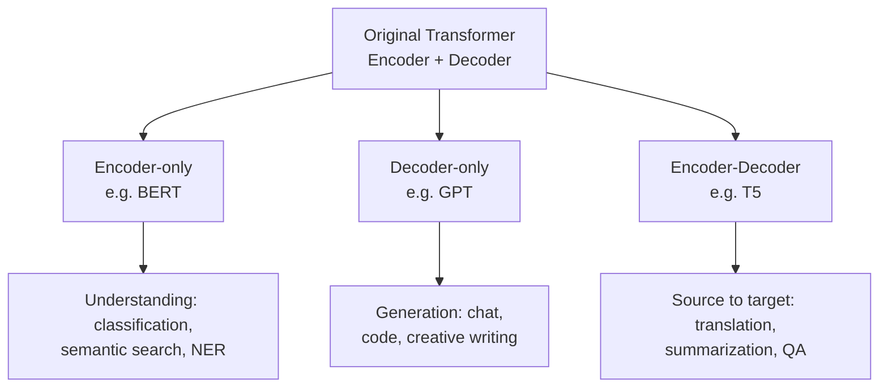
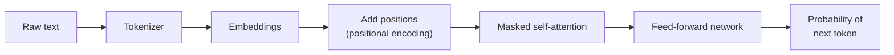
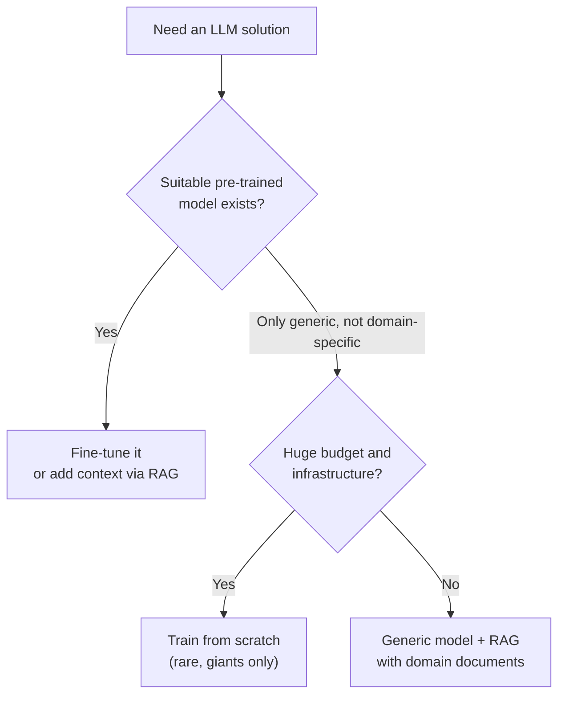
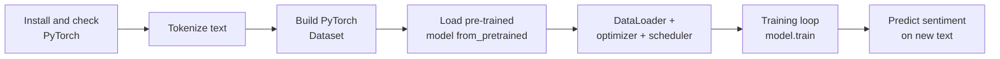

# Transformer Variants, LLMs and Transfer Learning

## What you will learn

- The three transformer design variants (encoder-only, decoder-only, encoder-decoder) and which task suits each
- How BERT (understanding) and GPT (generation) work, and why masking matters in both
- What pre-training, fine-tuning and transfer learning mean, and why industry prefers them to training from scratch
- The roadmap of efficiency topics: sparse attention, latent KV cache, tokenization (BPE, WordPiece, SentencePiece), decoding (greedy, beam, temperature, top-K, top-P)
- When to fine-tune, use RAG, or train from scratch, and how to evaluate a fine-tuned model
- A complete DistilBERT fine-tuning pipeline for sentiment classification in PyTorch

---

## 1. The Big Picture: Original Transformer and Its Three Variants

**Simple idea:** The original transformer is a machine with two halves: one half *reads*, the other half *writes*. Researchers found that for many jobs you only need one half, so they split it into three "designs".

**Analogy:** Think of a translation agency. A *reader* reads the French document and understands it (encoder). A *writer* produces fluent English text word by word (decoder). A translator needs both. A reviewer who only classifies reviews as good or bad needs just the reader. A novelist who only writes needs just the writer.

### The original transformer (recap)

The original transformer (paper: *Attention Is All You Need*) has an **encoder** and a **decoder**. Its key ideas:

- **Self-attention** replaced recurrence (RNNs/LSTMs/GRUs), so every token can look at every other token in parallel
- **Cross-attention** links the decoder to the encoder output
- **Positional encoding** injects word order, since attention alone has no sense of order

### The three variants

| Variant | Parts kept | Attention style | Example model | Typical tasks |
|---|---|---|---|---|
| Encoder-only | Encoder stack | Bidirectional (sees left and right context) | BERT | Text classification, semantic (similarity) search, NER, extractive QA |
| Decoder-only | Decoder stack | Causal / masked (sees only previous tokens) | GPT, Llama, Claude | Chat, code generation, creative writing, any text generation |
| Encoder-decoder | Both | Encoder: bidirectional; decoder: causal plus cross-attention to encoder | T5 | Translation, summarization, question answering |

- In **encoder-decoder** models the encoder reads the source text; the decoder generates the output text while attending to the encoder through **cross-attention**.
- **Semantic search** = finding text with similar meaning (not just identical words).

### How to choose the right variant

1. **Understand your task first.**
   - Bidirectional understanding (classification, semantic search) -> **encoder-only**
   - Chat, code generation, creation -> **decoder-only**
   - Summarization, translation (input sequence -> different output sequence) -> **encoder-decoder**
2. **Creation tasks** -> decoder-only.
3. **Shared foundation:** parts of the architecture (same attention network, same feed-forward layers) can be reused with *different data*; the model structure stays the same and only the data changes.
4. **Modern LLMs are mostly decoder-only**, because nearly all of their use is generation.

**Why it matters:** An LLM is expensive. Choosing the wrong variant wastes money and infrastructure, so the right choice is a core design decision.

**Caveat:** The "task -> variant" mapping is a strong default, not a hard rule. Decoder-only models can also do classification (via prompting) and encoder-decoder models can do chat; the table gives the *natural fit*.

---

## 2. BERT: Encoder-Only, Bidirectional Understanding

**Simple idea:** BERT reads a whole sentence at once, looking both left and right of every word, to truly understand it. It cannot write new text.

**Analogy:** Reading "I sat on the river **bank**" versus "I went to the **bank** to deposit money". The word *bank* is identical, but the surrounding words decide the meaning. Only a reader who looks at words on both sides can tell the difference.

### Key facts

- BERT = **B**idirectional **E**ncoder **R**epresentations from **T**ransformers.
- Uses only the **transformer encoder stack**; used for **understanding, not generation**. You cannot generate text with BERT.
- **Bidirectional** means each token's representation uses context from both the left and the right. (Informal explanation: "one transformer from the left, one from the right". Precise version: it is one encoder stack whose self-attention is unmasked, so every token attends to all tokens in both directions.)
- Good for: classification, semantic search, question answering, **NER** (Named Entity Recognition: extracting names of places, people, countries, etc. from documents).

### Pre-training objectives

**1. Masked Language Modelling (MLM):** about **15% of tokens are masked** and the model must predict them from the surrounding context.

- Why mask? In a bidirectional model every token can see every other token, including itself. Without masking, the model could trivially "see the answer" (**leakage**) and learn nothing. Masking hides the target tokens so the model must infer them from context.
- Caveat (standard detail): of the selected 15%, BERT replaces most with a `[MASK]` token, some with a random token and some leaves unchanged (80/10/10 split), so the model cannot rely on seeing `[MASK]` alone.

**2. Next Sentence Prediction (NSP):** the model is shown sentence pairs where **50% are the true next sentence and 50% are random sentences**, and learns **coherence** between sentences.

### Pre-training versus fine-tuning

| Aspect | Pre-training | Fine-tuning |
|---|---|---|
| What happens | Model is built from scratch on a huge corpus (e.g. books, Wikipedia) | A ready-made model is adapted to your task, changing/training only a few layers |
| Cost | Very high (huge data, large infrastructure) | Low |
| Done by | Few well-funded organizations, **once** | Anyone, many times |
| Result | General language knowledge | Task-specific model (classification, QA, NER) |

**Why fine-tuning is preferred:** building an LLM from scratch needs enormous data, hardware and money. You load a pre-made model, feed your data, adjust a small number of layers, and reuse it. The same logic applies to BERT, GPT and T5: nobody trains them from scratch for a normal project.

---

## 3. GPT: Decoder-Only, Autoregressive Generation

**Simple idea:** GPT is a super autocomplete. Given the words so far, it guesses the next word, adds it, and repeats.

**Analogy:** Your phone keyboard suggesting the next word, but trained on a huge part of the internet and able to continue for pages.

### Key facts

- Decoder-only transformer; examples: **GPT, Llama, Claude**. These are all **generation-based** models: ask a question and they generate the answer.
- **Autoregressive:** every task is turned into **next-token prediction**: given previous tokens, predict the next one using context.
- ChatGPT (built on GPT) is what introduced the public to generative AI, and decoder-only models remain the standard for generation at scale.
- **Masking** (causal mask) is present in the decoder: a token may attend only to earlier tokens, never to future ones, otherwise the model would see the answer it is supposed to predict.

### The GPT pipeline

The final output is a **probability distribution over the vocabulary** for the next token; one token is chosen from it (see decoding in Section 7) and fed back in.

### BERT versus GPT

| Feature | BERT | GPT |
|---|---|---|
| Architecture | Encoder-only | Decoder-only |
| Direction | Bidirectional | Left-to-right (causal) |
| Pre-training task | Masked tokens (15%) + NSP | Next-token prediction |
| Strength | Understanding context | Generating text |
| Can it generate text? | No | Yes |
| Tokenizer | WordPiece | BPE |

**Rule to remember:** any *generation* task -> decoder-only model.

---

## 4. Pre-training at Scale

**Simple idea:** Pre-training is the expensive "school years" of a model: it reads enormous amounts of text to learn language. Afterwards it can be specialised cheaply.

When you create a model from scratch with your own data and algorithm, the result is a **pre-trained model**. Topics around this:

- **Scale:** more data -> more parameters -> much higher cost.
- **Emergent abilities:** as scale grows, models gain abilities such as multi-step reasoning and better context understanding.
- **Metrics:** accuracy can mean direct-answer correctness, or the percentage of a reasoning answer that is right, depending on the task.
- **Quality over quantity:** prefer a few high-quality models/data rather than many mediocre ones.
- **Alignment:** base models are aligned through fine-tuning, specifically **SFT** (Supervised Fine-Tuning) and **RLHF** (Reinforcement Learning from Human Feedback), covered in later modules.
- **Efficiency goals after pre-training:** reduce **inference cost** and **latency** (the time a model takes to return a result, measured in seconds or milliseconds), so base models can be reused without rebuilding.

---

## 5. Efficient Transformers

**Simple idea:** Attention is powerful but memory-hungry. Efficient transformers find shortcuts so the model costs less and answers faster.

**Analogy:** In a meeting of 1,000 people, if everyone must talk to everyone else, it takes forever. If each person talks only to a relevant few, it is much faster.

- The bottleneck is **self-attention**: large **matrix multiplications** consume lots of memory and runtime (memory-bound on GPUs).
- **Sparse attention:** use only a subset of token pairs; masked-out positions are treated as 0. This reduces memory and compute.
- **Latent KV (low-rank latent cache):** compress the key-value cache into a low-rank latent form to save memory bandwidth, instead of filling the cache with the full tensors. (This idea is used in multi-head latent attention.)
- **Hybrid stacks:** mix sparse attention blocks with full attention blocks rather than using full attention everywhere.
- **Why it matters:** LLM cost is very high; not knowing how to use architectural fixes means extra money, infrastructure and bandwidth spent.

---

## 6. Tokenization

**Simple idea:** A model only understands numbers. Tokenization chops text into small pieces (tokens) and gives each piece a number.

**Analogy:** Breaking a sentence into Lego bricks, each with a serial number, so the machine can rebuild it.

Without tokenization nothing can be done. Different algorithms exist:

| Algorithm | How it works | Used in |
|---|---|---|
| **BPE** (Byte Pair Encoding) | Repeatedly **merges the most frequent adjacent pair** of symbols | GPT |
| **WordPiece** | Merges pieces according to the **likelihood** (of the training data under the model) | BERT |
| **SentencePiece** | Treats **white space as a normal character**, so it works on raw text without pre-splitting into words; suitable for languages such as Chinese, Japanese and Thai | T5 and multilingual models |

**Worked mini-example (BPE idea):** Suppose the corpus has the pairs `l o`, `l o`, `l o`, `w e`. The pair `l o` is most frequent (3 times), so it is merged into a new token `lo`; the process repeats on the updated corpus until a target vocabulary size is reached.

**Why it matters:** Tokenization choice affects memory consumption, computation cost, and multilingual handling. Real projects are not always English-only, so the tokenizer must suit the languages involved.

**Model-selection practical point:** Loading a very large model on hardware that cannot support it can take days, burns infrastructure and gives high latency. Check hardware requirements and fit with your use case *before* selecting a model.

---

## 7. Decoding Strategies and Sampling Parameters

**Simple idea:** The model outputs probabilities for the next word. Decoding is the rule for picking which word to actually use.

**Analogy:** Choosing a restaurant: always pick the highest-rated (greedy), keep a few promising shortlists and compare full meals (beam), or pick randomly among the good ones for variety (sampling).

### Algorithms

| Method | How it works | Notes |
|---|---|---|
| **Greedy search** | Picks the single most probable token at every step | Very fast, but may miss better overall sequences |
| **Beam search** | Keeps several candidate sequences (hypotheses, the "beam") at each step and prunes the weaker ones, keeping the best-scoring ones | Better quality than greedy, more compute; can reduce repetition |

### Sampling parameters

- **Temperature $T$:** rescales the logits before softmax:
$$P(w_i)=\frac{\exp(z_i/T)}{\sum_j \exp(z_j/T)}$$
  where $z_i$ is the logit of token $i$.
  - $T>1$: flatter distribution -> more **diverse, creative** answers.
  - $T<1$: sharper distribution -> **focused**, less diverse answers.
  - $T=1$: the unchanged model distribution.
- **Top-K:** sample only from the $K$ most probable tokens (e.g. top 10 or top 20).
- **Top-P (nucleus sampling):** sample from the smallest set of tokens whose cumulative probability reaches $P$ (e.g. 0.9). The candidate pool size therefore adapts to how confident the model is.

**Worked example (top-P):** Token probabilities: A 0.5, B 0.3, C 0.1, D 0.06, E 0.04. With $P=0.9$ the cumulative sum is 0.5, 0.8, 0.9 -> the nucleus is {A, B, C}; D and E are excluded and the three are renormalised. With top-K and $K=2$ the pool is always {A, B}.

**Choosing values:** there is no hard rule. For each task (e.g. translation) you pick values for temperature, top-K and top-P by **trial and error**: run the model, check performance, adjust.

---

## 8. Transfer Learning

**Simple idea:** Do not teach a newborn to read; hire someone who already reads and teach them your company's vocabulary.

**Analogy:** A chef who already knows cooking basics only needs to learn your restaurant's menu, not start culinary school again.

**Definition:** **Transfer learning** = take a model pre-trained on large data, keep its learned knowledge, and adapt it (usually by training only some layers) to your task and data.

- Motto: **"Pre-train once, fine-tune anywhere."**
- Before transformers, each task needed its own model trained from scratch and RNNs had limitations; massive pre-trained models changed this.
- You can reuse one base model for classification, translation or question answering with little extra training time.
- **Cost/time:** training a full model versus training only some layers differs greatly; transfer learning cuts both. Industry therefore takes a base model, adds organization data, fine-tunes and gets a custom version.

| Approach | Data needed | Compute cost | Time | Typical user |
|---|---|---|---|---|
| Train from scratch | Huge | Very high | Very long | Google, Microsoft, Meta, OpenAI |
| Fine-tune pre-trained model | Small to medium | Low to moderate | Short | Most companies |
| Use as-is / RAG / prompting | None to little | Lowest | Immediate | Most companies |

---

## 9. Choosing: Fine-tune, RAG, or Train from Scratch

**Scenario:** A bank wants a chatbot.

- If a general chatbot model exists but not a banking-specific one, the organization has two options:
  1. **Create a model from scratch** (only if it has the budget, infrastructure and data). Even large organizations avoid this; mostly giants (Google, Microsoft, Meta, OpenAI) do it.
  2. **Take a generic model and add as much domain knowledge as possible** (policy data, internal documents, external documents), typically via **RAG** (Retrieval-Augmented Generation; covered in a later module).
- Mid-size and small organizations do not train from scratch because both data creation and training are very expensive; they prefer fine-tuning or RAG.

### Keeping knowledge up to date (pre-training versus RAG)

- A pre-trained LLM has a **knowledge cut-off**: it does not know very recent events and may **hallucinate** or answer poorly about them. It is not real-time.
- Policies change (e.g. financial regulator rules), so the knowledge must be refreshed.
- **Updating a pre-trained model:** needs retraining the full model at some frequency (every 6 months or 1 year) -> **very costly**.
- **Updating via RAG:** you refresh the documents (also periodically, e.g. every 6 months) and supply them as context at runtime; **the LLM itself is not retrained** -> far cheaper.
- In RAG, newly added data is added on top of earlier data; it does not erase it.
- Even large organizations create a model once and then keep on fine-tuning or using RAG.

| Aspect | Re-pre-training | RAG |
|---|---|---|
| What changes | Model weights | The retrieved context/documents |
| Cost of update | Very high (full retraining) | Low |
| Freshness | As fresh as last training | Can be updated at any time, used at runtime |
| Domain depth | Deepest, if done from scratch | Depends on the quality of documents |

**Caveat:** RAG reduces but does not eliminate hallucination; fine-tuning, RAG and prompt engineering are complementary, not mutually exclusive.

---

## 10. Evaluating a Fine-Tuned Model

Two ways to check that fine-tuning worked:

1. **Direct questioning:** ask the model questions related to the data you fed it (general, quick check).
2. **Task-specific evaluation metrics:** e.g. separate metrics for translation, summarization, question answering and text generation. These show whether the model really learned the new knowledge.

Also test **after fine-tuning** that the model **still retains existing capabilities** as well as the new knowledge. Source claim: capabilities are retained because you only modify the outer layers and not the core layers of the model.

**Caveat:** the retention claim holds mainly when only some layers (or small adapters) are updated. If many weights are updated with a high learning rate, **catastrophic forgetting** can occur, so always re-test on old tasks.

**Classification evaluation:** use a held-out **test set** and compute **accuracy, precision, recall, and a confusion matrix**. In the notebook this is done by extending the `compute_metrics` function (add the confusion matrix and return it).

---

## 11. Hands-On: Fine-Tuning DistilBERT for Sentiment Classification

**Simple idea:** Take a ready-trained BERT-like model, show it a few labelled sentences, and nudge it to label new sentences as positive or negative.

**Analogy:** A film critic who already understands English only needs a few examples of your rating scheme.

**DistilBERT:** a **distilled** (smaller, lighter, faster) version of BERT, produced by knowledge distillation (standard figures: about 40% fewer parameters, about 60% faster, retaining about 97% of BERT's performance). Checkpoint used: `distilbert-base-uncased` (a "base" model that ignores letter case). This is **transfer learning**.

### Pipeline steps

1. **Setup:** install dependencies, check the PyTorch version (the environment must have a stable PyTorch). Import from `transformers`: `DistilBertTokenizer` (loads tokenizer), `DistilBertForSequenceClassification` (loads model), `Trainer`, `TrainingArguments` (fine-tuning configuration).
2. **Data preparation:** a custom `TextClassificationDataset` class holds the **encodings** and **labels**. Each item is returned as a dictionary (key/value); labels are converted to **tensors**; it also returns the dataset length.
3. **Dummy dataset (4 sentences, labels 1 = positive, 0 = negative):**

| Sentence | Label |
|---|---|
| "I love this movie, it was absolutely wonderful." | 1 |
| "Terrible experience. I hated every minute of it." | 0 |
| "Great acting and marvelous direction." | 1 |
| "Boring plot, waste of time and money." | 0 |

4. **Tokenizer:** load from the pre-trained name, apply to training text to get encodings; the dataset therefore has **4 samples**.
5. **Metrics function** (`compute_metrics`): takes **logits** and **labels**, takes the argmax to get predictions, computes **accuracy**.
6. **Load model:** `from_pretrained(model_name, num_labels=2)`. Whenever you see `.from_pretrained`, you are loading a pre-trained model. The pre-trained weights carry prior knowledge; the classification head is new.
7. **DataLoader:** wraps the dataset (required for PyTorch); **batch size = 2** (two samples at once), `shuffle=True`.
8. **Optimizer:** the **Adam**-family optimizer (a native PyTorch one; AdamW is the usual choice for transformers).
9. **Hyperparameters:** **epochs = 3**; **total steps = (number of batches per epoch) x epochs** (in the notebook described as dataset length times epochs; with 4 samples and batch size 2 there are 2 batches per epoch, 6 steps in all); a **scheduler** controls the learning-rate schedule (warm-up steps, total steps, optimizer).
10. **Training loop:** `model.train()`; for each epoch start loss at 0; for each batch get `input_ids`, `attention_mask`, `labels`; forward pass `outputs = model(input_ids, attention_mask, labels)`; `loss.backward()`; `optimizer.step()`; `scheduler.step()`; accumulate and print loss per batch and average loss per epoch.
11. **Inference:** tokenize new text with the same tokenizer, pass through the fine-tuned model to get **logits**, apply softmax for **probabilities**, take the label and report class and confidence.

### Results observed

- Average epoch loss: about 0.70 (epoch 1), about 0.66 (epoch 2), about 0.68 (epoch 3).
- Rule of thumb applied: **loss should keep decreasing**; since the loss rose from 0.66 to 0.68, stop at epoch 2 rather than run epoch 3.
- Test sentence: "The performance was surprisingly brilliant and engaging" -> predicted **positive**, confidence **50.46%**.

**Caveats (precise version):**
- A loss that goes up for one epoch is a warning, not an automatic stop rule; the proper method is to monitor **validation loss** and use early stopping. With 4 training samples the loss values are noisy.
- A confidence of 50.46% for a binary task is barely above a coin flip (50%). The label is right, but the model is not actually confident; the tiny dummy dataset is only a demonstration. Real fine-tuning needs far more data and a held-out test set.
- Initial loss near 0.69 equals $\ln 2 \approx 0.693$, which is the loss of a binary classifier guessing at random, so the model had barely learned yet.

**Reuse:** change the sentences to your organization's text, try other pre-trained models (GPT, T5) and other datasets after you understand this setup.

---

## Comparison Summary: Which Model Family for Which Task

| Task | Best fit | Reason |
|---|---|---|
| Sentiment / text classification | Encoder-only (BERT, DistilBERT) | Needs full bidirectional understanding |
| Semantic search | Encoder-only | Embeddings of meaning |
| Named entity recognition | Encoder-only | Token-level understanding of context |
| Chat, code generation, creative writing | Decoder-only (GPT) | Autoregressive next-token generation |
| Translation | Encoder-decoder (T5) | Read source, write target via cross-attention |
| Summarization, QA | Encoder-decoder | Read document, generate output |

---

## Exam and Assessment Hints

- Be ready to map **task -> variant** and **model -> variant** (BERT: encoder-only; GPT: decoder-only; T5: encoder-decoder).
- Know the BERT specifics: bidirectional, **15% masking**, **NSP with 50/50** real/random sentences, WordPiece tokenizer; GPT uses BPE.
- Know why **masking** is needed (prevents leakage of the answer) and what **autoregressive** means.
- Understand pre-training versus fine-tuning versus transfer learning, plus the "fine-tune vs RAG vs scratch" decision and the cost argument.
- Know decoding terms: greedy, beam, temperature (>1 diverse, <1 focused), top-K, top-P.
- The notebook steps (tokenize, dataset, `from_pretrained`, DataLoader, optimizer, scheduler, train loop, predict) can be asked as an ordered list or fill-in-the-blank.
- Slides and the practical notebook for this module are provided on the course platform for revision.

---

## Self-Check Questions

1. **Which transformer variant is BERT, and what is it good for?**
   Encoder-only and bidirectional; good for understanding tasks such as classification, semantic search, NER, QA. It cannot generate text.
2. **Why do decoder-only models dominate modern LLMs?**
   Most LLM usage is generation (chat, code, writing), and decoder-only autoregressive models are the natural architecture for next-token generation.
3. **Why is masking needed in BERT and in GPT?**
   In BERT, masked tokens (15%) hide the answer so the model must infer it from context instead of leaking it. In GPT, the causal mask hides future tokens so the model cannot peek at what it must predict.
4. **Define fine-tuning and explain why it is preferred over pre-training from scratch.**
   Fine-tuning adapts a pre-trained model by training only a few layers on your data. It saves data, compute, money and time compared with building an LLM from scratch.
5. **What does temperature do, and what happens at $T>1$ and $T<1$?**
   It scales logits before softmax. $T>1$ gives flatter probabilities and more diverse, creative output; $T<1$ gives sharper probabilities and more focused, less diverse output.
6. **How do BPE and WordPiece differ?**
   BPE repeatedly merges the most frequent adjacent pair (GPT); WordPiece merges based on likelihood (BERT).
7. **A bank needs an up-to-date policy chatbot. Why prefer RAG to re-pre-training?**
   RAG updates only the documents supplied as context, with no full-model retraining, so it is far cheaper and keeps answers current.
8. **In the DistilBERT demo the epoch losses were 0.70, 0.66, 0.68. What was concluded and what is the caveat?**
   Stop at epoch 2 because the loss rose. The proper approach is to monitor validation loss; with 4 samples the numbers are noisy.

---

## Common Pitfalls / Exam Traps

- Saying BERT can generate text; it is an encoder and only produces representations for understanding.
- Mixing up tokenizers: BPE goes with GPT, WordPiece with BERT.
- Describing bidirectional BERT as "two separate transformers"; it is one encoder stack with bidirectional self-attention.
- Confusing **pre-training** (building the base model, very expensive) with **fine-tuning** (adapting it, cheap).
- Assuming temperature > 1 makes output more deterministic; it makes it more random/diverse.
- Believing RAG retrains the model; it only adds retrieved context at runtime.
- Treating "loss increased in one epoch" as a rule without validation data, and treating 50% confidence as a good prediction.
- Forgetting that `from_pretrained` loads a pre-trained model while `num_labels` sets the size of the new classification head.
- Assuming fine-tuning always preserves old abilities; verify, since forgetting is possible.

---

## Quick Revision Summary

- Three variants: encoder-only (BERT, understanding), decoder-only (GPT, generation, autoregressive), encoder-decoder (T5, translation/summarization/QA via cross-attention).
- Choose the variant by task; modern LLMs are mostly decoder-only.
- BERT: bidirectional, 15% token masking (MLM), NSP with 50% real/50% random pairs; useful for NER, classification, semantic search.
- GPT pipeline: tokenizer -> embedding -> positions -> masked attention -> feed-forward -> next-token probabilities.
- Pre-training is costly and done once; fine-tuning and transfer learning ("pre-train once, fine-tune anywhere") cut cost, time and infrastructure.
- Efficiency: sparse attention, latent KV cache, hybrid stacks reduce memory and compute; watch inference cost and latency.
- Tokenizers: BPE (merge frequent pairs), WordPiece (likelihood), SentencePiece (whitespace as a character, multilingual).
- Decoding: greedy (fast, top token), beam (multiple hypotheses); temperature, top-K, top-P tuned by trial and error.
- For domain chatbots prefer fine-tuning or RAG over training from scratch; RAG is cheaper to update than re-pre-training.
- Practical recipe: tokenize -> Dataset -> `from_pretrained` -> DataLoader -> optimizer/scheduler -> train loop -> evaluate (accuracy, confusion matrix) -> predict.

---

**← [Previous](../week-05/01-transformers-part-1-architecture-attention-and-code-transcript.md) · [Index](../README.md) · [Next](../week-07/01-vision-transformers-architecture-training-and-practice-transcript.md) →**
