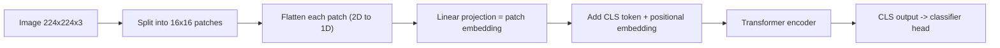
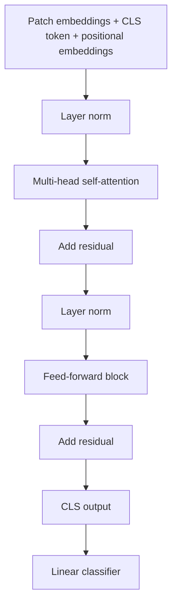

# Vision Transformers: Architecture, Training and Practice

## What you will learn

- Why CNNs hit limits and how transformers were extended from text to images
- How an image becomes a token sequence: patches, flattening, patch embeddings, CLS token, positional embeddings
- How self-attention works on patches, and efficient variants (window, shifted-window, neighbourhood attention)
- How ViTs are trained (pre-training, masked autoencoding, augmentation, regularisation) and how they compare with CNNs
- Variants (ViT, DeiT, Swin, ViViT, hybrids) and use cases (medical, remote sensing, video)
- Hands-on: ViT from scratch in PyTorch and fine-tuning a pre-trained ViT on CIFAR-10

---

## From CNNs to Vision Transformers

**Simple idea:** a Vision Transformer (**ViT**) reads a picture the way a transformer reads a sentence: it cuts the picture into small pieces and treats each piece like a "word".

**Analogy:** a CNN is like inspecting a wall brick by brick with a small magnifying glass, moving it slowly across the wall. A ViT is like cutting a photo into a grid of tiles, laying all tiles on a table, and letting every tile "look at" every other tile at once to decide which ones matter.

**Background.** Neural networks evolved from plain networks to RNNs, LSTMs and GRUs, and then to **transformers** (self-attention, feed-forward block, encoder-decoder attention), which became reusable pre-trained models (for example GPT, used for transfer learning). The same transformer can be reused for **vision**.

### Why CNNs were not enough

- A CNN uses convolutional layers, kernels and pooling layers. It works well on small and mid-sized datasets.
- **Long-range dependencies:** to relate far-apart regions (or reach high quality), many layers must be stacked.
- **No language ability:** a CNN does not understand text. When an image must be linked to a **description** (a text), you need a model that reads both image and text. Transformers fill that role.
- With very large datasets (100 million+ images), transformers outperform CNNs.

### Comparison: CNN vs ViT

| Aspect | CNN | Vision Transformer |
|--------|-----|--------------------|
| Input unit | Pixels (local neighbourhoods via kernels) | Patches turned into embeddings |
| Core operation | Convolution + pooling | Self-attention on patch tokens |
| Long-range context | Needs many stacked layers | One attention layer can relate any two patches |
| Small / mid data | Dominates | Weaker (needs lots of pre-training) |
| Large data | Plateaus | Outperforms CNNs |
| Text + image together | Poor | Natural (shared token/embedding view) |
| Robustness | Lower | Higher (attention focuses on the important regions) |
| Training from scratch | Usual | Usually avoided; start from a pre-trained model |

**Simplification gap:** "CNNs have no language ability" means CNNs are not built to handle text tokens; they can still be combined with text models. "ViT is more robust" is a general trend, not a guarantee on every dataset.

---

## Patch-Based Processing

**Simple idea:** chop the image into equal square tiles, flatten each tile into a list of numbers, and feed these lists to a transformer.

**Analogy:** a jigsaw puzzle. Each piece is a patch; the whole puzzle is the image. Instead of looking at individual colour dots (pixels), you handle whole pieces.

**Steps**

1. Take an image, for example $224 \times 224$ pixels with 3 colour channels (the "224 plus 224" size is $224 \times 224$).
2. Split it into **non-overlapping patches** of size $P \times P$ (typically $16 \times 16$).
3. **Flatten** each patch (2D grid of pixels $\rightarrow$ 1D vector).
4. Apply a **linear projection** to get a **patch embedding** of dimension $D$.
5. Add a learnable **CLS token** and **positional embeddings**.
6. Feed the sequence to a standard transformer encoder.

$$N = \frac{H \times W}{P^2}, \qquad \text{patch vector length} = P^2 \cdot C$$

- $H, W$: image height and width; $P$: patch side; $C$: channels; $N$: number of patches (tokens).

**Worked example:** $H = W = 224$, $P = 16$, $C = 3$.

- Patches per side $= 224 / 16 = 14$, so $N = 14 \times 14 = 196$ tokens.
- Each patch vector has $16 \times 16 \times 3 = 768$ numbers, which a linear layer maps to an embedding of size $D$.
- With the CLS token, the sequence length is $196 + 1 = 197$.

**Divisibility rule:** image size must be exactly divisible by patch size (for $224$ and $16$: $224 / 16 = 14$, fine). Choose image size and patch size accordingly.

### Why embeddings?

Transformers only operate on numerical embeddings. Once the image is converted into embeddings, everything downstream is identical to a text transformer: self-attention only needs numbers.

### Common questions

- **Is each pixel a token?** No. One **patch** (a group of pixels) is one token. Working per pixel would be far too long a sequence (a $224 \times 224$ image has 50,176 pixels vs 196 patches).
- **How is a 2D patch handled?** The width and height of the patch are flattened into a one-dimensional array of embedding values. There is no separate x-axis and y-axis interaction inside the transformer after flattening.
- **Are patches overlapping?** Normally non-overlapping (disjoint). A small overlap is possible in some designs, to relate neighbouring patches.
- **Is there information loss?** Yes, some, just as text models lose some information; it is usually small. Patches are learned and attended to, so relationships between patches are recovered by attention.
- **How is loss computed?** Same as any network: transformer already has a feed-forward network, and standard backpropagation with a loss function (for classification, cross-entropy) is used. There is no special image loss method.

**Simplification gap:** the common statement that a "patch is a $16 \times 16$ block" is a default, not a law; patch size can change (smaller patch = more tokens = more compute).

---

## ViT Architecture: CLS Token, Positional Embedding, Encoder

**Simple idea:** the sequence of patch embeddings goes through the same transformer blocks as text. One extra "summary" token collects what the image is about.

**Analogy:** a class representative who listens to all students (patches) and then gives the final answer for the whole class.

### Components

- **CLS token (classification token):** a **learnable** token prepended to the patch sequence. Through self-attention it **aggregates information from all patches**. Its final output is passed to the classification layer.
- **Positional embeddings:** patch order is otherwise lost, so position information is added to each patch embedding (the same idea as positional encoding in text transformers).
- **Transformer encoder block (repeated):** layer normalisation, multi-head self-attention, residual connection, layer normalisation, feed-forward (MLP) block, residual connection.
- **Classification head:** a final layer (layer norm plus linear) that outputs the class scores, the same job that the final layers of a CNN did.

**What changes vs a text transformer:** only the step **before** self-attention. For text, tokens are word embeddings; for images, tokens are patch embeddings. After embeddings exist (just numbers), everything is identical. The architecture is clean and scalable, which is why it spread from text to images.

**Added benefit:** CNNs operate on raw pixel values; a ViT operates on embeddings of patches, which are easier for the network to model and can naturally be combined with text.

### Directionality of attention

- In a ViT encoder, every patch can attend to every other patch (full, **bidirectional** self-attention). Patches have no left-to-right order like words.
- Text models can also be bidirectional (to get context from both sides) or causal (GPT, left-to-right). For classification ViTs, the encoder attends over all patches.

**Correction note:** a remark that image attention is "unidirectional" is not accurate for the standard ViT encoder: all patches attend to all patches. What is true is that the 2D patch layout is flattened into a 1D sequence.

---

## Self-Attention on Images

**Simple idea:** each patch asks "which other patches are useful for understanding me?" and mixes information from them, exactly like words in a sentence.

**Analogy:** in a group photo, to understand one face you may look at the person standing beside it and at a banner far away; attention weights say how much each matters.

**Query, key, value for patches**

- **Query (Q):** what this patch is looking for.
- **Key (K):** what this patch offers (how it can be matched).
- **Value (V):** the information this patch carries.

$$\text{Attention}(Q,K,V) = \text{softmax}\!\left(\frac{QK^\top}{\sqrt{d_k}}\right)V$$

- $d_k$ is the key dimension; the softmax turns match scores into weights that sum to 1.

**What self-attention gives you:**

- It learns **which parts of the image are important** and down-weights unimportant spatial areas (such as empty/white background), based on embedding values.
- **Noise and blur:** if a small region is blurred or low quality, attention and the network weights treat that region differently from normal ones, so a few bad patches are tolerated. If the **whole** image is bad quality, any model (CNN or ViT) will degrade: garbage in, garbage out.
- X-rays and scans are treated simply as images.

**Use cases for this ability:** medical imaging, satellite images, and any place where global context is important.

### Efficient attention variants

Full attention over $N$ patches costs $O(N^2)$, which is expensive for high-resolution images. Efficient forms restrict who attends to whom.

| Variant | Idea |
|---------|------|
| **Window attention** | Draw a window (a group of patches) and compute attention only inside it |
| **Shifted windows** | Move the windows by an offset between consecutive layers so information flows across window borders |
| **Neighbourhood attention** | Each patch token attends only to nearby (neighbour) patch tokens |

---

## Training ViTs

**Simple idea:** teach the ViT on a huge image collection first (pre-training), then adapt it to your small task.

**Analogy:** a student who first reads a big library of general pictures, then does a short course on your specific topic.

- **Large-scale pre-training:** ViT does not need convolutional layers. A typical dataset is **ImageNet** (about 14 million images, i.e. the large ImageNet-21k set). Pre-trained models can be reused (transfer learning).
- **Masked autoencoding:** hide (mask) some patches and train the model to predict/reconstruct them from the rest. This is self-supervised pre-training, so labels are not needed.
- **Re-use:** from one pre-trained model you can change a few layers (e.g. the head) to create other efficient models for other tasks.
- **Data augmentation:** artificially enlarge the training set from the images you have: rotations, cropping, colour changes, **mix-up** (blending two images and labels), scaling, and similar. Use it whenever the data is small.
- **Regularisation:** techniques to reduce **overfitting** (the model memorising training images), especially important when a pre-trained model is fine-tuned on a small set.

**Worked example (augmentation):** 1,000 training images, each rotated by 90, 180 and 270 degrees and kept in the original: $1000 \times 4 = 4000$ training images.

**Why VITs need so much data:** a ViT has little built-in knowledge about images (CNNs bake in locality through kernels). So ViTs learn more from data: with small data they are weaker, with huge pre-training they surpass CNNs.

---

## CNN vs ViT in Practice

- **Data size:** CNNs dominate small/mid data; ViTs are excellent on large data.
- **Robustness:** ViTs are generally more robust because self-attention finds the important locations.
- **Hybrid models:** CNN and ViT used together, e.g. a CNN extracts features first and a transformer does the reasoning over them, or some layers CNN and some ViT. Possible, but **more complex and not always preferred**: CNN layers add cost and ViTs are already heavy.

| Aspect | Pure ViT | Hybrid (CNN + ViT) |
|--------|----------|--------------------|
| Feature extraction | Patch embedding | CNN layers |
| Reasoning | Transformer | Transformer |
| Complexity | Cleaner | Higher |
| Cost | Heavy | Often heavier overall |

---

## ViT Variants

**Simple idea:** all variants share the patch-and-attention recipe, but trade data needs, cost and resolution.

| Variant | Key point | Data need |
|---------|-----------|-----------|
| **ViT** (normal) | $16 \times 16$ patch tokens; needs massive pre-training, so costly | Large |
| **DeiT** (Data-efficient image Transformer) | **Distilled**: a pre-trained **CNN teacher** teaches a **ViT student**; more efficient, no huge dataset prerequisite | Smaller |
| **Swin / hierarchical transformers** | Hierarchical (pyramid) feature maps, **patch merging** (merge neighbouring patches), **window attention**, **shifted windows**; for **high-resolution** images | Not a focus |
| **ViViT** | ViT extension for **video** with temporal attention | Understanding only |

**Knowledge distillation (precise):** the student is trained to match the teacher's outputs in addition to the true labels, so it learns with less data. DeiT adds a dedicated distillation token for this.

**Emphasis for study:** how ViT architecture works, its uses, and its variants (ViT vs DeiT) are the important parts. Swin / hierarchical transformers are only for additional knowledge: know what window attention is and what Swin is used for (high-resolution tasks) and do not go deep. ViViT: just a basic understanding; temporal attention details are not needed.

**Patch merging:** several neighbouring patches (for example 4) are merged to a coarser representation, forming a pyramid of feature maps from fine to coarse, which helps high-resolution tasks.

---

## Use Cases

| Domain | Use |
|--------|-----|
| **Medical imaging** | Tumour segmentation, tissue regions, organ boundaries; ViTs have outperformed local CNNs on organ boundary delineation |
| **Remote sensing** | Satellite images, land cover, disaster management; pre-trained ViTs used for classification |
| **Video** | ViViT, activity recognition across frames |
| **Efficient/hybrid** | Hybrid CNN+ViT, Swin, DeiT; still being explored |

Language transformers were adapted to vision by applying them to **patch tokens** and building layers on them. Areas where CNNs predominantly were used are now served by ViTs.

### Deployment in medical settings

- Domain-specific tasks (e.g. MRI) cannot use a general cat/dog/bus pre-trained model meaningfully. Large organisations typically **build their own models from scratch** (or on their own earlier model), often starting with a limited dataset and scaling up, and reuse the model for other datasets.
- Open-source medical models exist (for example on Hugging Face), fine for practice but usually not enough for industry; domain-specific models are rarely shared since they are tied to private data.
- **Where the model sits:** images from the scanner are stored in a hospital system or cloud; the model sits between image storage and the report/decision: image in, model prediction, report generated.
- **Human validation is required:** in sensitive domains (medical, financial), the AI output is cross-validated by a physician before reaching the patient; AI-only diagnosis would go against medical ethics. AI automates part of the work but does not remove the expert.

---

## Hands-On: ViT in PyTorch

### Pipeline summary

The basic idea: pass the image as small patches; flatten them; convert to embeddings (numbers); after that the transformer works just as for text; finally the patch representations are combined to produce the result.

### Option 1: ViT from scratch (for understanding)

1. **Patch embedding class:** a **convolution layer** with kernel size = stride = patch size and output channels = embedding dimension; then **flatten** the 2D output to a sequence. Inputs: patch size, number of input channels, embedding dimension.
2. **ViT class:** parameters are image size (224), patch size (16), number of classes (e.g. 10), depth, embedding dim. Number of patches $= (\text{image size}/\text{patch size})^2$.
3. Add **CLS token** and **positional embeddings**, a **transformer encoder** stack, **layer normalisation** and a **linear** head.
4. In `forward`: compute patch embeddings, add CLS and position, pass through encoder, take the representation at the CLS position, classify.
5. **Check on a dummy batch:** e.g. random tensor of shape (2, 3, 224, 224) (2 images, 3 channels). The output shape should be (batch size, number of classes), i.e. (2, 10), confirming the model is built correctly.

Why learn this: it is not typical industry practice, but you should be able to write an architecture from scratch if asked.

### Option 2: Pre-trained ViT, fine-tuned (preferred in industry)

- Load a pre-trained model such as `vit_b_16` (ViT with $16 \times 16$ patches) together with its weights and its transforms.
- **Freeze the backbone** (keep pre-trained parameters fixed), **replace the final linear head** with one for your target classes (e.g. 5 or 10), then fine-tune.
- Pre-trained models are also available on Hugging Face.
- More efficient in infrastructure and cost than training from scratch.

### Data pipeline used in the demo (CIFAR-10)

1. CIFAR-10 has **10 classes** (airplane, automobile, bird, cat, deer, dog, frog, horse, ship, truck). A subset stored as a pixel CSV (labels plus pixel values) was read from S3; direct image files also work.
2. Convert the pixel list to a 2D/3D array, then to a **tensor** (PyTorch needs tensors).
3. **Resize** from $32 \times 32$ to $224 \times 224$, because the pre-trained ViT expects $224 \times 224$ input. **The input size must match what the pre-trained model used, otherwise it will not work.**
4. Apply **normalisation** (fixed mean and standard deviation; keep constant).
5. Limit samples (20 in the demo, to save time) and wrap in a **DataLoader**.
6. Standard loop: loss function, optimiser, per epoch and per batch forward pass, loss, backward pass, update.

### Reading the demo training result

- Setup: 2 epochs, 5 batches. Epoch 1 loss went up and down (unstable: 'dilly-dally'). Epoch 2 batch losses: 1.76, 1.59, 1.44, 1.14, then it rose again.
- Interpretation: a few batches and epochs are too little to conclude; **increase the number of epochs** to get a reliable trend. Loss going down over steps means learning; random up-down means noisy training. (Stopping at the point where loss started rising again is a simple early-stopping idea.)

### Testing

- Pass 5 samples: use the same mean and standard deviation, add a batch dimension, **forward pass**, take the **argmax** class as prediction, **un-normalise** the image for display, convert tensor to NumPy, and compare predicted vs true labels.

### Activation functions

Common activation functions in the network: **ReLU** (most commonly used), Leaky ReLU, sigmoid, tanh, softmax. There are no special activation functions for ViTs. Note: transformer MLP blocks often use GELU, a smooth ReLU-like variant.

**Image vs text processing:** the only change is to split the image into patches and give patch **embeddings** (not text) to the transformer. From there, everything is the same.

| Way | When | Pros | Cons |
|-----|------|------|------|
| From scratch | Learning, domain with no suitable model | Full control | Needs large data and compute |
| Pre-trained + fine-tune | Most real projects | Cheaper, faster, better with little data | Input size and domain must fit |

---

## Exam and Assessment Hints

- **Most likely examinable:** ViT architecture (patches, embeddings, CLS token, positional embedding, encoder), how it differs from CNNs, variants (ViT, DeiT), and use cases.
- **Lower priority:** Swin / hierarchical transformers, patch merging, ViViT and temporal attention. Know what window attention is and what Swin is used for.
- **Foundation:** transformer blocks and pre-training (the two preceding modules). If those are solid, this module follows easily.
- **Graded assignment:** one graded assignment is available from 7 November to 5 December. It is **scenario-based**: a scenario (possibly from a particular industry) is given and you propose what model or solution fits. The problem statement is normally not walked through in class, but queries can be raised.

---

## Self-Check Questions

1. **Why were transformers extended to images?**
   CNNs need deep stacks for long-range dependencies, do not handle text, and plateau on very large data; transformers handle global context, text-image pairing and scale to 100M+ images.
2. **How does a ViT turn an image into tokens?**
   Split into non-overlapping patches (e.g. $16 \times 16$), flatten each, linearly project to embeddings, add CLS token and positional embeddings.
3. **For a $224 \times 224$ image and $16 \times 16$ patches, how many tokens?**
   $(224/16)^2 = 196$ patches, plus 1 CLS token = 197.
4. **What is the CLS token for?**
   A learnable token whose final output aggregates information from all patches and feeds the classifier.
5. **How does DeiT reduce the data need?**
   By distillation: a pre-trained CNN teacher trains the ViT student, so massive pre-training is not required.
6. **Which part of a transformer changes for images?**
   Only the input stage before self-attention (patch embedding instead of word embedding); the rest is the same.
7. **Why must image size match when using a pre-trained ViT?**
   The model expects a fixed input size (224 x 224); mismatch breaks the patch and positional embedding shapes. Resize e.g. CIFAR-10 images from 32 to 224.
8. **Why do medical organisations train their own models?**
   General models (cat, dog, bus) are not suitable for medical images, and domain models are rarely shared; outputs still need physician validation.

---

## Common Pitfalls / Exam Traps

- Saying each **pixel** is a token. A **patch** is the token.
- Forgetting that image size must be **divisible** by patch size.
- Thinking ViT changes the transformer encoder. Only the input embedding stage differs.
- Claiming ViTs beat CNNs everywhere. On small data CNNs usually do better; ViTs shine with large-scale pre-training.
- Confusing **ViT** (needs huge data) with **DeiT** (distilled from CNN teacher, smaller data need).
- Treating hybrids as always better: they are more complex and heavy.
- Over-studying Swin, ViViT and temporal attention; they are extra knowledge.
- Using a $32 \times 32$ image directly on a $224 \times 224$ pre-trained model without resizing.
- Judging training from two epochs of noisy loss; use more epochs.
- Believing AI replaces validation by doctors; human review is required in sensitive domains.

---

## Quick Revision Summary

- ViT = transformer applied to images by splitting them into patches treated as tokens.
- Pipeline: image $\rightarrow$ non-overlapping patches $\rightarrow$ flatten $\rightarrow$ linear embedding $\rightarrow$ + CLS + positional embeddings $\rightarrow$ transformer encoder $\rightarrow$ classifier.
- $N = HW/P^2$; $224/16$ gives 196 patches.
- Self-attention uses Q, K, V on patches; finds important regions; window, shifted-window and neighbourhood attention make it efficient.
- Training: large-scale pre-training (ImageNet, about 14M images), masked autoencoding, augmentation, regularisation.
- CNN better on small data; ViT better on large data and more robust; hybrids are possible but complex.
- Variants: ViT (needs massive pre-training), DeiT (CNN teacher distillation), Swin (hierarchical, high resolution), ViViT (video).
- Use cases: medical imaging, remote sensing, video; medical domains need domain-specific models and physician validation.
- Practice: freeze a pre-trained ViT backbone, replace the head, resize inputs to 224 x 224, fine-tune with more epochs.
- Assignment: scenario-based, propose a suitable model/solution.
