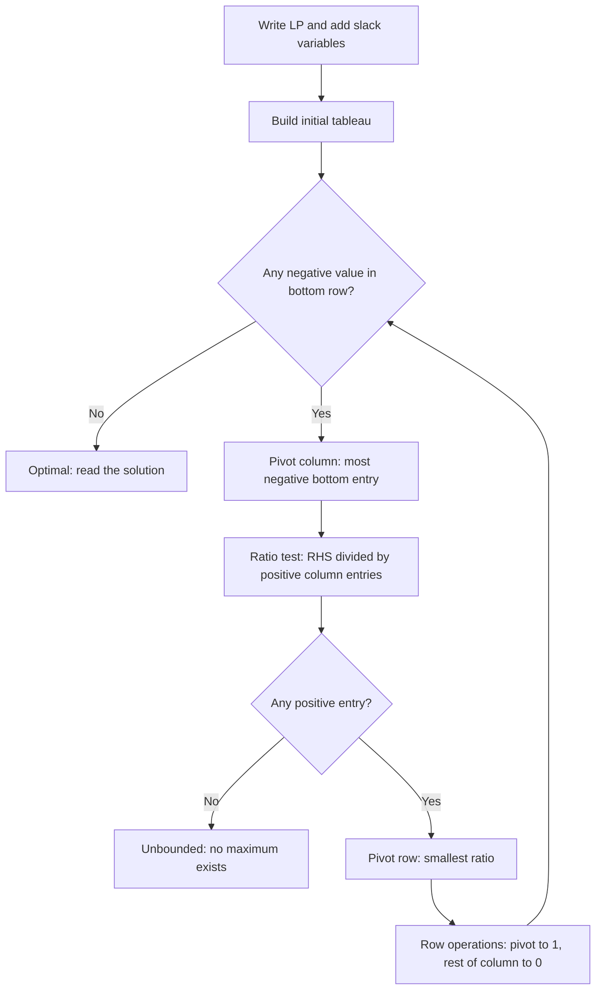

# Linear Inequalities and the Simplex Method

## What you will learn

- How to draw a linear inequality, test which side is feasible, and find a feasible region
- The anatomy of a linear program (LP): decision variables, objective, constraints, general and matrix forms
- The graphical method for two variables and why the best answer sits at a corner point
- Slack, surplus and artificial variables, and basic feasible solutions
- The simplex tableau method as numbered steps, with fully worked maximization examples
- How to solve an LP in Python with PuLP

---

## 1. Linear Inequalities and Feasible Regions

**Simple idea:** An inequality does not draw a line, it draws a whole half of the page. The line is only the fence; you then decide which side of the fence is allowed.

**Analogy:** A lift says "maximum load 15 persons". Every load from 0 up to 15 is allowed; 16 is not. The limit (15) is the boundary and everything on the allowed side is acceptable.

### 1.1 Axes and the first quadrant

| Statement | Meaning on the graph |
|---|---|
| $x = 0$ | the vertical y-axis |
| $x \ge 0$ | the y-axis and everything to its right |
| $y = 0$ | the horizontal x-axis |
| $y \ge 0$ | the x-axis and everything above it |
| $x \ge 0$ and $y \ge 0$ together | the **first quadrant**, including the origin and both axes |

Decision variables in business problems are quantities (units produced, hours used), so they are almost always restricted to the first quadrant.

### 1.2 Plotting one inequality (method)

Plot $3x + 5y \le 15$.

1. Replace the inequality sign by equality: $3x + 5y = 15$.
2. Find the **y-intercept** by setting $x = 0$: $5y = 15 \Rightarrow y = 3$, giving point $(0, 3)$.
3. Find the **x-intercept** by setting $y = 0$: $3x = 15 \Rightarrow x = 5$, giving point $(5, 0)$.
4. Draw the straight line through $(0,3)$ and $(5,0)$.
5. Pick a **test point** (the origin is easiest when the line does not pass through it) and check the inequality. The side that satisfies it is the feasible side.

Test points for $3x + 5y \le 15$:

| Point $(x, y)$ | $3x + 5y$ | Satisfies $\le 15$? | Location |
|---|---|---|---|
| $(0, 0)$ | 0 | Yes | below the line |
| $(1, 1)$ | 8 | Yes | below the line |
| $(3, 1)$ | 14 | Yes | below the line |
| $(2, 3)$ | 21 | No | above the line |

Rules for this example:

- Any point **on** the line gives $3x + 5y = 15$ exactly.
- Any point **below** it gives $3x + 5y < 15$.
- Any point **above** it gives $3x + 5y > 15$.

**Caveat:** "below the line" is true only for this example (the coefficient of $y$ is positive). Always confirm the side with a test point rather than by memory.

### 1.3 Two inequalities and the feasible region

Consider

$$3x + 5y \le 15 \qquad\text{and}\qquad -x + y \ge -1$$

For the second one, set $x = 0 \Rightarrow y = -1$, point $(0,-1)$; set $y = 0 \Rightarrow -x = -1 \Rightarrow x = 1$, point $(1, 0)$. Draw the line and shade the side that satisfies $\ge -1$.

The **feasible region** is the **intersection** of all the shaded half-planes. Any point in it satisfies every constraint simultaneously, so it is called feasible. (This illustration does not impose $x, y \ge 0$; adding those two constraints would cut the region down further to the part inside the first quadrant.)

### 1.4 Multiplying an inequality by a negative number

If $a \ge b$ then $-a \le -b$. **Multiplying (or dividing) both sides by a negative number reverses the inequality sign.**

Example: $-x + y \ge -1$ becomes $x - y \le 1$ after multiplying by $-1$. Both describe the same region. Use this to rewrite a constraint into the $\le$ form that LP methods prefer.

| Before multiplying by $-1$ | After |
|---|---|
| $\le$ | $\ge$ |
| $\ge$ | $\le$ |

---

## 2. Anatomy of a Linear Program

**Simple idea:** You control some knobs (how much of each product to make), you want the best score (profit), but the world limits you (hours, material).

**Analogy:** A bakery decides how many cakes ($x$) and pastries ($y$) to bake. The oven hours and flour are limited; the owner wants maximum profit.

| Component | Meaning |
|---|---|
| **Decision variables** | Quantities controlled by the decision maker (units of product A, units of product B). Normally $\ge 0$. May be discrete (1, 2, 3) or continuous (2.5). Values chosen must be allowed by the model. |
| **Objective function** | The rule that scores a solution; states whether to **maximize** (profit) or **minimize** (cost). |
| **Constraints** | Equations or inequalities that restrict the decision variables (capacity, demand, budget). |
| **Feasible solution** | Any assignment of the variables satisfying **all** constraints. There can be infinitely many. |
| **Optimal solution** | The feasible solution with the best objective value. |

Constraints are essential: without them most problems would be unbounded or trivial, and optimization would make no sense.

### 2.1 General form of a maximization LP

$$\max\; Z = c_1x_1 + c_2x_2 + \dots + c_nx_n$$

subject to

$$
\begin{aligned}
a_{11}x_1 + a_{12}x_2 + \dots + a_{1n}x_n &\le b_1\\
a_{21}x_1 + a_{22}x_2 + \dots + a_{2n}x_n &\le b_2\\
&\;\;\vdots\\
a_{m1}x_1 + a_{m2}x_2 + \dots + a_{mn}x_n &\le b_m\\
x_1, x_2, \dots, x_n &\ge 0
\end{aligned}
$$

| Symbol | Meaning | Known or unknown? |
|---|---|---|
| $Z$ | objective value | computed |
| $x_j$ | decision variable $j$ | **unknown** (to find) |
| $c_j$ | coefficient of $x_j$ in the objective (profit per unit) | known |
| $a_{ij}$ | coefficient of $x_j$ in constraint $i$ (resource use per unit) | known |
| $b_i$ | limit (right-hand side) of constraint $i$ | known, taken as $\ge 0$ |
| $n$ | number of variables | |
| $m$ | number of constraints | |

So the system has $n$ variables and $m$ constraints. In a minimization problem the constraints are typically of $\ge$ type, though a model may mix $\le$, $\ge$ and $=$. Always: variables $\ge 0$ and right-hand sides $b_i \ge 0$.

### 2.2 Matrix form

Write $\mathbf{c} = (c_1,\dots,c_n)^T$ and $\mathbf{x} = (x_1,\dots,x_n)^T$. Then

$$Z = c_1x_1 + \dots + c_nx_n = \mathbf{c}^T\mathbf{x}$$

Dimensions: $\mathbf{c}^T$ is $1 \times n$, $\mathbf{x}$ is $n \times 1$, so the product is $1 \times 1$, a single number (the total profit or cost).

$$\max\; \mathbf{c}^T\mathbf{x} \quad\text{subject to}\quad A\mathbf{x} \le \mathbf{b},\;\; \mathbf{x} \ge \mathbf{0},\;\; \mathbf{b} \ge \mathbf{0}$$

Here $A$ is the $m \times n$ matrix of the $a_{ij}$, and $\mathbf{b} = (b_1,\dots,b_m)^T$. Row $i$ of $A\mathbf{x}$ is the $i$-th constraint's left-hand side.

### 2.3 Three-variable example shape

$\max\; c_1x_1 + c_2x_2 + c_3x_3$ with $a_{i1}x_1 + a_{i2}x_2 + a_{i3}x_3 \le b_i$ and $x_1, x_2, x_3 \ge 0$.

**Key rule:** the graphical method works only for **two** decision variables. With three or more variables you must use the simplex method (or software).

---

## 3. Graphical Method (Worked Example)

**Simple idea:** Draw the allowed area, then slide a "profit line" as far as it can go while still touching the area. The last point it touches is the best.

**Analogy:** Pushing a ruler across a map of your land until it is about to leave the land; the last spot touched is the corner farthest in that direction.

### 3.1 Problem

$$\max\; Z = 5x + 2y \quad\text{s.t.}\quad 3x + y \le 6,\;\; x + 3y \le 10,\;\; x, y \ge 0$$

### 3.2 Steps

1. Convert each constraint to an equality and find intercepts.
   - $3x + y = 6$: $(0, 6)$ and $(2, 0)$.
   - $x + 3y = 10$: $(0, 10/3)$ and $(10, 0)$.
2. Shade the feasible side of each (origin satisfies both) and keep only the first quadrant. The intersection is the feasible region.
3. Find the **corner points** (vertices). Intersect the two lines: from $3x + y = 6$, $y = 6 - 3x$; substitute: $x + 18 - 9x = 10 \Rightarrow -8x = -8 \Rightarrow x = 1$, $y = 3$. So $(1, 3)$.
4. Evaluate $Z$ at every corner.

| Corner $(x, y)$ | $Z = 5x + 2y$ |
|---|---|
| $(0, 0)$ | 0 |
| $(2, 0)$ | 10 |
| $(1, 3)$ | **11** |
| $(0, 10/3)$ | $6.67$ |

5. The largest value, $Z = 11$ at $(1, 3)$, is the optimum.

### 3.3 Why corners?

Draw iso-profit lines $5x + 2y = k$ (for example $k = 5, 10, 11$). They are parallel; as $k$ grows the line moves in the direction of increasing $Z$. The last feasible point it touches is a corner (here $(1,3)$ where $k = 11$). Any interior or edge point gives a smaller $Z$.


**Idea to carry forward:** the simplex method does exactly this walk from corner to corner, but algebraically, so it scales to many variables.

**Caveat:** The feasible region of an LP is a convex **polyhedron** (a polygon in 2D). It is loosely called a "simplex" informally; strictly, the name **simplex method** refers to the algorithm, and the geometric simplex is a different object (a triangle/tetrahedron). The key fact: if an optimum exists, one occurs at a corner (extreme point). Special cases to remember are infinitely many optima (objective parallel to an edge), no feasible region (infeasible), and no bound on $Z$ (unbounded).

---

## 4. Simplex Method: The Idea

**Simple idea:** Stand on a corner, look at the neighbouring corners, step to one that improves the score, repeat until no step helps.

**Analogy:** Climbing a rocky hill by only moving along the ridges from peak to peak, always going up, until every ridge from where you stand goes down.

Procedure at a glance:

1. **Start** at a feasible corner (for $\le$ constraints with $b \ge 0$ the origin works).
2. **Move**: choose a variable that can improve the objective (it **enters** the set of basic variables) and decide which variable **leaves**.
3. **Stop** when no feasible move increases $Z$ (for maximization).



---

## 5. Slack, Surplus and Artificial Variables

These helper variables turn inequalities into equations, which simplex requires.

### 5.1 Slack variable (for $\le$)

**Simple idea:** The unused part of a limit.

**Example:** A factory makes products A and B. Each A needs 2 labor hours, each B needs 1; at most 100 hours are available:

$$2A + B \le 100 \;\;\Longrightarrow\;\; 2A + B + s = 100,\quad s \ge 0$$

If $A = 30$ and $B = 20$, hours used are $2(30) + 20 = 80$, so $s = 20$ hours stay **unused**. Slack measures unused capacity. It is **added** to a $\le$ constraint.

### 5.2 Surplus variable (for $\ge$)

**Simple idea:** The amount by which you exceed a minimum.

**Example:** A contract needs at least 40 machine hours; A uses 1 machine hour, B uses 2:

$$A + 2B \ge 40 \;\;\Longrightarrow\;\; A + 2B - u = 40,\quad u \ge 0$$

If $A = 30$, $B = 20$, hours supplied are $30 + 40 = 70$, so $u = 30$ hours **above the minimum**. Surplus is **subtracted** from a $\ge$ constraint.

### 5.3 Artificial variable (for $\ge$ and $=$)

**Simple idea:** A temporary scaffold that gives simplex a starting corner; it must be removed before finishing.

**Why needed:** With $\le$ constraints the slacks automatically give a starting corner (all decision variables $= 0$, slacks $= b$). With $\ge$ or $=$ constraints, the subtraction of surplus leaves $-u = b$, which would make $u$ negative at the origin, so no starting corner is available. Adding an artificial variable $a \ge 0$:

$$A + 2B - u + a = 40$$

gives an obvious starting solution $a = 40$. The artificial variable is **not real** (not an actual machine hour); in the final answer it **must be 0**, otherwise the solution is infeasible for the original problem. These are used in minimization and mixed-constraint problems (large-M or two-phase techniques).

### 5.4 Summary

| Constraint type | Add / subtract | Variable | Meaning | Gives starting corner? |
|---|---|---|---|---|
| $\le$ | add $+s$ | slack | unused capacity | Yes |
| $\ge$ | subtract $-u$ | surplus | excess over the minimum | No, needs artificial |
| $\ge$ or $=$ | add $+a$ | artificial | temporary, must end at 0 | Provides the start |

All of these variables are $\ge 0$.

---

## 6. Basic Variables and Basic Feasible Solutions

**Simple idea:** With $m$ equations you can only solve for $m$ unknowns at a time; you park the others at 0, solve, and call the result a "corner".

**Analogy:** In a seating chart with 5 names and 3 seats, 2 people sit out (value 0) and 3 are "in play".

**Definitions**

- **Non-basic variables:** set to 0.
- **Basic variables:** the remaining ones, solved from the equations.
- **Basic feasible solution (BFS):** a basic solution in which all variables are $\ge 0$. It corresponds to a **corner point** of the feasible region.

**Example.** $\max Z = 3x + 2y$ s.t. $x + y \le 4$, $x \le 2$, $y \le 3$, $x, y \ge 0$. Add slacks:

$$x + y + s_1 = 4,\qquad x + s_2 = 2,\qquad y + s_3 = 3$$

Five variables, three equations. Setting the non-basic variables $x = 0$, $y = 0$ gives $s_1 = 4$, $s_2 = 2$, $s_3 = 3$, all $\ge 0$, and $Z = 0$. This is a BFS (the origin).

### Entering and leaving variables

- **Entering variable:** the non-basic variable that will be raised from 0 because it improves $Z$. Raising $x$ adds 3 to $Z$ per unit; raising $y$ adds 2. Choose $x$ (larger gain).
- **Leaving variable:** as $x$ grows (with $y = 0$) the limits are $x \le 4$ (from $s_1$), $x \le 2$ (from $s_2$), and $s_3$ does not involve $x$. The **smallest limit** is 2, so $s_2$ hits zero first and **leaves**.

### Full solution of this example by tableau

Initial tableau (bottom row is $Z - 3x - 2y = 0$):

| Basis | $x$ | $y$ | $s_1$ | $s_2$ | $s_3$ | RHS | Ratio |
|---|---|---|---|---|---|---|---|
| $s_1$ | 1 | 1 | 1 | 0 | 0 | 4 | 4 |
| $s_2$ | **1** | 0 | 0 | 1 | 0 | 2 | **2** |
| $s_3$ | 0 | 1 | 0 | 0 | 1 | 3 | none (0 in column) |
| $Z$ | -3 | -2 | 0 | 0 | 0 | 0 | |

Pivot on the 1 in row $s_2$, column $x$. Operations: $R_1 \leftarrow R_1 - R_2$, $R_4 \leftarrow R_4 + 3R_2$.

| Basis | $x$ | $y$ | $s_1$ | $s_2$ | $s_3$ | RHS | Ratio |
|---|---|---|---|---|---|---|---|
| $s_1$ | 0 | **1** | 1 | -1 | 0 | 2 | **2** |
| $x$ | 1 | 0 | 0 | 1 | 0 | 2 | none |
| $s_3$ | 0 | 1 | 0 | 0 | 1 | 3 | 3 |
| $Z$ | 0 | -2 | 0 | 3 | 0 | 6 | |

Pivot column $y$ (entry $-2$), pivot row $s_1$ (ratio 2). Operations: $R_3 \leftarrow R_3 - R_1$, $R_4 \leftarrow R_4 + 2R_1$.

| Basis | $x$ | $y$ | $s_1$ | $s_2$ | $s_3$ | RHS |
|---|---|---|---|---|---|---|
| $y$ | 0 | 1 | 1 | -1 | 0 | 2 |
| $x$ | 1 | 0 | 0 | 1 | 0 | 2 |
| $s_3$ | 0 | 0 | -1 | 1 | 1 | 1 |
| $Z$ | 0 | 0 | 2 | 1 | 0 | 10 |

No negatives in the bottom row, so optimal: $x = 2$, $y = 2$, $s_3 = 1$ (one unit of the $y \le 3$ limit unused), $Z = 10$. Check: $3(2) + 2(2) = 10$; $x + y = 4 \le 4$; $x = 2 \le 2$; $y = 2 \le 3$.

---

## 7. The Simplex Tableau Method (Maximization)

**Simple idea:** Keep all the numbers of the problem in one table, and repeatedly do a fixed "tidy-up" (row operations) that moves you to a better corner.

### 7.1 Algorithm

1. **Formulate**: if the problem is in words, define the variables, write the objective and all constraints in mathematical form with $x \ge 0$.
2. **Add slack variables** to convert every $\le$ constraint to an equality. A slack appears in every equation, with coefficient 0 where it does not belong, for example $2x_1 + x_2 + x_3 + s_1 + 0s_2 + 0s_3 = 150$.
3. **Rewrite the objective** with all variables on the left: $Z - c_1x_1 - c_2x_2 - \dots = 0$. The bottom row holds $-c_j$ values.
4. **Set up the initial tableau** with columns for the decision variables, slacks, and RHS (and $Z$).
5. **Check optimality**: if all bottom-row entries are $\ge 0$, stop.
6. **Pivot column**: choose the column with the **most negative** bottom-row entry.
7. **Ratio test**: for each row divide the RHS by the pivot-column entry.
   - **Ignore** rows where the pivot-column entry is 0 or negative.
   - If **every** row is ignored, there is **no finite maximum** (unbounded).
   - The **smallest non-negative ratio** gives the **pivot row**. If tied, choose the row nearest the top.
   - The intersection of pivot row and column is the **pivot element**.
8. **Row operations**: make the pivot 1 (divide its row) and turn every other entry of the pivot column, including the bottom row, into 0.
   - Rule: never multiply the row being changed by a negative number (you may add a negative multiple of the **pivot row** to it, but do not scale the target row negatively). If you must scale the bottom row by a positive number, that is allowed.
9. Go back to step 5.
10. **Read the solution**: a **basic variable** has a column with a single non-zero entry (a unit column) and zeros elsewhere. Its value is RHS divided by that entry. All non-basic variables equal 0. $Z$ is read from the bottom-right (divided by the $Z$ column entry if not normalized).

### 7.2 Worked example (three variables)

Maximize $Z = 3x_1 + 2x_2 + x_3$ subject to

$$
\begin{aligned}
2x_1 + x_2 + x_3 &\le 150\\
2x_1 + 2x_2 + 8x_3 &\le 200\\
2x_1 + 3x_2 + x_3 &\le 320\\
x_1, x_2, x_3 &\ge 0
\end{aligned}
$$

**Step 1-2: add slacks**

$$
\begin{aligned}
2x_1 + x_2 + x_3 + s_1 + 0s_2 + 0s_3 &= 150\\
2x_1 + 2x_2 + 8x_3 + 0s_1 + s_2 + 0s_3 &= 200\\
2x_1 + 3x_2 + x_3 + 0s_1 + 0s_2 + s_3 &= 320
\end{aligned}
$$

**Step 3: objective:** $-3x_1 - 2x_2 - x_3 + 0s_1 + 0s_2 + 0s_3 + Z = 0$.

**Initial tableau**

| Basis | $x_1$ | $x_2$ | $x_3$ | $s_1$ | $s_2$ | $s_3$ | $Z$ | RHS | Ratio |
|---|---|---|---|---|---|---|---|---|---|
| $s_1$ | **2** | 1 | 1 | 1 | 0 | 0 | 0 | 150 | 75 |
| $s_2$ | 2 | 2 | 8 | 0 | 1 | 0 | 0 | 200 | 100 |
| $s_3$ | 2 | 3 | 1 | 0 | 0 | 1 | 0 | 320 | 160 |
| $Z$ | -3 | -2 | -1 | 0 | 0 | 0 | 1 | 0 | |

Most negative bottom entry is $-3$, so the pivot column is $x_1$. Ratios are $150/2 = 75$, $200/2 = 100$, $320/2 = 160$. The smallest is 75, so the pivot is the $2$ in row 1.

**Iteration 1 row operations**

- $R_2 \leftarrow -R_1 + R_2$
- $R_3 \leftarrow -R_1 + R_3$
- $R_4 \leftarrow 3R_1 + 2R_4$ (bottom row scaled by a positive 2 to avoid fractions)

| Basis | $x_1$ | $x_2$ | $x_3$ | $s_1$ | $s_2$ | $s_3$ | $Z$ | RHS | Ratio |
|---|---|---|---|---|---|---|---|---|---|
| $x_1$ | 2 | 1 | 1 | 1 | 0 | 0 | 0 | 150 | 150 |
| $s_2$ | 0 | **1** | 7 | -1 | 1 | 0 | 0 | 50 | **50** |
| $s_3$ | 0 | 2 | 0 | -1 | 0 | 1 | 0 | 170 | 85 |
| $Z$ | 0 | -1 | 1 | 3 | 0 | 0 | 2 | 450 | |

(Bottom row check: $3(2,1,1,1,0,0,0\,|\,150) + 2(-3,-2,-1,0,0,0,1\,|\,0) = (0,-1,1,3,0,0,2\,|\,450)$.)

A negative entry remains ($-1$), so the pivot column is $x_2$. Ratios: $150/1 = 150$, $50/1 = 50$, $170/2 = 85$. Smallest is 50, pivot is the 1 in row 2.

**Iteration 2 row operations**

- $R_1 \leftarrow -R_2 + R_1$
- $R_3 \leftarrow -2R_2 + R_3$
- $R_4 \leftarrow R_2 + R_4$

| Basis | $x_1$ | $x_2$ | $x_3$ | $s_1$ | $s_2$ | $s_3$ | $Z$ | RHS |
|---|---|---|---|---|---|---|---|---|
| $x_1$ | 2 | 0 | -6 | 2 | -1 | 0 | 0 | 100 |
| $x_2$ | 0 | 1 | 7 | -1 | 1 | 0 | 0 | 50 |
| $s_3$ | 0 | 0 | -14 | 1 | -2 | 1 | 0 | 70 |
| $Z$ | 0 | 0 | 8 | 2 | 1 | 0 | 2 | 500 |

All bottom-row entries are $\ge 0$: **final tableau**.

**Read the solution**

- Basic variables are $x_1, x_2, s_3$ (unit-type columns).
- $2x_1 = 100 \Rightarrow x_1 = 50$; $1\cdot x_2 = 50 \Rightarrow x_2 = 50$; $1\cdot s_3 = 70$.
- $2Z = 500 \Rightarrow Z = 250$. Non-basic $x_3 = s_1 = s_2 = 0$.

**Check:** $Z = 3(50) + 2(50) + 0 = 250$. Constraint 1: $100 + 50 = 150$ (tight). Constraint 2: $100 + 100 = 200$ (tight). Constraint 3: $100 + 150 = 250 \le 320$, leaving 70 unused, which equals $s_3$. So products using $x_3$ are not made.

### 7.3 Same method on the 2-variable graphical problem

Solve $\max Z = 5x + 2y$ s.t. $3x + y \le 6$, $x + 3y \le 10$.

| Basis | $x$ | $y$ | $s_1$ | $s_2$ | RHS | Ratio |
|---|---|---|---|---|---|---|
| $s_1$ | **3** | 1 | 1 | 0 | 6 | 2 |
| $s_2$ | 1 | 3 | 0 | 1 | 10 | 10 |
| $Z$ | -5 | -2 | 0 | 0 | 0 | |

Start $(x,y) = (0,0)$, $Z = 0$, neither $x$ nor $y$ is basic. Pivot column $x$; ratios $6/3 = 2$ and $10/1 = 10$; pivot the 3. After $R_1 \leftarrow R_1/3$, $R_2 \leftarrow R_2 - R_1$, $R_3 \leftarrow R_3 + 5R_1$:

| Basis | $x$ | $y$ | $s_1$ | $s_2$ | RHS | Ratio |
|---|---|---|---|---|---|---|
| $x$ | 1 | 1/3 | 1/3 | 0 | 2 | 6 |
| $s_2$ | 0 | **8/3** | -1/3 | 1 | 8 | **3** |
| $Z$ | 0 | -1/3 | 5/3 | 0 | 10 | |

Now $x = 2$, $y = 0$ ($Z = 10$, corner $(2,0)$). Pivot column $y$; ratios $2/(1/3) = 6$ and $8/(8/3) = 3$; pivot $8/3$. After $R_2 \leftarrow \tfrac{3}{8}R_2$, $R_1 \leftarrow R_1 - \tfrac13 R_2$, $R_3 \leftarrow R_3 + \tfrac13 R_2$:

| Basis | $x$ | $y$ | $s_1$ | $s_2$ | RHS |
|---|---|---|---|---|---|
| $x$ | 1 | 0 | 3/8 | -1/8 | 1 |
| $y$ | 0 | 1 | -1/8 | 3/8 | 3 |
| $Z$ | 0 | 0 | 13/8 | 1/8 | 11 |

Optimal: $x = 1$, $y = 3$, $Z = 11$, matching the graphical answer. Both $x$ and $y$ are now basic. The tableau path $(0,0) \to (2,0) \to (1,3)$ is exactly the corner walk drawn in Section 3.

---

## 8. Formulating a Word Problem (Lamp Example)

**Simple idea:** Translate the story into variables, a profit sentence, and one "hours" sentence per department.

**Problem shape:** A company makes three types of lamps A, B and C. Each lamp is processed in Department 1 and Department 2. Daily labor available is 400 hours in Department 1 and 600 hours in Department 2, with no additional labor. A table gives hours per unit and profit per unit for each lamp.

Steps:

1. Let $x_A, x_B, x_C$ be the units of each lamp made per day.
2. Objective: $\max Z = p_Ax_A + p_Bx_B + p_Cx_C$, where $p$ is the profit per unit from the table.
3. Department 1: $t_{1A}x_A + t_{1B}x_B + t_{1C}x_C \le 400$.
4. Department 2: $t_{2A}x_A + t_{2B}x_B + t_{2C}x_C \le 600$.
5. Non-negativity: $x_A, x_B, x_C \ge 0$.
6. Add slacks, build the initial tableau and apply the algorithm of Section 7 (or solve with software).

Here $t_{ij}$ is the hours lamp $j$ needs in department $i$. Because there are three variables, the graphical method does not apply.

---

## 9. Solving with Python (PuLP)

PuLP is a Python LP modelling library. The pattern: create variables with bounds, create a problem with an objective sense, add the objective, add constraints, solve, read values.

```python
from pulp import LpProblem, LpVariable, LpMaximize, LpStatus, value

x = LpVariable("x", lowBound=0)
y = LpVariable("y", lowBound=0)

prob = LpProblem("demo", LpMaximize)
prob += 5 * x + 2 * y            # objective
prob += 3 * x + y <= 6           # constraint 1
prob += x + 3 * y <= 10          # constraint 2

prob.solve()
print(LpStatus[prob.status], value(x), value(y), value(prob.objective))
# Optimal 1.0 3.0 11.0
```

Use `LpMinimize` for minimization. Software is how you solve larger models in practice; hand tableaus build understanding.

---

## 10. Comparison: Graphical vs Simplex

| Aspect | Graphical method | Simplex method |
|---|---|---|
| Variables | exactly 2 | any number |
| Idea | draw region, test corner points | move corner to corner algebraically |
| Output | optimum read from graph | optimum read from final tableau |
| Scalability | poor | good |
| Same answer? | Yes, for the same LP | Yes |

---

## Exam and Assessment Hints

- Be able to convert a word problem into variables, objective and constraints, and write the general and matrix forms.
- Know the pivot rules by heart: most negative bottom entry, smallest non-negative ratio, ignore zero and negative entries, tie goes to the top row, all ignored means no maximum.
- Practise the simplex tableau by hand on small maximization problems; the row operations must be applied to every row including the bottom row.
- Minimization problems (with surplus and artificial variables) are the next step; understand the purpose of artificial variables conceptually.
- Python PuLP code reading and writing may be asked.

---

## Self-Check Questions

1. **Why does the graphical method stop working after two variables?**
   A plot needs one axis per variable; with three or more variables you cannot draw the region, so simplex (or software) is used.

2. **How do you find which side of a line satisfies an inequality?**
   Substitute a test point not on the line (usually the origin) into the inequality; the side that satisfies it is feasible.

3. **For $2A + B \le 100$ with $A = 30$, $B = 20$, what is the slack?**
   Used hours $= 80$, so slack $s = 100 - 80 = 20$ unused hours.

4. **What is the difference between slack and surplus?**
   Slack is added to a $\le$ constraint and measures unused capacity; surplus is subtracted from a $\ge$ constraint and measures excess above the minimum.

5. **Why must the final value of an artificial variable be 0?**
   It is not a real quantity, only a device to get a starting corner; a non-zero value means the original constraint is not truly satisfied.

6. **State the pivot column and pivot row rules.**
   Column: most negative entry in the bottom row. Row: smallest non-negative ratio RHS/entry, ignoring zero or negative entries; ties go to the topmost row.

7. **When do you stop simplex, and what if all ratios are disallowed?**
   Stop when the bottom row has no negative entries. If no ratio is allowed in the pivot column, the problem is unbounded (no maximum).

8. **Optimal answer of $\max 3x+2y$ s.t. $x+y \le 4$, $x \le 2$, $y \le 3$?**
   $x = 2$, $y = 2$, $Z = 10$.

---

## Common Pitfalls / Exam Traps

- Forgetting that multiplying an inequality by a negative number flips its sign.
- Assuming the feasible side is always "below" the line; always use a test point.
- Choosing the smallest **ratio including zero or negative denominators**; such rows must be ignored.
- Forgetting that slack is added and surplus is subtracted.
- Not adding the slack variable to every equation (with coefficient 0 where unused), causing column mix-ups.
- Applying row operations to only some rows, or scaling the row being changed by a negative number.
- Reading the final answer incorrectly: non-basic variables are 0, and basic variable values come from RHS divided by the pivot-style entry (for example $2x_1 = 100$ gives $x_1 = 50$; $2Z = 500$ gives $Z = 250$).
- Treating an artificial variable as a real quantity.
- Using the graphical method for problems with more than two decision variables.

---

## Quick Revision Summary

- A linear inequality defines a half-plane; plot the boundary via intercepts and verify the side with a test point.
- The feasible region is the intersection of all constraint regions; every point in it satisfies all constraints.
- An LP has decision variables ($\ge 0$), an objective ($\max$ or $\min$) and constraints; matrix form is $\max\,\mathbf{c}^T\mathbf{x}$ s.t. $A\mathbf{x} \le \mathbf{b}$, $\mathbf{x}, \mathbf{b} \ge 0$.
- The optimum of an LP lies at a corner point; graphical method (2 variables) evaluates $Z$ at corners, e.g. $\max 5x+2y$ gives $Z = 11$ at $(1,3)$.
- Simplex moves from one basic feasible solution (corner) to a better one until no improvement is possible.
- Slack ($+s$, for $\le$) is unused capacity; surplus ($-u$, for $\ge$) is excess; artificial variables give a starting corner and must end at 0.
- Tableau steps: most negative bottom entry, ratio test (ignore $\le 0$ entries), pivot, row operations, repeat until the bottom row is non-negative.
- Worked results: the three-variable problem gives $x_1 = 50$, $x_2 = 50$, $s_3 = 70$, $Z = 250$; the small problem gives $x = 2$, $y = 2$, $Z = 10$.
- PuLP solves LPs in Python: define variables, objective, constraints, then `solve()`.

---

**← [Previous](../README.md) · [Index](../README.md) · [Next](../week-03/01-artificial-variables-big-m-and-lp-duality-transcript.md) →**
