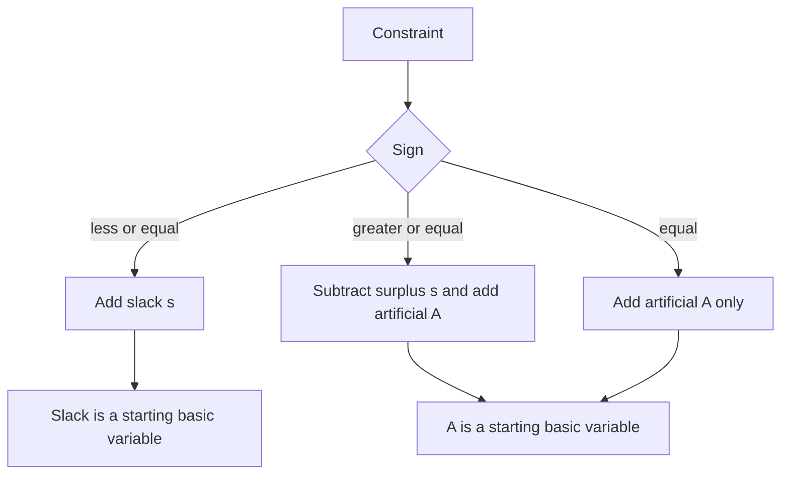

# Artificial Variables, Big M and LP Duality

## What you will learn

- Why the simplex method needs a starting basic feasible solution (BFS), and when slack variables alone give one
- When and why **artificial variables** are added, and how the **Big M penalty** handles them
- The canonical form of a linear program (LP) and how to force any LP into it
- How to write the **dual** of a **primal** LP, by the column rule and by the matrix-transpose shortcut
- The economic meaning of the dual and the fact that primal and dual optimal values are equal

---

## 1. Why Simplex Needs a Starting Corner

**Simple idea:** simplex is a "walk from corner to corner" of the feasible region, so it needs a legal corner to start from.

**Analogy:** a hiker can only follow a ridge trail if standing on the ridge to begin with. Slack variables put you on the ridge for free in some problems; in others you must build a temporary ramp (the artificial variable).

**Definitions**

- **Decision variables**: the quantities you choose ($x_1, x_2, \dots$).
- **Objective function**: the quantity you maximize or minimize.
- **Constraints**: the limits (resources, demand) the plan must respect.
- **Basic feasible solution (BFS)**: a corner point of the feasible region. Algebraically, after converting to equalities, set the non-basic variables to 0, solve for the basic ones, and require every variable to be $\ge 0$.
- **Standard form**: all constraints written as equalities with non-negative variables.

### Case A: all constraints are $\le$ (slack variables work)

Maximize $Z = 5x_1 + 3x_2$ subject to

$$3x_1 + 5x_2 \le 15,\qquad 5x_1 + 2x_2 \le 10,\qquad x_1, x_2 \ge 0.$$

A **slack variable** $s_i \ge 0$ is the unused part of a resource. Adding one per constraint gives the standard form:

$$3x_1 + 5x_2 + s_1 = 15,\qquad 5x_1 + 2x_2 + s_2 = 10.$$

Initial BFS: set the decision variables to 0 ($x_1 = x_2 = 0$, the origin). Then $s_1 = 15$, $s_2 = 10$, both $\ge 0$, so the origin is a valid starting corner.

Graphical check (corner points of the feasible region):

| Corner | How found | $Z = 5x_1 + 3x_2$ |
|---|---|---|
| $(0,0)$ | origin | 0 |
| $(2,0)$ | $5x_1 = 10$ on the $x_1$-axis | 10 |
| $(0,3)$ | $5x_2 = 15$ on the $x_2$-axis | 9 |
| $\left(\tfrac{20}{19}, \tfrac{45}{19}\right)$ | both lines intersect | $\tfrac{100+135}{19} = \tfrac{235}{19} \approx 12.37$ |

Intersection check: from $5x_1 + 2x_2 = 10$, $x_2 = (10 - 5x_1)/2$; substituting into the first line gives $6x_1 + 50 - 25x_1 = 30$, so $x_1 = 20/19$, $x_2 = 45/19$. The optimum is $Z = 235/19$.

Note: the $x_1$-intercept of the first line is $(5,0)$ and its $x_2$-intercept is $(0,3)$; the second line meets the axes at $(2,0)$ and $(0,5)$. The tighter limit on the $x_1$-axis is $(2,0)$, so that is the feasible corner. Every point in the feasible region is a feasible solution; the **corner points** are the basic feasible solutions.

### Case B: a $\ge$ constraint breaks the start

Maximize $Z = x_1 + x_2$ subject to

$$x_1 + 2x_2 \le 3,\qquad 2x_1 - 3x_2 \ge 3,\qquad x_1, x_2 \ge 0.$$

To turn $\ge$ into $=$ you must **subtract** a surplus variable:

$$x_1 + 2x_2 + s_1 = 3,\qquad 2x_1 - 3x_2 - s_2 = 3.$$

Starting at $x_1 = x_2 = 0$: $s_1 = 3$ (fine) but $-s_2 = 3 \Rightarrow s_2 = -3 < 0$ (violates $s_2 \ge 0$).

So the origin is **not** a BFS and **simplex cannot start**. Fix: add an artificial variable.

---

## 2. Artificial Variables

**Simple idea:** an artificial variable is a temporary "dummy helper" you add to a constraint purely so that the starting point looks legal; it has no real-world meaning and must be forced out of the final answer.

**Analogy:** a scaffold used to build a wall. It holds things up at the start but must be gone in the finished building.

**Rule: which constraint gets which extra variable**

| Constraint type | Convert to equality with | Gives usable starting basic variable? | Artificial variable needed? |
|---|---|---|---|
| $\le$ | add slack $+s$ | Yes ($s = $ RHS $\ge 0$) | No |
| $\ge$ | subtract surplus $-s$ | No (it would be $-$RHS) | Yes, add $+A$ |
| $=$ | nothing to add | No starting variable | Yes, add $+A$ |

All variables ($x$, slack, surplus, artificial) must be $\ge 0$.

**Example (two $\ge$ constraints).** Maximize $Z = -7.5x_1 + 3x_2$ subject to

$$3x_1 - x_2 \ge 3,\qquad x_1 - x_2 \ge 2,\qquad x_1,x_2 \ge 0.$$

Augmented form:

$$3x_1 - x_2 - s_1 + A_1 = 3,\qquad x_1 - x_2 - s_2 + A_2 = 2.$$

Now $x_1 = x_2 = s_1 = s_2 = 0$ gives $A_1 = 3$, $A_2 = 2$, both $\ge 0$: a legitimate starting BFS.

**Example (equality constraints).** For $Z = -x_1 + 2x_2 + 3x_3$ with equality constraints, e.g.

$$-2x_1 + 3x_2 = 2,\qquad 3x_2 + 4x_3 = 1,$$

no slack or surplus is added; just add one artificial variable to each:

$$-2x_1 + 3x_2 + A_1 = 2,\qquad 3x_2 + 4x_3 + A_2 = 1.$$

**Caveat (simplification gap):** adding $A$ changes the problem. The artificial variable is only legitimate if it ends up at 0 in the optimal solution. If any $A > 0$ at the optimum, the original problem is **infeasible**. This is why a penalty (Section 3) or a first phase is needed.

---

## 3. Big M Method

**Simple idea:** charge a huge fine for using the dummy helper, so the optimizer gets rid of it as soon as it can.

**Analogy:** a rental scaffold costing a million dollars a day. You will dismantle it at the earliest chance.

**Rule:** let $M$ be a very large positive number (a symbol, e.g. 1000 or $10^6$; the answer does not depend on its exact value).

- **Maximization:** objective $= \dots - M\sum A_i$ (subtract the penalty).
- **Minimization:** objective $= \dots + M\sum A_i$ (add the penalty).

For the example above:

$$\max Z = -7.5x_1 + 3x_2 - M A_1 - M A_2.$$

There are two ways of handling artificial variables: **Big M method** and the **two-phase method** (Phase 1 minimizes $\sum A_i$ to find a BFS; Phase 2 optimizes the real objective).

### Steps of Big M (maximization)

1. Put the LP in standard form; add slack/surplus and artificial variables as in the table.
2. Penalize each $A_i$ with $-M$ in the objective.
3. Initial basis = slack variables for $\le$ rows and artificial variables for $\ge$/$=$ rows.
4. Compute the $Z_j - C_j$ row (with $M$ kept symbolic, treating $M$ as larger than any other number).
5. Entering variable: most negative $Z_j - C_j$. Leaving variable: smallest non-negative ratio (RHS / positive entry of entering column).
6. Pivot. Repeat until no $Z_j - C_j$ is negative.
7. Check: if any artificial variable remains in the basis at a positive value, the LP is infeasible.

### Worked example (full run)

$\max Z = -7.5x_1 + 3x_2 - MA_1 - MA_2$, with rows $3x_1 - x_2 - s_1 + A_1 = 3$ and $x_1 - x_2 - s_2 + A_2 = 2$.

**Initial tableau** (basis $A_1, A_2$, $c_B = -M$):

| Basis | $x_1$ | $x_2$ | $s_1$ | $s_2$ | $A_1$ | $A_2$ | RHS | Ratio |
|---|---|---|---|---|---|---|---|---|
| $A_1$ | 3 | -1 | -1 | 0 | 1 | 0 | 3 | $3/3 = 1$ |
| $A_2$ | 1 | -1 | 0 | -1 | 0 | 1 | 2 | $2/1 = 2$ |
| $Z_j - C_j$ | $-4M + 7.5$ | $2M - 3$ | $M$ | $M$ | 0 | 0 | $-5M$ | |

Entering: $x_1$ (most negative since $M$ is huge). Leaving: $A_1$ (ratio 1).

**Iteration 1** (pivot on the 3):

| Basis | $x_1$ | $x_2$ | $s_1$ | $s_2$ | $A_1$ | $A_2$ | RHS | Ratio |
|---|---|---|---|---|---|---|---|---|
| $x_1$ | 1 | $-1/3$ | $-1/3$ | 0 | $1/3$ | 0 | 1 | negative entry, skip |
| $A_2$ | 0 | $-2/3$ | $1/3$ | -1 | $-1/3$ | 1 | 1 | $1/(1/3) = 3$ |
| $Z_j - C_j$ | 0 | $\tfrac{2M}{3} - 0.5$ | $-\tfrac{M}{3} + 2.5$ | $M$ | $\tfrac{4M}{3} - 2.5$ | 0 | $-M - 7.5$ | |

Entering: $s_1$. Leaving: $A_2$.

**Iteration 2** (pivot on $1/3$):

| Basis | $x_1$ | $x_2$ | $s_1$ | $s_2$ | $A_1$ | $A_2$ | RHS |
|---|---|---|---|---|---|---|---|
| $x_1$ | 1 | -1 | 0 | -1 | 0 | 1 | 2 |
| $s_1$ | 0 | -2 | 1 | -3 | -1 | 3 | 3 |
| $Z_j - C_j$ | 0 | 4.5 | 0 | 7.5 | $M$ | $M - 7.5$ | $-15$ |

All $Z_j - C_j \ge 0$: optimal. Both artificial variables are non-basic (zero).

**Answer:** $x_1 = 2$, $x_2 = 0$, $s_1 = 3$, $Z = -15$.

Check: $3(2) - 0 = 6 \ge 3$ and $2 - 0 = 2 \ge 2$; $Z = -7.5(2) = -15$. Graphically, the best feasible corner is $(2, 0)$.

---

## 4. Canonical Form of an LP

**Simple idea:** a "standard dress code" for LPs so that the duality and simplex rules apply mechanically.

An LP is in **canonical form** when:

| Objective | All constraints must be | Variables |
|---|---|---|
| Maximize | $\le$ | all $\ge 0$ |
| Minimize | $\ge$ | all $\ge 0$ |

If a constraint has the wrong direction, **multiply both sides by $-1$** (this reverses the inequality). If this is not possible or you are doing simplex, add an artificial variable.

Reason for the sign flip: if $a < b$ then $-a > -b$ (e.g. $3 < 5 \Rightarrow -3 > -5$).

**Caveat:** canonical form is a convention for solving and for taking duals. A maximization LP may legitimately contain $\ge$ or $=$ constraints; it is just not canonical until you convert it (or, in simplex, until artificial variables are added).

---

## 5. Primal and Dual Problems

**Simple idea:** every LP has a "mirror" LP. The original (**primal**) asks *how much to produce for the best profit given limited resources?* The **dual** asks *what is the smallest total price we could put on those resources so that no product is undervalued?*

**Analogy (shop vs. landlord):** a workshop owner picks production levels to maximize profit from limited labor and machine hours. A buyer who wants to purchase all the resources asks how little they can pay while still offering the owner at least as much as the products would earn. The two answers meet at the same number.

| | Primal | Dual |
|---|---|---|
| Question | Maximize profit from products | Minimize the value assigned to available resources |
| Variables | Quantities of products | Prices (values) of resources, called dual or shadow prices |
| Measures | Profit | Total value of resources (not the amount of resources used) |

### Worked example: product A and product B

| | Profit per unit | Labor hours per unit | Machine hours per unit |
|---|---|---|---|
| Product A | \$4 | 1 | 2 |
| Product B | \$3 | 1 | 1 |
| Available | | 40 | 60 |

**Primal:** with $a$ units of A and $b$ units of B,

$$\max Z = 4a + 3b \quad \text{s.t.}\quad a + b \le 40,\quad 2a + b \le 60,\quad a, b \ge 0.$$

**Dual:** let $p$ = value per labor hour, $q$ = value per machine hour. The resources are worth $40p + 60q$ in total. Each product's resource value must be at least its profit:

$$\min W = 40p + 60q \quad \text{s.t.}\quad p + 2q \ge 4,\quad p + q \ge 3,\quad p, q \ge 0.$$

Note how the dual uses the **transposed** coefficients: product A's column $(1, 2)$ becomes the constraint $p + 2q \ge 4$.

**Solve both:**

| Primal corner $(a,b)$ | $Z = 4a + 3b$ | Dual corner $(p,q)$ | $W = 40p + 60q$ |
|---|---|---|---|
| $(0,0)$ | 0 | $(0,3)$ | 180 |
| $(30,0)$ | 120 | $(4,0)$ | 160 |
| $(0,40)$ | 120 | $(2,1)$ | **140** |
| $(20,20)$ | **140** | | |

Primal optimum: $a = b = 20$, $Z = 140$ (from $a+b = 40$, $2a+b = 60$). Dual optimum: $p = 2$, $q = 1$, $W = 140$ (from $p+2q = 4$, $p+q = 3$).

**Equal optimal values: 140 = 140.** Interpretation: one extra labor hour is worth \$2 of profit and one extra machine hour is worth \$1 (these are **shadow prices**).

---

## 6. How to Write the Dual: Column Rule

**Simple idea:** swap the roles of "constraint limits" and "objective profits"; turn rows into columns.

### Conversion rules (canonical primal)

| Primal (maximize, $\le$ constraints) | Dual (minimize, $\ge$ constraints) |
|---|---|
| Objective coefficients $c_j$ | Right-hand sides of dual constraints |
| Right-hand sides $b_i$ | Objective coefficients of dual |
| Constraint $i$ | Dual variable $y_i \ge 0$ |
| Variable $x_j$ | Dual constraint $j$ |
| Column of $x_j$ in the constraint matrix | Coefficients of dual constraint $j$ |
| Number of constraints $m$, variables $n$ | $m$ dual variables, $n$ dual constraints |

For a canonical max primal $\max\, c^{T}x$, $Ax \le b$, $x \ge 0$:

$$\text{Dual: } \min\, b^{T}y,\quad A^{T}y \ge c,\quad y \ge 0.$$

For a canonical min primal $\min\, c^{T}x$, $Ax \ge b$, $x \ge 0$:

$$\text{Dual: } \max\, b^{T}y,\quad A^{T}y \le c,\quad y \ge 0.$$

### Steps

1. Check canonical form; fix any wrong-direction constraint by multiplying by $-1$.
2. Give each constraint a new non-negative variable $y_i$.
3. Dual objective: sum of (RHS of constraint $i$) $\times\, y_i$; direction flips (max to min, or min to max).
4. For each primal variable $x_j$ write one dual constraint using the **$j$-th column** of coefficients on the $y$'s; its RHS is the primal objective coefficient $c_j$.
5. Constraint direction in the dual: $\ge$ if the dual is a minimization, $\le$ if a maximization.
6. All $y_i \ge 0$.

### Example 1: maximization primal

$$\max Z = x_1 - x_2 + x_3$$
$$x_1 + x_2 + x_3 \le 10,\quad 2x_1 - x_2 - x_3 \le 2,\quad 2x_1 - 2x_2 - 3x_3 \le 6,\quad x \ge 0.$$

It is canonical (max with $\le$). Three constraints give $y_1, y_2, y_3$; three variables give 3 dual constraints.

Objective: $\min W = 10y_1 + 2y_2 + 6y_3$.

| Dual constraint | Column of | Expression | RHS |
|---|---|---|---|
| 1 | $x_1$: $(1, 2, 2)$ | $y_1 + 2y_2 + 2y_3 \ge$ | $1$ |
| 2 | $x_2$: $(1, -1, -2)$ | $y_1 - y_2 - 2y_3 \ge$ | $-1$ |
| 3 | $x_3$: $(1, -1, -3)$ | $y_1 - y_2 - 3y_3 \ge$ | $1$ |

with $y_1, y_2, y_3 \ge 0$.

Sanity check: $y = (1,0,0)$ satisfies all three ($1 \ge 1$, $1 \ge -1$, $1 \ge 1$) giving $W = 10$; primal $x = (0,0,10)$ is feasible and gives $Z = 10$. Since a feasible primal and a feasible dual meet at 10, both are optimal and the common value is 10.

### Example 2: minimization primal that is NOT canonical

$$\min Z = 3x_1 - 2x_2 + 4x_3$$

| # | Constraint as given |
|---|---|
| 1 | $5x_1 + 5x_2 + 4x_3 \ge 7$ |
| 2 | $6x_1 + x_2 + 3x_3 \ge 4$ |
| 3 | $7x_1 - 2x_2 - 5x_3 \le 10$ |
| 4 | $x_1 - 2x_2 + 5x_3 \ge 4$ |
| 5 | $4x_1 + 7x_2 - 2x_3 \ge 2$ |

with $x_1, x_2, x_3 \ge 0$.

**Step 1: check each row.** A minimization needs $\ge$. Constraint 3 has $\le$: **fails**. Multiply by $-1$:

$$-7x_1 + 2x_2 + 5x_3 \ge -10.$$

All five rows are now $\ge$ (canonical min).

**Step 2: dual variables** $y_1, \dots, y_5 \ge 0$ (one per constraint, five in total; $y_3$ belongs to the flipped constraint).

**Step 3: dual objective** (RHS values): $\max W = 7y_1 + 4y_2 - 10y_3 + 4y_4 + 2y_5$.

**Step 4: dual constraints** (one per $x_j$, using its column, $\le$ since dual is a max, RHS = primal objective coefficient):

| Column of | Dual constraint |
|---|---|
| $x_1$: $(5, 6, -7, 1, 4)$ | $5y_1 + 6y_2 - 7y_3 + y_4 + 4y_5 \le 3$ |
| $x_2$: $(5, 1, 2, -2, 7)$ | $5y_1 + y_2 + 2y_3 - 2y_4 + 7y_5 \le -2$ |
| $x_3$: $(4, 3, 5, 5, -2)$ | $4y_1 + 3y_2 + 5y_3 + 5y_4 - 2y_5 \le 4$ |

with $y_1, \dots, y_5 \ge 0$. Five constraints in the primal become only 3 constraints in the dual because there are 3 decision variables.

**Caveat:** $y_3$ here is the multiplier of the *flipped* constraint. In terms of the original $\le$ constraint, the multiplier is $-y_3$, i.e. a $\le$ row in a minimization gives a non-positive dual variable. Flipping first keeps every $y_i \ge 0$.

---

## 7. How to Write the Dual: Matrix Transpose Shortcut

**Simple idea:** write all numbers in one grid, flip the grid over its diagonal, and read off the mirror problem.

**Steps**

1. Make sure the primal (min) is in canonical form ($\ge$ everywhere; multiply by $-1$ otherwise).
2. Build the **augmented matrix**: one row per constraint (its coefficients, then its RHS); the last row holds the objective coefficients, with 0 in the bottom-right corner.
3. **Transpose** (rows become columns, columns become rows).
4. Read the transposed matrix: its last row gives the dual objective; the other rows give the dual constraints (with RHS from the last column).
5. The dual of a min is a max with $\le$ constraints (and the reverse).

### Worked example

Primal (minimize):

$$\min W = 8y_1 + 16y_2 \quad \text{s.t.}\quad y_1 + 5y_2 \ge 9,\quad 2y_1 + 2y_2 \ge 10,\quad y_1, y_2 \ge 0.$$

Both constraints are $\ge$, so it is canonical.

Matrix:

$$\begin{bmatrix} 1 & 5 & 9 \\ 2 & 2 & 10 \\ 8 & 16 & 0 \end{bmatrix}
\xrightarrow{\ \text{transpose}\ }
\begin{bmatrix} 1 & 2 & 8 \\ 5 & 2 & 16 \\ 9 & 10 & 0 \end{bmatrix}$$

Dual (maximize), with new variables $x_1, x_2$:

$$\max Z = 9x_1 + 10x_2 \quad \text{s.t.}\quad x_1 + 2x_2 \le 8,\quad 5x_1 + 2x_2 \le 16,\quad x_1, x_2 \ge 0.$$

**Solve the dual graphically** (corner points):

| Corner | $Z = 9x_1 + 10x_2$ |
|---|---|
| $(0,0)$ | 0 |
| $(3.2, 0)$ | 28.8 |
| $(0, 4)$ | 40 |
| $(2, 3)$ (intersection: $4x_1 = 8$) | $18 + 30 = $ **48** |

Maximum $= 48$ at $(2,3)$.

**Solve the primal graphically:**

| Corner | $W = 8y_1 + 16y_2$ |
|---|---|
| $(9, 0)$ | 72 |
| $(0, 5)$ | 80 |
| $(4, 1)$ (intersection of $y_1 + 5y_2 = 9$ and $y_1 + y_2 = 5$) | $32 + 16 = $ **48** |

Minimum $= 48$ at $(4,1)$.

The maximum of the dual equals the minimum of the primal: **48 = 48**. A minimization problem is awkward for simplex; converting it to its dual maximization lets you use the normal simplex steps (pick pivot, row-operate to build identity columns) or the graphical method, and the answer carries back.

For a minimization the feasible region lies on the "$\ge$" side of its lines and you push the objective line toward the origin; for a maximization you push it away from the origin.

---

## 8. Key Duality Facts

| Fact | Meaning |
|---|---|
| Dual of a max (canonical) is a min; dual of a min is a max | Direction always flips |
| $m$ primal constraints $\leftrightarrow$ $m$ dual variables | Constraint count equals dual variable count |
| $n$ primal variables $\leftrightarrow$ $n$ dual constraints | Variable count equals dual constraint count |
| Primal RHS $\leftrightarrow$ dual objective coefficients | And vice versa |
| Dual of the dual is the primal | Symmetry |
| Optimal values are equal (when both are feasible and bounded) | **Strong duality**: $\max Z = \min W$ |
| Any feasible primal value (max) $\le$ any feasible dual value (min) | **Weak duality**; a quick optimality check |
| Dual variables are non-negative in canonical form | $y_i \ge 0$ |

Primal versus dual in the product example: primal maximizes **profit** from using resources; dual minimizes the **value assigned to the available resources**, not the amount of resources used.

---

## Exam and Assessment Hints

- Always check **canonical form first** (max with $\le$, min with $\ge$) before writing a dual. Flip with $-1$ when needed. This is the most likely place to lose marks.
- Know the rule table for slack, surplus and artificial variables.
- Be able to write a Big M objective: $-M\sum A_i$ for max, $+M\sum A_i$ for min.
- Be ready to take the dual by both methods (column rule and transpose) and to verify that primal and dual optima agree.
- Know the two-phase method definition (Phase 1 minimizes the sum of artificials) and that duals can be solved by simplex or graphically.

---

## Self-Check Questions

1. **Why can't you start simplex at the origin for $2x_1 - 3x_2 \ge 3$?**
   After subtracting surplus $s_2$, the origin gives $s_2 = -3 < 0$, so it is not a BFS.

2. **When do you add an artificial variable?**
   For $\ge$ and $=$ constraints. $\le$ constraints use a slack variable instead.

3. **What is the physical meaning of an artificial variable?**
   None. It only supplies a starting BFS and must be zero in a feasible optimal solution.

4. **How does Big M change the objective?**
   Maximization: subtract $M A_i$. Minimization: add $M A_i$, with $M$ a huge positive number.

5. **Write the canonical form rule.**
   Maximize needs all $\le$; minimize needs all $\ge$; all variables $\ge 0$.

6. **Write the dual of $\max 4a + 3b$ s.t. $a + b \le 40$, $2a + b \le 60$.**
   $\min 40p + 60q$ s.t. $p + 2q \ge 4$, $p + q \ge 3$, $p, q \ge 0$. Both optima are 140.

7. **A minimization primal has 5 constraints and 3 variables. How big is the dual?**
   5 dual variables and 3 dual constraints (a maximization with $\le$).

8. **Transpose of the $3\times3$ matrix with rows $(1,5,9)$, $(2,2,10)$, $(8,16,0)$?**
   Rows $(1,2,8)$, $(5,2,16)$, $(9,10,0)$, giving $\max 9x_1 + 10x_2$ s.t. $x_1+2x_2\le8$, $5x_1+2x_2\le16$.

---

## Common Pitfalls / Exam Traps

- Adding a slack variable to a $\ge$ constraint (it must be **subtracted** as a surplus, then an artificial added).
- Forgetting that an equality constraint also needs an artificial variable (and no slack or surplus).
- Writing $+M A$ in a maximization objective (it must be $-M A$).
- Writing the dual before checking canonical form. A single $\le$ in a minimization must be multiplied by $-1$ first, which also changes the sign of its RHS.
- Mixing up which numbers go where: **RHS of primal becomes the dual objective**, and the **primal objective coefficients become the dual RHS**.
- Using rows instead of columns of the coefficient matrix for the dual constraints (it is the column of each primal variable).
- Reusing the same variable names ($y$ for dual, $x$ for primal) inconsistently; keep the two sets clearly separate.
- Believing the artificial variable can stay in the final solution at a positive value; that signals infeasibility.
- Thinking dual minimizes resources *used*; it minimizes the *value assigned* to resources.

---

## Quick Revision Summary

- Simplex needs a BFS to start; slack variables give one for $\le$ constraints with the origin as the start.
- $\ge$ constraints (surplus $-s$) and $=$ constraints need an artificial variable $A \ge 0$ to create a starting BFS.
- Artificial variables have no physical meaning; they must vanish at the optimum.
- Big M: penalize with $-M A$ in max problems and $+M A$ in min problems; the alternative is the two-phase method.
- Canonical form: max with $\le$, min with $\ge$, variables $\ge 0$; multiply by $-1$ to fix a wrong sign.
- Dual: direction flips, constraints become variables, RHS and objective coefficients swap, columns become constraints, and the matrix is transposed.
- Product example: primal $\max 4a+3b$ gives 140 at $(20,20)$; dual $\min 40p+60q$ gives 140 at $(2,1)$.
- Strong duality: primal and dual optimal values are equal (48 = 48 in the transpose example).
- Dual variables are shadow prices: the value of one extra unit of each resource.

---

**← [Previous](../week-02/01-linear-inequalities-and-the-simplex-method-transcript.md) · [Index](../README.md) · [Next](../week-05/01-duality-dual-solutions-and-cost-sensitivity-transcript.md) →**
