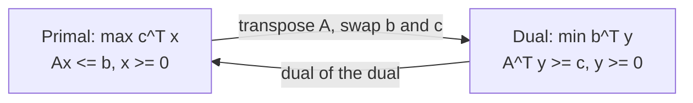

# Duality, Dual Solutions and Cost Sensitivity

## What you will learn

- How to write the dual of a linear program (LP), in scalar and matrix form
- Weak and strong duality, and why the primal and dual optimal values are equal
- Four ways to get dual values without solving the dual from scratch (optimal table, $C_B B^{-1}$, complementary slackness, dual simplex)
- What a shadow price is
- What post-optimality (sensitivity) analysis asks, and how to find the range of an objective coefficient that keeps the current solution optimal

---

## 1. Primal and Dual in Matrix Form

**Simple idea:** every LP has a "mirror" LP. One looks at the problem from the producer's side (how many units to make), the mirror looks at it from the resource's side (what price to put on each resource).

**Analogy:** a bakery makes cakes and bread using oven hours and labour hours. The owner asks, "how many of each should I bake to maximise profit?" (primal). A buyer who wants to rent all the bakery's resources asks, "what is the cheapest price per oven hour and per labour hour that still convinces the owner to rent out rather than bake?" (dual).

**Precise form (maximisation primal, all constraints $\le$):**

$$\text{Primal: } \max\ Z = c^T x \quad \text{s.t. } Ax \le b,\ x \ge 0$$

$$\text{Dual: } \min\ W = b^T y \quad \text{s.t. } A^T y \ge c,\ y \ge 0$$

- $x$ = $n$ decision variables, $c$ = profit (cost) vector, $A$ = $m \times n$ coefficient matrix, $b$ = right-hand side (resource) vector.
- $y$ = $m$ dual variables, one per primal constraint ($y_1$ for constraint 1, ..., $y_m$ for constraint $m$).
- $A^T$ is the **transpose**: row $i$ becomes column $i$. The first column of $A$ becomes the first row of $A^T$.

**Conversion recipe (numbered):**

1. Give each primal constraint its own variable $y_i$.
2. The dual objective is $\min \sum b_i y_i$ (RHS values become the dual costs).
3. Each primal variable $x_j$ gives one dual constraint: $\sum_i a_{ij} y_i \ge c_j$ (the column of $A$ for $x_j$ becomes a row; the sign flips from $\le$ to $\ge$).
4. All $y_i \ge 0$.

Writing $c^T x = x^T c$ and $Ax \le b$ as $x^T A^T \le b^T$ is the same problem in transposed notation.

**Worked example.** Primal: $\max Z = 40x_1 + 30x_2$ s.t. $2x_1 + x_2 \le 100$, $x_1 + x_2 \le 80$, $x_1, x_2 \ge 0$.

Dual: $\min W = 100y_1 + 80y_2$ s.t. $2y_1 + y_2 \ge 40$, $y_1 + y_2 \ge 30$, $y_1, y_2 \ge 0$.

- Primal optimum: $x_1 = 20,\ x_2 = 60$. Check: $2(20)+60 = 100$ and $20+60 = 80$ (both constraints tight). $Z^* = 40(20) + 30(60) = 800 + 1800 = 2600$.
- Dual optimum: $y_1 = 10,\ y_2 = 20$. Check: $2(10)+20 = 40$ and $10+20 = 30$. $W^* = 100(10) + 80(20) = 1000 + 1600 = 2600$.

Both equal 2600 although the variables themselves differ.

**Caveat:** this recipe is for the "standard" pair (max with $\le$, min with $\ge$). Equality constraints give free (unrestricted) dual variables, and $\ge$ constraints in a maximisation give $y_i \le 0$. Convert to standard form first if in doubt.

---

## 2. Weak and Strong Duality

**Simple idea:** the price the buyer offers can never be lower than the profit the owner can make; and at the best prices, the two exactly meet.

**Analogy:** if the buyer's total rent offer were less than what the owner could earn by baking, the owner would refuse. If it were higher than necessary, a smarter buyer would lower the offer. The deal settles where the two are equal.

**Weak duality.** For any feasible $x$ (primal) and any feasible $y$ (dual):

$$c^T x \le b^T y$$

So every dual-feasible value is an **upper bound** on every primal-feasible value. If this failed, the profit could grow without bound while resources are limited.

**Strong duality theorem.** If either the primal or the dual has a finite optimal solution, then so does the other, and

$$Z^* = c^T x^* = b^T y^* = W^*$$

Solving either problem gives the optimal value of both. The optimal decision variable values $x^*$ and $y^*$ are generally different.

| Property | Weak duality | Strong duality |
|----------|-------------|----------------|
| Applies to | Any feasible pair | Optimal solutions |
| Statement | $c^Tx \le b^Ty$ | $c^Tx^* = b^Ty^*$ |
| Gives | A bound | Exact equality |

**Why it matters:** solving a dual is as good as solving the primal. Choose whichever has fewer constraints or an easier starting point.

**Caveat:** if one problem is unbounded, the other is infeasible. If both are feasible, both have optima and they are equal. "One has an optimum implies the other has one" is the key exam statement.

---

## 3. Four Ways to Obtain the Dual Solution

You do not have to build and solve the dual separately. Given the primal, the dual values can be obtained by:

1. Reading the **optimal primal table** (slack-column entries)
2. Computing **$C_B B^{-1}$**
3. **Complementary slackness**
4. Solving the dual with the simplex or dual simplex method (the long way)

The first three are quick and are the ones to master.

---

## 4. Method 1: Read the Optimal Primal Table

**Simple idea:** the final table already hides the dual prices in the slack columns.

**Analogy:** a slack variable $s_i$ measures unused resource $i$. The final table's reduced cost under $s_i$ tells you how much profit you lose per unit of that resource taken away, which is exactly the resource's price $y_i$.

**Rule.** Each constraint $i$ has a slack variable $s_i$ (cost 0 in the objective). Then

$$y_i - c_{s_i} = (z_j - c_j)\big|_{s_i} \quad \Rightarrow \quad y_i = (z_j - c_j)\big|_{s_i} \quad (\text{since } c_{s_i}=0)$$

where $z_j - c_j$ is the net-evaluation (reduced cost) row of the final table. For a maximisation problem every $z_j - c_j \ge 0$ at the optimum.

**Steps:**

1. Solve the primal to the final optimal table.
2. Locate the slack columns $s_1, \dots, s_m$.
3. Read the $z_j - c_j$ entry in each slack column. Slack column $s_i$ gives $y_i$.
4. Check: $b^T y$ must equal the primal optimal value.

**Worked example (machine hours).** Maximise $Z = 6x_1 + 8x_2$ s.t. $30x_1 + 20x_2 + s_1 = 300$, $5x_1 + 10x_2 + s_2 = 110$. Optimum $x_1 = 4$, $x_2 = 9$, $Z = 24 + 72 = 96$.

Final table (optimal basis $x_1, x_2$):

| Basis | $x_1$ | $x_2$ | $s_1$ | $s_2$ | RHS |
|-------|-------|-------|-------|-------|-----|
| $x_1$ | 1 | 0 | 0.05 | -0.1 | 4 |
| $x_2$ | 0 | 1 | -0.025 | 0.15 | 9 |
| $z_j - c_j$ | 0 | 0 | **0.1** | **0.6** | 96 |

So $y_1 = 0.1 = 1/10$ and $y_2 = 0.6 = 6/10$. The dual is $\min W = 300y_1 + 110y_2$ s.t. $30y_1 + 5y_2 \ge 6$, $20y_1 + 10y_2 \ge 8$. Check: $300(0.1) + 110(0.6) = 30 + 66 = 96$. Constraints: $3 + 3 = 6$ and $2 + 6 = 8$ (both tight, because $x_1, x_2 > 0$). Interpretation: $y_1$ and $y_2$ are the worth (Rs per hour) of machine 1 and machine 2.

**Worked example (minimisation).** A minimisation primal $\min Z = x_1 - 2x_2 + x_3$ with three $\le$ constraints whose optimal table has $z_j - c_j$ entries $-3/2,\ 0,\ -1$ under $s_1, s_2, s_3$ gives, with RHS values $4, 3, 2$:

$$y_1 = -\tfrac32,\quad y_2 = 0,\quad y_3 = -1,\qquad W = 4\left(-\tfrac32\right) + 3(0) + 2(-1) = -6 - 2 = -8$$

The primal optimal value is also $-8$. Strong duality verified. (In a minimisation with $\le$ constraints the dual variables are $\le 0$, which is why they come out negative; in a minimisation table the optimality test is $z_j - c_j \le 0$.)

**Case with a $\ge$ constraint (Big-M).** A $\ge$ constraint is written with a surplus $-s_1$ and an artificial variable $A_1$, whose objective coefficient is $-M$ in a maximisation (we **subtract** $M A_1$ to penalise it; the penalty keeps the artificial out of the final answer). Because $s_1$ cannot start as a basic variable (it would be negative), use the **artificial column** for that constraint:

$$y_1 - (-M) = (z_j - c_j)\big|_{A_1} \quad \Rightarrow \quad y_1 = (z_j - c_j)\big|_{A_1} - M$$

Example: if the entry under $A_1$ is $M$, then $y_1 + M = M$ so $y_1 = 0$. For the other constraints (slack columns $s_2, s_3$, cost 0): $y_2 - 0 = 3$ gives $y_2 = 3$; $y_3 - 0 = 0$ gives $y_3 = 0$. Dual solution: $(0, 3, 0)$.

**Why subtract $M$:** the artificial variable is added only to obtain a starting basic feasible solution. If a constraint is $x_1 + 2x_2 - s_1 = 2$ and $x_1 = x_2 = 0$, then $s_1 = -2$ is infeasible, hence the artificial variable. Giving it cost $-M$ ($M$ huge) in a max problem makes any use of it unprofitable. (In a minimisation problem the penalty is $+M$.)

---

## 5. Method 2: $y^T = C_B B^{-1}$

**Simple idea:** the dual values equal the basic-variable costs multiplied by the inverse of the basis matrix.

**Definitions:**

- $C_B$ = row vector of objective coefficients of the **basic** variables in the final table.
- $B$ = matrix of original columns of the basic variables.
- $B^{-1}$ = the final table's entries under the **initial identity columns** (the slack columns). Where the starting basis was the slack variables, the slack columns of the final table are exactly $B^{-1}$.

$$y^T = C_B B^{-1}$$

**Steps:**

1. List the basic variables of the final table, in row order.
2. Write $C_B$ from their original costs (slack cost = 0).
3. Take the slack-column block of the final table: this is $B^{-1}$.
4. Multiply the $1 \times m$ vector $C_B$ by the $m \times m$ matrix $B^{-1}$. The result is a $1 \times m$ row: $(y_1, \dots, y_m)$.
5. If an artificial variable replaced a slack (for a $\ge$ constraint), take the artificial's column for that position (together with the slack columns of other rows).

**Worked example (machine problem above).** Basic variables $x_1, x_2$: $C_B = (6,\ 8)$. Original $B = \begin{pmatrix}30 & 20\\ 5 & 10\end{pmatrix}$, $\det B = 300 - 100 = 200$:

$$B^{-1} = \frac{1}{200}\begin{pmatrix}10 & -20\\ -5 & 30\end{pmatrix} = \begin{pmatrix}0.05 & -0.1\\ -0.025 & 0.15\end{pmatrix}$$

This is exactly the $s_1, s_2$ block of the final table. Then

$$C_B B^{-1} = (6(0.05) + 8(-0.025),\ \ 6(-0.1) + 8(0.15)) = (0.3 - 0.2,\ -0.6 + 1.2) = (0.1,\ 0.6)$$

Same as Method 1.

**Worked example (minimisation).** Basic variables $x_2, s_2, x_3$ with costs $C_B = (-2,\ 0,\ 1)$; multiplying by the slack-column block $B^{-1}$ of the final table gives $(-3/2,\ 0,\ -1)$, matching Method 1. A second case with basic variables $x_2, x_1, s_3$ and $C_B = (4,\ 3,\ 0)$ is solved the same way: $(1\times3)\cdot(3\times3) = (1\times3)$ gives $y_1, y_2, y_3$.

**Caveat:** $B^{-1}$ must be taken from the columns that were the **identity matrix at the start**. Taking the wrong columns (for example a surplus column instead of the artificial one) changes the answer.

---

## 6. Method 3: Complementary Slackness

**Simple idea:** if a resource is not fully used, it is worth nothing at the margin; and if a product is made, its dual constraint must be exactly tight.

**Analogy:** if the oven has spare hours left over, one more oven hour has no value ($y = 0$). If you do make a cake, the cake's "resource cost" must equal its profit exactly; otherwise it would not be worth making.

**Rules.** At the optimal primal and dual solutions:

1. If a primal slack or surplus variable $s_i > 0$ (constraint $i$ is not tight), then $y_i = 0$.
2. If a primal variable $x_j > 0$, then the $j$-th **dual constraint holds as an equality**.

Equivalent forms: $y_i \cdot s_i = 0$ for every $i$, and $x_j \cdot (\text{dual surplus}_j) = 0$ for every $j$.

**Steps:**

1. Write the primal optimal solution (all basic values; non-basic variables are 0).
2. Write the dual (one constraint per primal variable).
3. For every slack/surplus with positive value, set the matching $y_i = 0$.
4. For every $x_j > 0$, turn dual constraint $j$ into an equation.
5. Substitute the known $y_i = 0$ values and solve the remaining simultaneous equations.
6. Check dual feasibility and $b^Ty = c^Tx$.

**Worked example.** Primal: $\max Z = -x_1 + 3x_2 - 3x_3$ s.t.

$$3x_1 - x_2 \le 7,\qquad -x_1 + 2x_2 \le 6,\qquad -4x_1 + 3x_2 + 8x_3 \le 10$$

Optimal solution: $x_1 = 4,\ x_2 = 5,\ x_3 = 0$, slacks $s_1 = 0,\ s_2 = 0,\ s_3 = 11$. Check: $12 - 5 = 7$; $-4 + 10 = 6$; $-16 + 15 + 0 = -1$ and $-1 + 11 = 10$. $Z = -4 + 15 = 11$.

Dual: $\min W = 7y_1 + 6y_2 + 10y_3$ s.t.

$$3y_1 - y_2 - 4y_3 \ge -1,\qquad -y_1 + 2y_2 + 3y_3 \ge 3,\qquad 8y_3 \ge -3,\qquad y \ge 0$$

- $s_3 = 11 > 0$, so $y_3 = 0$.
- $x_1 = 4 > 0$, so dual constraint 1 is an equality; $x_2 = 5 > 0$, so dual constraint 2 is an equality.
- With $y_3 = 0$: $3y_1 - y_2 = -1$ and $-y_1 + 2y_2 = 3$. From the first, $y_2 = 3y_1 + 1$. Substitute: $-y_1 + 6y_1 + 2 = 3$, so $y_1 = 1/5$ and $y_2 = 8/5$.
- Check: $W = 7(0.2) + 6(1.6) + 0 = 1.4 + 9.6 = 11 = Z$. Constraint 3: $0 \ge -3$ holds (it is slack, consistent with $x_3 = 0$).

**Second worked example (Big-M problem).** The primal optimum has $s_1 > 0$ and $s_3 > 0$, so $y_1 = y_3 = 0$. Only the dual constraint for the basic variable $x_2$ is an equality: $2y_1 + y_2 = 3$. With $y_1 = 0$: $y_2 = 3$. Dual solution $(0, 3, 0)$, the same as Method 1 gave.

**Key point:** all methods must agree. If two methods give different answers, there is an arithmetic error.

| Method | Needs | Best when |
|--------|-------|-----------|
| Optimal table ($z_j - c_j$ of slack) | Final table | Final table is given |
| $C_B B^{-1}$ | $C_B$ and slack block | Matrix form is convenient |
| Complementary slackness | Primal solution and dual constraints | Only the solution values are given |
| Dual simplex | Dual written out | You want an independent check |

---

## 7. Recovering Unknown Table Entries (Quiz Type)

**Simple idea:** the final table obeys the rules above, so you can use them backwards to find missing numbers.

A final table for $\max Z = \alpha x_1 + x_2$ (slack variables $x_3, x_4$) shows $x_1$ as a basic variable with a partly unknown row. Method:

1. A basic variable must have coefficient 1 in its row, so divide the whole row by the coefficient ($\beta$). The row $\beta x_1 + 2\beta x_2 + \beta x_3 \ldots$ becomes $x_1 + \frac{2\beta}{\beta}\ldots$; comparing coefficients such as $1/\beta = 1/3$ gives $\beta = 3$.
2. Use $z_j - c_j$ of a convenient column. With $x_1$ basic and cost $\alpha$: $z_3 - c_3 = \alpha \cdot \tfrac13 + 0 \cdot (\ldots) - 0 = \tfrac23$, so $\alpha = 2$.
3. Use the RHS: non-basic variables are 0, so a relation like $x_2 + x_4 = \gamma$ with $x_2 = 0$ and $x_4 = 2$ gives $\gamma = 2$.

Results: $\beta = 3,\ \alpha = 2,\ \gamma = 2$. Then the dual values are read from the slack columns $x_3, x_4$ as in Method 1.

**Caveat:** the exact table is not reproduced here; the technique is: normalise the basic row, use one $z_j - c_j$ equation for the cost unknown, and use RHS equations for constants.

---

## 8. Sensitivity (Post-Optimality) Analysis

**Simple idea:** after finding the best plan, ask "how wrong can my numbers be before this plan stops being best?"

**Analogy:** a shop plans stock based on a profit of Rs 15 per unit of item A. If the true profit drifts to Rs 14 or Rs 18, does the shop still stock the same mix? There is a safe range within which the plan is unchanged.

**Definition.** **Sensitivity analysis** finds the range (lower and upper limit) within which an LP parameter can vary, **one at a time**, without changing the optimal basis (the current solution stays optimal). It measures how sensitive the optimal answer is to changes in the input.

**Types of changes studied:**

1. Change in an objective coefficient $c_j$ (cost vector)
2. Change in a right-hand side value $b_i$ (requirement vector) - linked to **shadow prices**
3. Adding a new variable
4. Adding or deleting a constraint (or deleting a variable)
5. Changing coefficients $a_{ij}$ in $A$

**Shadow price.** The shadow price of constraint $i$ is the change in the optimal objective value per unit increase in $b_i$, other things fixed. It equals the dual value $y_i^*$.

Example: $y_1 = 0.1$ for machine 1 means one extra machine-1 hour raises the maximum profit by Rs 0.1 (as long as the basis stays the same). A constraint that is not tight has shadow price 0.

---

## 9. Range of an Objective Coefficient

**Simple idea:** keep the same optimal corner; find how far a profit number can move before a different corner becomes better.

Let $c_k \to c_k + \Delta c_k$. There are two cases.

### Case A: $c_k$ belongs to a basic variable

Look at row $k$ of the final table (the row of the basic variable $x_k$), with entries $y_{kj}$ in column $j$ (this $y_{kj}$ is the table entry, not the dual variable). For every non-basic column $j$:

$$\max_{y_{kj} > 0}\left\{\frac{-(z_j - c_j)}{y_{kj}}\right\} \ \le\ \Delta c_k\ \le\ \min_{y_{kj} < 0}\left\{\frac{-(z_j - c_j)}{y_{kj}}\right\}$$

Then the allowed range of the coefficient is $c_k + \Delta c_k$ between those bounds. Use only **non-basic** columns (basic columns have $z_j - c_j = 0$ and $y_{kj}$ is 1 or 0). If there is no positive (or negative) $y_{kj}$, that side is unbounded ($-\infty$ or $+\infty$).

**Why it works:** changing $c_k$ changes $z_j$ in every column by $\Delta c_k \cdot y_{kj}$. For a max problem the optimum remains while all $z_j - c_j \ge 0$, so $(z_j - c_j) + \Delta c_k\, y_{kj} \ge 0$ for each $j$. Dividing by $y_{kj}$ reverses the inequality when $y_{kj} < 0$, giving the max/min bounds.

**Steps:**

1. Identify whether the coefficient belongs to a basic or non-basic variable.
2. Write row $k$ of the final table.
3. For each non-basic column $j$ compute $-(z_j - c_j)/y_{kj}$.
4. Lower bound = maximum of the values from positive $y_{kj}$; upper bound = minimum of the values from negative $y_{kj}$.
5. Add the original $c_k$ to turn the $\Delta c_k$ range into a range for $c_k$.

**Worked example (machine problem, $c_1 = 6$, $c_2 = 8$).** Non-basic columns: $s_1$ with $z_j - c_j = 0.1$ and $s_2$ with $0.6$.

- **$c_1$** (row $x_1$: $y_{s_1} = 0.05 > 0$, $y_{s_2} = -0.1 < 0$):
  - Lower: $-0.1/0.05 = -2$.
  - Upper: $-0.6/(-0.1) = 6$.
  - $-2 \le \Delta c_1 \le 6$, so $4 \le c_1 \le 12$.
- **$c_2$** (row $x_2$: $y_{s_1} = -0.025 < 0$, $y_{s_2} = 0.15 > 0$):
  - Lower: $-0.6/0.15 = -4$.
  - Upper: $-0.1/(-0.025) = 4$.
  - $-4 \le \Delta c_2 \le 4$, so $4 \le c_2 \le 12$.

Verification for $c_1$ (with $c_2 = 8$): dual constraints $30y_1 + 5y_2 = c_1$ and $20y_1 + 10y_2 = 8$ give $y_2 = 0.8 - 2y_1$ and $c_1 = 4 + 20y_1$. Dual feasibility $y_1, y_2 \ge 0$ requires $0 \le y_1 \le 0.4$, so $4 \le c_1 \le 12$. Matches.

Meaning: as long as profit per unit of product 1 stays between 4 and 12, the plan $x_1 = 4,\ x_2 = 9$ stays optimal (the objective value changes, the plan does not).

**Another case.** For a different problem with $c_1 = 15$ on a basic variable, the row had positive entries $1$ (basic column, ignored) and $8/39$, and one negative entry $-1/39$; applying the formula gave $\Delta c_1$ bounds so that $45/16 \le c_1 \le 225/2$ (about $2.8$ to $112.5$). The current value $15$ lies inside, so the solution does not change.

**Second method (inequality form).** Replace $c_k$ by $c_k + \Delta c_k$, recompute the $z_j - c_j$ row symbolically, and impose $z_j - c_j \ge 0$ for each non-basic $j$ (for max). Solving these inequalities gives the same range.

### Case B: $c_k$ belongs to a non-basic variable

Only its own $z_j - c_j$ changes. For a max problem, keep $(z_j - c_j) \ge 0$ after the change: $(z_j - c_j) - \Delta c_j \ge 0$, so $\Delta c_j \le (z_j - c_j)$ and $c_j$ has **no lower limit** ($-\infty$).

Examples: slack $s_1$ with original cost 0 and $z_j - c_j = 0.1$ gives $\Delta c_{s_1} \le 0.1$. In another example $z_j - c_j = 45/41$ gives $-\infty < \Delta c_4 \le 45/41$. Intuition: making an unused item less profitable cannot make it start being used; only making it much more profitable can.

| Situation | Rows used | Range is | Limits |
|-----------|-----------|----------|--------|
| $c_k$ of a basic variable | Row of $x_k$, all non-basic columns | A two-sided interval | max of positive-ratio, min of negative-ratio |
| $c_k$ of a non-basic variable | Its own column $z_j - c_j$ only | One-sided | $\Delta c_j \le z_j - c_j$ (max problem) |

**Caveat:** the ranges are valid for one change at a time with everything else fixed. Changing several coefficients together needs a different (100 percent rule) check.

---

## Exam and Assessment Hints

- Quiz questions may give a final table with some entries replaced by letters (such as $\alpha$, $\beta$, $\gamma$) and ask you to find them, then read off the dual values.
- Be ready to find dual values by all of: slack-column $z_j - c_j$, $C_B B^{-1}$, and complementary slackness, and to confirm $Z^* = W^*$.
- Know the sign convention: in a maximisation Big-M problem the artificial variable has coefficient $-M$.
- Be able to compute the range of an objective coefficient for a basic and a non-basic variable.

## Self-Check Questions

1. **State weak duality.** For any feasible $x, y$: $c^Tx \le b^Ty$. The dual value always bounds the primal value.
2. **State strong duality.** If either problem has a finite optimum, so does the other, and $Z^* = W^*$.
3. **A slack variable is 7 at the optimum. What is the corresponding dual variable?** 0 (complementary slackness).
4. **$x_2 = 6 > 0$. What follows in the dual?** Dual constraint 2 is an equality.
5. **Machine problem: $C_B = (6,8)$, $B^{-1}$ as above. Dual values?** $(0.1, 0.6)$; $W = 300(0.1) + 110(0.6) = 96$.
6. **What is the range for a basic coefficient $c_1 = 6$ in the machine problem?** $4 \le c_1 \le 12$.
7. **Which bound does a non-basic coefficient lack (max problem)?** The lower bound; only $\Delta c_j \le z_j - c_j$.
8. **What is the dual variable $y_1$ if the Big-M entry under $A_1$ is $M$?** $y_1 = M - M = 0$.

## Common Pitfalls / Exam Traps

- Adding $+M A_1$ instead of subtracting in a maximisation problem. The penalty must hurt the objective.
- Reading the dual from the surplus column of a $\ge$ constraint instead of the artificial column.
- Concluding the dual variable values equal the primal variable values. Only the optimal objective values are equal.
- Forgetting to take $B^{-1}$ from the initial identity columns, or multiplying $C_B$ and $B^{-1}$ in the wrong order (result must be a $1 \times m$ row).
- Using basic columns in the ratio formula for the cost range, or forgetting that a missing positive/negative entry means an infinite bound.
- Mixing up the direction: for a minimisation problem the optimality signs ($z_j - c_j \le 0$) and the dual variable signs flip.
- Saying shadow price applies to non-binding constraints: it is 0 for them.

## Quick Revision Summary

- Dual of $\max c^Tx,\ Ax \le b,\ x \ge 0$ is $\min b^Ty,\ A^Ty \ge c,\ y \ge 0$.
- Weak duality: $c^Tx \le b^Ty$. Strong duality: optimal values are equal (2600 in the 100/80 example, 96 in the machine example).
- Dual values from the table: $y_i = (z_j - c_j)$ under slack $s_i$; for a Big-M constraint use the artificial column and subtract $M$.
- $y^T = C_B B^{-1}$, with $B^{-1}$ read from the initial-identity columns.
- Complementary slackness: positive slack means $y_i = 0$; positive $x_j$ means dual constraint $j$ is an equality.
- Shadow price = $y_i^*$ = profit change per extra unit of resource $i$.
- Sensitivity analysis gives the range of a parameter (one at a time) that keeps the current basis optimal.
- Basic $c_k$: $\max_{y>0}\{-(z_j-c_j)/y_{kj}\} \le \Delta c_k \le \min_{y<0}\{-(z_j-c_j)/y_{kj}\}$ (example: $4 \le c_1 \le 12$).
- Non-basic $c_j$: $\Delta c_j \le z_j - c_j$, no lower limit (max problem).

---

**← [Previous](../week-03/01-artificial-variables-big-m-and-lp-duality-transcript.md) · [Index](../README.md) · [Next](02-sensitivity-analysis-recap-and-convexity-foundations-makeup-transcript.md) →**
