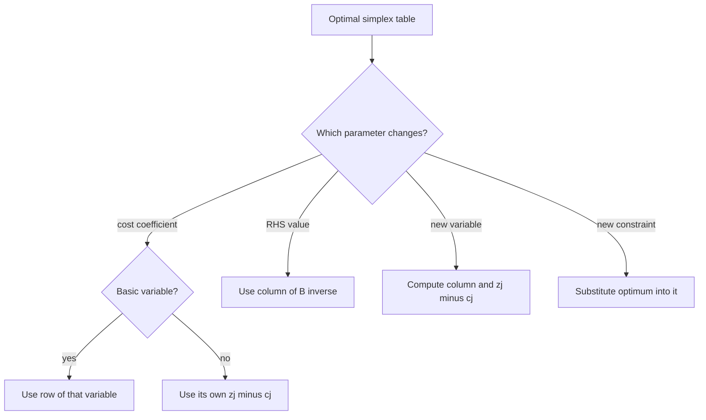
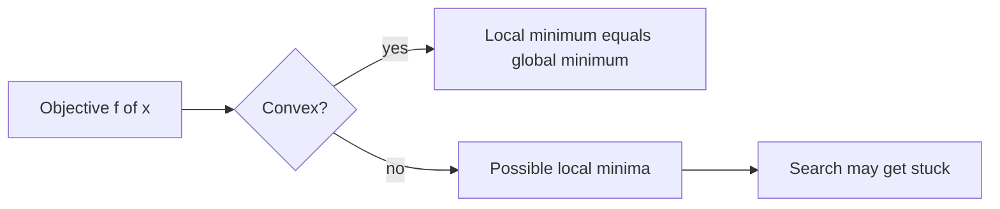

# Sensitivity Analysis Recap and Convexity Foundations

## What you will learn

- How to find the range of a cost coefficient (basic and non-basic variable) that keeps the optimal LP solution unchanged
- How to find the range of a right-hand-side (requirement) value that keeps the current basis feasible
- How to test the effect of adding a new variable or a new constraint
- What a convex set and a convex function are, and how to test for them
- What unconstrained optimization is, and the meaning of local versus global minima

---

## 1. Sensitivity (Post-Optimality) Analysis: The Big Picture

**Simple idea:** After you have solved a linear program, you ask "how much can the inputs change before my answer stops being the best one?"

**Analogy:** A shop owner has found the best product mix at today's prices. Sensitivity analysis tells the owner: "as long as the profit per shirt stays between Rs 0 and Rs 7.5, keep making the same mix; outside that band, re-plan."

**What it does:** It gives a **lower bound and an upper bound** (a range) for one parameter at a time, keeping all others fixed, such that the current optimal basis stays optimal (or feasible). The changes studied are:

| Change | Question answered |
|---|---|
| Cost (objective) coefficient $c_k$ | Range of $c_k$ for which the optimal solution is unchanged |
| Requirement (RHS) value $b_k$ | Range of $b_k$ for which the current basis stays feasible |
| Adding a new variable | Does the new column enter the basis? |
| Adding a new constraint | Is it already satisfied by the current optimum? |
| Deleting a constraint or variable, changing a technology coefficient | Handled similarly, not worked here |

**Gap in the plain version:** "Unchanged optimal solution" means the same basis stays optimal. Inside a cost range the optimal values of the variables do not change, but the objective value $Z$ does change when the changed coefficient multiplies a non-zero variable.

### Running example used below

$$\max Z = 3x_1 + 5x_2 \quad \text{s.t. } x_1 \le 4,\; 2x_2 \le 12,\; 3x_1 + 2x_2 \le 18,\; x_1,x_2 \ge 0$$

Adding slacks $s_1,s_2,s_3$, the optimal solution is $x_1 = 2,\; x_2 = 6,\; s_1 = 2,\; Z = 36$. Basic variables (in row order): $s_1, x_2, x_1$, with $c_B = (0, 5, 3)$.

Optimal table (rows are basic variables):

| Basis | $x_1$ | $x_2$ | $s_1$ | $s_2$ | $s_3$ | RHS |
|---|---|---|---|---|---|---|
| $s_1$ | 0 | 0 | 1 | 1/3 | -1/3 | 2 |
| $x_2$ | 0 | 1 | 0 | 1/2 | 0 | 6 |
| $x_1$ | 1 | 0 | 0 | -1/3 | 1/3 | 2 |
| $z_j - c_j$ | 0 | 0 | 0 | 3/2 | 1 | 36 |

The columns under the slack variables form $B^{-1}$:

$$B^{-1} = \begin{pmatrix} 1 & 1/3 & -1/3 \\ 0 & 1/2 & 0 \\ 0 & -1/3 & 1/3 \end{pmatrix}$$

Check of $z_j - c_j$ for $s_2$: $c_B \cdot (\text{column}) = 0\cdot\tfrac13 + 5\cdot\tfrac12 + 3\cdot(-\tfrac13) = 1.5$. For $s_3$: $0 + 0 + 3\cdot\tfrac13 = 1$.

---

## 2. Changing a Cost Coefficient $c_k$

### 2.1 Case A: $c_k$ belongs to a basic variable

**Simple idea:** Changing the profit of something you are currently producing can make some unused resource suddenly look more attractive. Find how far you can push before that happens.

**Method (maximization problem), numbered steps:**

1. Let $x_k$ be the basic variable in row $k$ and let $\Delta c_k$ be the change in its cost.
2. Take the row of $x_k$ in the optimal table. Its entries under the non-basic columns are $y_{kj}$.
3. The new $z_j - c_j$ for each non-basic column $j$ becomes $(z_j - c_j) + \Delta c_k\, y_{kj}$. Optimality needs every one of these $\ge 0$.
4. This gives the range
$$\max_{y_{kj} > 0} \left\{ \frac{-(z_j - c_j)}{y_{kj}} \right\} \le \Delta c_k \le \min_{y_{kj} < 0} \left\{ \frac{-(z_j - c_j)}{y_{kj}} \right\}$$
   Columns with $y_{kj} = 0$ are discarded (they impose no limit).
5. Add the original $c_k$ to every part of the inequality to get the range of $c_k$ itself.

**In words:** for the lower limit look only at positive $y_{kj}$; for the upper limit look only at negative $y_{kj}$.

**Worked example: range of $c_1 = 3$ (basic variable $x_1$).** Row of $x_1$: $y_{s_2} = -1/3$, $y_{s_3} = 1/3$.

- Positive $y$: $s_3$, bound $= -1/(1/3) = -3$. So $\Delta c_1 \ge -3$.
- Negative $y$: $s_2$, bound $= -(3/2)/(-1/3) = 4.5$. So $\Delta c_1 \le 4.5$.
- Range: $-3 \le \Delta c_1 \le 4.5$, so $0 \le c_1 \le 7.5$.

Check directly: new $z_{s_2} - c_{s_2} = 1.5 - \Delta/3 \ge 0 \Rightarrow \Delta \le 4.5$; new $z_{s_3} - c_{s_3} = 1 + \Delta/3 \ge 0 \Rightarrow \Delta \ge -3$. Same result.

**Second (direct) method:** write $c_1$ as a symbol, recompute $z_j - c_j = c_B B^{-1} a_j - c_j$ for each non-basic column in terms of $c_1$, and demand each be $\ge 0$. Solving the resulting inequalities gives the same range.

**Worked example: range of $c_2 = 5$ (basic variable $x_2$).** Row of $x_2$: $y_{s_2} = 1/2$, $y_{s_3} = 0$.

- Positive $y$: $s_2$, bound $= -1.5/0.5 = -3$, so $\Delta c_2 \ge -3$.
- No negative $y$, so no upper limit.
- Range: $c_2 \ge 2$ (upper limit infinite).

### 2.2 Case B: $c_k$ belongs to a non-basic variable

**Simple idea:** A product you are not making stays unmade unless its profit becomes high enough. You only need its own $z_j - c_j$.

**Method:**

1. Read $z_j - c_j$ under the column of the non-basic variable.
2. Because $z_j$ does not depend on $c_j$ (the column is not in the basis), the new condition is $z_j - c_j^{\text{new}} \ge 0$ (maximization).
3. So $c_j^{\text{new}} \le z_j$. In terms of change: $\Delta c_j \le z_j - c_j$.

If the original cost is 0 (for example a slack variable $s_1$ with $z_j - c_j = 45/41$), the range is simply $c_j \le 45/41$, since $0 + 45/41$ is the upper limit.

**Worked example (own numbers):** if a product $x_5$ had $c_5 = 2$ and $z_5 - c_5 = 1.5$, then $z_5 = 3.5$. The current solution stays optimal while $c_5 \le 3.5$; no lower limit exists.

| | Basic variable | Non-basic variable |
|---|---|---|
| Uses | Row of the variable in the optimal table | Only its own $z_j - c_j$ |
| Range type | Two-sided (lower and upper) | One-sided (upper limit for max problem) |
| $z_j$ changes? | Yes | No |

---

## 3. Changing a Requirement (RHS) Value $b_k$

**Simple idea:** If you get more or less of a resource, how far can it move before the current set of "binding" resources is no longer feasible?

**Theory in one line:** if $x_B = B^{-1} b$ is the optimal basic solution, then after changing $b_k$ by $\Delta b_k$ the basis stays optimal exactly while $B^{-1}b^{new} \ge 0$ (the $z_j - c_j$ row does not depend on $b$, so optimality conditions stay satisfied; only feasibility can break).

**Method, numbered steps:**

1. Identify the slack/surplus column that corresponds to the constraint $k$; that column of $B^{-1}$ holds $\beta_{ik}$ for each row $i$.
2. The new basic values are $x_{B_i} + \Delta b_k \beta_{ik} \ge 0$ for every row $i$.
3. The range is
$$\max_{\beta_{ik} > 0} \left\{ \frac{-x_{B_i}}{\beta_{ik}} \right\} \le \Delta b_k \le \min_{\beta_{ik} < 0} \left\{ \frac{-x_{B_i}}{\beta_{ik}} \right\}$$
4. Add the original $b_k$ to get the range of $b_k$.

**Equivalent (second) method:** replace $b_k$ by a symbol, multiply $B^{-1}$ by the vector $b$ and require every component of the product to be $\ge 0$. Solve these inequalities.

**Worked example (basic values $x_B = (2, 6, 2)$ for rows $s_1, x_2, x_1$):**

| Constraint | Column of $B^{-1}$ | Lower limit of $\Delta b$ | Upper limit of $\Delta b$ | Range of $b$ |
|---|---|---|---|---|
| $b_1 = 4$ ($s_1$) | $(1, 0, 0)$ | $-2/1 = -2$ | none | $2 \le b_1 < \infty$ |
| $b_2 = 12$ ($s_2$) | $(1/3, 1/2, -1/3)$ | $\max(-6,\,-12) = -6$ | $-2/(-1/3) = 6$ | $6 \le b_2 \le 18$ |
| $b_3 = 18$ ($s_3$) | $(-1/3, 0, 1/3)$ | $-2/(1/3) = -6$ | $-2/(-1/3) = 6$ | $12 \le b_3 \le 24$ |

Note on the last row: the positive entry is in row $x_1$ (value 2), giving lower limit $-6$; the negative entry is in row $s_1$ (value 2), giving upper limit $+6$. Hence $12 \le b_3 \le 24$.

**Caveat:** inside this range the basis stays the same but the optimal **values** of the variables and $Z$ do change (they are $B^{-1}b$). Outside the range the basis becomes infeasible and you must re-solve (typically with the dual simplex method).

| | Cost change | RHS change |
|---|---|---|
| What can break | Optimality ($z_j - c_j \ge 0$) | Feasibility ($B^{-1}b \ge 0$) |
| Table part used | Row of the variable | Column of $B^{-1}$ |
| Solution values change inside range? | No | Yes |

---

## 4. Adding a New Variable

**Simple idea:** You are thinking of launching a new product that uses the existing resources. Will it be worth making, given the current "prices" of those resources?

**Method:**

1. Write the new column $a_{new}$ of constraint coefficients and its cost $c_{new}$.
2. Compute the updated column $y = B^{-1} a_{new}$.
3. Compute $z_{new} - c_{new} = c_B \cdot y - c_{new}$.
4. If $z_{new} - c_{new} \ge 0$ (maximization), the new variable is not attractive: the **current solution remains optimal** and the new variable stays non-basic at 0.
5. If it is negative, the variable enters the basis and simplex continues from this table.

**Worked example:** add $x_4$ with column $(1,1,1)^T$ in the three constraints.

$$y = B^{-1}\begin{pmatrix}1\\1\\1\end{pmatrix} = \begin{pmatrix} 1 + 1/3 - 1/3 \\ 1/2 \\ -1/3 + 1/3 \end{pmatrix} = \begin{pmatrix} 1 \\ 1/2 \\ 0 \end{pmatrix}$$

$z_4 = 0\cdot 1 + 5 \cdot \tfrac12 + 3\cdot 0 = 2.5$.

- If $c_4 = 2$: $z_4 - c_4 = 0.5 \ge 0$, solution unchanged.
- If $c_4 = 4$: $z_4 - c_4 = -1.5 < 0$, $x_4$ enters the basis; re-iterate.

The break-even profit is $c_4 = z_4 = 2.5$.

---

## 5. Adding a New Constraint

**Simple idea:** A new rule is added. If the plan you already have obeys the rule, nothing changes.

**Method:**

1. Substitute the current optimal values into the new constraint.
2. If it is satisfied, the constraint is **redundant** at this optimum and the current optimal solution stays unchanged.
3. If it is violated, the current solution is no longer feasible. Append the new constraint (with a slack) to the optimal table, eliminate basic variables from the new row, and restore feasibility (dual simplex), or simply re-solve the modified LP.

**Worked example:** optimum is $(x_1, x_2) = (2, 6)$.

- New constraint $x_1 + x_2 \le 9$: $2 + 6 = 8 \le 9$, satisfied, so no change.
- New constraint $x_1 + x_2 \le 7$: $8 > 7$, violated, so the LP must be modified and re-optimized.

---

## 6. Convex Sets

### 6.1 Space $\mathbb{R}^n$

**Simple idea:** $\mathbb{R}^n$ is just the collection of all lists of $n$ real numbers, i.e. all points in $n$-dimensional space.

Examples: $(1,2) \in \mathbb{R}^2$, $(\pi, 7/2) \in \mathbb{R}^2$, $(e, -\pi, \sqrt2) \in \mathbb{R}^3$, $(1,0,1) \in \mathbb{R}^3$. Every coordinate must be a real number.

### 6.2 Definition of a convex set

**Simple idea:** A set is convex if, whenever you pick two points inside it and draw a straight line between them, the whole line stays inside the set. No dents, no holes.

**Analogy:** A round pizza is convex. A pizza with a bite taken out of the edge is not: a line between two points on either side of the bite passes through the missing part.

**Precise definition:** A set $S \subseteq \mathbb{R}^n$ is convex if for any $x_1, x_2 \in S$ and any $\lambda_1, \lambda_2 \ge 0$ with $\lambda_1 + \lambda_2 = 1$,
$$\lambda_1 x_1 + \lambda_2 x_2 \in S.$$
Usually written as $\lambda x_1 + (1-\lambda) x_2$ with $0 \le \lambda \le 1$. The expression is a **convex linear combination** of $x_1$ and $x_2$; it traces the line segment joining them.

### 6.3 Worked tests

**Test 1: Circle $S = \{(x_1,x_2) : x_1^2 + x_2^2 = 1\}$ (only the boundary).**

1. Take $x_1 = (1,0)$ and $x_2 = (0,1)$; both satisfy $a^2 + b^2 = 1$.
2. Take $\lambda = 1/2$: $\tfrac12(1,0) + \tfrac12(0,1) = (\tfrac12,\tfrac12)$.
3. Check: $(\tfrac12)^2 + (\tfrac12)^2 = \tfrac12 \ne 1$, so the point is not in $S$.
4. Hence the circle (boundary only) is **not convex**. The filled disc $x_1^2 + x_2^2 \le 1$ is convex.

**Test 2: $\mathbb{R}^n$ with the origin removed.** Take $x$ and $-x$, both in the set. With $\lambda = 1/2$ the combination is $0$, which was removed. So removing even a single point from a convex set (in general a point lying on a segment between two others) destroys convexity.

**Test 3: Unit ball $B = \{x \in \mathbb{R}^n : \|x\| \le 1\}$, i.e. $\sum x_i^2 \le 1$.**

For $x, y \in B$ and $0 \le \lambda \le 1$, using the triangle inequality and the scaling property of a norm:
$$\|\lambda x + (1-\lambda) y\| \le \lambda\|x\| + (1-\lambda)\|y\| \le \lambda\cdot 1 + (1-\lambda)\cdot 1 = 1.$$
So the combination is in $B$: the unit ball is **convex**. (It is a set, so "convex set", not "convex function".)

**Test 4: $S = \{(x,y) : y \le \sin x,\; y \ge \tfrac12,\; 0 \le x \le \pi\}$.** The region is below the curve $y = \sin x$ and above the line $y = 1/2$. Sketching it shows no dent, so it is **convex**. Reason: $\sin x$ is concave on $[0,\pi]$, so the region under it is convex, and intersecting with a half-plane keeps convexity.

**General fact:** the intersection of convex sets is convex. A plane (hyperplane) and a half-plane are convex.

### 6.4 The LP feasible region is convex

The feasible set $F = \{x \in \mathbb{R}^n : Ax \le b,\; x \ge 0\}$ is convex.

Proof sketch: let $x, y \in F$ and $w = \lambda x + (1-\lambda) y$ with $0\le\lambda\le1$.

- $Aw = \lambda Ax + (1-\lambda) Ay \le \lambda b + (1-\lambda) b = b$.
- $w \ge 0$ because it is a non-negative weighted sum of non-negative vectors.

So $w \in F$. This is why the feasible region of an LP looks like a polygon (or polytope) with corner points and no dents.

### 6.5 Is a point a convex combination of given points?

**Method:**

1. Write the target point as $\lambda x_1 + (1-\lambda) x_2$.
2. Solve for $\lambda$ from each coordinate.
3. If one value of $\lambda$ with $0 \le \lambda \le 1$ satisfies all coordinates, the point is a convex linear combination. If the coordinates give inconsistent equations or $\lambda$ falls outside $[0,1]$, it is not.

**Worked example:** is $(2,1)$ a convex combination of $(1,1)$ and $(-1,2)$?

- First coordinate: $\lambda(1) + (1-\lambda)(-1) = 2\lambda - 1 = 2 \Rightarrow \lambda = 3/2$.
- Second coordinate: $\lambda + 2(1-\lambda) = 2 - \lambda = 1 \Rightarrow \lambda = 1$.
- The two values disagree (and $3/2 > 1$), so $(2,1)$ is **not** on the segment and is not a convex combination.

### 6.6 Representation theorem

**Simple idea:** Every point inside a bounded feasible region can be built as a weighted average of its corner points.

**Theorem:** every point $x$ in a non-empty **bounded** LP feasible region can be written as
$$x = \lambda_1 v_1 + \lambda_2 v_2 + \dots + \lambda_m v_m, \quad \lambda_i \ge 0,\; \sum \lambda_i = 1,$$
where $v_1,\dots,v_m$ are the corner (extreme) points.

**Why it matters:** the objective is linear, so its value at $x$ is the same weighted average of its values at the corners; the best value is therefore always reached at a corner. This is the basis of the simplex method's search over corner points. (The bounded condition is needed; unbounded regions also need extreme directions.)

---

## 7. Convex Functions

**Simple idea:** A function is convex if its graph is bowl-shaped: the straight line joining any two points on the graph never dips below the graph.

**Analogy:** A smooth bowl. Drop a marble anywhere; it always rolls to the single lowest region. A bumpy egg-carton surface has many dips where the marble can get stuck.

**Definition:** let $S$ be a convex set and $f : S \to \mathbb{R}$. Then $f$ is **convex** if for all $x_1, x_2 \in S$ and $0 \le \lambda \le 1$,
$$f(\lambda x_1 + (1-\lambda) x_2) \le \lambda f(x_1) + (1-\lambda) f(x_2).$$

- Left side: the height of the graph at the point $x_\lambda = \lambda x_1 + (1-\lambda)x_2$.
- Right side: the height of the straight chord joining $(x_1, f(x_1))$ and $(x_2, f(x_2))$ at that same position.
- If the inequality is reversed ($\ge$), $f$ is **concave**.

**Worked check:** $f(x) = x^2$, $x_1 = 0$, $x_2 = 2$, $\lambda = 1/2$. $x_\lambda = 1$, $f(1) = 1$. Chord value: $\tfrac12\cdot 0 + \tfrac12 \cdot 4 = 2$. Since $1 \le 2$, the inequality holds.

### Second-derivative test (one variable)

| Condition on $f''(x)$ | Conclusion |
|---|---|
| $f'' \ge 0$ everywhere | convex |
| $f'' \le 0$ everywhere | concave |
| $f'' > 0$ at some points and $< 0$ at others | neither convex nor concave |

For functions of several variables the analogous test uses the Hessian matrix (positive semi-definite means convex); this uses eigenvalues and is treated separately.

### Why convexity matters

- A convex function has no "false" valleys: **every local minimum is a global minimum.**
- A non-convex function can have several local minima. An algorithm that descends can get stuck in one of them and it is hard to escape.
- Caveat: convexity guarantees that a minimum, if it exists, is global; it does not guarantee that a minimum exists (for example $e^x$ has no minimum on $\mathbb{R}$).
- Deep learning loss functions are generally **not** convex, so these guarantees are lost and care is needed.

| | Convex function | Non-convex function |
|---|---|---|
| Chord vs graph | Chord never below graph | Chord goes above and below |
| Local minima | All are global | May be many, not all global |
| Descent algorithms | Reach global minimum | May stop at a local minimum |

---

## 8. Unconstrained Optimization

**Simple idea:** Find the input that makes a function as small (or as large) as possible, with no rules limiting which inputs you may choose.

**Formal statement:**
$$\min_{x \in \mathbb{R}^n} f(x)$$
where $x$ is the **decision variable** and $f$ is the **objective function**. There are no equality or inequality constraints. A maximization problem is handled by replacing min with max (or minimizing $-f$).

### 8.1 Minimizer versus minimum value

Two different things are being asked:

- $x^*$: the **best input** (where the minimum occurs).
- $f(x^*)$: the **minimum value** (the smallest output).

**Worked example (one variable):** $f(x) = (x-2)^2 + 1$.

1. $(x-2)^2 \ge 0$, so $f(x) \ge 1$, with equality only at $x = 2$.
2. Therefore $x^* = 2$ and $f(x^*) = f(2) = 1$.

(Equivalently $f'(x) = 2(x-2) = 0 \Rightarrow x = 2$ and $f''(x) = 2 > 0$.)

**Two-variable example:** for $f(x_1,x_2) = x_1^2 + x_2^2$ the best input is $(0,0)$ and the minimum value is $0$; here both happen to be zero, but in general they differ.

### 8.2 Local and global minima

- A point $a$ is a **local minimum** if $f(a) \le f(x)$ for all $x$ sufficiently close to $a$ (a small neighbourhood).
- A point $a$ is a **global minimum** if $f(a) \le f(x)$ for **all** $x$ in the domain.
- Local and global **maximum** are defined the same way with $\ge$.
- Every global minimum is also a local minimum, but not conversely.

| | Local minimum | Global minimum |
|---|---|---|
| Comparison set | Nearby points only | Every point in the domain |
| Unique? | Can be many | Value is unique (location may not be) |

The tests using the first derivative (stationary points where $f'(x) = 0$) and the second derivative follow from these definitions.

---

## Exam and Assessment Hints

- Be ready to compute the range of a basic-variable cost coefficient and of an RHS value from a given optimal table using the formulas above; remember to add back the original value at the end.
- Remember the rule: lower limit from positive entries, upper limit from negative entries, zero entries ignored.
- Expect short convexity-check questions (circle boundary, punctured space, unit ball, convex combination of given points) and the convexity test by the sign of $f''$.

---

## Self-Check Questions

1. **What does sensitivity analysis give you?**
   A lower and an upper bound on one parameter (cost, RHS, etc.) over which the current optimal basis remains optimal or feasible, with all other parameters fixed.
2. **For a basic variable's cost change, which entries give the upper limit?**
   Entries $y_{kj} < 0$ in its row: $\Delta c_k \le \min\{-(z_j - c_j)/y_{kj}\}$.
3. **What condition must hold for the RHS change?**
   $B^{-1}b^{new} \ge 0$, i.e. $x_{B_i} + \Delta b\,\beta_{ik} \ge 0$ for all rows.
4. **A new variable has $z_{new} - c_{new} \ge 0$ in a max problem. What happens?**
   It is not attractive; the current solution remains optimal.
5. **Is the set $\{x_1^2 + x_2^2 = 1\}$ convex?**
   No. The midpoint of $(1,0)$ and $(0,1)$ is $(1/2,1/2)$, with $x_1^2 + x_2^2 = 1/2 \ne 1$.
6. **State the inequality defining a convex function.**
   $f(\lambda x_1 + (1-\lambda)x_2) \le \lambda f(x_1) + (1-\lambda) f(x_2)$ for $0 \le \lambda \le 1$.
7. **Why is the LP feasible region convex?**
   If $Ax \le b$ and $Ay \le b$ then $A(\lambda x + (1-\lambda)y) \le b$, and non-negativity is preserved.
8. **For $f(x) = (x-2)^2 + 1$, what are $x^*$ and the minimum value?**
   $x^* = 2$, minimum value $1$.

---

## Common Pitfalls / Exam Traps

- Forgetting to add the original coefficient (for example $c_1$ or $b_k$) after computing the range of $\Delta$.
- Using the wrong sign rule: positive entries give the lower limit, negative entries the upper limit (for a maximization problem).
- Confusing cost ranges (optimality) with RHS ranges (feasibility); the first keeps the same solution values, the second changes them.
- Treating the circle boundary as convex; only the filled disc is.
- Mixing up the minimizer $x^*$ with the minimum value $f(x^*)$.
- Writing "convex" for a set versus a function: sets use the line-segment test, functions use the chord-above-graph inequality.
- Assuming a convex function must have a minimum; it only guarantees that any local minimum is global.

---

## Quick Revision Summary

- Sensitivity analysis finds ranges of single parameters that keep the optimal LP solution valid.
- Basic-variable cost range: use the variable's row; $\max$ over positive $y$ gives the lower limit, $\min$ over negative $y$ the upper limit; add $c_k$ back.
- Non-basic cost range: only $c_j \le z_j$ (maximization).
- RHS range: require $B^{-1}b \ge 0$; use the matching column of $B^{-1}$.
- New variable: compute $y = B^{-1}a$ and $z - c$; non-negative means no change.
- New constraint: substitute the optimum; satisfied means redundant, violated means re-optimize.
- Convex set: the segment between any two points stays inside; the LP feasible region is always convex.
- Convex function: $f(\lambda x_1 + (1-\lambda)x_2) \le \lambda f(x_1) + (1-\lambda)f(x_2)$; $f'' \ge 0$ means convex.
- For convex functions every local minimum is global; non-convex functions can trap descent methods.
- Unconstrained optimization minimizes $f(x)$ with no constraints; distinguish $x^*$ from $f(x^*)$.

---

**← [Previous](01-duality-dual-solutions-and-cost-sensitivity-transcript.md) · [Index](../README.md) · [Next](../week-06/01-convexity-and-unconstrained-optimization-basics-transcript.md) →**
