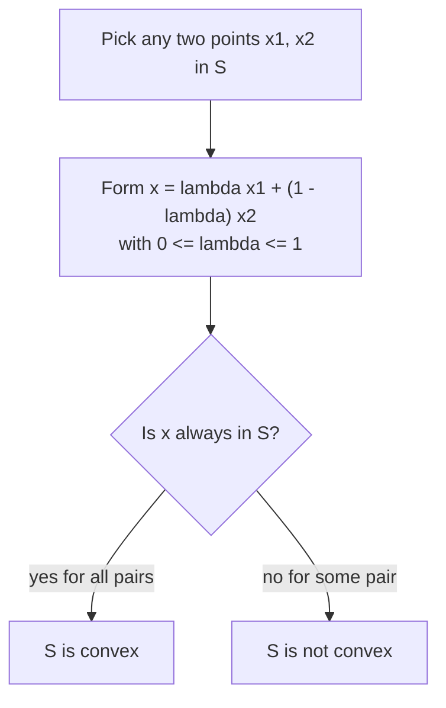

# Convexity and Unconstrained Optimization Basics

## What you will learn

- What a **convex set** is, how to test it, and which common sets are (or are not) convex
- How to check whether a point is a **convex linear combination** of other points, and why corner points matter in LPP
- What a **convex function** is, and the second-derivative and Hessian tests for convexity
- What **unconstrained optimization** means and why convexity guarantees a global minimum
- Stationary points, the second derivative test, gradient, directional derivative, and the Hessian with positive (semi-)definiteness

---

## 1. Notation: Points and Vectors in $\mathbb{R}^n$

**Simple idea:** $\mathbb{R}^n$ is just "lists of $n$ real numbers"; each list is a point in $n$-dimensional space.

**Analogy:** A GPS location is a list of 2 numbers (latitude, longitude) - a point in $\mathbb{R}^2$. Adding altitude gives 3 numbers - a point in $\mathbb{R}^3$.

| Symbol | Meaning | Example |
|---|---|---|
| $x \in \mathbb{R}$ | a single real number | $2,\ 4.6,\ \pi$ |
| $x \in \mathbb{R}^2$ | a pair $(x_1, x_2)$ | $(3, -1)$ |
| $x \in \mathbb{R}^3$ | a triple $(x_1, x_2, x_3)$ | $(1,\ 1.2,\ 5)$ |
| $x \in \mathbb{R}^n$ | $n$ real components | decision vector of an LPP with $n$ variables |

A **set** $S \subseteq \mathbb{R}^n$ is any collection of such points.

---

## 2. Convex Sets

**Simple idea:** A set is convex if, whenever you pick two points inside it, the straight line between them never leaves the set.

**Analogy:** A round pizza is convex - any straight cut between two points on it stays on the pizza. A pizza with a bite taken out, or a star-shaped cookie, is not: a line between two points can cross the "missing" part.

### Precise definition

Take any two points $x_1, x_2 \in S$. A point of the form

$$x = \lambda_1 x_1 + \lambda_2 x_2,\qquad \lambda_1,\lambda_2 \ge 0,\quad \lambda_1+\lambda_2 = 1$$

is a **convex linear combination** of $x_1, x_2$. Writing $\lambda_1=\lambda$ and $\lambda_2=1-\lambda$ with $\lambda\in[0,1]$:

$$x_\lambda = \lambda x_1 + (1-\lambda)x_2 .$$

As $\lambda$ goes from $1$ to $0$, $x_\lambda$ slides along the segment from $x_1$ to $x_2$.

**$S$ is convex** if for every $x_1,x_2\in S$ and every $\lambda\in[0,1]$, $x_\lambda\in S$.

Steps to test convexity:
1. Pick two points of $S$.
2. Form $\lambda x_1+(1-\lambda)x_2$ (try $\lambda=\tfrac12$ first).
3. If the result is ever outside $S$, $S$ is **not** convex (one counter-example is enough).
4. To prove convexity you must show it for **all** pairs and all $\lambda$ (a general argument, not examples).

### Shapes
- Filled disc, filled rectangle, filled triangle, lines, planes: convex.
- Star shape, crescent/"C" shape, a shape with a dent or hole: **not** convex (some segment leaves the set).

### Example A: The unit circle is NOT convex

The unit circle is $S=\{(x_1,x_2): x_1^2+x_2^2=1\}$ - only the boundary, radius 1 around the origin.

- $(0,1)\in S$ since $0^2+1^2=1$; $(1,0)\in S$ since $1^2+0^2=1$.
- With $\lambda=\tfrac12$: $\tfrac12(1,0)+\tfrac12(0,1)=(\tfrac12,\tfrac12)$.
- Check: $\left(\tfrac12\right)^2+\left(\tfrac12\right)^2=\tfrac12\ne 1$, so the midpoint is **not** on the circle. Hence not convex.

### Example B: Removing one point destroys convexity

Take $\mathbb{R}^2$ minus the origin.
- $x_1=(1,0)$, $x_2=(-1,0)$ both lie in the set. With $\lambda=\tfrac12$: $\tfrac12(1,0)+\tfrac12(-1,0)=(0,0)$, which was removed. Not convex.
- The same trick works for removing any single point (choose two points whose midpoint is the removed point).

### Example C: The unit ball IS convex

**Unit circle vs unit ball:** the circle is only the boundary ($x_1^2+x_2^2=1$); the **unit ball** is boundary plus interior ($x_1^2+x_2^2\le1$, i.e., $\|x\|\le1$).

Proof: let $x,y$ be in the ball ($\|x\|\le1,\ \|y\|\le1$) and $\lambda\in[0,1]$. Let $w=\lambda x+(1-\lambda)y$. Using the triangle inequality $\|a+b\|\le\|a\|+\|b\|$ and homogeneity $\|c\,a\|=|c|\,\|a\|$:

$$\|w\|\le\lambda\|x\|+(1-\lambda)\|y\|\le\lambda\cdot1+(1-\lambda)\cdot1=1 .$$

So $w$ is in the ball; the unit ball is convex. (Expanding $w_1^2+w_2^2$ directly works but is long; the norm argument is the clean route.)

### Example D: A region between a curve and a line

$S=\{(x,y): \tfrac12\le y\le\sin x,\ 0\le x\le\pi\}$.
- $y\le \sin x$ is the region under a concave curve (on $[0,\pi]$), which is convex.
- $y\ge\tfrac12$ is a half-plane, convex.
- The shaded overlap is an intersection of convex sets, so it is convex. (General fact: the **intersection of convex sets is convex**.)

### Example E: The LPP feasible region is convex

$$F=\{x\in\mathbb{R}^n: Ax\le b,\ x\ge0\}.$$

Proof: take $x,y\in F$, $\lambda\in[0,1]$, $w=\lambda x+(1-\lambda)y$.

$$Aw=\lambda Ax+(1-\lambda)Ay\le\lambda b+(1-\lambda)b=b,$$

and $w\ge0$ because $\lambda,1-\lambda,x,y\ge0$. So $w\in F$.

### Other convex sets
- A **line** such as $4x+2y=3$, a **plane** in 3 variables, and in general any **hyperplane** is convex.

### Comparison

| Set | Convex? | Reason |
|---|---|---|
| Unit circle $x_1^2+x_2^2=1$ | No | midpoint of $(1,0),(0,1)$ is inside, not on the circle |
| Unit ball $x_1^2+x_2^2\le1$ | Yes | norm/triangle inequality |
| $\mathbb{R}^2\setminus\{0\}$ | No | midpoint of $(1,0),(-1,0)$ is the removed point |
| LPP feasible region | Yes | linearity of $A$ |
| Hyperplane / line | Yes | linear combination stays on it |
| Star, crescent | No | segments leave the shape |

**Caveat:** "Looks round and solid" is not a proof; a picture suggests convexity, the definition (or a closure rule such as intersection) proves it.

---

## 3. Convex Linear Combination: Checking a Point

**Simple idea:** Ask "is this point on the straight segment between the two given points?"

**Analogy:** Mixing two paints in proportions $\lambda$ and $1-\lambda$: you can only get colours "between" them, never beyond.

Steps:
1. Write $x=\lambda p+(1-\lambda)q$ (or $\lambda_1p+\lambda_2q$).
2. Solve component by component for $\lambda$.
3. Verify the answer is consistent in all components and $0\le\lambda\le1$ (all weights $\ge0$, summing to 1).

### Worked example 1: Is $(\tfrac13,\tfrac43)$ a convex combination of $(1,2)$ and $(0,1)$?

$$(\lambda,\ 2\lambda+(1-\lambda))=(\lambda,\ 1+\lambda).$$

- First coordinate: $\lambda=\tfrac13$.
- Second coordinate: $1+\lambda=\tfrac43\Rightarrow\lambda=\tfrac13$ (consistent).
- $\lambda=\tfrac13\in[0,1]$. Yes:

$$(\tfrac13,\tfrac43)=\tfrac13(1,2)+\tfrac23(0,1).$$

### Worked example 2: Is $(2,1)$ a convex combination of $(1,1)$ and $(-1,2)$?

Using $\lambda_1(1,1)+\lambda_2(-1,2)=(2,1)$:

$$\lambda_1-\lambda_2=2,\qquad \lambda_1+2\lambda_2=1\ \Rightarrow\ \lambda_2=-\tfrac13,\ \lambda_1=\tfrac53 .$$

$\lambda_2<0$ violates $\lambda\ge0$ (and $\lambda_1+\lambda_2=\tfrac43\ne1$), so **no**. (Indeed $(2,1)$ does not even lie on the line through the two points, so it is not an affine combination either.)

### Worked example 3: $(0,\tfrac32)$ from $(1,1)$ and $(-1,2)$

$\lambda=\tfrac12$: $\tfrac12(1,1)+\tfrac12(-1,2)=(0,\tfrac32)$. Yes.

### Key LPP result (corner-point representation)

> Every point of a **non-empty, bounded** LPP feasible region can be written as a convex combination of its corner points (vertices).

$$x=\lambda_1v_1+\lambda_2v_2+\dots+\lambda_kv_k,\qquad \lambda_i\ge0,\ \sum_i\lambda_i=1 .$$

For a triangle with corners $v_1,v_2,v_3$, any interior point is a weighted blend of those three corners.

**Why it matters:** a linear objective over such a region is a weighted average of its values at corners, so its best value is attained at a corner - the reason the simplex method only needs to examine corner points.

**Caveat:** the statement needs the region to be bounded (unbounded regions also need extreme "directions").

---

## 4. Convex and Concave Functions

**Simple idea:** A function is convex if its graph is "bowl-shaped": the curve always sits **below** any straight chord drawn between two of its points.

**Analogy:** A hanging hammock/bowl: a stretched string across the top of the bowl always lies above the bowl's surface. A hill (cap shape) is the opposite: concave.

### Definition

$f$ is **convex** on an interval $[a,b]$ if for every $\lambda\in[0,1]$:

$$f\big(\lambda a+(1-\lambda)b\big)\ \le\ \lambda f(a)+(1-\lambda)f(b).$$

- Left side: the function's value at the point $x_\lambda=\lambda a+(1-\lambda)b$ between $a$ and $b$.
- Right side: the height of the chord joining $(a,f(a))$ and $(b,f(b))$ at that same $x_\lambda$.
- With $\lambda=\tfrac12$: $f\!\left(\tfrac{a+b}2\right)\le\tfrac{f(a)+f(b)}2$ (function at the midpoint is at most the average of the end values).
- With $\lambda=\tfrac13$: $x_\lambda=\tfrac13a+\tfrac23b$, a point one-third of the way from $b$ toward $a$.

**Concave:** the inequality reverses ($\ge$), i.e., the curve lies **above** its chords.

**Neither:** if the graph lies below the chord for some pairs and above for others, it is neither convex nor concave (it may be convex in parts and concave in other parts). Convexity must hold for **all** pairs of points and all $\lambda$.

### Second-derivative test (1 variable)

| Condition on $f''(x)$ over the whole domain | Conclusion |
|---|---|
| $f''(x)\ge0$ everywhere | convex |
| $f''(x)\le0$ everywhere | concave |
| changes sign | neither (e.g., $x^3$ with $f''=6x$; $\sin x$) |

Double derivative measures **curvature**: positive = bends upward (bowl), negative = bends downward (cap).

Examples:
- $f(x)=x^2$: $f'=2x$, $f''=2\ge0$, convex.
- $f(x)=\sqrt{1-x^2}$ on $(-1,1)$: $f''<0$ throughout, so it is concave.
- $x^3$: $f''=6x$ is negative for $x<0$, positive for $x>0$: neither.
- $\sin x$: neither (on its full domain).

### Standard convex functions
$x^2,\ x^4,\ e^x,\ |x|,\ -\ln x$ (for $x>0$). They play a central role in optimization.

### Higher dimensions: the Hessian test

For $f:\mathbb{R}^n\to\mathbb{R}$, $f$ is convex if its **Hessian matrix** (matrix of second partial derivatives, Section 10) is **positive semi-definite** everywhere. Practical test: compute the eigenvalues of the Hessian; all $\ge0$ means convex. Bowl-shaped surfaces such as $x_1^2+x_2^2$ and $(x_1+x_2)^2$ are convex.

---

## 5. What Is Unconstrained Optimization?

**Simple idea:** Find the input that gives the smallest (or largest) output of a function, with no rules restricting which inputs you may use.

**Analogy:** Finding the lowest point of a valley when you may walk anywhere, with no fences. In an LPP you had fences (constraints); here there are none.

$$\min_{x\in\mathbb{R}^n} f(x)\qquad\text{(or }\max\text{)}$$

- $x$ = decision variable(s); $f$ = objective function.
- No equality or inequality constraints on $x$.
- **$\arg\min$** returns the **location** $x^*$ of the minimum; the minimum **value** is $f(x^*)$.

### Worked example

$f(x)=(x-2)^2+1$, a parabola.
- $(x-2)^2\ge0$, so $f(x)\ge1$ with equality only at $x=2$.
- $x^*=\arg\min f=2$; minimum value $f(x^*)=1$; the minimum point is $(2,1)$.
- For $f(x_1,x_2)=x_1^2+x_2^2$ the global minimum value is $0$, attained at $(0,0)$.

| Item | Constrained (LPP) | Unconstrained |
|---|---|---|
| Constraints | $Ax\le b$, $x\ge0$ | none |
| Typical objective | linear | nonlinear (often convex) |
| Where the optimum lies | at a corner | where gradient is zero |

---

## 6. Local vs Global Optima and Why Convexity Matters

**Simple idea:** A local minimum is the bottom of **a** valley; the global minimum is the bottom of **the deepest** valley. You want the deepest.

**Analogy:** A ball rolling downhill in hilly terrain stops in the nearest dip, not necessarily the lowest dip in the country.

### Definitions
- $x^*$ is a **local minimum** if $f(x^*)\le f(x)$ for all $x$ **near** $x^*$ (in some neighbourhood).
- $x^*$ is a **global minimum** if $f(x^*)\le f(x)$ for **all** $x$ in the domain.
- Local/global **maximum**: reverse the inequality.
- Optimum (extremum) = minimum or maximum. In optimization we want the **global** one.

A graph with two dips at $x_1$ and $x_2$: both are local minima, but only the lower one ($x_2$) is the global minimum. Similarly the peaks $y_1,y_2$: one is merely local, the highest is global.

### Why convex functions are "nice"

For a convex function **every local minimum is a global minimum**. So there are no false valleys - one bowl, one bottom. (Precision: a convex function can have a flat floor with many equally good minimisers, or no minimum at all, e.g. $e^x$; but it never has a local minimum that is not global. A strictly convex function has at most one minimiser.)

### Non-convex functions and getting stuck

A descent algorithm moves to a nearby point with lower $f$ and stops when no neighbouring step improves. On a non-convex function it can stop in a **local minimum**, never discovering the deeper global one. It "thinks" it is done because $f(x)\le f(x_{\text{next}})$ in every nearby direction.

**Deep learning link:** neural network loss landscapes are non-convex with many local minima. Remedies such as **momentum** add "velocity" to push the ball through shallow dips. In practice you rarely prove global optimality; you accept a solution whose loss is within a small $\epsilon$ of the best, which is why training needs many iterations (epochs).

| Property | Convex $f$ | Non-convex $f$ |
|---|---|---|
| Local minimum = global? | Yes | Not necessarily |
| Descent algorithm | reliably reaches the optimum | can stall at a local minimum |
| Example | $x^2,\ e^x,\ |x|$ | deep network loss, $\sin x$ |

---

## 7. Stationary (Critical) Points

**Simple idea:** A point where the curve is momentarily flat - the tangent line is horizontal.

**Analogy:** The top of a hill, the bottom of a valley, or a flat ledge on a slope: all have zero slope.

**Definition:** $x^*$ is a **stationary (critical) point** of $f$ if $f'(x^*)=0$.

Steps:
1. Compute $f'(x)$.
2. Solve $f'(x)=0$ to get candidates.
3. Classify each candidate (Section 8).

Example: $f(x)=x^2\Rightarrow f'(x)=2x=0\Rightarrow x=0$ is stationary. For $x^3$ also $f'(x)=3x^2=0$ at $x=0$, but this stationary point is **not** a min or max.

**Caveat:** Stationary is only a candidate. A zero slope can be a minimum, a maximum or an inflection (saddle) point.

---

## 8. Second Derivative (Curvature) Test

**Simple idea:** After finding a flat point, check whether the curve bends up (bowl: minimum) or down (cap: maximum).

At a stationary point $x^*$:

| $f''(x^*)$ | Curvature | Conclusion |
|---|---|---|
| $>0$ | positive (bowl) | local minimum |
| $<0$ | negative (cap) | local maximum |
| $=0$ | flat/unknown | **test inconclusive** |

Worked example: $f(x)=x^2$: $f'=2x$, stationary at $0$; $f''=2>0$, so a minimum. For $f(x)=(x-2)^2+1$: $f'=2(x-2)=0\Rightarrow x=2$; $f''=2>0$, minimum at $2$ with value $1$.

### When $f''(x^*)=0$

Three look-alike cases, all with $f'(0)=0$ and $f''(0)=0$:

| Function | At $x=0$ | Why |
|---|---|---|
| $x^4$ | minimum | $f\ge0$ on both sides |
| $-x^4$ | maximum | $f\le0$ on both sides |
| $x^3$ | **neither** (inflection / saddle-type point) | $f'$ has the same sign on both sides; curve flattens then keeps rising |

Then further analysis is needed: check the **sign of $f'$ on each side** of $x^*$ (negative to positive means min; positive to negative means max; no sign change means inflection point), or higher-order derivatives.

---

## 9. Gradient and Directional Derivative

### 9.1 Gradient

**Simple idea:** The gradient is an arrow that points straight uphill, as steeply as possible; its length says how steep.

**Analogy:** Standing on a hillside, the gradient points the way water would **not** flow - toward the summit. Water flows along $-\nabla f$.

For $f:\mathbb{R}^n\to\mathbb{R}$:

$$\nabla f(x)=\left(\frac{\partial f}{\partial x_1},\frac{\partial f}{\partial x_2},\dots,\frac{\partial f}{\partial x_n}\right).$$

**Worked example:** $f(x,y)=x^2+2y^2$.
- $\partial f/\partial x=2x$, $\partial f/\partial y=4y$, so $\nabla f=(2x,4y)$.
- At $(1,1)$: $\nabla f(1,1)=(2,4)$, and $f(1,1)=1+2=3$.

**Level curves (contours):** slicing the surface at constant height and projecting to 2D gives nested closed curves (here ellipses). The gradient at a point is perpendicular to the contour through it and points toward increasing $f$.

- $\nabla f$ = direction of **steepest ascent**.
- $-\nabla f$ = direction of **steepest descent** (the basis of gradient-descent methods).

**Optimality condition:** 1-D: solve $f'(x)=0$. Multi-D: solve $\nabla f(x)=0$ (a system of equations, one per variable). Solutions are the **stationary points**; the Hessian is then used to classify them.

### 9.2 Directional derivative

**Simple idea:** The rate of change of $f$ if you walk in a chosen direction, not just along the axes.

- $\partial f/\partial x=\nabla f\cdot\mathbf{i}$ (direction of the $x$-axis), $\partial f/\partial y=\nabla f\cdot\mathbf{j}$ (the $y$-axis).
- For any direction vector $v\neq0$, first **normalise** it to a unit vector $u=v/\|v\|$, then

$$D_uf(x)=\nabla f(x)\cdot u .$$

**Worked example:** $f=x^2+2y^2$ at $(1,1)$ in direction $v=(3,4)$.
1. $\nabla f(1,1)=(2,4)$.
2. $\|v\|=\sqrt{9+16}=5$, so $u=(\tfrac35,\tfrac45)$.
3. $D_uf=2\cdot\tfrac35+4\cdot\tfrac45=\tfrac65+\tfrac{16}5=\tfrac{22}5=4.4$.

Interpretation:

| $D_uf$ | Meaning |
|---|---|
| $>0$ | $f$ increases in that direction |
| $<0$ | $f$ decreases |
| $=0$ | no first-order change |

**Trap:** skipping normalisation gives a result scaled by $\|v\|$ (here $22$ instead of $4.4$).

---

## 10. Positive Definite Matrices and the Hessian

### 10.1 Definiteness

**Simple idea:** A positive definite matrix describes a perfect bowl: moving away from the centre in **any** direction makes the value go up.

**Requirements:** the matrix $A$ must be **real** and **symmetric** ($A^T=A$).

| Type | Quadratic form $v^TAv$ | Eigenvalues | Surface shape |
|---|---|---|---|
| Positive definite (PD) | $>0$ for all $v\ne0$ | all $>0$ | bowl rising in every direction |
| Positive semi-definite (PSD) | $\ge0$ for all $v$ | all $\ge0$ | bowl with possible flat directions, touching 0 at more than the origin |
| Negative definite | $<0$ for all $v\ne0$ | all $<0$ | upside-down bowl |
| Negative semi-definite | $\le0$ | all $\le0$ | upside-down with flat directions |

Example: $A=I$ gives $v^TAv=a^2+b^2$ for $v=(a,b)$, which is $>0$ whenever $(a,b)\ne(0,0)$ (a paraboloid), so $I$ is PD.

### 10.2 Hessian matrix

**Simple idea:** The Hessian is the multi-variable version of $f''$: it records how the curvature behaves in every direction.

$$H(x)=\nabla^2f(x)=\begin{bmatrix}f_{xx}&f_{xy}\\ f_{yx}&f_{yy}\end{bmatrix}.$$

For smooth (continuous second partial derivatives) functions $f_{xy}=f_{yx}$, so $H$ is symmetric. If the function is not smooth these can differ and the symmetry cannot be assumed.

### Second-order optimality (multi-D)

At a stationary point $x^*$ ($\nabla f(x^*)=0$):

| Hessian $H(x^*)$ | Conclusion |
|---|---|
| Positive definite | strict local minimum |
| Negative definite | strict local maximum |
| Indefinite (mixed signs) | saddle point |
| PSD / NSD with a zero eigenvalue | inconclusive; further analysis |

If $H(x)$ is PSD **everywhere**, $f$ is convex.

### Worked example

$f(x,y)=x^2+xy+y^2$.
1. Gradient: $\nabla f=(2x+y,\ x+2y)$. Setting to zero: $2x+y=0,\ x+2y=0\Rightarrow(x,y)=(0,0)$.
2. Hessian: $f_{xx}=2,\ f_{xy}=f_{yx}=1,\ f_{yy}=2$:
$$H=\begin{bmatrix}2&1\\1&2\end{bmatrix}.$$
3. Eigenvalues from $\det(H-\mu I)=(2-\mu)^2-1=0\Rightarrow\mu=1,3$.
4. Check: sum $=1+3=4=\operatorname{trace}(H)=2+2$; product $=1\cdot3=3=\det(H)=4-1$.
5. Both eigenvalues $>0$, so $H$ is positive definite: $(0,0)$ is a **strict local minimum**, and since $H$ is constant and PD, $f$ is convex so it is the global minimum (value $0$).

**Eigenvalue shortcuts (2x2 and beyond):** sum of eigenvalues = trace; product of eigenvalues = determinant. Use these to verify your eigenvalues.

Another example: $f=(x_1+x_2)^2$ has Hessian $\begin{bmatrix}2&2\\2&2\end{bmatrix}$ with eigenvalues $0$ and $4$: PSD but not PD, so $f$ is convex (but its minimum is not unique - every point with $x_1+x_2=0$ attains $0$).

---

## Self-Check Questions

1. **Is the unit circle convex? Why or why not?**
   No. $(1,0)$ and $(0,1)$ lie on it, but their midpoint $(\tfrac12,\tfrac12)$ has $x_1^2+x_2^2=\tfrac12\ne1$.

2. **Show the LPP feasible region $\{Ax\le b,\ x\ge0\}$ is convex.**
   For $w=\lambda x+(1-\lambda)y$: $Aw=\lambda Ax+(1-\lambda)Ay\le b$ and $w\ge0$.

3. **Is $(2,1)$ a convex combination of $(1,1)$ and $(-1,2)$?**
   No; solving gives a negative weight ($\lambda_2=-\tfrac13$), violating $\lambda\ge0$.

4. **Why do we prefer convex functions in optimization?**
   Every local minimum is a global minimum, so descent algorithms do not get stuck in false valleys.

5. **Find and classify the stationary point of $f(x)=(x-2)^2+1$.**
   $f'=2(x-2)=0\Rightarrow x=2$; $f''=2>0$, so a minimum with value $1$.

6. **Compute the directional derivative of $x^2+2y^2$ at $(1,1)$ along $(3,4)$.**
   $\nabla f=(2,4)$, $u=(\tfrac35,\tfrac45)$, so $D_uf=\tfrac{22}5=4.4$.

7. **What does the Hessian of $x^2+xy+y^2$ tell you?**
   $H=\begin{bmatrix}2&1\\1&2\end{bmatrix}$ has eigenvalues $1,3>0$, so it is positive definite: strict local (here global) minimum at the origin.

8. **What can you conclude if $f'(x^*)=0$ and $f''(x^*)=0$?**
   Nothing directly; it may be a min ($x^4$), max ($-x^4$) or inflection ($x^3$). Check the sign of $f'$ on both sides.

---

## Common Pitfalls / Exam Traps

- Calling the **unit circle** convex: the circle is only the boundary; the **unit ball** (filled) is convex.
- Believing a set missing even one point stays convex: it does not.
- Proving convexity from one example: one counter-example disproves convexity, but proof needs all points.
- Convex combination weights must be **non-negative and sum to 1**; a negative weight (e.g., $\lambda_2=-\tfrac13$) means the point is not a convex combination.
- Mixing up convex ($f(x_\lambda)\le$ chord) and concave (reverse).
- $f''\ge0$ at one point is not convexity; it must hold throughout the domain. $x^3$ and $\sin x$ are neither convex nor concave.
- $f'(x^*)=0$ does not imply min or max ($x^3$ at $0$ is an inflection point).
- $f''(x^*)=0$ makes the second derivative test inconclusive ($x^4$, $-x^4$, $x^3$ all give $0$ but behave differently).
- Forgetting to **normalise** the direction vector before a directional derivative.
- $\arg\min$ gives the minimiser, not the minimum value.
- Hessian definiteness tests require a symmetric matrix; PSD allows zero eigenvalues while PD does not.

---

## Quick Revision Summary

- Convex set: for all $x_1,x_2\in S$ and $\lambda\in[0,1]$, $\lambda x_1+(1-\lambda)x_2\in S$. Convex: unit ball, hyperplanes, LPP feasible region. Not convex: unit circle, sets with a point removed, stars.
- Convex linear combination: weights $\ge0$ summing to 1. Every point of a bounded LPP feasible region is a convex combination of its corner points.
- Convex function: $f(\lambda a+(1-\lambda)b)\le\lambda f(a)+(1-\lambda)f(b)$; test with $f''\ge0$ (1-D) or PSD Hessian (multi-D). Concave reverses the inequality.
- Unconstrained optimization: $\min_{x\in\mathbb{R}^n}f(x)$ with no constraints; $\arg\min$ gives the minimiser (for $(x-2)^2+1$: $x^*=2$, value $1$).
- For convex $f$, any local minimum is global; non-convex functions (e.g., deep-learning losses) trap algorithms in local minima.
- Stationary point: $f'(x)=0$ (or $\nabla f=0$). Second derivative test: $f''>0$ min, $f''<0$ max, $f''=0$ inconclusive ($x^4$, $-x^4$, $x^3$).
- Gradient points to steepest ascent, $-\nabla f$ to steepest descent; directional derivative $=\nabla f\cdot u$ with $u$ a unit vector.
- Hessian PD (all eigenvalues $>0$) at a stationary point means a strict local minimum; sum of eigenvalues = trace, product = determinant. Example: $x^2+xy+y^2$ has eigenvalues 1 and 3.

---

**← [Previous](../week-05/02-sensitivity-analysis-recap-and-convexity-foundations-makeup-transcript.md) · [Index](../README.md) · [Next](../week-07/01-gradient-descent-for-fitting-a-line-transcript.md) →**
