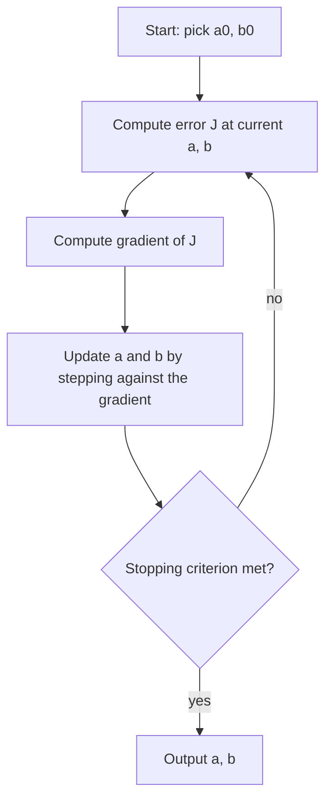

# Gradient Descent for Fitting a Line

## What you will learn

- Why analytical (closed-form) solutions are replaced by iterative methods for large or complex problems
- How fitting a straight line $\hat y = ax + b$ becomes a minimisation problem over $(a, b)$
- How the squared-error cost (MSE) is built, and why squaring makes it convex
- How to compute the gradient, apply the update rule, and run gradient descent by hand
- How the learning rate, stopping criteria and starting point affect convergence
- How to read contour (level-curve) plots and why the negative gradient points downhill

---

## 1. Analytical vs Iterative Methods

**Simple idea:** an analytical method is a formula that jumps straight to the answer; an iterative method starts with a guess and keeps improving it until improvement stops.

**Analogy:** finding the lowest point of a valley. Analytical: read the exact coordinates off a map. Iterative: stand somewhere blindfolded, feel which way the ground slopes down, take a step, and repeat.

### The optimisation problem

We want to **minimise** (or maximise) a function $f(\mathbf{x})$, where $\mathbf{x}$ is generally an $n$-dimensional vector: find the $\mathbf{x}$ at which $f(\mathbf{x})$ is as small as possible. With no restrictions on $\mathbf{x}$ this is **unconstrained optimisation**.

### Analytical (closed-form) method: second derivative test (one variable)

1. Compute $f'(x)$.
2. Set $f'(x) = 0$ and solve; the solutions are the **critical points**.
3. Compute $f''(x)$ at each critical point.
4. If $f''>0$ the point is a **minimum**; if $f''<0$ it is a **maximum**.

**Worked example.** $f(x) = x^3 - 3x$.

- $f'(x) = 3x^2 - 3 = 0 \Rightarrow x = \pm 1$.
- $f''(x) = 6x$. At $x=1$: $f''=6>0$, local minimum. At $x=-1$: $f''=-6<0$, local maximum.

This direct "set derivative to zero and solve" is called a **closed-form** or **analytical solution**.

### When it fails: iterative methods

For simple functions, the analytical route is exact and fast. For complicated functions (typical of machine learning, with huge datasets and many parameters) you cannot set the derivative to zero and solve it by hand. An **iterative method** instead:

1. Starts from some initial guess.
2. Evaluates the function (and its derivative or **gradient**).
3. Improves the guess using a rule that involves the gradient.
4. Repeats, and stops when nothing further can be gained (a stopping criterion you must define).

| Aspect | Analytical method | Iterative method |
|---|---|---|
| Idea | Differentiate, set to zero, solve once | Start, evaluate, improve, repeat |
| Accuracy | Exact | Approximate (to a tolerance) |
| Speed | Fast for simple functions | Scales to large data |
| Suitable for | Simple functions | Complex objectives, machine learning, large datasets |
| Needs stopping rule | No | Yes |

**Simplification gap:** for simple linear regression a closed-form answer (the normal equations) does exist, and it is the reason the toy problem below can be checked exactly. It becomes impractical when data and parameters are very large, and it does not exist for most models used in machine learning, which is why gradient descent is the general tool.

---

## 2. Setting Up the Problem: Fitting a Straight Line

**Simple idea:** you have some known (size, price) pairs and want a rule that predicts the price for a size you have never seen.

**Example.** $x$ = size of a house, $y$ = price (illustrative made-up numbers). A size of 0.8 has price 58 and a size of 1.0 has price 72, but there is no recorded price for a size of 1.1. A common practice is to **fit a straight line** through the points and read off the prediction.

### The line and its parameters

$$\hat y = a x + b$$

- $y$ is the **observed** value (from data); $\hat y$ ("y-hat") is the **predicted** value from the line.
- $a$ is the **slope**: it controls the orientation or direction of the line. Positive $a$: line rises left to right. $a = 0$: flat. Negative $a$: line falls.
- $b$ is the **y-intercept**: where the line crosses the $y$-axis. Changing $b$ moves the line up or down without changing its tilt.

**Fitting a line means finding the values of $a$ and $b$.** Nothing more.

### Preconditions

- Draw a **scatter plot** first. Fit a straight line only if the relationship looks **linear**. If the point cloud is curved (non-linear relationship), a line is the wrong model and a curve is needed.
- The line need not pass through every point; for each $x_i$ there is an observed $y_i$ and a predicted $\hat y_i$, and they usually differ.

### Many lines, one best line

Infinitely many lines can be drawn through a cloud of points: line 1 gives $(a_1,b_1)$, line 2 gives $(a_2,b_2)$, and so on. We want the **best fit**, so we need a way to score how bad each $(a,b)$ is. That score is the error.

---

## 3. The Four Ingredients of Gradient Descent

| Ingredient | What it does | In line fitting |
|---|---|---|
| **Cost (loss) function** $J(a,b)$ | Defines the goal; says how wrong the current $(a,b)$ is | Mean squared error |
| **Gradient** $\nabla J$ | Local information: how the cost changes if you nudge $a$ and $b$ | Partial derivatives w.r.t. $a$ and $b$ |
| **Learning rate** $\alpha$ (also $\eta$) | How big a step to take | A chosen constant, e.g. 0.05 |
| **Stopping criterion** | Decides when to end the iteration | Small change in parameters, small gradient norm, or max iterations |

### The iterative idea for the line

Start with a random guess, for example $a_0 = 0, b_0 = 0$ (the line $y = 0$, the $x$-axis, which is useless). Then use the previous guess to get the next:

$$(a_0,b_0) \to (a_1,b_1) \to (a_2,b_2) \to \dots$$

With each iteration the line moves closer to the data cloud until it fits well. This is gradient descent.

---

## 4. Building the Cost Function (MSE)

**Simple idea:** measure how far each point is from the line, make every miss count as a positive number, punish big misses extra, and average.

### Step by step

1. **Error at point $i$:** $e_i = y_i - \hat y_i = y_i - (a x_i + b)$.
2. **Why not just add the errors?** Points above the line give positive errors and points below give negative errors, so they can cancel to zero even for a bad fit.
3. **Square each error:** $e_i^2$. This removes sign cancellation and penalises large errors more.
4. **Add them:** the **sum of squared errors (SSE)** $=\sum_{i=1}^{n}(y_i - \hat y_i)^2$.
5. **Average:** the **mean squared error (MSE)**, also called the **loss function** or **cost function**:

$$J(a,b)=\frac{1}{n}\sum_{i=1}^{n}\bigl(y_i-(a x_i+b)\bigr)^2$$

Here $n$ is the number of data points; $x_i,y_i$ are known data, so the only unknowns are $a$ and $b$, which makes $J$ a **function of $a$ and $b$**. Different $(a,b)$ give different MSE values.

Some authors use $\frac{1}{2n}$ instead of $\frac1n$; the 2 only cancels the 2 that appears when differentiating the square. It changes the cost by a constant factor, not the location of the minimum.

### Worked example: four points

Data: $x = 1,2,3,4$ and $y = 10,20,30,40$. Then

$$J(a,b)=\tfrac14\bigl[(10-a-b)^2+(20-2a-b)^2+(30-3a-b)^2+(40-4a-b)^2\bigr].$$

Evaluate at $(a,b)=(0,0)$ (the flat line $y=0$):

$$J=\tfrac14(100+400+900+1600)=\tfrac{3000}{4}=750.$$

Evaluate at $(a,b)=(10,0)$: every prediction equals the observed value, so $J=0$, the minimum. (Here the data lie exactly on $y=10x$.)

**Why not solve $\partial J/\partial a = \partial J/\partial b = 0$ by hand?** It is solvable for four points, but with a million points and many parameters it is impractical; this motivates gradient descent.

### Why squaring matters: convexity

Squaring makes $J(a,b)$ a **quadratic (bowl-shaped) function**. A **convex** function has a single bowl with no separate valleys, so every local minimum is the **global minimum**.

- Simple and multiple linear regression always give a convex MSE, so gradient descent (with a suitable step size) reaches the global minimum.
- In deep learning the loss is generally **not convex**; there are local minima and saddle points, and other methods and tricks are needed.

**Simplification gap:** convexity of MSE holds for models linear in their parameters, as here. Squaring is chosen for sign removal, extra penalty on large errors and convexity; it also makes the loss sensitive to outliers.

---

## 5. Error Surface, Contours and the Hiker's Map

**Simple idea:** for every pair $(a,b)$, the height of a landscape at that spot is the cost $J(a,b)$. We want the lowest point of the bowl.

**Analogy:** a hiker on a hilly landscape wants to reach the valley floor; a topographic map shows height by lines.

- **Error (loss) surface:** the 3D plot of $J$ over the $(a,b)$ plane.
- **Contours / level curves / level sets:** slice the surface at a constant height $J = k$ and project to 2D. Each curve is the set of all $(a,b)$ with the same cost. For the surface $z = x^2+y^2$, cutting at $z = 3$ gives the circle $x^2+y^2=3$ (radius $\sqrt3$); more cuts give concentric circles.
- For the MSE of a line the contours are nested ellipses around the best $(a,b)$.
- Contour plots (the "hiker's map") make minima easy to see even when the 3D surface hides them. For example, a surface with two minima is hard to spot in 3D but obvious in its level curves; the same works for surfaces such as $\sin x \cos y$ or the 3D Gaussian $e^{-(x^2+y^2)}$.
- Gradient descent: start anywhere on the map and walk down towards the minimum.

---

## 6. The Gradient and the Update Rule

### Gradient of the MSE

Use $J(a,b)=\dfrac{1}{2n}\sum_{i=1}^n\bigl(y_i-a x_i-b\bigr)^2$ (the factor 2 cancels with the derivative of the square). Then, with $\hat y_i = a x_i + b$:

$$\frac{\partial J}{\partial a}=-\frac1n\sum_{i=1}^{n}x_i\,(y_i-\hat y_i),\qquad
\frac{\partial J}{\partial b}=-\frac1n\sum_{i=1}^{n}(y_i-\hat y_i).$$

The gradient is the vector $\nabla J=\bigl(\partial J/\partial a,\ \partial J/\partial b\bigr)$. (With the $\frac1n$ definition, both expressions are multiplied by 2; either way the minimum is the same, only the effective step size changes.)

### Direction of the gradient

- At any point, the **gradient points in the direction of steepest increase** of the surface (uphill). Moving along $+\nabla J$ is **gradient ascent**.
- The **negative gradient** points downhill. Moving along $-\nabla J$ is **gradient descent**.
- The gradient is perpendicular to the contour through that point.

### Update rule

$$a_{\text{new}}=a_{\text{old}}-\alpha\frac{\partial J}{\partial a},\qquad
b_{\text{new}}=b_{\text{old}}-\alpha\frac{\partial J}{\partial b}$$

In general, for a parameter vector $\mathbf{x}$ at iteration $k$:

$$\mathbf{x}_{k+1}=\mathbf{x}_k-\eta\,\nabla J(\mathbf{x}_k)$$

where $\alpha$ (or $\eta$) $>0$ is the learning rate. Both $a$ and $b$ must be updated **simultaneously** using the gradient computed at the old values.

### The algorithm

1. Choose a starting point $(a_0,b_0)$, a learning rate $\alpha$, and a stopping criterion.
2. Compute predictions $\hat y_i=a x_i+b$ and errors $y_i-\hat y_i$ for all points.
3. Compute $\partial J/\partial a$ and $\partial J/\partial b$.
4. Update $a$ and $b$ with the update rule.
5. Check the stopping criterion; if not met, return to step 2.

A simple implementation is a loop in Python: initialise `sum_a = sum_b = 0`, loop over the points accumulating $x_i(y_i-\hat y_i)$ and $(y_i-\hat y_i)$, then update.

### Fully worked example (two iterations)

Data $x=1,2,3,4$; $y=10,20,30,40$; start $(a_0,b_0)=(0,0)$; $\alpha=0.05$; cost $J=\frac1{2n}\sum(\cdot)^2$, $n=4$.

**Iteration 1** (at $a=0,b=0$): $\hat y=0,0,0,0$; errors $y-\hat y=10,20,30,40$.

| Quantity | Calculation | Value |
|---|---|---|
| $\sum x_i e_i$ | $10+40+90+160$ | 300 |
| $\sum e_i$ | $10+20+30+40$ | 100 |
| $\partial J/\partial a$ | $-300/4$ | $-75$ |
| $\partial J/\partial b$ | $-100/4$ | $-25$ |

$a_1 = 0 - 0.05(-75) = 3.75$, $b_1 = 0 - 0.05(-25)=1.25$.

**Iteration 2** (at $a=3.75,b=1.25$): $\hat y=5,\ 8.75,\ 12.5,\ 16.25$; errors $=5,\ 11.25,\ 17.5,\ 23.75$.

| Quantity | Calculation | Value |
|---|---|---|
| $\sum x_i e_i$ | $5+22.5+52.5+95$ | 175 |
| $\sum e_i$ | $5+11.25+17.5+23.75$ | 57.5 |
| $\partial J/\partial a$ | $-175/4$ | $-43.75$ |
| $\partial J/\partial b$ | $-57.5/4$ | $-14.375$ |

$a_2=3.75+0.05(43.75)=5.9375$, $b_2=1.25+0.05(14.375)=1.96875$.

**Cost check (MSE with $1/n$):** at $(0,0)$ it is 750; at $(3.75,1.25)$: $(25+126.5625+306.25+564.0625)/4=255.47$, a large drop. The line rotates up from the flat $y=0$ towards the data, and the cost keeps falling toward 0 at $(a,b)=(10,0)$.

### One-variable illustration

Minimise $f(x)=x^2$ (gradient $2x$), start $x_0=4$:

| $\eta$ | Update | Sequence | Behaviour |
|---|---|---|---|
| 0.1 | $x\leftarrow 0.8x$ | 4, 3.2, 2.56, ... | Smooth, slow convergence |
| 0.5 | $x\leftarrow 0$ | 4, 0 | Reaches minimum in one step |
| 1.0 | $x\leftarrow -x$ | 4, -4, 4, ... | Oscillates, never converges |
| 1.1 | $x\leftarrow -1.2x$ | 4, -4.8, 5.76, ... | Diverges |

---

## 7. Learning Rate

**Simple idea:** the learning rate is the stride length. Too small: a very long walk. Too large: you step across the valley and may fly out of it.

| Learning rate | Effect |
|---|---|
| Very small | Converges but needs many iterations |
| Good value | Quick, steady decrease of loss to the minimum |
| Large | Long jumps; may overshoot or bounce around the minimum |
| Too large (e.g. 1.5 in the demo) | **Diverges**: the loss explodes and $(a,b)$ never settle |

**Adaptive / decaying schedule.** The learning rate can be reduced as iterations proceed, for example $\alpha_t=\alpha/\sqrt t$. At the fifth iteration: $x_6 = x_5 - \dfrac{\alpha}{\sqrt5}\nabla J(x_5)$. How to set the learning rate is an active research topic.

**Caveat on how large is too large.** For a quadratic cost the largest safe step is $2/\lambda_{\max}$, where $\lambda_{\max}$ is the largest eigenvalue of the Hessian of $J$. In the four-point example with the $\frac1{2n}$ cost, the Hessian is $\begin{pmatrix}7.5&2.5\\2.5&1\end{pmatrix}$ with $\lambda_{\max}\approx 8.35$, so $\alpha$ must be below about $0.24$ to converge. This is why $\alpha = 0.05$ works but a value near 1 or more diverges. The right threshold depends on the data scale (x values, number of points), so a value that works on one dataset may diverge on another.

**Typical loss curve:** the loss starts very high, falls steadily, then flattens (stagnates). Once it is static, further iterations are wasted.

---

## 8. Stopping Criteria

You must define when to stop; otherwise the loop never ends. Common choices:

1. **Maximum number of iterations.**
2. **Small change in parameters:** $|a_{\text{new}}-a_{\text{old}}|<\varepsilon$ and $|b_{\text{new}}-b_{\text{old}}|<\varepsilon$ (for example $\varepsilon=0.01$).
3. **Small gradient norm:** $\lVert\nabla J\rVert<\varepsilon$, since the gradient is zero at the minimum.

**Worked example.** At iteration 20, $a_{20}=4.3,\ b_{20}=3.2$. At iteration 21, $a_{21}=4.3001,\ b_{21}=3.2001$. The changes are $0.0001<0.01$ for both, so the algorithm is no longer improving and stops.

**Starting point:** you can start at any $(a_0,b_0)$ and still converge on a convex bowl, but a start close to the minimum needs fewer iterations. In practice you do not know in advance whether you are close.

---

## 9. Gradient Descent vs Related Ideas

| Concept | Meaning |
|---|---|
| Gradient descent | Step along $-\nabla J$ to reduce $J$ |
| Gradient ascent | Step along $+\nabla J$ to increase $J$ |
| Analytical solution | Solve $\nabla J=0$ directly |
| Loss / cost / objective | Different names for the function minimised, here $J(a,b)$ |
| SSE vs MSE | SSE is the sum of squared errors; MSE is SSE divided by $n$ |

---

## Exam and Assessment Hints

- Be able to write the line $\hat y=ax+b$, state the role of $a$ (slope/orientation) and $b$ (y-intercept), and expand $J(a,b)$ for a small dataset like the four-point example.
- Be able to state the gradients with respect to $a$ and $b$, apply the update rule for one or two iterations with a given $\alpha$, and show the cost decreasing.
- Know the four ingredients (cost, gradient, learning rate, stopping criterion) and the three stopping options.
- Explain why squared errors are used (no cancellation, bigger errors penalised, convexity giving a global minimum).
- Explain what happens with too small, good and too large learning rates, and what a contour plot shows.

---

## Self-Check Questions

1. **What does "fitting a line" mean?** Finding the values of $a$ and $b$ in $\hat y=ax+b$ that give the best fit to the data.
2. **Why are errors squared before summing?** To stop positive and negative errors cancelling, to penalise larger errors more, and to make the cost convex.
3. **Why does a convex cost matter?** Every local minimum is the global minimum, so gradient descent cannot get trapped in a worse valley.
4. **Write the update rule.** $a_{\text{new}}=a_{\text{old}}-\alpha\,\partial J/\partial a$ and $b_{\text{new}}=b_{\text{old}}-\alpha\,\partial J/\partial b$, updated simultaneously.
5. **Which way does the gradient point?** Towards steepest increase of the surface; the minus sign in the update makes the step go downhill.
6. **What if $\alpha$ is too large?** The steps overshoot, the loss can oscillate or explode, and the algorithm diverges.
7. **Compute $J$ for $a=b=0$ on $x=(1,2,3,4),y=(10,20,30,40)$.** $(100+400+900+1600)/4=750$.
8. **Give two stopping criteria.** Parameter change below a tolerance (for example $0.01$), gradient norm below a tolerance, or a maximum number of iterations.

---

## Common Pitfalls / Exam Traps

- Fitting a line without first checking the scatter plot for a linear relationship.
- Updating $a$ and then using the new $a$ when computing the gradient for $b$; both must use the old values.
- Adding the gradient instead of subtracting it (that is gradient ascent).
- Forgetting that the $\frac1n$ versus $\frac1{2n}$ convention changes the gradient by a factor of 2, and so the effective learning rate.
- Assuming a bigger learning rate is always faster; beyond a threshold the method diverges.
- Believing gradient descent always finds a global minimum; this holds for convex costs like linear-regression MSE, not for deep learning losses.
- Having no stopping criterion, or setting it so loose that the algorithm stops far from the minimum.
- Confusing observed $y$ with predicted $\hat y$, and the sign of the error $y-\hat y$ with $\hat y - y$ (squaring hides the sign of the error, but the gradient sign convention depends on it).

---

## Quick Revision Summary

- Analytical methods set the derivative to zero and solve exactly; they fail or are impractical for complex, large problems.
- Iterative methods start with a guess, evaluate, improve and repeat until a stopping rule is met.
- Line fitting = find $a$ (slope) and $b$ (intercept) in $\hat y=ax+b$; check linearity with a scatter plot first.
- Cost $J(a,b)=\frac1n\sum(y_i-ax_i-b)^2$ (MSE); squaring avoids cancellation, penalises big errors and gives a convex bowl with a global minimum.
- Gradients: $\partial J/\partial a=-\frac1n\sum x_i(y_i-\hat y_i)$ and $\partial J/\partial b=-\frac1n\sum(y_i-\hat y_i)$ (for the $\frac1{2n}$ cost).
- Update: $\theta_{k+1}=\theta_k-\alpha\nabla J(\theta_k)$; the gradient points uphill, so subtract it.
- Learning rate: too small is slow, too large overshoots or diverges; decaying schedules such as $\alpha/\sqrt t$ exist.
- Stop on max iterations, tiny parameter change, or tiny gradient norm.
- Contour plots show the loss landscape as level curves; descent follows the negative gradient across them towards the minimum.

---

**← [Previous](../week-06/01-convexity-and-unconstrained-optimization-basics-transcript.md) · [Index](../README.md) · [Next](../week-08/01-newtons-method-for-unconstrained-optimization-transcript.md) →**
