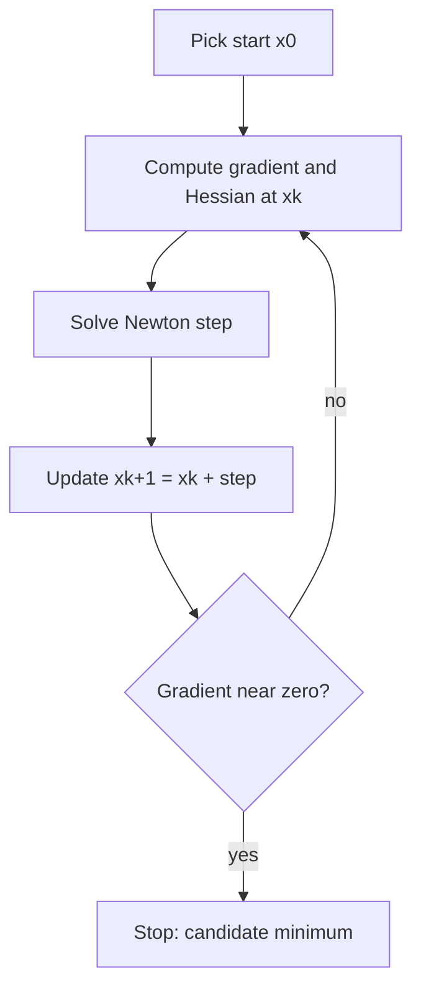

# Newton's Method for Unconstrained Optimization

## What you will learn

- How a second-order Taylor expansion turns "find the minimum" into "solve $f'(x)=0$"
- The Newton update in one dimension and in $n$ dimensions (gradient and Hessian)
- Damped Newton steps (step size $\gamma$) and when full steps fail
- Worked examples: cubic, quadratic, quartic, Rosenbrock, and a non-convex case
- Linear versus quadratic convergence and what "digits double" means
- How to check Hessian definiteness (PSD / PD) with simple tests

---

## 1. The Big Idea: Replace the Curve by a Parabola

**Simple idea:** Standing on a hilly curve, pretend the ground near you is a perfect bowl (parabola), jump straight to the bottom of that bowl, then repeat.

**Analogy:** You are in a dark valley with a torch that only shows slope and curvature right under your feet. From those two facts you guess where the valley floor is, walk there, and re-measure.

### Taylor expansions around a point

For a function $f$ near a point $x_k$:

- **First-order (linear) approximation:** a straight line, the **tangent** with slope $f'(x_k)$.
- **Second-order (quadratic) approximation:** a **parabola** that also matches the **curvature** $f''(x_k)$.

Example: for $f(x)=x^3-x$ expanded about $x=1$, you compute $f'(1)$ and $f''(1)$. The first-order model is a line, the second-order model is a parabola hugging the curve much more closely.

### The problem setting

$$\min_{x\in\mathbb{R}^n} f(x), \qquad f:\mathbb{R}^n\to\mathbb{R}$$

**Assumption:** $f$ is **twice continuously differentiable** (first and second derivatives exist and are continuous).

**Necessary condition for a local minimum $x^*$:**
$$\nabla f(x^*)=0$$

Newton's method is simply an iterative way to **solve $\nabla f(x)=0$** (it is the Newton-Raphson root-finding idea applied to $f'$).

---

## 2. Deriving the 1-D Newton Step

1. Pick any starting point $x_0$ (free choice).
2. At the current point $x_k$, write the next point as $x_{k+1}=x_k+t$.
3. Use the second-order Taylor model in the step $t$:
$$f(x_k+t)\approx f(x_k)+f'(x_k)\,t+\tfrac12 f''(x_k)\,t^2$$
   - $f(x_k)$ = height, $f'(x_k)$ = slope, $f''(x_k)$ = curvature.
4. This is a parabola in $t$. If $f''(x_k)>0$ it opens **upward** and has a minimum. Set its derivative in $t$ to zero:
$$f'(x_k)+f''(x_k)\,t=0 \;\Rightarrow\; t=-\frac{f'(x_k)}{f''(x_k)}$$
5. Update:
$$\boxed{x_{k+1}=x_k-\frac{f'(x_k)}{f''(x_k)}}$$

**Damped (modified) version:** $x_{k+1}=x_k-\gamma\,\dfrac{f'(x_k)}{f''(x_k)}$ with $\gamma\in(0,1]$ (also written $\alpha$).

- $\gamma=1$: **full Newton step**.
- $\gamma<1$: **damped Newton**, e.g. $\gamma=\tfrac12$ takes half a Newton step.
- If the full step does not reduce $f$ enough, shrink $\gamma$ using a rule such as the **Armijo (sufficient decrease) check**. $\gamma$ plays the role of the **learning rate** in gradient descent.

---

## 3. Worked Example 1: Cubic in One Dimension

$$f(x)=x^3-6x^2+9x+2$$

**Find the true minimum first (check):**
- $f'(x)=3x^2-12x+9=3(x-1)(x-3)$, so critical points $x=1$ and $x=3$.
- $f''(x)=6x-12$. At $x=1$: $f''=-6<0$ (local **maximum**). At $x=3$: $f''=6>0$ (local **minimum**), $f(3)=2$.

**Newton from $x_0=4$** ($f(4)=6$):

| $k$ | $x_k$ | $f'(x_k)$ | $f''(x_k)$ | $x_{k+1}=x_k-f'/f''$ |
|---|---|---|---|---|
| 0 | 4 | $48-48+9=9$ | 12 | $4-0.75=3.25$ |
| 1 | 3.25 | $31.6875-39+9=1.6875$ | 7.5 | $3.25-0.225=3.025$ |
| 2 | 3.025 | $0.151875$ | 6.15 | $3.025-0.0247=3.000305$ |

Errors $|x_k-3|$: $1,\;0.25,\;0.025,\;0.000305$. Matching correct digits go roughly $0\to1\to2\to3$ (the accuracy is improving very fast). This is **quadratic convergence** (Section 8).

---

## 4. Extension to $n$ Dimensions

**Simple idea:** Same trick, but "slope" becomes the gradient vector and "curvature" becomes the Hessian matrix.

- $f'(x)\to\nabla f(x)$ (gradient, vector of partial derivatives)
- $f''(x)\to H(x)=\nabla^2 f(x)$ (**Hessian**, matrix of second partial derivatives)

You cannot "divide by a matrix", so you multiply by its **inverse**. Dividing by $f''$ becomes multiplying by $H^{-1}$:

$$\boxed{x_{k+1}=x_k-\gamma\,H(x_k)^{-1}\nabla f(x_k)}$$

with $\gamma=1$ for the full Newton step. Define the **Newton direction** $p_k=-H(x_k)^{-1}\nabla f(x_k)$ so that $x_{k+1}=x_k+p_k$.

**2x2 inverse (needed in every exercise):**
$$\begin{pmatrix}a&b\\c&d\end{pmatrix}^{-1}=\frac{1}{ad-bc}\begin{pmatrix}d&-b\\-c&a\end{pmatrix}$$
(swap the diagonal, negate the off-diagonal, divide by the determinant).

### Steps of Newton's method (n-D)

1. Choose $x_0$ (and tolerance).
2. Compute $\nabla f(x_k)$ and $H(x_k)$.
3. Compute $H(x_k)^{-1}$ (or solve $H p=-\nabla f$).
4. Set $x_{k+1}=x_k-\gamma H^{-1}\nabla f$ (use $\gamma=1$ unless damping is needed).
5. Repeat until $\|\nabla f(x_k)\|$ is small.

---

## 5. Hessian Definiteness (PSD / PD) Quick Tests

**Simple idea:** The Hessian tells you if the surface is a bowl (curves up), a dome, or a saddle.

For a symmetric Hessian $H$:
- **Positive semi-definite (PSD):** all eigenvalues $\ge 0$.
- **Positive definite (PD):** all eigenvalues $>0$.

For a $2\times2$ symmetric $H=\begin{pmatrix}H_{11}&H_{12}\\H_{12}&H_{22}\end{pmatrix}$:

| Property | Test |
|---|---|
| PSD | $H_{11}\ge0$, $H_{22}\ge0$ and $\det H\ge0$ |
| PD | $H_{11}>0$ and $\det H>0$ (equivalently both leading minors positive) |

- $H_{11}=f_{xx}$ measures curvature along the $x$-axis only, so $H_{11}$ alone checks just one direction; it is **not** enough.
- A **larger eigenvalue** means **stronger curvature** along its eigenvector.
- If $H$ is PD, the local quadratic model has a unique minimizer and the Newton direction is a **descent direction**.

---

## 6. Worked Examples in Two Dimensions

### Example 2: Quadratic, one-step convergence

$$f(x,y)=x^2+xy+y^2-6x-9y,\quad z_0=(0,0)$$

1. Gradient: $\nabla f=(2x+y-6,\;x+2y-9)$, so $\nabla f(z_0)=(-6,-9)$.
2. Hessian (constant): $H=\begin{pmatrix}2&1\\1&2\end{pmatrix}$, $\det H=4-1=3$.
3. Inverse: $H^{-1}=\tfrac13\begin{pmatrix}2&-1\\-1&2\end{pmatrix}$.
4. Step: $H^{-1}\nabla f=\tfrac13(2(-6)-(-9),\;-(-6)+2(-9))=\tfrac13(-3,-12)=(-1,-4)$.
5. $z_1=z_0-(-1,-4)=\mathbf{(1,4)}$.
6. Check: $\nabla f(1,4)=(2+4-6,\;1+8-9)=(0,0)$. Done in **one** step.

**Why exactly one step?** For a quadratic $f$, the second-order Taylor model **is** $f$ itself (the model is exact everywhere). $H$ is PD ($H_{11}=2>0$, $\det=3>0$; eigenvalues 1 and 3), so the unique global minimizer is where the model's gradient vanishes, which Newton finds in one full step ($\gamma=1$).

### Example 3: Quartic plus square

$$f(x,y)=x^4+y^2,\quad z_0=(1,1)$$

1. $\nabla f=(4x^3,\,2y)\Rightarrow\nabla f(1,1)=(4,2)$.
2. $H=\begin{pmatrix}12x^2&0\\0&2\end{pmatrix}\Rightarrow H(1,1)=\begin{pmatrix}12&0\\0&2\end{pmatrix}$, $\det=24$.
3. $H^{-1}=\begin{pmatrix}1/12&0\\0&1/2\end{pmatrix}$.
4. $p_0=-H^{-1}\nabla f=-(4/12,\;2/2)=(-\tfrac13,\,-1)$.
5. $z_1=(1-\tfrac13,\;1-1)=\mathbf{(2/3,\,0)}$.
6. Function values: $f(1,1)=2$; $f(2/3,0)=(2/3)^4=16/81\approx0.1975$.

The $y^2$ part is exactly quadratic, so $y$ jumps to its minimizer $0$ in one step. The $x^4$ part is not quadratic, so $x$ only moves from 1 to $2/3$ toward the minimizer $0$ (the quadratic model underestimates how flat $x^4$ is near 0).

### Example 4: Eigenvalues and curvature

For a function whose Hessian is $H=\begin{pmatrix}1&1\\1&2\end{pmatrix}$ (for instance $f=\tfrac12x^2+xy+y^2-x$ with $z_0=(0,0)$, $\nabla f(z_0)=(-1,0)$):

1. Diagonal entries $1,2>0$ and $\det H=2-1=1>0$, so $H$ is **PD**: the surface curves upward in every direction.
2. Eigenvalues solve $\lambda^2-3\lambda+1=0$: $\lambda=\frac{3\pm\sqrt5}{2}\approx0.382,\;2.618$. Both positive. The larger one ($2.618$) gives the stronger curvature, along its eigenvector.
3. $H^{-1}=\begin{pmatrix}2&-1\\-1&1\end{pmatrix}$, so $p_0=-H^{-1}\nabla f=-(-2,\,1)=(2,-1)$ and $z_1=(2,-1)$ (and it is the exact minimizer since this $f$ is quadratic: gradient there is $(0,0)$).

(The function behind this Hessian is illustrative; the method and the eigenvalue interpretation are what matter.)

---

## 7. When Newton Fails or Loses to Gradient Descent

### Example 5: Rosenbrock function (benchmark)

**Simple idea:** a long, curved, narrow banana-shaped valley; the floor is easy to describe but hard to walk along. It is a standard **benchmark function** used in optimization research papers.

$$f(x,y)=(1-x)^2+100\,(y-x^2)^2$$

True minimizer: $(1,1)$ with $f=0$ (the valley floor is the curve $y=x^2$). Start $z_0=(0,0)$, where $f=1$.

**Partial derivatives** (chain rule for the second term):
$$f_x=-2(1-x)-400x\,(y-x^2),\qquad f_y=200\,(y-x^2)$$
$$f_{xx}=2-400y+1200x^2,\quad f_{xy}=-400x,\quad f_{yy}=200$$

At $(0,0)$: $\nabla f=(-2,0)$, $H=\begin{pmatrix}2&0\\0&200\end{pmatrix}$.

| Method | Step | New point | $f$ |
|---|---|---|---|
| Full Newton ($\gamma=1$) | $-H^{-1}\nabla f=(1,0)$ | $(1,0)$ | $0+100(0-1)^2=\mathbf{100}$ |
| Gradient descent, $\alpha=0.001$ | $-\alpha\nabla f=(0.002,0)$ | $(0.002,0)$ | $\approx0.996$ |

Newton **increased** $f$ from 1 to 100, while the tiny gradient step slightly decreased it.

**Why:** the valley curves along $y=x^2$. Newton trusts a parabola model that is accurate only very near the start; the full step keeps $y=0$ while $x$ jumps to 1, landing high on the valley wall. The small gradient step stays near the start and lowers $f$ a bit.

**Fix:** use a **damped Newton** step (smaller $\gamma$ chosen by Armijo or line search), or a trust-region method.

### Example 6: Non-convex function, Newton goes uphill

$$f(x)=\frac{x^4}{4}-x^2,\quad x_0=0.5$$

1. $f'(x)=x^3-2x=x(x^2-2)$, critical points $x=0,\pm\sqrt2$ (a degree-3 derivative has 3 roots by the fundamental theorem of algebra).
2. $f''(x)=3x^2-2$. At $0$: $f''=-2<0\Rightarrow$ **local maximum**, $f(0)=0$. At $\pm\sqrt2$: $f''=4>0\Rightarrow$ **local minima**, $f(\pm\sqrt2)=1-2=-1$.
3. Newton from $0.5$: $f'(0.5)=0.125-1=-0.875$, $f''(0.5)=0.75-2=-1.25$.
$$x_1=0.5-\frac{-0.875}{-1.25}=0.5-0.7=-0.2$$

**Interpretation:** the Hessian is **negative** at the start, so the local quadratic model opens **downward**; its zero-slope point is a **maximum**. Newton heads for the stationary point of the model, which is the maximum at $0$ (it crossed $0$ and landed at $-0.2$, only 0.2 away from the maximum, instead of approaching $\pm\sqrt2\approx\pm1.414$). It goes **uphill**.

**Fixes:**
- Fall back to **gradient descent** (always downhill for small enough $\alpha$).
- Use a modified Hessian $H+\lambda I$ with $\lambda$ large enough to make it PD, plus damping/line search.
- Only trust the pure Newton step when $f''>0$ (or $H$ is PD).

**Takeaway:** Newton finds **stationary points**, not necessarily minima. Always check the sign of $f''$ / definiteness of $H$.

---

## 8. Linear vs Quadratic Convergence

**Simple idea:** Linear convergence shaves off a fixed fraction of the error each time; quadratic convergence **squares** the error, so the number of correct digits roughly doubles.

**Analogy:** Linear: each day you halve the remaining distance to a shop. Quadratic: the amount of distance you remove grows so quickly that after a few days you are practically inside.

**Error:** $e_k=|x_k-x^*|$.

| | Linear | Quadratic |
|---|---|---|
| Rule | $e_{k+1}\approx Q\,e_k$, $0<Q<1$ | $e_{k+1}\approx C\,e_k^{2}$ |
| Behaviour | constant fraction of error removed each step | error squared each step |
| Typical method | gradient descent with fixed step | Newton's method (near the solution) |

### Linear example: gradient descent on $f(x)=x^2$

$x_0=4$, learning rate $0.25$: $x_{k+1}=x_k-0.25\cdot2x_k=0.5\,x_k$.

| $k$ | $x_k$ | error | ratio $e_{k+1}/e_k$ |
|---|---|---|---|
| 0 | 4 | 4 | 0.5 |
| 1 | 2 | 2 | 0.5 |
| 2 | 1 | 1 | 0.5 |
| 3 | 0.5 | 0.5 | 0.5 |

Each step removes 50% of the error: $e_{k+1}=0.5\,e_k$ ($Q=0.5$).

**Why linear approximations are weak:** gradient descent effectively minimizes the tangent **line**, which has no minimum and gives no control over how far to go; hence the need for a step size. Newton minimizes the **parabola**, which has a built-in step length.

### Quadratic example: the cubic of Section 3

Errors $1,\;0.25,\;0.025,\;0.000305$. Check $e_{k+1}/e_k^2$: $0.25,\;0.4,\;0.488$, approaching $0.5=\dfrac{|f'''(x^*)|}{2f''(x^*)}=\dfrac{6}{12}$.

Digit doubling: if $e_k=10^{-2}$ then $e_{k+1}\approx10^{-4}$, then $10^{-8}$, then $10^{-16}$. The exponent doubles, so the number of correct digits roughly doubles per iteration.

**Caveat:** quadratic convergence is **local**: it holds only once you are close enough to the solution (and $H$ is PD and invertible). Far away, Newton can diverge or go uphill (Examples 5 and 6).

---

## Comparison: Newton vs Gradient Descent

| Feature | Newton's method | Gradient descent |
|---|---|---|
| Information used | gradient **and** Hessian | gradient only |
| Update | $x-\gamma H^{-1}\nabla f$ | $x-\alpha\nabla f$ |
| Step length | built in ($\gamma=1$) | needs learning rate $\alpha$ |
| Convergence near solution | quadratic | linear |
| Cost per iteration | high (compute/invert $n\times n$ Hessian) | low |
| Risks | needs $H$ invertible and PD; can go uphill or overshoot far from solution | slow, step-size sensitive |
| Quadratic objective, PD $H$ | exact in 1 step | many steps |

---

## Exam and Assessment Hints

- Problems of the types above (quadratic one-step, $x^4+y^2$, Rosenbrock, $x^4/4-x^2$ with $x_0=0.5$) are typical assignment questions. Be able to compute gradient, Hessian, inverse, one Newton step, and function values before/after.
- Know the formula $x_{k+1}=x_k-f'/f''$ and its matrix form $x_k-H^{-1}\nabla f$ by heart.
- Be ready to **explain** (not just compute) failures: negative curvature, valley walls, why a full step overshoots, and the fix (damping or gradient descent).
- Know the linear vs quadratic convergence definitions and the "digits double" interpretation.

---

## Self-Check Questions

1. **What equation does Newton's method try to solve for minimization?**
   $\nabla f(x)=0$, using a second-order Taylor model at each iterate.

2. **Write the 1-D and $n$-D updates.**
   $x_{k+1}=x_k-f'(x_k)/f''(x_k)$ and $x_{k+1}=x_k-H(x_k)^{-1}\nabla f(x_k)$.

3. **Why does Newton minimize a strictly convex quadratic in one step?**
   The second-order Taylor model equals the function exactly, and $H$ is PD, so the first full step lands on the unique global minimizer.

4. **For $f=x^3-6x^2+9x+2$ from $x_0=4$, what are $x_1$ and $x_2$?**
   $x_1=3.25$, $x_2=3.025$ (true minimizer $3$).

5. **What does a negative $f''$ at the current point imply for Newton?**
   The model opens downward, so the step heads to a maximum (uphill). Use damping, $H+\lambda I$, or gradient descent.

6. **What is a damped Newton step and why use it?**
   $x_{k+1}=x_k+\gamma p_k$ with $\gamma<1$ (chosen via Armijo sufficient decrease) when a full step does not reduce $f$ enough.

7. **Distinguish linear and quadratic convergence.**
   Linear: $e_{k+1}\approx Qe_k$ (constant fraction). Quadratic: $e_{k+1}\approx Ce_k^2$ (error squared; correct digits roughly double).

8. **How do you test a $2\times2$ Hessian for positive definiteness?**
   $H_{11}>0$ and $\det H>0$ (or both eigenvalues $>0$).

---

## Common Pitfalls / Exam Traps

- Dividing by the Hessian: you must use $H^{-1}$ (multiply) in $n$ dimensions.
- Forgetting the minus sign in $x_k-H^{-1}\nabla f$, or evaluating $H$ and $\nabla f$ at the wrong point (they are evaluated at $x_k$).
- Checking only $H_{11}>0$ instead of also the determinant (or all eigenvalues).
- Assuming Newton always decreases $f$: it only finds **stationary points** and can increase $f$ (Rosenbrock from $(0,0)$ gives $f=100$ versus $1$) or climb to a maximum.
- The Rosenbrock minimizer is $(1,1)$, not $(0,0)$ ($f(0,0)=1$).
- 2x2 inverse errors: swap diagonal, negate off-diagonal, divide by $ad-bc$.
- Treating quadratic convergence as global: it is a local property.
- $\gamma=1$ is the full Newton step; $\gamma<1$ is damped Newton.

---

## Quick Revision Summary

- Newton's method minimizes $f$ by solving $\nabla f=0$ using the second-order Taylor (parabolic) model.
- 1-D: $x_{k+1}=x_k-f'/f''$; $n$-D: $x_{k+1}=x_k-H^{-1}\nabla f$; step size $\gamma=1$ is full Newton, $\gamma<1$ damped.
- Requires $f$ twice continuously differentiable and (for a safe minimization step) $H$ PD.
- PD test for $2\times2$: $H_{11}>0$ and $\det H>0$; larger eigenvalue = stronger curvature.
- Strictly convex quadratics are solved exactly in one Newton step (example: $(0,0)\to(1,4)$).
- Cubic example converges $4\to3.25\to3.025\to3.000305$ to the minimizer $3$.
- Failures: Rosenbrock (full step lands on the valley wall, $f$ jumps to 100) and negative curvature ($x^4/4-x^2$ from $0.5$ goes to $-0.2$, towards the maximum).
- Remedies: damping/Armijo line search, $H+\lambda I$, or gradient descent.
- Linear convergence: $e_{k+1}\approx Qe_k$; quadratic: $e_{k+1}\approx Ce_k^2$, digits double, but only locally.

---

**← [Previous](../week-07/01-gradient-descent-for-fitting-a-line-transcript.md) · [Index](../README.md) · [Next](../README.md) →**
