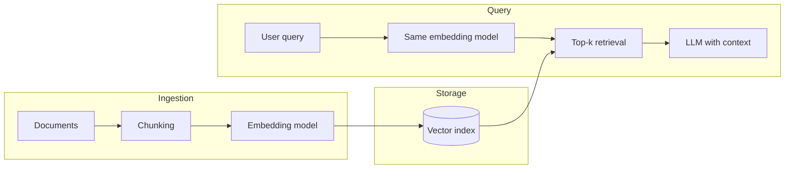

# Why vectors?

Language models and search systems do not store words as symbols alone. They map text (tokens, sentences, documents) into **vectors** — fixed-length lists of real numbers — so that **geometric proximity** reflects **semantic relatedness**.

## Distributional intuition

Words that appear in similar contexts tend to have similar meanings (distributional hypothesis). Embedding models learn maps $f : \text{text} \rightarrow \mathbb{R}^d$ such that:

- Paraphrases and related passages land near each other.
- Unrelated passages are farther apart (under a chosen metric).

You do not need to hand-code synonyms; similarity is induced from data and training objectives (contrastive loss, language modeling, and so on).

## Where vectors show up

Typical uses:

- **Semantic search** over documentation, tickets, or course notes.
- **RAG** — retrieve chunks, then condition a generator on them.
- **Recommendations** — user and item embeddings in the same space.
- **Clustering and visualization** — audit what your index actually groups together.

## Properties that matter in production

| Property | Why it matters |
| :--- | :--- |
| Dimension $d$ | Memory, index size, and latency scale with $d$ |
| Normalization | Cosine similarity equals dot product on unit vectors |
| Model version | Re-embed everything when you change the encoder |
| Metric choice | Inner product vs cosine vs $L_2$ must match training and index |
