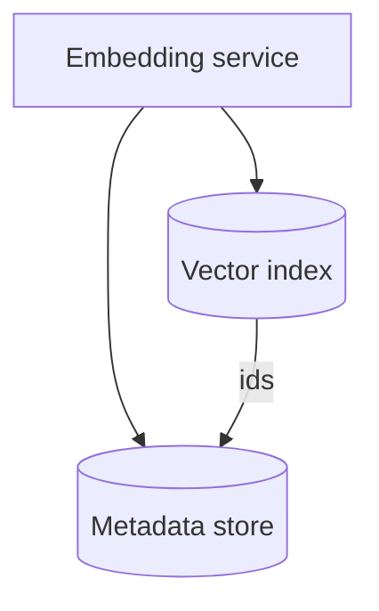

# Indexing at scale

Exact nearest-neighbor search in $\mathbb{R}^d$ is expensive for millions of vectors. **Approximate nearest neighbor (ANN)** indexes trade a small recall loss for large speedups.

## Brute force vs ANN

- **Exact**: compare the query to every vector — simple, correct ranking, slow at scale.
- **ANN**: navigate a graph or inverted lists to visit only a subset of candidates — fast, tunable recall.

## Common index families (overview)

| Family | Idea | Typical use |
| :--- | :--- | :--- |
| **HNSW** | Layered small-world graph; greedy graph walk | General-purpose ANN, strong default |
| **IVF** | Cluster centroids; search only a few lists | Large corpora, tunable `nprobe` |
| **PQ / scalar quant** | Compress vectors for RAM | Billion-scale, slightly lower recall |

Parameters such as `efConstruction`, `M` (HNSW), or `nprobe` (IVF) control the **recall–latency** curve. Measure with your own queries and ground-truth labels when possible.

## Operational concerns

- **Freshness**: streaming updates vs batch rebuilds.
- **Filters**: metadata pre-filtering vs post-filtering (can hurt recall if misconfigured).
- **Versioning**: blue/green index when swapping embedding models.

When you move from reading to practice, pair ANN indexes with a real vector database and measure recall@k on a small labeled query set.
