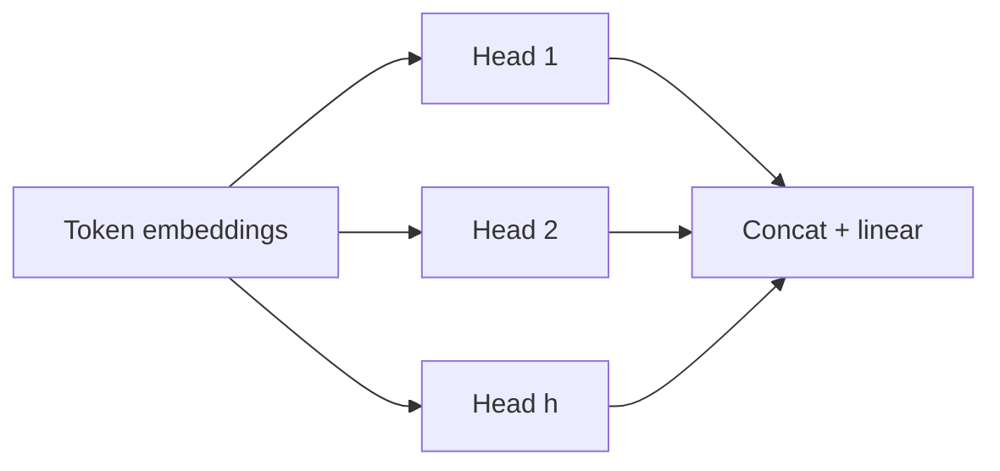

# Attention and the transformer block

Transformers map a sequence of token embeddings to contextual representations using **self-attention** and position-aware feed-forward layers.

## Scaled dot-product attention

Given queries $Q$, keys $K$, and values $V$ (matrices over tokens):

$$\text{Attention}(Q, K, V) = \text{softmax}\left(\frac{QK^\top}{\sqrt{d_k}}\right) V$$

The scale $\sqrt{d_k}$ keeps dot products from growing too large before softmax, which would saturate gradients.

## Multi-head attention

Several attention heads run in parallel with different learned projections, then concatenate and mix:

Each head can specialize (syntax, coreference, local vs global patterns).

## Transformer block (decoder layer sketch)

1. Masked self-attention (causal for autoregressive LMs).
2. Residual connection and normalization.
3. Position-wise feed-forward network (two linear layers with activation).
4. Another residual and normalization.

Stack $L$ such blocks to build depth. **Embeddings + positions** enter the bottom; **logits** exit the top for next-token prediction.

## What to study next

- How **KV cache** avoids recomputing keys/values for past tokens during generation (module note 03).
- How **RoPE** encodes position in $Q$ and $K$ (module note 02).
