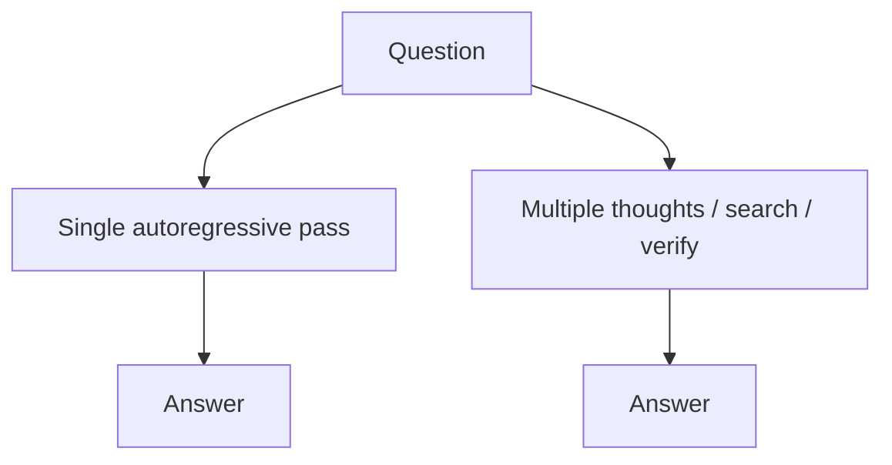

# Two modes of generation

**System 1** (in this curriculum's sense): one forward pass per token, greedy or sampled — low latency, good for fluent completion.

**System 2**: spend extra inference compute — longer chains, multiple rollouts, search, or verifier models — to improve reliability on hard tasks.

Neither replaces the other. Product systems often route easy queries to System 1 and escalate hard ones to System 2 within budget.

## Trade-offs

| | System 1 | System 2 |
| :--- | :--- | :--- |
| Latency | Low | Higher |
| Cost per query | Usually lower | Scales with branches |
| Math / logic | Can fail silently | Can recover with search or checks |
| UX | Streaming friendly | May need progress UI |

## Connection to training

Reasoning-focused models combine pretraining, supervised fine-tuning on long reasoning traces, and reinforcement learning with verifiable rewards (RLVR) where answers can be checked automatically.
