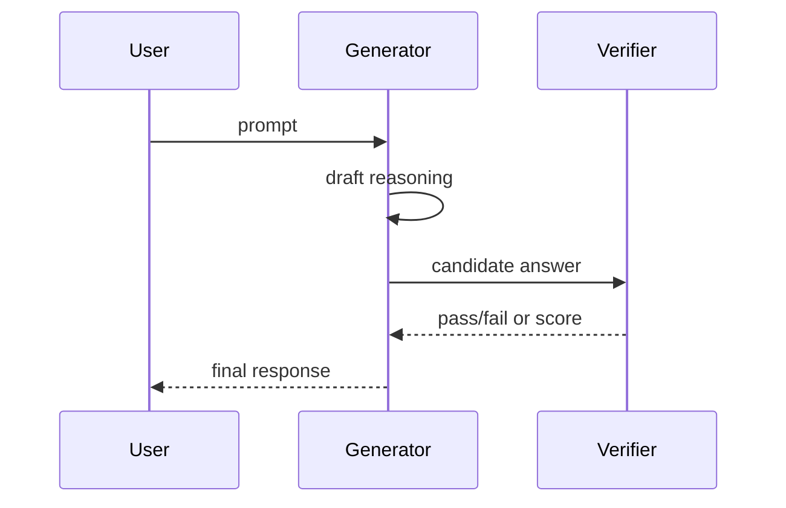

# Rewards and verification

Training and serving can use **outcome** signals (was the final answer correct?) and **process** signals (were intermediate steps valid?).

## Outcome reward model (ORM)

Scores final answers or full completions — useful when only the endpoint is checkable (e.g., unit tests, exact match).

## Process reward model (PRM)

Scores steps along a reasoning trace — helps credit good partial work and penalize logical slips earlier.

## RLVR (sketch)

When rewards are **verifiable** (code passes tests, math matches a symbolic checker), reinforcement learning can align models without human labels on every step.

## Serving pattern

Keep verifiers fast and deterministic where possible; they run on the critical path for gated releases.
