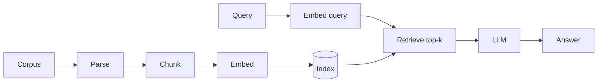

# RAG pipeline

RAG reduces hallucination by conditioning generation on **retrieved evidence**.

## Stages

1. **Ingest** — parse PDFs, HTML, tickets; extract text and metadata.
2. **Chunk** — split into passages with overlap; preserve headings and source IDs.
3. **Embed** — bi-encoder maps chunks to vectors; store in an ANN index.
4. **Retrieve** — embed the query; top-$k$ similarity search (optionally hybrid with lexical search).
5. **Generate** — prompt the LLM with query + retrieved chunks; cite sources in the UI when possible.

## Failure modes

- Wrong chunk retrieved → confident wrong answer.
- Chunk too small — lost context; too large — noisy context window.
- Stale index — product docs changed but vectors did not.

Fix retrieval before tuning the prompt.
