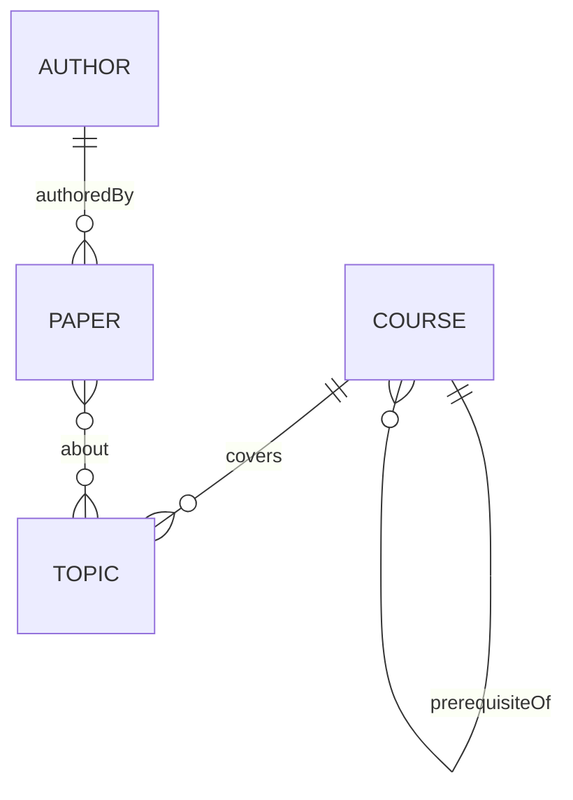

# Building a small knowledge graph

Start with a **schema** before bulk extraction.

## Steps

1. **Define entity types** — `Course`, `Topic`, `Paper`, `Author`.
2. **Define relations** — `teaches`, `prerequisiteOf`, `cites`, `authoredBy`.
3. **Assign stable IDs** — URIs or internal keys; never key only on display strings.
4. **Ingest** — ETL from CSV, APIs, or LLM-assisted extraction with human review.
5. **Validate** — cardinality, required properties, duplicate detection.

## Quality bar

Prefer a small, correct graph over a large noisy one. Log provenance (`source_doc`, `extracted_at`, `confidence`) for every edge you automate.
