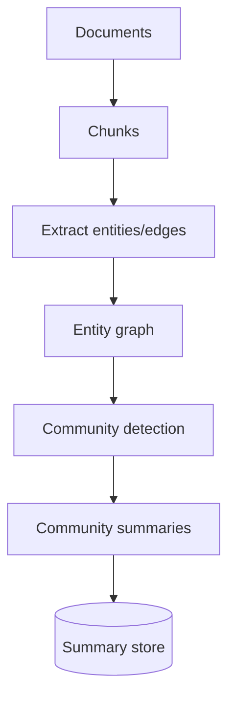

# From text to graph

GraphRAG-style pipelines build a **text graph**: entities and relationships extracted from chunks, then clustered into communities.

## Typical flow

1. Chunk documents.
2. LLM (or NER + RE models) extract entities and relations per chunk.
3. Merge duplicate entities (canonicalization).
4. Detect **communities** (e.g., Leiden algorithm on the entity graph).
5. Summarize each community for **global** questions.

## Cost

Extraction and summarization are one-time or batch costs; query time can be cheaper than scanning every chunk for global themes.
