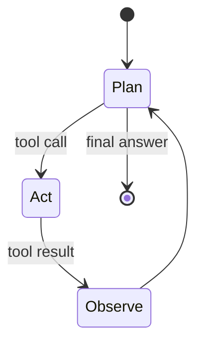

# Agents and tools

An **agent** loop: observe state, decide an action, call tools, update state, repeat until done.

## Tools

Tools are functions with schemas (name, parameters, description). The model emits structured calls; your runtime executes them and returns JSON/text observations.

Design tools to be:

- **Idempotent** where possible.
- **Narrow** — one clear job per tool.
- **Safe** — auth, rate limits, confirmation for destructive actions.

## Failure modes

- Infinite loops — cap steps and tokens.
- Wrong tool arguments — validate with JSON schema; retry with error message.
- Over-broad tools — model confuses similar endpoints.
