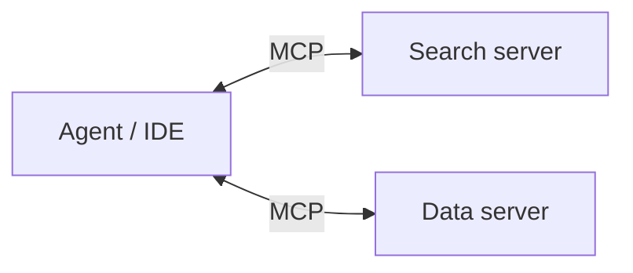

# Model Context Protocol (MCP)

MCP standardizes how applications expose **tools, resources, and prompts** to model clients.

## Roles

- **MCP server** — hosts capabilities (search flights, read files, query DB).
- **MCP client** — IDE or agent runtime that discovers and invokes them.

Benefits: one integration per server, reusable across clients; explicit capability lists instead of ad-hoc HTTP wrappers.

## Design tips

- Version your tool schemas; deprecate with notice.
- Never pass secrets through the model — inject credentials server-side.
- Return concise observations; large payloads belong in resources with pagination.
